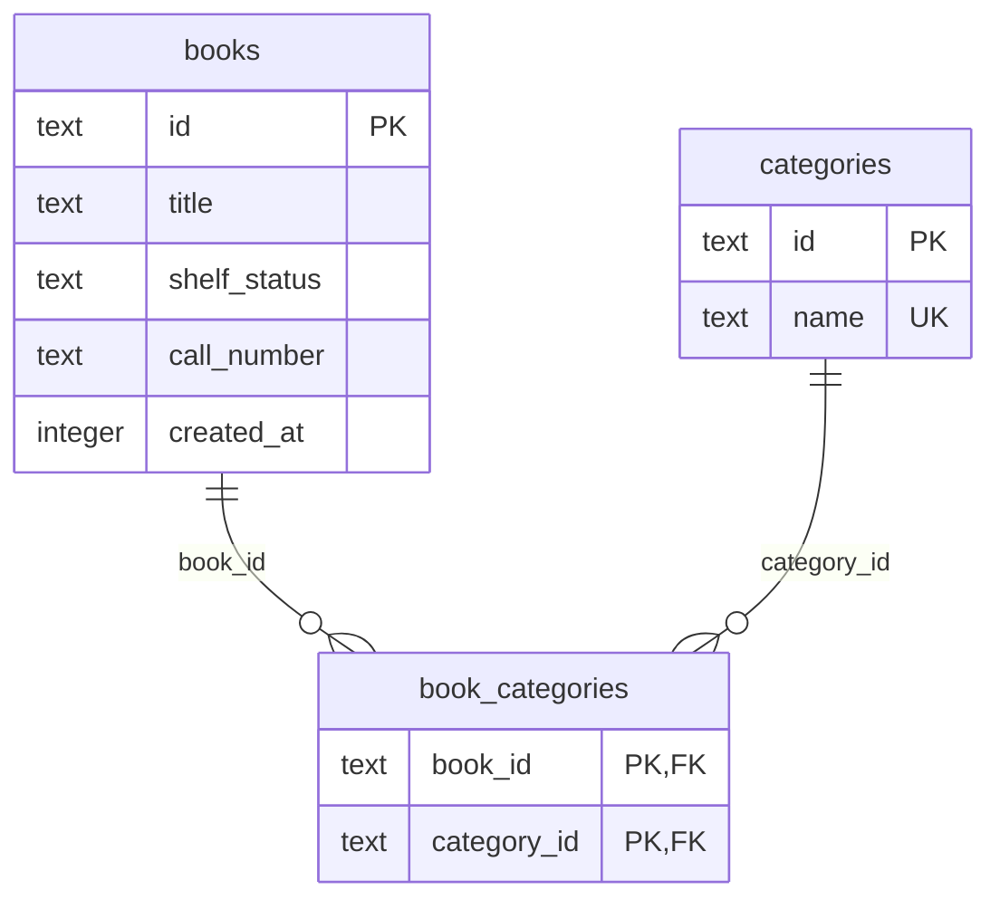

<!-- doc-structured:generated 生成元: docs/domains/01-catalog/ コマンド: bin/doc-structured generate (このファイルを直接編集せず、生成元を直して生成し直す) -->

# ドメイン `catalog` のスキーマ

## テーブル `books`

対応するモデル: [モデル「図書」][d-catalog-m-book]

主キー: `id`

| カラム | 型 | NULL | デフォルト値 | 参照先 | 属性・定義 |
|---|---|---|---|---|---|
| `id` | `text` | | | | 図書を識別する値。 |
| `title` | `text` | | | | [モデル「図書」の属性「書名」][d-catalog-m-book-a-title] |
| `shelf_status` | `text` | | `'shelved'` | | [モデル「図書」の属性「配架状態」][d-catalog-m-book-a-shelf_status] |
| `call_number` | `text` | | | | 図書の請求記号。 |
| `created_at` | `integer` | | | | 行を作った時刻 (UNIX 時刻のミリ秒)。 |

## テーブル `categories`

対応するモデル: [モデル「分類」][d-catalog-m-category]

主キー: `id`

| カラム | 型 | NULL | デフォルト値 | 参照先 | 属性・定義 |
|---|---|---|---|---|---|
| `id` | `text` | | | | 分類を識別する値。 |
| `name` | `text` | | | | [モデル「分類」の属性「分類名」][d-catalog-m-category-a-name] |

インデックス:

- `name` (一意)

## テーブル `book_categories`

対応する属性: [モデル「図書」の属性「分類」][d-catalog-m-book-a-categories]

主キー: `book_id`・`category_id`

| カラム | 型 | NULL | デフォルト値 | 参照先 | 属性・定義 |
|---|---|---|---|---|---|
| `book_id` | `text` | | | [テーブル `books` のカラム `id`][d-catalog-t-books-c-id] | 分類を付けた図書。 |
| `category_id` | `text` | | | [テーブル `categories` のカラム `id`][d-catalog-t-categories-c-id] | 図書に付けた分類。 |

インデックス:

- `category_id`

[d-catalog-m-book]: models.md#d-catalog-m-book "ドメイン `catalog` のモデル「図書」"
[d-catalog-m-book-a-categories]: models.md#d-catalog-m-book-a-categories "ドメイン `catalog` のモデル「図書」の属性「分類」"
[d-catalog-m-book-a-shelf_status]: models.md#d-catalog-m-book-a-shelf_status "ドメイン `catalog` のモデル「図書」の属性「配架状態」"
[d-catalog-m-book-a-title]: models.md#d-catalog-m-book-a-title "ドメイン `catalog` のモデル「図書」の属性「書名」"
[d-catalog-m-category]: models.md#d-catalog-m-category "ドメイン `catalog` のモデル「分類」"
[d-catalog-m-category-a-name]: models.md#d-catalog-m-category-a-name "ドメイン `catalog` のモデル「分類」の属性「分類名」"
[d-catalog-t-books-c-id]: #d-catalog-t-books-c-id "ドメイン `catalog` のテーブル `books` のカラム `id`"
[d-catalog-t-categories-c-id]: #d-catalog-t-categories-c-id "ドメイン `catalog` のテーブル `categories` のカラム `id`"
