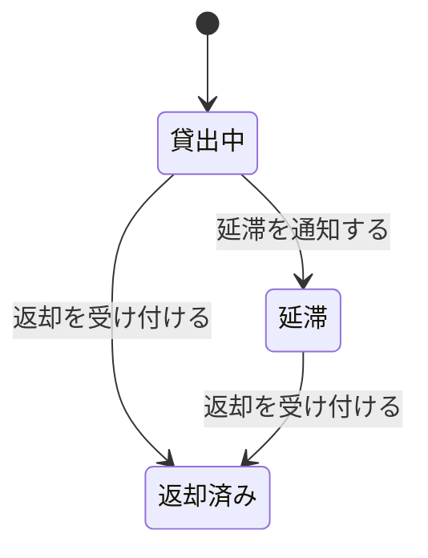
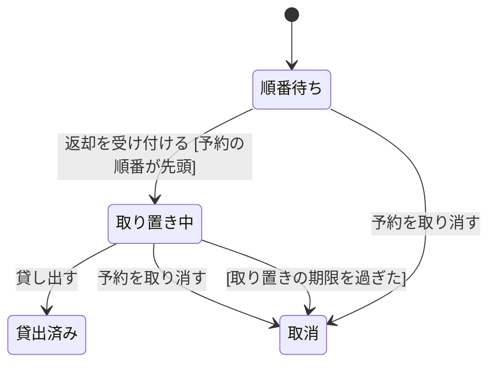

<!-- doc-structured:generated 生成元: docs/domains/02-loans/ コマンド: bin/doc-structured generate (このファイルを直接編集せず、生成元を直して生成し直す) -->

# ドメイン `loans` のモデル

## モデル「貸出」 `loan`

利用者が図書を借りてから返すまでの 1 回の記録。

### 属性「貸出図書」 `book`

貸し出した図書。参照先: [ドメイン `catalog` のモデル「図書」][d-catalog-m-book]

### 属性「借りた利用者」 `member`

図書を借りた利用者。参照先: [ドメイン `members` のモデル「利用者」][d-members-m-member]

### 属性「元の予約」 `reservation`

この貸出のもとになった予約。予約せずに借りたときは無い。参照先: [モデル「予約」][d-loans-m-reservation]

### 属性「貸出状態」 `status`

貸出が今どの段階にあるか。

状態の遷移 (最初の状態: [値「貸出中」][d-loans-m-loan-a-status-v-on_loan]):

| 前の状態 | 後の状態 | 操作 | 前提 |
|---|---|---|---|
| [貸出中][d-loans-m-loan-a-status-v-on_loan] | [延滞][d-loans-m-loan-a-status-v-overdue] | [延滞を通知する][d-loans-op-notify_overdue] | |
| [貸出中][d-loans-m-loan-a-status-v-on_loan]・[延滞][d-loans-m-loan-a-status-v-overdue] | [返却済み][d-loans-m-loan-a-status-v-returned] | [返却を受け付ける][d-loans-op-return_book] | |

#### 値「貸出中」 `on_loan`

図書が利用者の手元にある。

#### 値「延滞」 `overdue`

返却期限を過ぎても、図書が利用者の手元にある。

#### 値「返却済み」 `returned`

図書が図書館に戻った。

## モデル「予約」 `reservation`

貸出中の図書が返ったときに、次に借りる権利を取っておく記録。

このモデルを参照するモデル: [モデル「貸出」][d-loans-m-loan]・[モデル「予約」][d-loans-m-reservation]

### 属性「予約図書」 `book`

予約した図書。参照先: [ドメイン `catalog` のモデル「図書」][d-catalog-m-book]

### 属性「前の予約」 `previous`

同じ図書について、この予約の 1 つ前の予約。参照先: [モデル「予約」][d-loans-m-reservation]

### 属性「予約状態」 `status`

予約が今どの段階にあるか。

状態の遷移 (最初の状態: [値「順番待ち」][d-loans-m-reservation-a-status-v-waiting]):

| 前の状態 | 後の状態 | 操作 | 前提 |
|---|---|---|---|
| [順番待ち][d-loans-m-reservation-a-status-v-waiting] | [取り置き中][d-loans-m-reservation-a-status-v-on_hold] | [返却を受け付ける][d-loans-op-return_book] | [予約の順番が先頭][d-loans-pre-first_in_line] |
| [取り置き中][d-loans-m-reservation-a-status-v-on_hold] | [貸出済み][d-loans-m-reservation-a-status-v-fulfilled] | [貸し出す][d-loans-op-lend] | |
| [順番待ち][d-loans-m-reservation-a-status-v-waiting]・[取り置き中][d-loans-m-reservation-a-status-v-on_hold] | [取消][d-loans-m-reservation-a-status-v-cancelled] | [予約を取り消す][d-loans-op-cancel_reservation] | |
| [取り置き中][d-loans-m-reservation-a-status-v-on_hold] | [取消][d-loans-m-reservation-a-status-v-cancelled] | | [取り置きの期限を過ぎた][d-loans-pre-hold_expired] |

#### 値「順番待ち」 `waiting`

図書が返るまで待機している。

#### 値「取り置き中」 `on_hold`

返った図書を、予約した利用者のために取り置いている。

#### 値「貸出済み」 `fulfilled`

取り置いた図書を、予約した利用者に貸し出した。

#### 値「取消」 `cancelled`

図書を貸し出さずに、予約を終えた。

[d-catalog-m-book]: ../01-catalog/models.md#d-catalog-m-book "ドメイン `catalog` のモデル「図書」"
[d-loans-m-loan]: #d-loans-m-loan "ドメイン `loans` のモデル「貸出」"
[d-loans-m-loan-a-status-v-on_loan]: #d-loans-m-loan-a-status-v-on_loan "ドメイン `loans` のモデル「貸出」の属性「貸出状態」の値「貸出中」"
[d-loans-m-loan-a-status-v-overdue]: #d-loans-m-loan-a-status-v-overdue "ドメイン `loans` のモデル「貸出」の属性「貸出状態」の値「延滞」"
[d-loans-m-loan-a-status-v-returned]: #d-loans-m-loan-a-status-v-returned "ドメイン `loans` のモデル「貸出」の属性「貸出状態」の値「返却済み」"
[d-loans-m-reservation]: #d-loans-m-reservation "ドメイン `loans` のモデル「予約」"
[d-loans-m-reservation-a-status-v-cancelled]: #d-loans-m-reservation-a-status-v-cancelled "ドメイン `loans` のモデル「予約」の属性「予約状態」の値「取消」"
[d-loans-m-reservation-a-status-v-fulfilled]: #d-loans-m-reservation-a-status-v-fulfilled "ドメイン `loans` のモデル「予約」の属性「予約状態」の値「貸出済み」"
[d-loans-m-reservation-a-status-v-on_hold]: #d-loans-m-reservation-a-status-v-on_hold "ドメイン `loans` のモデル「予約」の属性「予約状態」の値「取り置き中」"
[d-loans-m-reservation-a-status-v-waiting]: #d-loans-m-reservation-a-status-v-waiting "ドメイン `loans` のモデル「予約」の属性「予約状態」の値「順番待ち」"
[d-loans-op-cancel_reservation]: functions.md#d-loans-op-cancel_reservation "ドメイン `loans` の操作「予約を取り消す」"
[d-loans-op-lend]: functions.md#d-loans-op-lend "ドメイン `loans` の操作「貸し出す」"
[d-loans-op-notify_overdue]: functions.md#d-loans-op-notify_overdue "ドメイン `loans` の操作「延滞を通知する」"
[d-loans-op-return_book]: functions.md#d-loans-op-return_book "ドメイン `loans` の操作「返却を受け付ける」"
[d-loans-pre-first_in_line]: functions.md#d-loans-pre-first_in_line "ドメイン `loans` の前提「予約の順番が先頭」"
[d-loans-pre-hold_expired]: functions.md#d-loans-pre-hold_expired "ドメイン `loans` の前提「取り置きの期限を過ぎた」"
[d-members-m-member]: ../03-members/models.md#d-members-m-member "ドメイン `members` のモデル「利用者」"
