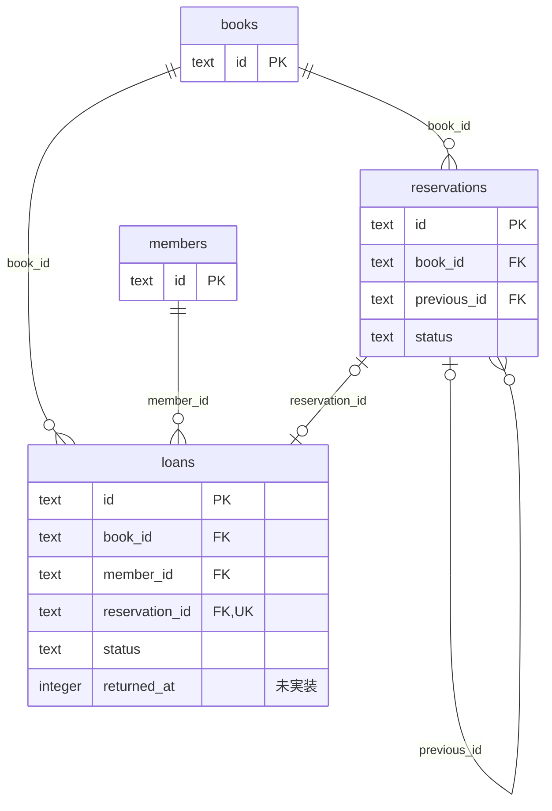

<!-- doc-structured:generated 生成元: docs/domains/02-loans/ コマンド: bin/doc-structured generate (このファイルを直接編集せず、生成元を直して生成し直す) -->

# ドメイン `loans` のスキーマ

## テーブル `reservations`

対応するモデル: [モデル「予約」][d-loans-m-reservation]

主キー: `id`

| カラム | 型 | NULL | デフォルト値 | 参照先 | 属性・定義 |
|---|---|---|---|---|---|
| `id` | `text` | | | | 予約を識別する値。 |
| `book_id` | `text` | | | [ドメイン `catalog` のテーブル `books` のカラム `id`][d-catalog-t-books-c-id] | [モデル「予約」の属性「予約図書」][d-loans-m-reservation-a-book] |
| `previous_id` | `text` | 許可 | | [テーブル `reservations` のカラム `id`][d-loans-t-reservations-c-id] | [モデル「予約」の属性「前の予約」][d-loans-m-reservation-a-previous] |
| `status` | `text` | | `'waiting'` | | [モデル「予約」の属性「予約状態」][d-loans-m-reservation-a-status] |

## テーブル `loans`

対応するモデル: [モデル「貸出」][d-loans-m-loan]

主キー: `id`

| カラム | 型 | NULL | デフォルト値 | 参照先 | 属性・定義 |
|---|---|---|---|---|---|
| `id` | `text` | | | | 貸出を識別する値。 |
| `book_id` | `text` | | | [ドメイン `catalog` のテーブル `books` のカラム `id`][d-catalog-t-books-c-id] | [モデル「貸出」の属性「貸出図書」][d-loans-m-loan-a-book] |
| `member_id` | `text` | | | [ドメイン `members` のテーブル `members` のカラム `id`][d-members-t-members-c-id] | [モデル「貸出」の属性「借りた利用者」][d-loans-m-loan-a-member] |
| `reservation_id` | `text` | 許可 | | [テーブル `reservations` のカラム `id`][d-loans-t-reservations-c-id] | [モデル「貸出」の属性「元の予約」][d-loans-m-loan-a-reservation] |
| `status` | `text` | | `'on_loan'` | | [モデル「貸出」の属性「貸出状態」][d-loans-m-loan-a-status] |
| `returned_at` (未実装) | `integer` | 許可 | | | 図書が返った時刻 (UNIX 時刻のミリ秒)。 |

インデックス:

- `member_id`
- `reservation_id` (一意)

[d-catalog-t-books-c-id]: ../01-catalog/schema.md#d-catalog-t-books-c-id "ドメイン `catalog` のテーブル `books` のカラム `id`"
[d-loans-m-loan]: models.md#d-loans-m-loan "ドメイン `loans` のモデル「貸出」"
[d-loans-m-loan-a-book]: models.md#d-loans-m-loan-a-book "ドメイン `loans` のモデル「貸出」の属性「貸出図書」"
[d-loans-m-loan-a-member]: models.md#d-loans-m-loan-a-member "ドメイン `loans` のモデル「貸出」の属性「借りた利用者」"
[d-loans-m-loan-a-reservation]: models.md#d-loans-m-loan-a-reservation "ドメイン `loans` のモデル「貸出」の属性「元の予約」"
[d-loans-m-loan-a-status]: models.md#d-loans-m-loan-a-status "ドメイン `loans` のモデル「貸出」の属性「貸出状態」"
[d-loans-m-reservation]: models.md#d-loans-m-reservation "ドメイン `loans` のモデル「予約」"
[d-loans-m-reservation-a-book]: models.md#d-loans-m-reservation-a-book "ドメイン `loans` のモデル「予約」の属性「予約図書」"
[d-loans-m-reservation-a-previous]: models.md#d-loans-m-reservation-a-previous "ドメイン `loans` のモデル「予約」の属性「前の予約」"
[d-loans-m-reservation-a-status]: models.md#d-loans-m-reservation-a-status "ドメイン `loans` のモデル「予約」の属性「予約状態」"
[d-loans-t-reservations-c-id]: #d-loans-t-reservations-c-id "ドメイン `loans` のテーブル `reservations` のカラム `id`"
[d-members-t-members-c-id]: ../03-members/schema.md#d-members-t-members-c-id "ドメイン `members` のテーブル `members` のカラム `id`"
