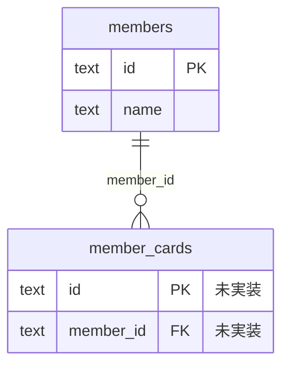

<!-- doc-structured:generated 生成元: docs/domains/03-members/ コマンド: bin/doc-structured generate (このファイルを直接編集せず、生成元を直して生成し直す) -->

# ドメイン `members` のスキーマ

## テーブル `members`

対応するモデル: [モデル「利用者」][d-members-m-member]

主キー: `id`

| カラム | 型 | NULL | デフォルト値 | 参照先 | 属性・定義 |
|---|---|---|---|---|---|
| `id` | `text` | | | | 利用者を識別する値。 |
| `name` | `text` | | | | [モデル「利用者」の属性「氏名」][d-members-m-member-a-name] |

## テーブル `member_cards`

利用者に発行する利用者カード 1 枚の行。

未実装

主キー: `id`

| カラム | 型 | NULL | デフォルト値 | 参照先 | 属性・定義 |
|---|---|---|---|---|---|
| `id` | `text` | | | | 利用者カードを識別する値。 |
| `member_id` | `text` | | | [テーブル `members` のカラム `id`][d-members-t-members-c-id] | カードを持つ利用者。 |

インデックス:

- `member_id`

[d-members-m-member]: models.md#d-members-m-member "ドメイン `members` のモデル「利用者」"
[d-members-m-member-a-name]: models.md#d-members-m-member-a-name "ドメイン `members` のモデル「利用者」の属性「氏名」"
[d-members-t-members-c-id]: #d-members-t-members-c-id "ドメイン `members` のテーブル `members` のカラム `id`"
