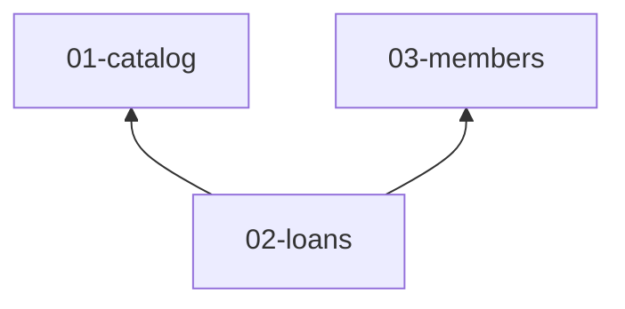

<!-- doc-structured:generated 生成元: docs/domains/ コマンド: bin/doc-structured generate (このファイルを直接編集せず、生成元を直して生成し直す) -->

# ドメインの依存

| ドメイン | 依存先のドメイン | 依存の元の参照 |
|---|---|---|
| [`01-catalog`][d-catalog] | | |
| [`02-loans`][d-loans] | [`01-catalog`][d-catalog]・[`03-members`][d-members] | [`dependencies.md`][d-loans-dependencies] |
| [`03-members`][d-members] | | |

[d-catalog]: 01-catalog/README.md#d-catalog "ドメイン `catalog`"
[d-loans]: 02-loans/README.md#d-loans "ドメイン `loans`"
[d-loans-dependencies]: 02-loans/dependencies.md#d-loans-dependencies "ドメイン `loans` のファイル `dependencies.md`"
[d-members]: 03-members/README.md#d-members "ドメイン `members`"
