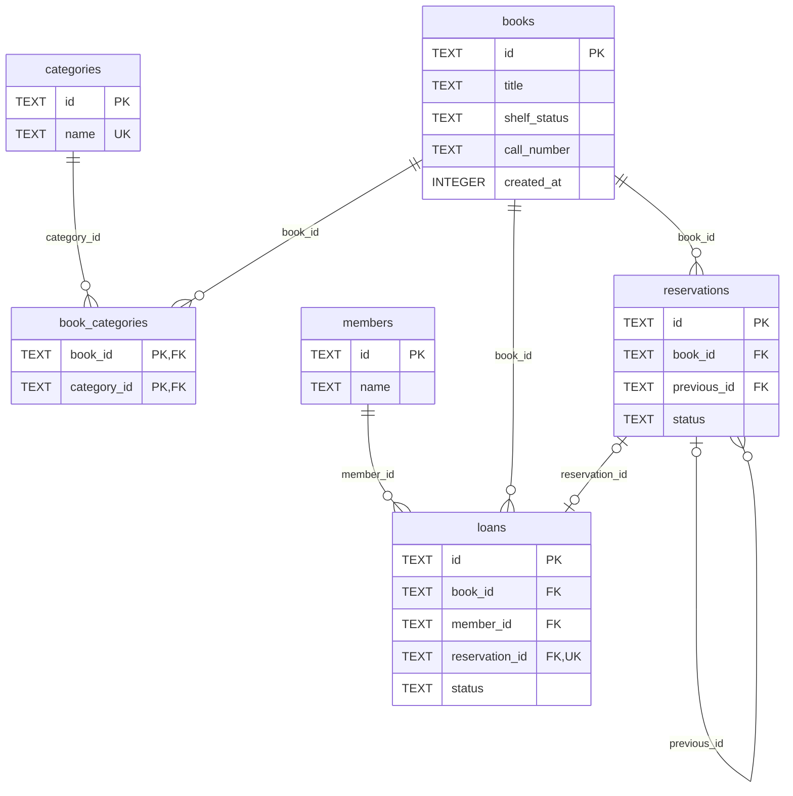

<!-- doc-structured:generated 生成元: migrations/*.sql コマンド: bin/doc-structured generate --all (このファイルを直接編集せず、生成元を直して生成し直す) -->

# 実際のスキーマ

マイグレーション `migrations/*.sql` を SQLite に適用したスキーマ。

## テーブル `book_categories`

主キー: `book_id`・`category_id`

| カラム | 型 | NULL | デフォルト値 | 参照先 |
|---|---|---|---|---|
| `book_id` | `TEXT` | | | `books`.`id` |
| `category_id` | `TEXT` | | | `categories`.`id` |

インデックス:

- `category_id`

## テーブル `books`

主キー: `id`

| カラム | 型 | NULL | デフォルト値 | 参照先 |
|---|---|---|---|---|
| `id` | `TEXT` | | | |
| `title` | `TEXT` | | | |
| `shelf_status` | `TEXT` | | `'shelved'` | |
| `call_number` | `TEXT` | | | |
| `created_at` | `INTEGER` | | | |

CHECK 制約:

- `shelf_status IN ('shelved', 'on_loan')`

## テーブル `categories`

主キー: `id`

| カラム | 型 | NULL | デフォルト値 | 参照先 |
|---|---|---|---|---|
| `id` | `TEXT` | | | |
| `name` | `TEXT` | | | |

インデックス:

- `name` (一意)

## テーブル `loans`

主キー: `id`

| カラム | 型 | NULL | デフォルト値 | 参照先 |
|---|---|---|---|---|
| `id` | `TEXT` | | | |
| `book_id` | `TEXT` | | | `books`.`id` |
| `member_id` | `TEXT` | | | `members`.`id` |
| `reservation_id` | `TEXT` | 許可 | | `reservations`.`id` |
| `status` | `TEXT` | | `'on_loan'` | |

インデックス:

- `member_id`
- `reservation_id` (一意。条件: `reservation_id IS NOT NULL`)

CHECK 制約:

- `status IN ('on_loan', 'returned')`

## テーブル `members`

主キー: `id`

| カラム | 型 | NULL | デフォルト値 | 参照先 |
|---|---|---|---|---|
| `id` | `TEXT` | | | |
| `name` | `TEXT` | | | |

## テーブル `reservations`

主キー: `id`

| カラム | 型 | NULL | デフォルト値 | 参照先 |
|---|---|---|---|---|
| `id` | `TEXT` | | | |
| `book_id` | `TEXT` | | | `books`.`id` |
| `previous_id` | `TEXT` | 許可 | | `reservations`.`id` |
| `status` | `TEXT` | | `'waiting'` | |
