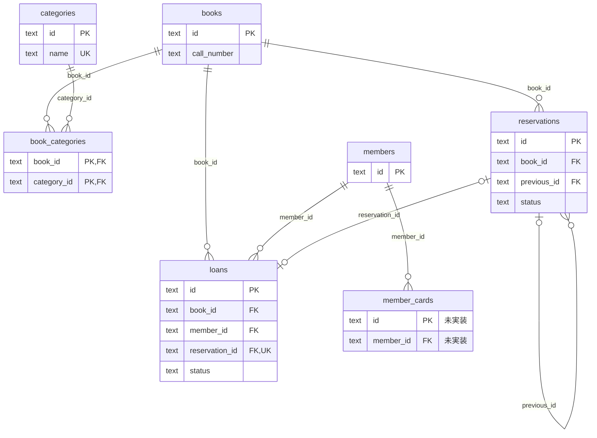

<!-- doc-structured:generated 生成元: docs/domains/ コマンド: bin/doc-structured generate (このファイルを直接編集せず、生成元を直して生成し直す) -->

# スキーマ

| テーブル | ドメイン | 対応するモデル・属性・定義 |
|---|---|---|
| [`books`][d-catalog-t-books] | [`catalog`][d-catalog] | 対応するモデル: [モデル「図書」][d-catalog-m-book] |
| [`categories`][d-catalog-t-categories] | [`catalog`][d-catalog] | 対応するモデル: [モデル「分類」][d-catalog-m-category] |
| [`book_categories`][d-catalog-t-book_categories] | [`catalog`][d-catalog] | 対応する属性: [モデル「図書」の属性「分類」][d-catalog-m-book-a-categories] |
| [`reservations`][d-loans-t-reservations] | [`loans`][d-loans] | 対応するモデル: [モデル「予約」][d-loans-m-reservation] |
| [`loans`][d-loans-t-loans] | [`loans`][d-loans] | 対応するモデル: [モデル「貸出」][d-loans-m-loan] |
| [`members`][d-members-t-members] | [`members`][d-members] | 対応するモデル: [モデル「利用者」][d-members-m-member] |
| [`member_cards`][d-members-t-member_cards] (未実装) | [`members`][d-members] | 利用者に発行する利用者カード 1 枚の行。 |

[d-catalog]: ../domains/01-catalog/README.md#d-catalog "ドメイン `catalog`"
[d-catalog-m-book]: ../domains/01-catalog/models.md#d-catalog-m-book "ドメイン `catalog` のモデル「図書」"
[d-catalog-m-book-a-categories]: ../domains/01-catalog/models.md#d-catalog-m-book-a-categories "ドメイン `catalog` のモデル「図書」の属性「分類」"
[d-catalog-m-category]: ../domains/01-catalog/models.md#d-catalog-m-category "ドメイン `catalog` のモデル「分類」"
[d-catalog-t-book_categories]: ../domains/01-catalog/schema.md#d-catalog-t-book_categories "ドメイン `catalog` のテーブル `book_categories`"
[d-catalog-t-books]: ../domains/01-catalog/schema.md#d-catalog-t-books "ドメイン `catalog` のテーブル `books`"
[d-catalog-t-categories]: ../domains/01-catalog/schema.md#d-catalog-t-categories "ドメイン `catalog` のテーブル `categories`"
[d-loans]: ../domains/02-loans/README.md#d-loans "ドメイン `loans`"
[d-loans-m-loan]: ../domains/02-loans/models.md#d-loans-m-loan "ドメイン `loans` のモデル「貸出」"
[d-loans-m-reservation]: ../domains/02-loans/models.md#d-loans-m-reservation "ドメイン `loans` のモデル「予約」"
[d-loans-t-loans]: ../domains/02-loans/schema.md#d-loans-t-loans "ドメイン `loans` のテーブル `loans`"
[d-loans-t-reservations]: ../domains/02-loans/schema.md#d-loans-t-reservations "ドメイン `loans` のテーブル `reservations`"
[d-members]: ../domains/03-members/README.md#d-members "ドメイン `members`"
[d-members-m-member]: ../domains/03-members/models.md#d-members-m-member "ドメイン `members` のモデル「利用者」"
[d-members-t-member_cards]: ../domains/03-members/schema.md#d-members-t-member_cards "ドメイン `members` のテーブル `member_cards`"
[d-members-t-members]: ../domains/03-members/schema.md#d-members-t-members "ドメイン `members` のテーブル `members`"
