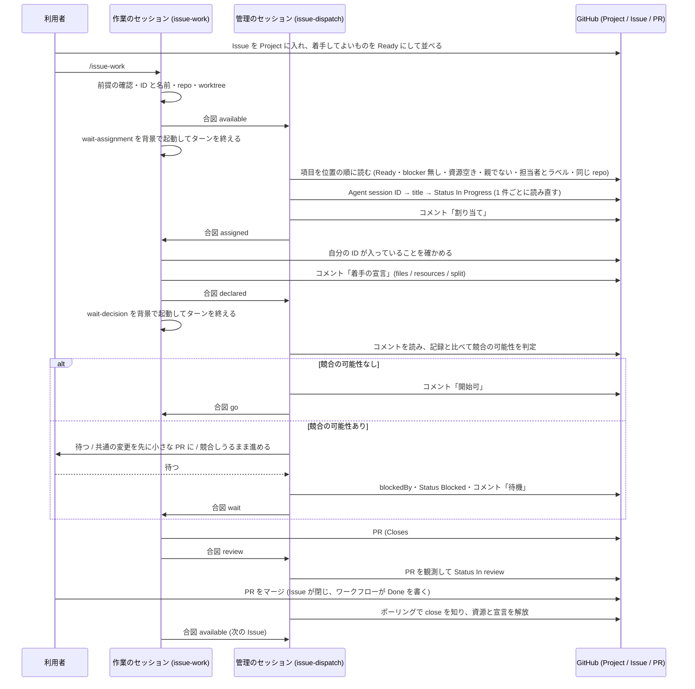
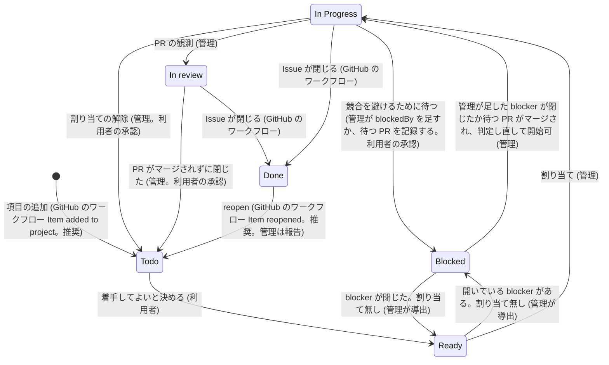
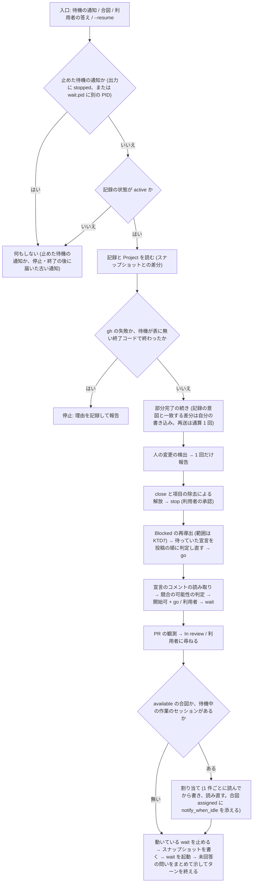

# 複数のセッションで Issue を並行して進める仕組み (issue-dispatch) - Plan

要件の出所は GitHub の Issue [akm/claude-plugins#114](https://github.com/akm/claude-plugins/issues/114) の本文 (「問題」「要望」「これまでに決めたこと」「調べたこと」「決まっていないこと」) と、2026-10-06 の会話で利用者が決めた事項 (Product Contract の Key Decisions)。Issue の「作るものの順番」のうち 1〜3 (仕様の正本・前提条件の検査・管理のセッション) がこの計画の範囲で、4 (Issue のレビュアと整える機能) と 5 (割り振りの最適化) は別の Issue にする。

この計画で使う語:

- **Project**: GitHub Projects (ProjectV2) の 1 つの Project。Issue のキューの正本。1 つの Project に複数のリポジトリ (別の owner も) の Issue を入れる。
- **項目**: Project に入った Issue (GraphQL の `ProjectV2Item`)。
- **`Ready` の項目**: 利用者が Status を `Ready` にした項目。「着手してよい」という利用者の判断を表し、割り当ての対象はこの項目だけ (R1・KD13)。
- **管理のセッション**: スキル `issue-dispatch` を実行する Claude Code のセッション。Project 1 つにつき 1 つ。Issue を作業のセッションに割り当て、Project のフィールドと記録を書く。
- **作業のセッション**: スキル `issue-work` を実行する Claude Code のセッション。Issue の作業をする。複数ある。利用者が作る。
- **管理ディレクトリ**: 利用者が管理のセッションを動かすディレクトリ。設定 `.claude/akm-claude-plugins/issue-dispatch/config.json` と記録の置き場を持つ。専用のリポジトリでも、空のディレクトリでもよい。
- **割り当て**: 管理のセッションが項目のフィールド `Agent session ID` に作業のセッションの ID を書くこと。このフィールドが割り当ての正本。
- **競合の可能性**: 2 つの Issue が、同じファイルの同じ部分 (節で判定できるファイルは同じ節) を同時に変える予定で、マージで衝突しうること。管理のセッションが宣言どうしを比べて判定する。英語の識別子では `conflictability` と書く (`conflict` は git のマージの衝突の意味で浸透しているため)。
- **着手の宣言 (宣言)**: 作業のセッションが着手の時点で Issue のコメントとして書く、変更予定のファイル・必要な資源・分ける必要の有無。
- **資源**: 同時に 1 つしか使えないもの (検証用の Worker、固定のポートなど)。Issue のラベル `resource:<名前>` で表す。
- **記録**: 管理のセッションが記録の置き場に持つファイル群 (`record.json`・`snapshot.json`・`actions.log`・`wait.pid`)。GitHub に無いもの (宣言の写し・資源の使用・手順の段階・時刻) を持つ。
- **合図**: セッション間のメッセージ (Claude Code のツール `SendMessage`)。`available` と `renamed` を除き GitHub に対応物を持ち、失われても処理が遅れるだけで食い違わない。この 2 つはセッションの状態を運ぶので対応物が無く、失われたときの回復の仕方を別に決める (KTD1)。
- **待機**: GitHub の変化を待つために背景で起動する、同梱の Python のスクリプト (KTD6)。終わると Claude Code がそのセッションに通知を届け、通知で次のターンが始まる。割り当てを待っている作業のセッションは「待機中の作業のセッション」と呼ぶ。
- **待機の知らせ**: ツール `SendMessage` の引数 `notify_when_idle` で申し込む知らせ。相手のセッションが次に入力待ち (ターンを終え、次の入力を待つ状態) になったときに 1 回届く (R10)。
- **依頼**: 管理のセッションが作業のセッションに何かをしてもらうための、Issue のコメント `依頼` と合図 `request`。種類は、宣言の書き直し・PR の本文の追記・小さな PR の作成の 3 つ (R6)。
- **再入の手順**: 管理のセッションが、背景の待機の通知・合図・利用者の答え・`--resume` のどれで動き出しても入る 1 つの入口。
- **前提条件の検査**: スキル `repo-preflight` が行う、リポジトリ・Project・セッションの検査と、変更の案の提示。

## Goal Capsule

- **目的**: 1 つの Project に集めた Issue を複数の Claude Code のセッションで並行して進めるとき、どの Issue をどのセッションが受け持つか・ほかの Issue の完了を待つか・変更予定のファイルと資源が競合しないかを、利用者が手で判断しなくてよい。進み具合は Project に現れ、利用者は Project を見れば誰が何をしているか分かる。作業のセッションとその sub-agent が、ほかのセッションの作業ツリーでコマンドを実行しない (Issue #114 では、sub-agent がほかのセッションの作業ディレクトリでコマンドを実行し、マージの途中のロックファイルを書き換えた)。
- **手段**: 新しいプラグイン `issue-dispatch` (スキル 3 つ・フック 1 つ・Python のスクリプト) を足す。GitHub (Project のフィールド・Issue の依存関係とコメント・PR の状態) を正本にし、セッション間のメッセージは合図に限る (KTD1〜KTD3)。
- **優先順位**: 重点は、様式と取り決めの正本 (U2〜U4)、割り当てと再入の手順 (U9)、LLM の判断を要しない処理をテストできるスクリプトとして書くこと (U5・U6)。U7 のうち、前提条件の検査は仕組みが成り立つ条件を利用者に示すもので、検査の項目は後から足せる。U7 のフックは、ほかの作業ツリーでのコマンドの実行を防ぐもので、検査とは別に初版で要る。
- **正本の優先順位**: 製品の振る舞いは Product Contract の R-ID が正本。実装の選び方は Planning Contract の KTD が正本。実装単位 (U-ID) はどちらも書き換えない。
- **止まる条件**: U1 の実測で次のどれかが分かったら、設計を変えずに止め、人間に判断を求める。(1) 名前宛てのメッセージが管理のセッションに届かない条件 (保留・破棄) を設定で解消できない。(2) 割り当てのフィールドを書いた後、数秒おいてもう 1 回読み直しても、自分の書いた値を返さないことがある (直後の読み直しだけが古い値を返すなら、読み直しを数秒後に 1 回繰り返す規則を KTD3 に足して進む。Risks)。(3) Project の組み込みワークフローを無効にしなければ成り立たない。実装の途中で、ほかのプラグインのファイルや `.github/workflows/test.yml` を変えなければ実装できないと分かったら止める (KTD18)。
- **判断の原則**: この仕組みが利用者の手から外すのは、機械的に決まる判断 (割り当て・依存関係からの `Blocked`・競合の可能性の検出) だけ。決め方に選択の余地がある判断は、必ず利用者に尋ね、答えの無いまま進めない。問いの回数を減らすことより、確認しないまま進めて後で直すことを避けるほうを優先する。そのほうがやり取りの手間が減り、全体の作業時間も短くなる。問いが多くても、まとめて尋ねれば利用者は答える時間を確保しやすいので、問いはまとめて尋ねる (KD20)。
- **進め方**: スクリプトとフックは、偽の `gh` と固定の入力で動かすテスト (Python の unittest) を先に書く。手順書 (Markdown) は、検証用の Project と小さなリポジトリ 2 つで、管理のセッション 1 つと作業のセッション 2 つを実際に開き、通し確認 (最初から最後まで動かして、期待どおりかを確かめること) をする (Verification Contract)。文書を変えたら `doc-dag` と `wording-guard` を実行する。
- **後始末の担当**: PR は人間が作る。コミットは動機ごとに分ける (規範は利用者のコミットルール)。Issue #114 へのコメントは人間の指示を受けてから行う。
- **Product Contract の保全**: 要件の出所は Issue #114 と 2026-10-06 の会話。Issue の「これまでに決めたこと」と食い違う点は 4 つで、いずれも会話で利用者が決めた。(1) 宣言と PR の報告を運ぶ手段を、メッセージから Issue のコメントと PR の観測に変えた (KD5)。(2) 管理のセッションは Status の `Done` を書かない (KD7)。(3) 記録の置き場を設定と分け、git が無視する場所にした (KD3・KTD5)。(4) 何日もかかる利用者の作業の Issue は、担当者を利用者にするだけでなく、ラベル `human-handed` を付けて表す (KD16)。

---

## Product Contract

### Summary

新しいプラグイン `issue-dispatch` を足す。管理のセッションのスキル `issue-dispatch` が GitHub Projects をキューとして Issue を作業のセッションに 1 件ずつ割り当て、作業のセッションのスキル `issue-work` が着手の宣言を Issue のコメントとして書き、スキル `repo-preflight` と PreToolUse のフックが、リポジトリ・Project・セッションの前提条件を検査する。様式と取り決めはスキルの references の文書を正本とし、LLM の判断を要しない処理 (Project の読み書き・依存関係からの `Blocked` の導出・競合の可能性の判定・記録の読み書き・ポーリング) は Python のスクリプトとして書き、偽の `gh` でテストする。

### Problem Frame

1 つの目標 (Issue の集まり) を複数の Claude Code のセッションで並行して進めるとき、Issue の割り当て・ほかの Issue の完了を待つかの判断・ファイルの競合の回避・同時に 1 つしか使えない資源の調停を、利用者と割り当て役のセッションが手で行っている。Issue #114 は 2026-10-05〜06 の実例 (13 件の Issue、2 つのセッション) で起きたことを挙げる。依存関係が Issue の文章にしか無く割り当てを人が決めた。完了を待つ順序を覚えておく必要があった。検証用の Worker が 1 つしか無く、別のブランチからのデプロイが前のコードを置き換えた。並行した 3 つの PR が同じ 5 つのファイルを変え、1 つが `main` と競合した。調査を任せた sub-agent がほかのセッションの作業ディレクトリでコマンドを実行し、マージの途中のロックファイルを書き換えた。

GitHub にはこれを支える道具がそろっている。Projects の独自フィールドと並び順、Issue の依存関係 (`blockedBy`)、組み込みワークフロー、`gh` の名前指定のフィールド更新と依存関係の編集である。一方、Claude Code のセッション間のメッセージは、Desktop のセッション ID 宛てだと利用者の最後の入力から 10 通で断られ、名前宛てでも中継の履歴 (メッセージがどのセッションを経て届いたかの記録) が上限を越えると捨てられ、受け取りの確認が無い (Issue の実測と公式文書)。管理のセッションは利用者の入力がほとんど無いまま背景の通知で動くので、メッセージを主な経路にすると、作業のセッションが 2〜3 あるだけで上限に先に当たりうる。そこで、状態の正本を GitHub にし、メッセージは「見に行け」という合図に限る。合図が失われても、どちらの側も GitHub を読めば同じ状態に戻れる。

### Key Decisions

- KD1. **範囲は Issue の「作るものの順番」の 1〜3** (session-settled: user-approved — chosen over 1 のみ・1〜2・1〜5 すべて: 1 だけでは振る舞いを確かめる対象が無く、4・5 は 3 の管理のセッションが残す記録が無いと設計を決めにくい)。Governs Scope Boundaries。
- KD2. **プラグインの名前は `issue-dispatch`、スキルは `issue-dispatch` (管理) / `issue-work` (作業) / `repo-preflight` (前提条件の検査)** (session-settled: user-approved — chosen over `session-dispatch`・`issue-queue`: Issue を割り振ることが中心の機能で、PR のレビューは対象にしない)。Governs R18, R26, R33。
- KD3. **Project 全体の設定と記録は、利用者が選ぶ管理ディレクトリに置く** (session-settled: user-approved — chosen over 対象リポジトリの 1 つ・ユーザーの設定 `~/.claude/` の下: Project が複数のリポジトリにまたがるので、どのリポジトリに置くかの規則が別に要り、作業のセッションと作業ツリーを共有する危険もある)。Governs R11, R32。
- KD4. **作業のセッションは利用者が作る** (session-settled: user-approved — chosen over 管理のセッションが `claude --bg` で作る: 端末の `claude --bg` と Desktop の `start_session` は環境で使えるかが変わる。割り当ての手順は、誰がセッションを作ったかに依存しない形にする)。Governs R23, R26。
- KD5. **GitHub を正本にし、メッセージは合図に限る** (session-settled: user-approved — chosen over メッセージで宣言と報告を運ぶ案: メッセージは平文で、上限で断られ、捨てられ、受け取りの確認が無い。GitHub に対応物があれば、失われても遅れるだけで食い違わない)。宣言は Issue のコメント、`In review` は PR の観測から導く。Governs R4, R7, R21, R28。
- KD6. **Issue のコメントの先頭行に、書いたセッションの種類と識別子を書く** (session-settled: user-directed — chosen over 本文だけのコメント: 複数のセッションのコメントが同じ GitHub のユーザー名で書かれるので、どのセッションが書いたかを先頭で見分けられるようにする)。Governs R6。
- KD7. **管理のセッションが書く Status は 5 つに限り、`Done` は書かず、利用者が手で変えた Status は上書きしない** (session-settled: user-approved — chosen over 「Auto-close issue」を無効にして自分で `Done` を書く案: 利用者の既存の Project ではワークフロー「Auto-close issue」が有効で、`Done` を書くと Issue が閉じる)。Governs R2, R22。
- KD8. **ファイルの競合を避けるために待たせるときは、利用者の承認のうえで `blockedBy` を足して `Blocked` を導く** (session-settled: user-approved — chosen over 記録の中だけで待たせる案: GitHub 上で理由が見え、`Blocked` を 1 つの規則で導ける)。Governs R20。
- KD9. **資源の解放は、作業のセッションの明示の報告と、Issue が閉じたときの自動解放の 2 つ** (session-settled: user-approved — chosen over PR を ready for review (draft を解除した状態) にした時点で解放する案: レビューの修正で再デプロイしうる)。Governs R21。
- KD10. **マージ・close・依存の解消は、管理のセッションが一定の間隔で `gh` を実行して知る** (session-settled: user-approved — chosen over 作業のセッションの報告だけに頼る案: PR のマージは人が行い、作業のセッションは気づけない)。Governs R21。
- KD11. **優先順位は Project の並び順 (上が先)。sub-issue を持つ親 Issue は割り当てない** (session-settled: user-approved)。Governs R1, R3, R19。
- KD12. Issue #114 の「これまでに決めたこと」のうち、この計画がそのまま引き継ぐもの (see origin: Issue #114): キューは GitHub Projects で 1 つの Project に複数のリポジトリの Issue を入れる。割り当ては管理のセッションが 1 件ずつ行う (Projects のフィールドの更新に、今の値を条件にした更新が無いため)。独自フィールドは `Agent session ID` (正本) と `Agent session title` (写し)。Status に `In review` を足し、依存で待つ状態は `Blocked` として `blockedBy` から導く。利用者の答えを待つ短い待ちは Status にしない。資源はラベルで表す。ファイルは種類に分けて扱う (種類の分け方は KD22 で改めた)。Issue を分ける必要は作る時点で見つける (順番 4 の範囲)。作業のセッションは Desktop と端末の両方。宛先は名前で書く。Governs R1, R3, R5, R8, R10, R19。
- KD13. **割り当ての対象は、利用者が Status を `Ready` にした項目だけにする** (session-settled: user-approved — chosen over `Todo` の項目を対象にする案と、`Todo` にすることを着手の合図にする案: ワークフロー「Item added to project」が有効だと、Project に入れた Issue がすぐ `Todo` になり、利用者が順を決めたり中身を整えたりする前に着手される。`Todo` を合図にする案は、このワークフローの設定に左右される。名前は GitHub の Project のテンプレートでも使われている `Ready` にし、同じ名前だった合図 `ready` は `available` に改めた)。Governs R1, R2, R19, R22。
- KD14. **作業の途中で宣言に無いファイルや節を変える必要が分かったら、変える前に宣言を更新して判定を待つ。競合の可能性があるときの扱いは、待つ・共通の変更を先に小さな PR にする・競合しうるまま進める、の 3 つから利用者が選ぶ** (session-settled: user-approved — chosen over 変えた後でも PR を ready for review にする前に更新すればよい案: 競合の可能性に気づくのが、両方の作業ツリーで同じファイルを変えた後になる。待つ対象が相手の Issue の完了だけだと、数行の変更のために何時間も止まる)。ほぼ同時の宣言は投稿の順に判定し、順を決められなければ Project の中の項目の順で決める。Governs R4, R20, R21, R28。
- KD15. **設定 `crossSessionInbound` が `refuse` (ほかのセッションからのメッセージをすべて捨てる) のとき、管理のセッションは開始を止め、作業のセッションは警告して続ける** (session-settled: user-approved — chosen over どちらも止めて、合図が届かない場面の通し確認では開始の後に `refuse` にする案: 途中で変えた設定が適用されるかが U1 の結果しだいで、確かめる手順も増える)。作業のセッションに届く合図はどれも GitHub に対応物があり、待機のスクリプトが回復するので、遅くはなるが動く。管理のセッションに届く `available` には対応物が無く、受け取れないと割り当てられない。Governs R16。
- KD16. **割り当ての候補にするのは、ラベル `human-handed` が付いておらず、担当者 (assignee) が未設定か、担当者が認証しているアカウント (`gh` のトークンのログイン) 1 つだけの Issue に限る** (session-settled: user-directed — chosen over 担当者が付いた Issue をすべて除く案: 計画の段階で担当者だけを大まかに決め、後からその担当者が人と作業のセッションに振り分けることがある。人に振り分ける前に、作業できるものから進めたほうがよい場合もある)。人が行う Issue は、ラベル `human-handed` を付けるか、担当者をほかの人にして表す。Issue #114 の決定「何日もかかる利用者の作業は、担当者を利用者にした Issue にして、依存関係で結ぶ」は、この印 (ラベル `human-handed`) を足して引き継ぐ。Governs R3, R19。
- KD17. **ワークフロー「Auto-add to project」(指定したリポジトリで開かれた Issue を自動で Project に入れる) は禁止しない。作者か本文の最後の編集者が認証しているアカウントと違う Issue は、利用者が `Ready` にした後に本文が編集されていれば割り当てない** (session-settled: user-approved — chosen over Auto-add を無効にする前提の案と、作者が認証しているアカウントの Issue だけを候補にする案: 割り当ての対象は利用者が `Ready` にした項目だけなので、第三者の Issue が自動で Project に入っても、それだけでは着手されない。残るのは、`Ready` にした後で第三者が本文を書き換えることで、Auto-add を無効にしても防げない)。Governs R1, R15, R19。
- KD18. **管理のセッションの GitHub の読み書きは、すべて同梱の CLI を通す。事前に許可するのは CLI だけにし、人間だけが行う操作のサブコマンドは CLI に作らない** (session-settled: user-approved — chosen over 権限の設定を利用者に任せ README に注意を書くだけの案: 管理のセッションは利用者の入力がほとんど無いまま動き、第三者も書ける Issue の本文やコメントを読み続ける。事前の許可が広い (`Bash(gh *)` など) か権限の確認を省くモードだと、紛れ込んだ指示で PR のマージや Issue の close まで確認なしに実行しうる)。`gh` の読み取りも CLI を通す (`gh api graphql` は書き込みも実行できるので、読み取りだけを許可する書き方が難しいため)。Governs R13, R16。
- KD19. **`--end` で、管理のセッションの名前を規約の名前から外す** (session-settled: user-approved — chosen over 新しい管理のセッションを始める前に、利用者が古いセッションを閉じる手順を README に書くだけの案: 手順を忘れると、古いセッションが名前を持ったままになり、新しい管理のセッションは排他で起動しない。Claude Code は使われている名前を新しいセッションに渡さないので、新しいセッションは規約の名前を名乗れない。合図も終了した古いセッションに届き続ける)。Governs R25。
- KD20. **判断が要るときは必ず利用者に尋ね、答えの無いまま進めない。問いはまとめて尋ね、答えを待つ間も問いに関係しない処理は続ける。問いの回数は記録するが、上限にはしない** (session-settled: user-directed — chosen over 成功の経路の問いを 0 回にする基準の案: 問いの回数を減らすことを目標にすると、確認しないまま進めて後で直す事態を招く。確認なしに進めないことと、まとめて尋ねて利用者が時間を確保しやすくすることを優先する)。答えを待つ間に管理のセッションが止まるツール `AskUserQuestion` は使わず、ターンの最後の文章で番号付きの問いとして尋ねる。Governs R13, R24, Success Criteria。
- KD21. **作業の停滞と管理のセッションの停止を、Project の独自フィールド `Agent stuck state` に書く。空なら正常** (session-settled: user-approved — chosen over 停滞を Issue のコメントに書くだけの案: コメントは Issue を開かないと見えず、Project の表やボードで止まっている項目を見分けられない。Issue #114 の要望 2 は「止まっているか」を Project に記録することを求める)。値は `idle-no-progress`・`deadline-passed`・`session-missing`・`manager-stopped`。書くのは管理のセッションと、管理のセッションの停止に気づいた利用者。管理のセッションの停止は作業中の項目ごとに書く (Project 全体の「ステータスの更新」にはしない。表やボードで項目ごとに見えるようにするため)。Governs R1, R10, R23, R25。
- KD22. **ファイルの種類は、パスについて 6 段の問いに順に答えて決める** (session-settled: user-directed — chosen over 計画の 5 種類 (`generated`・`sectioned`・`indivisible`・`splittable`・`unknown`) をリポジトリの設定に書く案: 「節の表記がある」は構造を知っていることの一部で、ほかの種類と並べると分類が重なる。分け方を知らないファイルまで分けられる扱いになる)。1. 内容を知らない → `unknown-content`、2. ツールが生成する → `generated`、3. 構造を知らない → `unknown-structure`、4. 分割できない → `indivisible`、5. 分割すると意味が変わる可能性がある → `unstable`、6. それ以外 → `divisible`。節 (unit) は種類ではなく、構造を知っている種類の判定の細かさとして扱う。種類は拡張子ではなくパスのパターンで決める (同じ `.js` でも、自前で書いたものと、`.ts` やビルドから生成したものがある)。パスから種類を決める処理は、ほかのモジュールに依存しない独立したモジュールにする。種類の決定を GitHub の操作や記録から切り離し、単独でテストできるようにするため (別のプラグインへの切り出しも検討したが、利用者の判断で一旦見送った)。Governs R4, R5, R32。

### Actors

- A1. **利用者** (人間)。Project に Issue を入れ、管理のセッションと作業のセッションを作り、`/issue-dispatch`・`/issue-work`・`/repo-preflight` を入力し、PR をマージし、管理のセッションの問い (承認・判断) に答える。
- A2. **管理のセッション**。Project を読み、割り当てを書き、宣言を読んで競合の可能性を判定し、ポーリングで変化を知り、記録を書き、作業のセッションに合図を送る。
- A3. **作業のセッション** (複数)。自分の作業ツリーで Issue の作業をし、宣言を Issue のコメントとして書き、PR を作り、管理のセッションに合図を送る。
- A4. **GitHub**。Project のフィールドと組み込みワークフロー (`Done` を書く・Issue を閉じる)、Issue の依存関係とコメント、PR の状態を持つ。

### Requirements

**仕様の正本 — Project と Issue の様式**

- R1. **Project の様式を 1 つの文書 (`project-schema.md`) に定める。**
  - 独自フィールド: `Agent session ID` (テキスト。割り当ての正本)・`Agent session title` (テキスト。人が読む写し。管理のセッションが合わせる)・`Agent stuck state` (単一選択。止まっているときだけ値が入り、空なら正常。KD21)。`Agent stuck state` の値は 4 つ — `idle-no-progress` (作業のセッションが入力待ちになったのに、宣言も PR も現れない)・`deadline-passed` (期限を過ぎても進みが無い。権限の確認で止まっている場合など)・`session-missing` (作業のセッションが `ListAgents` に見つからない)・`manager-stopped` (管理のセッションが止まっている)。
  - Status の選択肢: `Todo`・`Ready`・`In Progress`・`In review`・`Blocked`・`Done`。`Todo`・`In Progress`・`Done` は Project が最初から持ち、`Ready`・`In review`・`Blocked` はこの仕組みが足す (`In Progress` の綴りは Project のまま使う)。**`Ready` は、利用者が「着手してよい」と決めた印で、割り当ての対象は Status が `Ready` の項目だけ** (KD13)。`Todo` (未着手) と Status が空の項目は割り当てない。利用者は、Issue の中身を整え、ほかの Issue との順を決めてから `Ready` にする。
  - キューの順は項目の位置 (GraphQL の `orderBy: {field: POSITION, direction: ASC}`) で、上が先。ビューの sort と group は見ない。
  - 組み込みワークフロー「Item closed」が有効であること。「Pull request merged」は Project に入れた PR の項目に適用されるもので、この仕組みは Issue だけを Project に入れるので、必須にしない。「Auto-close issue」は有効でも無効でもよい (有効なときに成り立つ規則が R2)。「Auto-add to project」も有効でも無効でもよい。有効なら、公開リポジトリでは第三者が開いた Issue も Project に入るが、利用者が `Ready` にするまで割り当てられない。`Ready` にする前に、利用者が中身を確かめる (KD17)。「Item added to project」(追加した項目の Status を設定する) と「Item reopened」(reopen した項目の Status を設定し直す) は推奨で、必須にしない。有効なら、追加した項目と reopen した項目に Status が付き、Project の画面で未着手の項目として並ぶ。割り当ての対象は `Ready` の項目だけなので、どちらが無効でも割り当ては変わらない。**Status が空の項目は無視する** — 管理のセッションは Status を書き足さない。Project によって Status の選択肢の名前が違い (`Todo`・`TODO`・`やること` など)、空の項目に何を書けばよいかを決められないため。
  - 1 つの Project に複数のリポジトリ (別の owner も) の Issue を入れる。(KTD7)
- R2. **管理のセッションが書く Status は `Todo`・`Ready`・`Blocked`・`In Progress`・`In review` の 5 つに限り、`Done` は書かない。** `Done` は組み込みワークフローが書く。`Todo` や空の項目を `Ready` にするのは利用者だけで、管理のセッションが `Ready` を書くのは、`Ready` だった項目を `Blocked` から戻すときだけ (KTD7)。管理のセッションが `Todo` を書くのは、割り当ての解除と、マージされずに閉じた PR の Issue の Status を戻すとき (どちらも利用者の承認。R13) で、着手してよいかを利用者が決め直す。利用者が手で変えた Status は上書きせず、1 回だけ報告する (R22)。(KTD7)
- R3. **Issue の様式を定める (`issue-format.md`)。** 依存関係は Issue の blocked by (`blockedBy`)。必要な資源はラベル `resource:<名前>`。人が行う Issue はラベル `human-handed` を付けるか、担当者をほかの人にする (担当者が認証しているアカウント 1 つだけで `human-handed` が無い Issue は、作業のセッションの対象になる。KD16)。sub-issue を持つ親 Issue は割り当ての対象にしない (sub-issue は対象にする)。1 つの PR で閉じる大きさに作り、PR の本文に Issue を閉じる記法 (`Closes #<番号>`) を書く — マージで Issue が閉じ、`Done` と資源の解放がそれに続くため (R21)。作る時点で分ける規則は順番 4 の範囲で、この計画では着手の後に分ける必要が分かったときの扱い (R20) だけを定める。
- R4. **宣言の様式を定める (`issue-format.md`)。** 宣言は作業のセッションが Issue のコメントとして書く。本文は R6 の先頭行と、1 つの JSON のコードブロック。JSON は `files` (要素は `path` と、省略できる `units`)・`resources` (資源の名前の配列)・`split` (分ける必要の有無 `needed` と理由 `reason`。必要なら、新しい Issue にする残りの部分の説明 `remaining` と、残りの部分が完了を待つ Issue の参照の配列 `blocked_by` も書く。`blocked_by` は、大きさのために分けるときは空の配列でよい) を持つ。`path` はリポジトリのルートからの相対パス。`units` は、そのファイルのうち変える予定の節の配列で、1 つの節は、上の階層から順に名前を並べた文字列の配列で書く (例: `[["dependencies", "zod"], ["exports", "./utils"]]`)。名前は、ファイルにある文字のまま書く。節の表記 (R5) があるファイルにだけ書ける。省けばファイル全体を変える予定とみなす。種類は宣言に書かず、スクリプトがパスから決める (R5・KD22)。宣言に無いファイル・節・資源が要ると分かったら、それを変える前 (資源は使う前) に宣言を更新する (コメント `宣言の更新`)。節も含めるのは、節で比べた判定が、宣言に無い節の変更で意味を持たなくなるため。更新では宣言の全体を書き直し、足したものだけを書かない (管理のセッションは最新の宣言 1 件だけを読めばよい)。更新を受け付けるのは、PR が ready for review になる前まで。(KTD2, KTD9, KD14, KD22)
- R5. **ファイルの種類と、競合の可能性の判定の規則を定める (`file-kinds.md`)。** 種類は、パスについて次の問いに上から順に答え、最初に当てはまったものにする (KD22)。

  | 段 | 問い | 当てはまれば | 競合の可能性の判定 | 競合の可能性があるときに示す扱い |
  | --- | --- | --- | --- | --- |
  | 1 | 内容を知らない (パスに一致するパターンが、リポジトリの設定にも既定の表にも無い) | `unknown-content` | 同じパスなら、競合しうるかどうかを利用者に尋ねる | — |
  | 2 | ツールが生成する | `generated` | 判定しない | — |
  | 3 | 構造を知らない | `unknown-structure` | 同じパスなら競合しうる | R20 の 3 つ (待つ・共通の変更を先に小さな PR にする・競合しうるまま進める) |
  | 4 | 分割できない | `indivisible` | 節で判定する (下) | 同上 |
  | 5 | 分割すると意味が変わる可能性がある | `unstable` | 節で判定する | 同上。共通の変更を先にする小さな PR で、分けるリファクタリングも行える (意味が変わりうる点を添える) |
  | 6 | (上のどれでもない) | `divisible` | 節で判定する | 同上。共通の変更を先にする小さな PR で、分けるリファクタリングも行える |

  - **節で判定する**: 構造を知っている種類 (`indivisible`・`unstable`・`divisible`) は、両方の宣言がそのパスに `units` を書いていれば、節が同じか、一方の配列が他方の配列の先頭部分 (`["dependencies"]` と `["dependencies", "react"]` など) のときだけ競合しうる。名前はファイルにある文字のまま比べ、正規化しない (`"./utils"` と `"utils"` は JSON では別のキー)。どちらかが `units` を省けば、同じパスで競合しうる。
  - **節の表記**: JSON と YAML のキー (深さはパスのパターンごとに指定できる。例: `package.json` では `dependencies` の下を依存ごとの節にする)、Markdown の見出しと frontmatter、Makefile のターゲット、TOML のテーブル、`go.mod` のディレクティブ (`["require", "<モジュール>"]` など)、Dockerfile のステージ、Terraform のブロック (`["resource", "<型>", "<名前>"]` など)。名前に `.` や `/` が含まれても、1 つの階層の名前として扱う (`["exports", "./utils"]`・`["require", "github.com/foo/bar"]`)。節の名前は作業のセッションがファイルを読んで書き、スクリプトは名前を比べるだけで、ファイルを構文解析しない。
  - **種類の決め方**: パスのパターン (glob。ディレクトリ単位を含む) で、リポジトリの設定 (R32) を先に、プラグインに同梱する既定の表を後に照合する。1 つのパスが、種類の違う 2 つ以上のパターンに一致すれば、上の段の順で先の種類にする。設定のパターンは、読み込むときに先頭の `./` を取り除き、`//` を `/` にそろえる (末尾の `/` は変えない)。絶対パスと `..` を含むパターンは、ルートの外を指すので、設定の誤りとしてその規則を使わずに警告する (KTD15)。
  - **パターンの書き方**: `*` は 1 つのディレクトリの名前の中だけで一致し (`/` を越えない)、`**` は 0 個以上のディレクトリに一致する。パターンは、リポジトリのルートからのパス全体と照合する (`*.pb.go` はルートのファイルだけに一致し、どの階層にも一致させるには `**/*.pb.go` と書く)。末尾が `/` のパターン (`dist/`) は、そのディレクトリの下のすべて (`dist/**`) と同じに扱う。Python 3.13 の `PurePath.full_match` と同じ規則で、`.gitignore` や `.gitattributes` の規則 (`/` を含まないパターンがどの階層にも一致する) とは違う。
  - **分けるリファクタリングと参照元**: `unstable` と `divisible` のパターンには、ほかのファイルがそのファイルをどう参照するか (`split_reference`) を書く。`directory` は、参照する側がディレクトリを指定するもの (Go の `import` のパッケージ) で、同じディレクトリの中で分けるかぎり参照元は変わらない。`file` は、参照する側がファイルを指定するもの (TypeScript の `import './app'`・Makefile の `include`・CSS の `@import` など) で、分けると参照元も変わるので、リファクタリングの宣言には変わる参照元も含める。
  - **マージできないファイル**: 画像など、差分でマージできないファイル (パターンに印を付ける) で「競合しうるまま進める」を選ぼうとしたら、後で衝突を直せないことを添えて尋ねる。
  - **共有の状態を持つファイル**: `terraform.tfstate` のように、ファイルより先に共有の状態があるものは、種類 (`generated`) とは別に資源 (ラベル `resource:…`) として扱う。
  - レビューでの修正による競合の可能性は判定しない (競合しうる相手とのマージの衝突は利用者が解消する)。(KTD9)
- R6. **Issue のコメントの先頭行に、書いたセッションの種類と識別子を書く。** 形は `issue-dispatch | <管理のセッション | 作業のセッション> | <セッションの名前> | <セッション ID> | <コメントの種類>`。コメントの種類は、作業のセッションが `着手の宣言`・`宣言の更新`、管理のセッションが `割り当て`・`開始可` (宣言に競合の可能性が無いという判定の結果)・`待機`・`解放`・`引き継ぎ`・`停滞` (`Agent stuck state` に値を書いた経緯。先頭行に値も書き、同じ割り当てで同じ値の停滞は 1 回だけ書く)・`依頼` (作業のセッションにしてもらうこと。先頭行に依頼の種類 `宣言の書き直し` / `本文の追記` / `小さな PR` を書き、本文に理由と、何をすればよいかを書く)。**管理のセッションの `割り当て`・`開始可`・`待機`・`解放`・`停滞`・`依頼` は、続けて宛先 (`対象 <作業のセッションの ID>`) と割り当ての番号 (`割り当て <番号>`。その Issue で何回目の割り当てか。1 から数える) を持ち、`開始可` と `待機` と、種類が `宣言の書き直し` の `依頼` はさらに、判定した宣言のコメントの ID (`宣言 <ID>`。GitHub がコメントごとに付ける識別子で、どの値を使うかは U2 で決める) を持つ。** 同じ Issue で、同じ宛先に同じ種類のコメントを 2 度書く場面 (解放した Issue を同じ作業のセッションに割り当て直す・宣言を更新する) があり、書き手と種類だけでは前のコメントと見分けられないため。導出だけの変更 (`Blocked` ⇄ `Ready`) と `In review` はコメントにせず、記録のログだけに残す。**先頭行の形をしていても、書き手 (`author.login`) が `gh api user` で得たトークンのログインと違うコメントは、この仕組みのコメントとして扱わない** — 公開リポジトリでは第三者もコメントを書けるので、先頭行の形だけで受け入れると、第三者の 1 件のコメントで競合の可能性の判定を省いて作業を始めさせる・正規のコメントを既投稿と見せて書かせない、ができてしまう。この仕組みのセッションはすべて利用者のトークンで書くので、ログインで絞っても正規のコメントは除かれない。(KTD2)

**仕様の正本 — セッション間の取り決めと記録**

- R7. **メッセージは合図に限り、運ぶ情報は `available` と `renamed` を除いて GitHub に対応物を持つ (`messaging.md`)。** この 2 つはセッションの状態 (着手できる・名前が変わった) を運ぶので対応物が無い。`available` が失われたら、作業のセッションの待機が期限で終わったときに送り直す。`renamed` が失われたら、管理のセッションが宛先の名前を見つけられなかったときに、Desktop の `list_sessions` で ID から名前を引き直すか、利用者に尋ねる (R23)。作業 → 管理: `available` (手が空いていて、次の Issue に着手できる)・`declared` (宣言を書いた)・`review` (PR を ready for review にした)・`renamed` (名前を変えた)・`assignment-mismatch` (割り当ての食い違い)。管理 → 作業: `assigned` (割り当て)・`go` (進めてよい)・`wait` (待つ。理由を含む)・`stop` (止める。理由は解放・close・項目の除去のいずれか)・`request` (依頼。宣言の書き直し・PR の本文の追記・小さな PR の作成のいずれか。内容は Issue のコメント `依頼` に書く)。先頭行は `issue-dispatch: <種類>`、続く行は `<キー>: <値>`。`available` と `renamed` 以外のどの合図が失われても、受け手は GitHub を読めば同じ状態に至る (対応物の表は KTD1)。(KTD1, KTD11)
- R8. **宛先はセッションの名前で書く。** 同じ名前が複数あるときだけ `ListAgents` の短い識別子を添える。Desktop のセッション ID (`local_…`) 宛てとツール `send_message` は使わない。(KTD10)
- R9. **合図が捨てられた知らせ (中継の履歴の上限) を受けたら、利用者に 1 行の入力を求める。** 捨てられた合図を送ったものとして進まない。管理のセッションは、利用者の最後の入力からの送受の数を記録に持ち、報告に書く。(KTD11)
- R10. **止まったことに気づく手段は、期限と待機の知らせの 2 つ。** 待機の知らせ (`notify_when_idle`) は、相手が次に入力待ち (ターンを終え、次の入力を待つ状態) になったときか終了したときに 1 回だけ届き、単独で申し込んだときに相手が既に入力待ちなら直ちに届く。作業のセッションは待機のスクリプトを背景で起動してターンを終えるので、普段は入力待ちである。そこで管理のセッションは、申し込みを合図 `assigned`・`go` に添えて行う (合図を届けた後、作業のセッションが次に入力待ちになったときに知らせが届く)。合図 `wait` には添えない。再入のたびには申し込み直さない。失効 (12 時間) の知らせを受けたときなど単独で申し込むときは、`ListAgents` で busy の作業のセッションにだけ申し込む。止まったかどうかは知らせの有無ではなく、GitHub 上の進み (宣言・PR) の有無で判断し、知らせはその確認を期限より早く行うきっかけに使う。待機の知らせの後に GitHub 上の進みが無ければ、`Agent stuck state` に `idle-no-progress` を書き、コメント `停滞` を書いて報告する。期限を過ぎても進みが無ければ `deadline-passed` を書く。進み (宣言・PR) が現れたら、`Agent stuck state` を空に戻す (KD21)。権限の確認で止まった作業のセッションは入力待ちにならないので、期限でしか気づけないことを文書に書く。(KTD6)
- R11. **記録の契約を 1 つの文書 (`records.md`) に定める。** 記録の置き場は `<管理ディレクトリ>/<record_dir>/<owner>-<number>/` で、`record.json` (割り当て・宣言の写し・資源の使用・手順の段階を持つ本体)・`snapshot.json` (ポーリングの基準。再入のターンが待機を起動する直前に書き、待機は読むだけ)・`actions.log` (GitHub への書き込みの追記専用のログ)・`wait.pid` (実行中の待機の PID・開始時刻・所有者のセッション ID。待機のスクリプトが書き、終わるときに、中身が自分の PID のときだけ消す) を置く。書く側は管理のセッション (とそのスクリプト) だけ。相手が読むファイルは一時名に書いてから改名する。失敗時の扱いは種類ごとに決める — 設定はデフォルト値で続行して警告、記録は壊れていれば止めて新規として扱わない、スナップショットは壊れていれば作り直して 1 行報告、宣言 (エージェント入力) は形を検査して差し戻す。(KTD5)
- R12. **状態機械を図と決定表で 1 つの文書 (`flow.md`) に定め、散文で言い直さない。** 項目の状態 (`Todo` → `Ready` → `In Progress` → `In review` → `Done` と、`Blocked` との往復)、フィールド × 書く側 × いつ の表、停止ノード、ポーリングで複数の変化が同時に見つかったときの処理の順 (`gh` の失敗 → 部分完了の続き (記録の意図と一致する差分は自分の書き込みとして扱う) → 人の変更の検出 → close と項目の除去による解放 → `Blocked` の再導出 → 宣言の競合の可能性 → PR の観測 → 待機中への割り当て)。決定表の条件は記録の段階の印 (項目ごとに、割り当ての手順のどこまでが済んだかを示す印。名前の一覧は R24) で書き、段階の印がいつ付くかの正本もこの文書。(KTD6, KTD7)
- R13. **行為の区分を表で定める (`flow.md`)。** 承認なしに行う: フィールド 3 つの書き込み、Status の 5 つ (R2)、定型のコメント (R6)、`notify_when_idle` の申し込み。利用者の承認を要する: 競合の可能性があるときの扱い (待つ・小さな PR・競合しうるまま進める) の選択と、それに伴う `blockedBy` の追加、連絡の取れないセッションからの Issue の回収、マージされずに閉じた PR の Issue の Status の戻し、進行中の Issue が外から閉じられたときの作業の中止の指示、宣言の `split` に基づく新しい Issue の作成とその `blockedBy` の追加 (R20)、Project とリポジトリの構造の変更 (フィールド・選択肢・ラベル・設定)、ほかのセッションの名前の変更。人間だけが行う: PR のマージ、項目を `Ready` にすること (`Blocked` からの戻りを除く)、セッションの作成、Issue の close と reopen、Project からの項目の除去、コメントの削除、人が書いた `blockedBy` の削除、`Done` の設定、ワークフローの有効と無効。人間だけが行う操作は、管理のセッションが使う CLI にサブコマンドを作らず、事前の許可も CLI だけにして、確認なしには実行できないようにする (KD18)。取り消し方も同じ表に書く — 割り当ては、フィールドを空にして `Todo` に戻し `解放` のコメント。`blockedBy` は、自分が足したものだけ外す (記録に誰が足したかを持つ)。コメントは削除せず訂正のコメントを足す。**問いの出し方** (KD20): 承認を要する行為は、利用者の答えが記録に入るまで実行しない。1 回の処理で見つけた問いは 1 つにまとめ、ターンの最後の文章で番号付きの問いとして尋ねる。答えのまだ無い問いは記録に積み、次のターンの終わりにも未回答の問いをまとめて示す (同じ問いを新しく増やさない)。答えを待つ間も、問いに関係しない処理 (ほかの割り当て・ポーリング) は続け、答えを待つ項目には手を付けない。

**前提条件の検査**

- R14. **リポジトリの検査と変更の案。** スキル `repo-preflight` は、設定 (R32) の有無と妥当性、固定のポート (開発サーバの設定とスクリプト)、共有のデプロイ先 (`wrangler` の `name` など)、ファイルの種類 (R5。Git が追跡しているファイルに設定と既定の表を照合した、種類ごとの件数と、どのパターンにも一致しないパス)、ツールが生成するファイルの候補 (ロックファイル・Go のファイル (`*.go`) のうち Go の決まった形の `// Code generated ... DO NOT EDIT.` の行があるもの・ファイル `.gitattributes` で `linguist-generated` の印があるパス) を調べ、指摘ごとに変更の案 (設定の JSON の雛形・`files` の規則の案・設定ファイルの差分の案・環境変数でポートを変える案) を示す。生成ファイルの候補の案の書き方 (1 ファイルごとにするか、ディレクトリや名前のパターンにまとめるか、`.gitattributes` のパターンを写すか) は、リポジトリによって適切なものが違うので、見つけたものを示して利用者に尋ねる (KD20)。ビルドの出力先 (vite や `tsc` が書き出すディレクトリ) は、ビルドツールの設定を読んで検出することはしない。出力先をコミットしているリポジトリでは、利用者が調べて設定の `files` に規則 (例: `dist/**`) を書く。適用は人間が行い、スキルはファイルを変えない。設定が無いリポジトリでも動き、「設定が無い」を報告する。
- R15. **Project の検査。** フィールド 3 つ・Status の選択肢・`Agent stuck state` の値・ワークフローの有効を確かめる。不足は案を示し、承認を得て作る (フィールドは `gh project field-create`、選択肢は GraphQL の `updateProjectV2Field` で既存の選択肢の id を保ったまま足す)。ワークフローは API で変えられないので UI の手順を案内する。推奨のワークフロー (R1) が無効なら案内し、無効のままでも続ける (割り当ての対象は `Ready` の項目だけなので、割り当ては変わらない)。「Auto-add to project」が有効なら、第三者の Issue も Project に入るので `Ready` にする前に中身を確かめるよう案内する。管理のセッションの開始 (R18) と `repo-preflight` の両方から使える。
- R16. **セッションの検査。** `crossSessionInbound` の設定 (ユーザー設定が `accept` で、プロジェクトとローカルの設定に `refuse` が無い) を読み、無ければ、管理と作業のセッションの権限モードの組 (権限確認を省くモードかそれ以外か) が同じことを利用者に確かめる。`refuse` があるときの扱いは、セッションの役割で分ける (KD15)。管理のセッションでは止める。作業のセッションでは、合図が届かず GitHub の読み取りで進むので遅くなることと、待機の知らせも届かないので止まったことには期限でしか気づけないことを警告し、続ける。Claude Code の版 (`ListAgents` と `notify_when_idle` が使える 2.1.236 以降) は、確かめられる経路 (Desktop は `get_session`、端末は `claude --version`) で読み、読めなければ「確かめていない」と報告する。作業のセッションは、自分専用の作業ツリー (`git worktree list` に出る worktree で、ほかの作業のセッションが申告していないもの) にいること。プラグインのフックが有効なこと (リポジトリに設定があること)。ツールの権限: 管理のセッションでは、広すぎる事前の許可 (`Bash(gh *)`・`Bash(*)` など、CLI のほかのコマンドまで含む許可) と、権限の確認を省くモード (`bypassPermissions`) を警告する。作業のセッションでは、ふだんの作業と同じ権限が要るので許可は問わず、権限の確認を省くモードだけを警告する (KD18)。(KTD12)
- R17. **フック。** PreToolUse のフックが、同じリポジトリのほかの worktree の実体パス (と設定 `protected_paths` のパス) を対象にした操作を拒否する。対象は、Bash のコマンドのうちそのパスを含むものとそこへ `cd` するもの、編集系のツール (Edit・Write・MultiEdit・NotebookEdit) のうち書き込むファイルのパスがその中にあるもの。読むだけのツール (Read など) は拒否しない。拒否の理由に、代わりの実行の仕方 (自分の作業ツリーで実行する・読むだけなら Read を使う) を書く。設定の無いリポジトリでは何もしない。入力が読めないときは拒否せず、何も出力しない。`git worktree` のサブコマンド自体は拒否しない。フックが検出しないもの (相対パス `../`、別の clone、シェルの変数を経たパス) を文書に書く。(KTD13)

**管理のセッション (スキル `issue-dispatch`)**

- R18. **開始。** 設定を読む (無ければ Project の owner と番号を利用者に尋ね、設定の雛形を示す)。管理ディレクトリが git リポジトリなら、記録の置き場が無視されていることを `git check-ignore` で確かめ、無視されていなければ `.gitignore` への追加を案内して止まる (スキルは `.gitignore` を変えない)。Project とセッションを検査する (R15・R16)。トークンのログインを `gh api user` で得て記録に持つ (R6)。自分の名前を規約 `issue-dispatch <owner>/<number>` に合わせる (Desktop はツール `set_session_title`、端末は利用者に `/rename` を頼む)。同じ名前のほかのセッションが `ListAgents` にあれば、起動せず報告する (管理の排他)。同期する (全項目の `Blocked` の導出、人の変更の検出、`Agent session ID` が入っているが記録に無い項目の検出)。記録を作るか読む。待機を起動してターンを終える。(KTD4)
- R19. **割り当て。** 候補は、位置の順で、Status が `Ready` (`Todo` と Status が空の項目は対象にしない。R1)、`Agent session ID` が空、開いている blocker が無い、必要な資源 (ラベル) が記録で空いている、親 Issue でない、ラベル `human-handed` が付いていない、担当者が未設定か認証しているアカウント 1 つだけ (KD16)、作業のセッションの `repo` と同じリポジトリの項目。`Ready` なのに担当者かラベルの条件から外れる項目は割り当てず、理由 (ほかの人が担当者・`human-handed` が付いている) を項目ごとに 1 回だけ報告する。作者か本文の最後の編集者が認証しているアカウントと違う項目は、利用者が `Ready` にした時刻 (Status の値の更新時刻) より後に本文が編集されていれば割り当てず、1 回だけ報告する (KD17)。利用者が中身を確かめて、`Todo` に戻してから `Ready` にし直せば、候補に戻る。書き込みの順は、記録に意図 (書く予定の ID・title・Status・割り当ての番号) → `Agent session ID` が空であることを読んで確かめる → `Agent session ID` → 読み直す → `Agent session title` → Status `In Progress` → コメント `割り当て` → 合図 `assigned` → 記録に完了。各手順は冪等 (同じ値を 2 度書いても害がなく、コメントは先頭行で既投稿を検出する)。割り当ての番号は、その Issue にある `割り当て` のコメント (書き手がトークンのログインと同じもの) の数に 1 を足した値で、意図に書いてから使う (途中で止まって再開しても同じ番号を使う)。書く前の読みが空でないか、読み直しが自分の値でなければ、上書きせず報告して候補を選び直す。1 ターンで複数を割り当てるときも 1 件ごとに読む。`available` を送ったセッションが既に `in_review` 未満の項目を持っていれば新しく割り当てず、その項目の `assigned` を再送する (R24 の上限に数える)。既に待機中なら時刻を変えずに 1 件のまま。候補が無ければ記録に待機中 (時刻) と書き、空いたら送ると伝える。待機中が複数なら時刻の順に渡す。(KTD3)
- R20. **宣言の受け取りと競合の可能性の判定。** 宣言のコメント (書き手がトークンのログインと同じもの。R6) を読んで形を検査し (誤りは、コメント `依頼` (宣言の書き直し) と合図 `request` で差し戻す。`Blocked` にはしない。依存関係で待っているわけではないため)、記録に写し、R5 で判定する。**判定は宣言のコメントの投稿の順に 1 件ずつ行い、比べる相手は既に `開始可` になった宣言 (競合しうるまま進めた宣言を含む) だけにする。** まだ判定していない宣言どうしは比べない。投稿の時刻が同じで順を決められないときは、Project の中の項目の順 (上が先) で決める。競合の可能性が無ければコメント `開始可` を書いて `go`。あれば利用者に次の 3 つを示して決めてもらい、作業に伝える。(1) 待つ: 相手の Issue を `blockedBy` に足して `Blocked` にし、コメント `待機`。待つのは相手の Issue が閉じるまで。(2) 共通の変更を先に小さな PR にする: 管理のセッションがコメント `依頼` (小さな PR) と合図 `request` で頼み、先に `開始可` になった側のセッションが、競合しうるファイルの変更だけを別のブランチの小さな PR にして先にマージし、待つ側はその PR のマージまで待つ。待つ側の項目は `Blocked` にし、コメント `待機` に PR の URL を書き、記録に待つ PR を持つ (`blockedBy` は Issue どうしの関係で PR には足せないため。U1 で確かめる)。分けられるファイル (`unstable`・`divisible`。R5) では、分けるリファクタリングをこの小さな PR で行える (`unstable` では意味が変わりうる点を添えて示す)。(3) 競合しうるまま進める: コメント `開始可` を書いて `go`。マージの衝突は利用者が解消する。宣言の資源が Issue のラベルに無ければ、ラベルを足すことを提案する (承認)。`split` が真なら、競合の可能性の判定と同じ問いの中で、利用者に分割の案を示す。案は、進行中の Issue の範囲を狭めることと、残りの部分 (`remaining`) を同じリポジトリの新しい Issue にすること (題と本文の案)、新しい Issue が完了を待つ Issue (`blocked_by`) からなる。承認を得たら、管理のセッションが新しい Issue を作り、`blocked_by` の Issue を `blockedBy` に足す。新しい Issue の本文の先頭行には、分割の元の Issue と宣言のコメントの ID を書く (再開したときに 2 つ作らないため)。進行中の Issue の sub-issue にはしない (親 Issue は割り当ての対象から外れるため。R19)。新しい Issue の Status は書かない (着手してよいかは、利用者が `Ready` にして決める。KD13)。Project への追加は、自動追加のワークフローか利用者が行う。分割の結果 (新しい Issue の参照か、分けないこと) は、その宣言への `開始可` か `待機` の本文に書く。分けずに、残りの部分が待つ Issue の完了を待つことを利用者が選んだら、(1) の待つと同じ扱い (`blockedBy` と `Blocked`) にする。作業のセッションは判定を待っているので、分割の結果を知らせるための新しい合図は要らない。宣言の更新は PR が ready for review になる前まで受け、同じ判定をする。(KTD8, KTD9, KD14)
- R21. **ポーリングと導出。** 間隔は設定 (デフォルト 3 分)。見つける変化と処理: Issue が閉じた → 資源と宣言を解放 (`Done` は GitHub が書く)。`blockedBy` の変化 → `Blocked` を再導出する (範囲と戻り先は KTD7)。管理が足した blocker が閉じた項目と、待っていた小さな PR がマージされた項目は、待っていた宣言を判定し直してから戻す。待っていた項目が複数あれば、宣言の投稿の順 (同じなら Project の中の順) に 1 件ずつ判定し、`開始可` になった項目だけ記録に最後に書いた Status (`In Progress`) に戻して `go` を送る。競合の可能性が残る項目は、待つ相手が `開始可` になった項目に変わる。待つ相手が変わると待つ時間の見込みも変わるので、前に選んだ扱いを引き継がず、新しい相手を示して利用者に扱いを尋ね直す (ほかの問いとまとめて。R13・KD20)。答えが出るまでは `Blocked` のままにする。宣言のコメント → R20。PR の観測 → 開いていて draft でなく `closingIssuesReferences` に割り当ての Issue を含み、作者がトークンのログインと同じ PR があれば `In review` (無ければ、コメント `依頼` (本文の追記) と合図 `request` で作業に追記を求める。KTD8)。PR がマージされたが Issue が開いている → 閉じるかを利用者に尋ねる。PR がマージされずに閉じた → Status の戻しと割り当ての解除を利用者に尋ねる。進行中の Issue が閉じられた → 作業に止めるよう伝えてよいかを利用者に尋ねる。Issue が reopen された → 報告。`Agent session ID` が人によって空にされた・別の値にされた、項目が Project から除かれた → 割り当ての解除 (資源と宣言の解放) と作業への `stop` を利用者に尋ねる (R13)。項目の追加と並び順の変化 → 次の割り当てから反映。処理の順は R12。(KTD6, KTD7, KTD8)
- R22. **人の変更。** 記録に最後に書いた値を持ち、そこからの差分のうち、記録の意図と一致するもの (自分の部分書き込み。部分完了の続きとして扱う) と組み込みワークフローの遷移で説明できるものを除いた残りを人の変更として記録に印を付け、1 回だけ報告する。人が `In Progress`・`In review` の項目に足した `blockedBy` は導出せず報告する。上書きせず、記録を Project に合わせる。人が `Agent stuck state` を空にしたときも、上書きせず 1 回だけ報告する (`manager-stopped` を除く。R25)。人が外した `blockedBy` を足し直さない (競合しうる箇所が変わるまで再提案しない)。手で `Blocked` にした項目は割り当てない。手で `Blocked` から `Ready` に戻した項目も、blocker が開いていれば割り当てない。利用者が `Todo` や空の項目を `Ready` にすることは、着手してよいという通常の操作なので、人の変更として報告しない (開いている blocker があれば KTD7 の導出で `Blocked` にする)。(KTD7)
- R23. **作業のセッションの監視。** 動き出すたびに `ListAgents` を取り、記録にある名前が無ければ報告して割り当ては保つ (利用者が解除を選べば、フィールドを空にして `Todo` に戻し、コメント `解放`)。合図の宛先が見つからなければ、Desktop のツール `list_sessions` で ID から名前を引き直せれば `Agent session title` を更新して続け、できなければ利用者に尋ねる。待機の知らせの後に宣言も PR も現れなければ報告する (R10)。記録にある名前が `ListAgents` に無いときは、`Agent stuck state` に `session-missing` を書き、名前が戻ったら空に戻す (KD21)。
- R24. **再入。** 待機の通知・合図・利用者の答え (問いへの答えで始まったターン)・`--resume` の 4 つは同じ入口 (`reentry.md`)。利用者の答えは記録に書き、答えを待っていた項目を、答えに従って処理する (R13)。記録の段階の印 (`fields_written`・`notified`・`declared`・`in_review`・`released`) で部分完了を検出する。`Agent session ID` が書かれているが記録に無い項目は、Project とコメント (宣言・`割り当て`) から記録を作り直し、宣言のコメントが無いときだけ作業に宣言の再送を求める。作り直すとき、割り当ての番号は今の宛先への最新の `割り当て` のコメントから取る。宣言は、今の割り当てで `Agent session ID` が書かれた時刻 (フィールドの値の更新時刻) より後のものだけを使い、前の割り当てのときの宣言を使わない。`notified` が無い項目は `assigned` を再送する (作業は同じ Issue なら了解だけ返し、`in_review` 未満の別の Issue を持っていれば `assignment-mismatch` を送る)。再送は項目ごとに通算 1 回で、超えたら再送せず、作業のセッションの待機 (GitHub の対応物) に任せて 1 回報告する。待機の Bash 呼び出しの `description` に、Project・何を待つか・次に入る手順を書く。通知は人間の入力ではない。止めた待機の通知 (出力に `stopped` の行がある、または `wait.pid` に別の PID がある) で入ったときは、何もせずにターンを終える (KTD6)。`notify_when_idle` は再入のたびには申し込み直さない (申し込み方は R10)。待機はターンの最後にだけ起動し、起動の前に動いている待機 (`wait.pid` の PID。所有者が誰でも) を止め、スナップショットを書く。通知で入ったとき、記録の状態が `active` でなければ (停止・`--end` の後に届いた古い通知) 何もしない。(KTD6)
- R25. **停止と終了。** 止まる条件: `gh` の認証切れ、記録が壊れている、合図が捨てられた知らせ、同じ名前の管理のセッション、割り当ての食い違いが候補を選び直した後も続く (1 件の食い違いでは止まらず、報告して候補を選び直す。R19)、宛先の名前が無い、ポーリングのネットワークの失敗が続く、待機が終了コードの表 (KTD6) に無いコードで終わった。止まるときは記録に理由を書いて報告し、待機を起動し直さない。GitHub に書ける場合 (記録の破損・同じ名前の管理のセッション・合図が捨てられた知らせなど) は、止まる前に、作業中の項目ごとに `Agent stuck state` を `manager-stopped` にする。書けない場合 (`gh` の認証切れ・ネットワークの失敗など) は、利用者がそれを書けるように、報告に作業中の項目の一覧を添える。`--resume` で続ける。`--resume` で再開したら、`manager-stopped` を空に戻し (管理のセッションが書いたものも利用者が書いたものも)、報告に書く。この値は再開で役目を終えるので、人の変更として扱わない (KD21)。`--end` で終える (記録に `ended` を書き、Project のフィールドは消さず、待機を起動し直さない。次の管理のセッションは R18 の同期で引き継ぐ)。`--end` は、自分の名前を規約の名前から外す (KD19)。Desktop のセッションはツール `set_session_title` で名前の末尾に印を付ける (例: `issue-dispatch akm/3 (終了)`)。端末のセッションはスキルから名前を変えられないので、利用者に `/rename` するかセッションを閉じるよう頼む。`ListAgents` の 1 行目で名前が外れたことを確かめるまでは、終了は完了していないと報告する。

**作業のセッション (スキル `issue-work`)**

- R26. **開始。** 引数 `--manager <名前>` (省けばリポジトリの設定の `project` から規約の名前を導く)。前提を確かめる (R16・R17)。自分の ID (`CLAUDE_CODE_HOST_SESSION_ID` があればそれ、無ければ `CLAUDE_CODE_SESSION_ID`)・名前 (`ListAgents` の 1 行目)・`repo` (`origin` の URL から `owner/repo`)・`worktree` (実体パス)・トークンのログイン (`gh api user`。R6) を決め、合図 `available` を送る。管理の名前が `ListAgents` に無ければ、管理のセッションを起動してから `/issue-work` をやり直すよう利用者に伝えて止まる。合図を送ったら、割り当てを GitHub で確かめる待機 (自分の ID が `Agent session ID` に入った項目を探す) を背景で起動してターンを終える。待機が読む Project はリポジトリの設定の `project` で、設定が無ければ開始時に利用者に尋ねる (KTD6)。(KTD10)
- R27. **割り当ての受け取り。** `assigned` を受けたら (または待機が項目を見つけたら)、`gh` でフィールドの値が自分の ID であることを確かめてから着手する。同じ Issue の `assigned` を 2 度受けたら了解だけ返す。合図と待機の通知の両方が届いても着手は 1 回。`in_review` 未満の別の Issue を持っているときに受けたら `assignment-mismatch` を送る。宣言を書く前と PR を作る前にも、フィールドが自分の ID のままであることを確かめ、違えば止めて管理に `assignment-mismatch` を送る (`stop` が失われても段の境目で気づく)。ブランチ名の案を使い、既存のブランチと衝突すれば連番を足す。
- R28. **宣言。** Issue を調べて変える予定のファイルを決め、同梱の CLI のサブコマンド `files classify` で、各ファイルの種類・節の表記・分けたときの参照のされ方を確かめる。節の表記があるファイルでは変える節を決め、R4 の様式でコメントを書き、合図 `declared` を送り、判定の待機 (書いた宣言に対するコメント `開始可` か Status `Blocked` が現れるまで。KTD6) を背景で起動して待つ。`go` を受けるかコメント `開始可` を見つけたら作業を始める。`開始可` の本文に分割の結果があれば、新しい Issue に移した部分を作業の範囲から外して始める。`wait` を受けるか Status が `Blocked` になったら理由を読んで待つ (利用者が判断を変えるか blocker が閉じるまで)。`stop` を受けたら作業を止め、理由を報告する。`request` を受けたら、自分宛ての最新の `依頼` を読み、種類に従って行う (宣言の書き直し → 直した宣言の全体を `宣言の更新` で書いて判定を待つ。本文の追記 → PR の本文に `Closes #<番号>` を足す。小さな PR → 下の小さな PR を作る)。合図は失われうるので、判定の待機・PR を作る前・割り当ての待機が終わったときにも、自分宛てでまだ行っていない `依頼` があるかを確かめる。待機のスクリプトは、行ったかどうかを GitHub から判断できる依頼だけを見つけて終わる (判定の待機は、待っている宣言の ID を持つ `宣言の書き直し`。割り当ての待機は、PR の参照にまだ Issue が無い `本文の追記`)。`小さな PR` はスクリプトでは見つけず、合図と、PR を作る前の確かめで知る。宣言は投稿の前に同梱の CLI の `declaration parse` で形を確かめ、PR は ready for review にする前に本文に `Closes #<番号>` があることを確かめる (依頼が要る場面を減らすため)。宣言に無いファイルや節を変える必要が分かったら、それを変える前に手を止め、コメント `宣言の更新` (宣言の全体。足したファイルも `files classify` で確かめる) を書いて `declared` を送り、更新したコメントの ID を渡して判定の待機を起動する。判定を待つ間は、宣言済みのファイルも含めて作業を止める。`開始可` ならそれを変える。待つことになったら、待つ対象 (相手の Issue の完了か、小さな PR のマージ) の後に `main` に rebase してから変える。自分が先に `開始可` になった側で、利用者が小さな PR を選んだら (コメント `依頼` (小さな PR) で知らされる)、競合しうるファイルの変更だけを別のブランチの小さな PR にする。(KD14)
- R29. **PR と次の Issue。** 本文に `Closes #<番号>` を書いて PR を作り、ready for review にしたら合図 `review` を送る (管理は PR の観測で `In review` にするので、合図は観測を早めるだけ)。次の Issue を求めるときは `available` を送る (R26 と同じ待機を起動する)。
- R30. **作業のセッションがしないこと。** 記録の置き場に書かない。Project のフィールドと Status を書かない。ほかの作業のセッションに合図を送らない。自分で Issue を選んで着手しない。名前を変えない (変わったら `renamed` を送る)。

**同梱のスクリプト・設定・登録**

- R31. **スクリプト。** `gh` の実行は 1 つの関数にまとめる。入出力は JSON。終了コードで結果の種類を分ける。エージェントが組み立てる入力 (宣言・割り当ての引数) は形を検査し、未知のキーと欠けた必須キーは理由付きで差し戻す。テストは偽の `gh` (PATH の先頭に置く) と、実物の `--json` と GraphQL の出力を写した固定データで動き、`python3 -m unittest discover -s issue-dispatch/tests` で実行する。Python 3.11 の標準ライブラリだけを使う。(KTD14)
- R32. **設定。** 管理ディレクトリとリポジトリの同じパス `.claude/akm-claude-plugins/issue-dispatch/config.json`。管理側のキー: `project.owner`・`project.number`・`record_dir`・`poll_minutes`・`wait_minutes`・`manager_name`。リポジトリ側のキー: `project` (owner と番号。`issue-work` が管理の名前を導く)・`files` (パスのパターンごとの種類の規則の配列。要素は `pattern`・`kind` と、省略できる `unit_notation` (節の表記とキーの深さ。宣言の `units` と混同しないよう名前を分ける)・`split_reference` (`directory` / `file`)・`mergeable`。既定の表より先に照合する。R5)・`resources`・`protected_paths`・`hooks.guard_other_worktrees`。未設定の扱いを表で定め、設定が無くても動く (尋ねるか、その処理を行わずに報告する)。(KTD15)
- R33. **登録と文書。** ファイル `issue-dispatch/.claude-plugin/plugin.json` (版 0.1.0)、`.claude-plugin/marketplace.json`、ルートの `README.md` (収録プラグインの表・構成・プロジェクト固有の設定の表)、`issue-dispatch/README.md`、`CONCEPTS.md` の用語 (管理のセッション・作業のセッション・割り当て・着手の宣言・資源・合図・記録)、`.github/test-targets.txt` の 1 行。文書はルートの `CLAUDE.md` の規則に従い、`doc-dag` と `wording-guard` を実行する。(KTD18)

### Key Flows

- F1. 管理のセッションの開始
  - **起点:** 利用者が管理ディレクトリで `/issue-dispatch` を入力する。
  - **関与:** A1, A2, A4。
  - **手順:** 設定を読む → 記録の置き場の確認 → Project の検査 (不足は承認を得て作る) → セッションの検査 → 名前の規約と排他 → 同期 → 記録を作るか読む → 待機を起動してターンを終える。
  - **結果:** 管理のセッションの待機が動いている。Project の `Blocked` が依存関係と一致している。
  - **Covers R15, R16, R18, R32.**
- F2. 作業のセッションの開始
  - **起点:** 利用者が作業ツリーで `/issue-work` を入力する。
  - **関与:** A1, A3, A2。
  - **手順:** 前提の確認 → 自分の ID・名前・`repo`・`worktree` を決める → 合図 `available` → 割り当ての待機を起動してターンを終える。
  - **結果:** 管理のセッションに `available` が届く。
  - **Covers R16, R17, R26.**
- F3. 割り当て
  - **起点:** 管理のセッションが `available` を受ける (または、待機中の作業のセッションに割り当てられる項目ができる)。
  - **関与:** A2, A3, A4。
  - **手順:** Project を読み直して候補を選ぶ → フィールドと Status を書く → 読み直す → コメント `割り当て` → 合図 `assigned` → 作業のセッションが `gh` で確かめて着手する。
  - **結果:** 項目の `Agent session ID` が作業のセッションの ID、Status が `In Progress`。
  - **Covers R19, R27.**
- F4. 宣言と競合の可能性の判定
  - **起点:** 作業のセッションが Issue を調べ終える。
  - **関与:** A3, A2, A1, A4。
  - **手順:** 宣言のコメント → 合図 `declared` → 管理のセッションが検査と判定 → 競合の可能性が無ければ `go`。競合の可能性があれば利用者に 3 つの扱いを示す。「待つ」なら `blockedBy` を足して `Blocked` とコメント `待機`、合図 `wait`。「小さな PR」なら待つ側を `Blocked` にしてコメント `待機` に PR の URL を書き、合図 `wait`。「許す」なら `go`。
  - **結果:** 作業のセッションが作業を始める、または待つ。
  - **Covers R4, R5, R20, R28.**
- F5. PR から次の Issue
  - **起点:** 作業のセッションが PR を ready for review にする。
  - **関与:** A3, A2, A4。
  - **手順:** PR (`Closes #<番号>`) → ready for review → 合図 `review` → 管理のセッションが PR を観測して `In review` → 作業のセッションが `available` を送る (F3 へ)。
  - **結果:** Status が `In review`。作業のセッションは次の Issue を待つ。
  - **Covers R21, R29.**
- F6. ポーリング
  - **起点:** 背景の待機が変化か期限で終わり、通知が届く。
  - **関与:** A2, A4, A3。
  - **手順:** 再入の手順 → 変化を R12 の順で処理 → 待機中の作業のセッションがあれば割り当て (F3) → 待機を起動し直してターンを終える。
  - **結果:** Project と記録が GitHub の現状と一致している。
  - **Covers R12, R21, R22, R23, R24.**
- F7. 待たせた Issue の解除
  - **起点:** ポーリングが blocker の close か、待っていた小さな PR のマージを見つける。
  - **関与:** A2, A3, A4。
  - **手順:** `Blocked` を再導出 → `Agent session ID` がある項目は、待っていた宣言を投稿の順に判定し直す → `開始可` になった項目だけ `In Progress` に戻す → 合図 `go`。競合の可能性が残る項目は、待つ相手が変わることを示して、利用者に扱いを尋ね直す。
  - **結果:** 待っていた作業のセッションが作業を始める。
  - **Covers R21.**
- F8. 停止と再開
  - **起点:** R25 の止まる条件に当たる。
  - **関与:** A2, A1。
  - **手順:** 記録に理由を書いて報告 → 利用者が直す・判断する → `--resume` → 再入の手順。
  - **結果:** 待機が続く。
  - **Covers R9, R24, R25.**
- F9. 終了
  - **起点:** 利用者が `/issue-dispatch --end` を入力する。
  - **関与:** A1, A2。
  - **手順:** 記録に `ended` → 名前を規約から外す (Desktop は `set_session_title`、端末は利用者に頼む) → 名前が外れたことを確かめて報告。Project のフィールドは消さない。
  - **結果:** 次の管理のセッションが F1 の同期で引き継げる。
  - **Covers R25.**
- F10. 前提条件の検査
  - **起点:** 利用者がリポジトリで `/repo-preflight` を入力する。
  - **関与:** A1, A4。
  - **手順:** リポジトリ・Project・セッションの検査 → 報告と変更の案 → 利用者が採否を決める。フックは、設定のあるリポジトリで常に有効になる。
  - **結果:** 仕組みの前提が満たされているか、何を直せばよいかが分かる。
  - **Covers R14, R15, R16, R17.**
- F11. 外部の変化
  - **起点:** ポーリングが、進行中の Issue の close か reopen、PR のマージ無し close、マージされたが Issue が開いている状態を見つける。
  - **関与:** A2, A1。
  - **手順:** 利用者に尋ねる (閉じるか・Status を戻すか・作業に止めるよう伝えるか) → 答えに従って書く。
  - **結果:** 管理のセッションが Issue の close や `Done` を自分で書くことはない。
  - **Covers R13, R21.**
- F12. 作業のセッションの異常
  - **起点:** 動き出したときの `ListAgents` に記録の名前が無い。宛先が見つからない。`assignment-mismatch` が届く。
  - **関与:** A2, A1, A3。
  - **手順:** 報告 → 名前の引き直し (Desktop) → 利用者の判断 (保持か解除)。
  - **結果:** 割り当てが放置されない。
  - **Covers R23, R27, R30.**

### Acceptance Examples

- AE1. 2 つの作業のセッションがほぼ同時に `available` を送る
  - **Covers F3, R19.**
  - **Given:** `Ready` の項目が 3 件。作業のセッション A と B。
  - **When:** A と B が続けて `available` を送る。
  - **Then:** A と B に別の項目が割り当てられ、各項目の `Agent session ID` は 1 つの値だけ。管理のセッションは 1 件ごとに Project を読み直している (`actions.log` で分かる)。
- AE2. 書いた直後の読み直しで別の ID が入っている
  - **Covers R19, R22.**
  - **Given:** 偽の `gh` が、`Agent session ID` を書いた直後の読み取りで別のセッション ID を返す。
  - **Then:** 上書きせず、割り当ての食い違いとして記録と報告に書き、候補を選び直す。その項目への追加の書き込みは無い。
- AE3. 合図 `assigned` が失われても着手できる
  - **Covers R7, R26, R27.**
  - **Given:** 作業のセッション B の受信が `refuse` (通し確認で再現する。B の開始時の検査は警告を出して続ける。AE34)。
  - **When:** 管理のセッションが B に割り当てる。
  - **Then:** B の背景の待機が自分の ID の項目を見つけ、B は `gh` で確かめて着手し、宣言の後はコメント `開始可` を見つけて作業を始める。
- AE4. 宣言どうしが競合しうるので待ち、blocker の close で解除される
  - **Covers F4, F7, R5, R20, R21.**
  - **Given:** A が #9 で `src/app.ts` (`divisible`。節なし) を宣言済み。
  - **When:** B が #12 で同じパスを宣言する。
  - **Then:** 管理のセッションは利用者に「待つ / 共通の変更を先に小さな PR にする (`divisible` なので分けるリファクタリング) / 競合しうるまま進める」を示す。「待つ」なら #12 に blocked by #9 を足し、Status を `Blocked` にし、コメント `待機` を書き、B に `wait` を送る。#9 が閉じると次のポーリングで #12 は `In Progress` に戻り、B に `go` が届く。
- AE5. `Done` は GitHub が書き、資源の解放が続く
  - **Covers R2, R3, R21.**
  - **Given:** #9 の PR の本文に `Closes #9`。#9 がラベル `resource:workers-dev` を持ち、記録で使用中。
  - **When:** 利用者が PR をマージする。
  - **Then:** Issue が閉じ、組み込みワークフローが `Done` を書く。次のポーリングで管理のセッションが資源と宣言を解放し、待機中の作業のセッションに次を割り当てる。`actions.log` に `Done` の書き込みは無い。
- AE6. PR の観測で `In review` になる
  - **Covers R21, R29.**
  - **Given:** #12 の PR が draft。
  - **Then:** `In review` にしない。
  - **When:** PR を ready for review にする。
  - **Then:** 次のポーリングで `In review`。PR の `closingIssuesReferences` に #12 が無ければ、`In review` にせず、#12 にコメント `依頼` (本文の追記) を書いて作業のセッションに `request` を送る。
- AE7. マージされたが Issue が開いている
  - **Covers F11, R21.**
  - **Then:** 利用者に閉じるかを尋ね、`Done` も close も書かない。
- AE8. 利用者が Status を手で変える
  - **Covers R22.**
  - **Given:** 記録では #12 が `In Progress`。
  - **When:** 利用者が Project の画面で `Todo` にする。
  - **Then:** 次のポーリングで 1 回だけ報告し、上書きしない。記録は `Todo` に合わせる。#12 は `Agent session ID` が残っているので候補にせず、割り当てを解除するかを利用者に尋ねる。
- AE9. 部分完了からの再入
  - **Covers R24.**
  - **Given:** 偽の `gh` で #12 のフィールドは書かれ、記録の意図に `notified` が無い。
  - **When:** 再入する。
  - **Then:** `assigned` を 1 回だけ再送し、コメント `割り当て` は増えない。
- AE10. 記録が壊れている
  - **Covers R11, R25.**
  - **Then:** 止めて知らせ、新規として扱わない。
- AE11. 2 つ目の管理のセッション
  - **Covers R18.**
  - **Given:** 名前 `issue-dispatch akm/3` のセッションが動いている。
  - **When:** 別のセッションで `/issue-dispatch` を入力する。
  - **Then:** `ListAgents` に同じ名前があるので起動せず、報告する。
- AE12. 作業のセッションが消えた
  - **Covers F12, R23.**
  - **Given:** #12 を持つ B を閉じる。
  - **Then:** 次のポーリングで報告し、割り当ては保つ。利用者が解除を選べば、フィールドを空にして `Todo` に戻し、コメント `解放` を書く。
- AE13. 合図が捨てられた知らせ
  - **Covers R9.**
  - **Then:** 捨てられた合図を送ったものとして進まず、利用者に 1 行の入力を求める。
- AE14. `gh` の認証切れ
  - **Covers R25, R31.**
  - **Then:** 待機が終了コード 2 で終わり、再入の手順で止まって `gh auth login` を案内する。記録には停止の理由が書かれ、項目の状態は変わらない。
- AE15. フックの拒否
  - **Covers R17.**
  - **Given:** 同じリポジトリの worktree `/w/a` と `/w/b`。`/w/a` のリポジトリに設定がある。
  - **When:** `/w/a` のセッションで `pnpm --dir /w/b exec vitest` を実行する。Edit ツールで `/w/b/src/app.ts` を書き換える。
  - **Then:** どちらも拒否され、理由に自分の作業ツリーで実行・編集することが書かれる。`ls /w/a/src` と、Edit ツールでの `/w/a/src/app.ts` の書き換えは許可される。設定の無いリポジトリでは何も出力しない。
- AE16. `repo-preflight` の指摘
  - **Covers R14.**
  - **Given:** `vite.config.ts` に `port: 5173`、設定が無い。
  - **Then:** 固定のポートの指摘と、環境変数で変える案と、設定の雛形を示す。ファイルは変わらない。
- AE17. 設定の無い管理ディレクトリ
  - **Covers R18, R32.**
  - **Then:** Project の owner と番号を尋ね、設定の雛形を示し、答えで続ける。
- AE18. 親 Issue
  - **Covers R3, R19.**
  - **Given:** sub-issue を 2 つ持つ Issue が `Ready` で先頭にある。
  - **Then:** 割り当てず、次の項目を割り当てる。sub-issue は対象になる。
- AE19. 複数のリポジトリ
  - **Covers R19, R26.**
  - **Given:** リポジトリ X と Y の項目が混在。作業のセッション A の `repo` は X。
  - **Then:** A には X の項目だけが割り当てられる。
- AE20. `--end`
  - **Covers F9, R25.**
  - **Then:** 記録に `ended`、フィールドは残り、待機は起動し直されない。名前が規約から外れ (Desktop は末尾に `(終了)` が付き、端末は利用者が `/rename` するか閉じる)、古いセッションを開いたままでも、新しい管理のセッションが規約の名前で起動できる。
- AE21. Status の選択肢の追加
  - **Covers R15.**
  - **Given:** Status に `Ready`・`In review`・`Blocked` が無い。
  - **Then:** 既存の選択肢の id を保って 3 つ足す案を示し、承認で足す。既存の項目の Status は変わらない。
- AE22. 権限モードの組
  - **Covers R16.**
  - **Given:** ユーザー設定に `crossSessionInbound` が無い。
  - **Then:** 警告し、`accept` の設定か同じ組であることの確認を求める。
- AE23. 合図 `go` が失われる
  - **Covers R7, R20, R28.**
  - **Given:** B の受信が `refuse`。B が宣言を書き `declared` を送った。
  - **Then:** 管理のセッションはコメント `開始可` を書く。B の判定の待機がコメントを見つけ、B は作業を始める。
- AE24. 利用者が `Agent session ID` を空にする
  - **Covers R13, R21, R22.**
  - **Given:** #12 が B に割り当て済みで作業中。
  - **When:** 利用者が Project の画面で `Agent session ID` を空にする。
  - **Then:** 次のポーリングで管理のセッションは、割り当ての解除 (資源と宣言の解放) と B への `stop` を利用者に尋ね、答えに従って書く。自分では値を書き戻さない。
- AE25. 項目を持つセッションからの `available`
  - **Covers R19, R24.**
  - **Given:** B が #12 を割り当てられたが `assigned` が届かず、B の待機が期限で終わって B が `available` を送り直す。
  - **Then:** 新しい項目は割り当てず、#12 の `assigned` を 1 回だけ再送する。2 度目以降は再送せず、B の待機に任せて 1 回報告する。
- AE26. 使用中の資源を要する項目は、資源の解放まで割り当てない
  - **Covers R19, R21.**
  - **Given:** #9 がラベル `resource:workers-dev` を持ち、A に割り当て済みで、記録ではこの資源を使用中。キューの次は同じラベルを持つ #10、その次は資源の要らない #11 (どちらも `Ready`)。
  - **When:** B が `available` を送る。
  - **Then:** B には #10 ではなく #11 が割り当てられる。#9 が閉じて資源が解放されると、次に `available` を送った作業のセッションか、待機中の作業のセッションに #10 が割り当てられる。
- AE27. 止めた待機の通知で再入を繰り返さない
  - **Covers R24.**
  - **Given:** 管理のセッションの待機 1 が動いている。
  - **When:** 作業のセッションの `available` で始まったターンが、割り当ての後に待機 1 を止め、待機 2 を起動してターンを終える。
  - **Then:** 待機 1 の通知 (出力に `stopped`) で始まったターンは、Project を読まず、待機 2 を止めずに終わる。`actions.log` に、このターンの書き込みは無い。
- AE28. 第三者のコメントと PR は受け入れない
  - **Covers R6, R20, R21.**
  - **Given:** 公開リポジトリの #12 が B に割り当て済みで、B は宣言を書いて判定を待っている。
  - **When:** 利用者以外のアカウントが、先頭行の形をした `開始可` のコメントと、本文に `Closes #12` を書いた ready for review の PR を作る。
  - **Then:** B の判定の待機は終わらない。管理のセッションは #12 を `In review` にせず、そのコメントを既投稿として数えない。
- AE29. 同じセッションに割り当て直した Issue で、前の判定を使わない
  - **Covers R6, R19, R28.**
  - **Given:** #12 を A に割り当て、A の宣言 1 に `開始可` を書いた後、利用者の判断で割り当てを解除した (コメント `解放`)。
  - **When:** #12 を A にもう一度割り当て、A が宣言 2 を書く。
  - **Then:** 2 回目の `割り当て` のコメントが、割り当ての番号 2 で書かれる。A の判定の待機は、宣言 1 に対する `開始可` では終わらず、宣言 2 に対する判定 (`開始可` か `Blocked`) を待つ。
- AE30. Status が空の項目と `Todo` の項目は割り当てない
  - **Covers R1, R15, R19.**
  - **Given:** Project のワークフロー「Item added to project」が無効。キューの先頭に Status が空の項目、次に `Todo` の項目、その次に `Ready` の項目がある。
  - **When:** 作業のセッションが `available` を送る。
  - **Then:** Status が空の項目と `Todo` の項目は割り当てず、Status も書かない。`Ready` の項目を割り当てる。Project の検査は、推奨のワークフローが無効なことを報告し、止まらない。
- AE31. 作業の途中で宣言に無いファイルや節が要ると分かる
  - **Covers R4, R28.**
  - **Given:** A が #9 で `src/app.ts` を宣言して作業中。
  - **When:** A が `package.json` を変える必要に気づく。
  - **Then:** A は `package.json` を変える前に、`src/app.ts` と `package.json` を含む宣言の全体をコメント `宣言の更新` に書き、`declared` を送り、判定を待つ。`開始可` が付くまで、どのファイルも変えない。A が `package.json` の節 `["dependencies", "zod"]` だけを宣言した後に、節 `["scripts"]` も変える必要に気づいたときも同じく、`units` に `["scripts"]` を足した宣言の全体を書いて判定を待つ。
- AE32. ほぼ同時の宣言の更新が 3 つ競合しうる
  - **Covers R20, R21.**
  - **Given:** A・B・C がそれぞれ #9・#10・#11 で作業中。3 つとも、`package.json` の節 `dependencies` (キーの深さを指定していない) を変える `宣言の更新` を、A・B・C の順に投稿した。
  - **When:** 管理のセッションが判定し、利用者は B と C について「待つ」を選ぶ。
  - **Then:** A の更新が `開始可` になる。B と C は A とだけ比べられて競合しうると判定され、#9 の完了待ちで `Blocked` になる。#9 が閉じると、B が先に判定し直されて `開始可` になり `In Progress` に戻る。C は B と競合しうるので、待つ相手が #10 に変わることを示して、利用者に扱い (待つ / 小さな PR / 許す) を尋ね直す。答えが出るまで C は `Blocked` のまま。
- AE33. 共通の変更を先に小さな PR にする
  - **Covers R20, R21, R28.**
  - **Given:** AE32 の A と B の競合の可能性。
  - **When:** 利用者が「共通の変更を先に小さな PR にする」を選ぶ。
  - **Then:** 管理のセッションが #9 にコメント `依頼` (小さな PR) を書いて A に `request` を送り、A が `package.json` の変更だけの小さな PR を作る。#10 は `Blocked` になり、コメント `待機` にその PR の URL が書かれる。小さな PR がマージされると、#9 が閉じていなくても B の宣言が判定し直され、`開始可` になって `In Progress` に戻る。B は `main` に rebase してから `package.json` を変える。利用者が「競合しうるまま進める」を選んだ場合は、B にすぐ `開始可` と `go` が届く。
- AE34. 受信が `refuse` のセッションの開始
  - **Covers R16.**
  - **Given:** 作業のセッションのリポジトリと管理ディレクトリの、どちらのプロジェクト設定にも `crossSessionInbound: "refuse"` がある。
  - **When:** 利用者が、作業のセッションで `/issue-work` を、管理のセッションで `/issue-dispatch` を入力する。
  - **Then:** 作業のセッションは、合図が届かず遅くなることと、止まったことに期限でしか気づけないことを警告して続ける。管理のセッションは、`available` を受け取れず割り当てられないことを報告して止まる。
- AE35. 担当者とラベル `human-handed` による候補の絞り込み
  - **Covers R3, R19.**
  - **Given:** `Ready` の項目が 5 件ある。(1) 担当者が未設定。(2) 担当者が認証しているアカウントだけ。(3) 担当者が認証しているアカウントとほかの人。(4) 担当者がほかの人だけ。(5) 担当者が未設定でラベル `human-handed` が付いている。
  - **When:** 作業のセッションが `available` を送る。
  - **Then:** (1) と (2) だけが割り当ての候補になる。(3)〜(5) は割り当てず、項目ごとに理由を 1 回だけ報告する。次のポーリングで同じ報告を繰り返さない。
- AE36. `Ready` にした後で第三者が本文を書き換える
  - **Covers R1, R15, R19.**
  - **Given:** 公開リポジトリで「Auto-add to project」が有効。第三者が開いた Issue #20 が Project に入り、利用者が中身を確かめて `Ready` にした。その後、第三者が #20 の本文を書き換えた。
  - **When:** 作業のセッションが `available` を送る。
  - **Then:** #20 は割り当てず、本文が `Ready` の後に編集されたことを 1 回だけ報告する。利用者が本文を確かめて `Todo` に戻し、`Ready` にし直すと、次の割り当てで候補になる。Project の検査は、「Auto-add to project」が有効なことを案内する。
- AE37. 広すぎる事前の許可の警告
  - **Covers R16.**
  - **Given:** 管理ディレクトリの設定の `permissions.allow` に `Bash(gh *)` がある。
  - **When:** 利用者が管理のセッションで `/issue-dispatch` を入力する。
  - **Then:** 開始時の検査が、`gh` のすべての操作 (PR のマージや Issue の close を含む) が確認なしに実行されうることを警告し、同梱の CLI だけを許可する設定の例を示す。
- AE38. 問いをまとめて尋ね、答えを待つ間もほかの処理を進める
  - **Covers R13, R24.**
  - **Given:** 1 回のポーリングで、宣言の競合の可能性が 2 件と、マージされたが開いたままの Issue が 1 件見つかる。割り当てを待っている作業のセッションが 1 つある。
  - **When:** 管理のセッションが処理する。
  - **Then:** 3 つの問いは、ターンの最後に 1 つの番号付きの問いとしてまとめて尋ねられる。答えを待つ間も、待っている作業のセッションへの割り当ては進む。競合しうる 2 件と開いたままの Issue には、答えが出るまで手を付けない。利用者が 1 つのメッセージで 3 つに答えると、そのターンで答えを記録に書き、答えに従って処理する。答えの前に、承認を要する行為は `actions.log` に無い。
- AE39. 作業の停滞が Project に現れる
  - **Covers R10, R23.**
  - **Given:** #12 が B に割り当て済み。
  - **When:** B が入力待ちになったのに宣言も PR も現れない。その後、B が宣言を書く。
  - **Then:** #12 の `Agent stuck state` が `idle-no-progress` になり、コメント `停滞` が 1 回書かれる。宣言が現れると `Agent stuck state` は空に戻る。B のセッションを閉じたときは `session-missing` になる。
- AE40. 管理のセッションの停止が Project に現れる
  - **Covers R25.**
  - **Given:** 作業中の項目が #9 と #12。
  - **When:** (1) 記録が壊れていて管理のセッションが止まる。(2) `gh` の認証切れで止まる。
  - **Then:** (1) では、止まる前に #9 と #12 の `Agent stuck state` を `manager-stopped` にする。(2) では GitHub に書けないので、報告に #9 と #12 の一覧を添え、利用者が `manager-stopped` を書ける。どちらも、`--resume` で再開すると `manager-stopped` が空に戻り、そのことが報告に書かれる。
- AE41. Issue #114 の実例のファイル構成で、競合しうるものだけが競合する
  - **Covers R5.**
  - **Given:** 検証用リポジトリの設定と既定の表で、`README.md` は `divisible` (見出し)、`package.json` は `indivisible` (キー。`dependencies` の下は依存ごと)、`CLAUDE.md` は `unstable` (見出し)、`vite.config.ts` と `src/routes/+page.svelte` は `divisible`、`pnpm-lock.yaml` と `dist/**` は `generated`。
  - **When:** 2 つの Issue が、次のどれかを宣言する。(1) `README.md` の別の見出し。(2) `package.json` の別のトップレベルのキー。(3) `package.json` の `dependencies` に別の依存。(4) `CLAUDE.md` の同じ見出し。(5) `src/routes/+page.svelte` (節なし)。(6) `pnpm-lock.yaml`。
  - **Then:** (1)〜(3) と (6) は競合しない。(4) と (5) だけが競合しうる。(5) では分けるリファクタリングも示し、(4) では意味が変わりうる点を添えて示す。
- AE42. パスから種類を決める
  - **Covers R5, R32.**
  - **Given:** リポジトリの設定に `dist/**` → `generated` の規則がある。既定の表に `**/*.js` → `divisible` と `**/*.xlsx` → `unknown-structure` がある。
  - **Then:** `dist/app.js` は `generated`、`src/app.js` は `divisible`、`report.xlsx` は `unknown-structure`、どのパターンにも一致しない `data/model.bin` は `unknown-content`。`unknown-content` のパスを 2 つの Issue が宣言すると、競合しうるかどうかを利用者に尋ねる。
- AE43. `repo-preflight` が、ファイルの種類の規則の案を示す
  - **Covers R5, R14.**
  - **Given:** 設定の無いリポジトリで、Git が追跡しているファイルに、先頭に `// Code generated by protoc-gen-go. DO NOT EDIT.` がある `gen/api.pb.go`、`.gitattributes` で `docs/api/** linguist-generated` の印があるパスの `docs/api/index.html`、`data/model.bin` がある。`gen/` には、印の無い `gen/helpers.go` もある。
  - **Then:** 種類ごとの件数と、どのパターンにも一致しないパスとして `data/model.bin` を報告する。生成ファイルの候補として `gen/api.pb.go` (Go の印) と `docs/api/**` (`.gitattributes` のパターン) を示し、`gen/` には印の無い `gen/helpers.go` があることを添えて、1 ファイルごとにするか、パターンにまとめるかを利用者に尋ねる。答えに従った `files` の規則の案を示す。ファイルは変わらない。
- AE44. 着手の後で、Issue を分ける必要が分かる
  - **Covers R4, R13, R20, R28.**
  - **Given:** A が #9 に着手し、#9 の一部 (設定画面の保存) が、まだ閉じていない #12 の成果を使うと分かる。
  - **When:** A が `split` を `{"needed": true, "reason": "…", "remaining": "設定画面の保存", "blocked_by": ["akm/sample#12"]}` にした宣言を書く。
  - **Then:** 管理のセッションは、競合の可能性の判定と同じ問いの中で、分割の案 (#9 の範囲を狭め、設定画面の保存を新しい Issue にし、それが #12 を待つ) を利用者に示す。利用者が承認すると、管理のセッションは同じリポジトリに新しい Issue (#20) を作り、本文の先頭行に分割の元 (#9 と宣言の ID) を書き、#12 を `blockedBy` に足す。#20 の Status は書かず、#9 の sub-issue にもしない。#9 への `開始可` の本文に #20 の参照が書かれ、A は設定画面の保存を作業の範囲から外して始める。利用者が分けずに待つことを選んだ場合は、#9 に #12 が `blockedBy` で足され、`Blocked` になり、コメント `待機` が書かれる。
- AE45. 管理のセッションが、作業のセッションに依頼する
  - **Covers R6, R20, R21, R28.**
  - **Given:** A が #9 に、必須のキー `resources` の無い宣言を書いた (`declaration parse` を省いた)。
  - **When:** 管理のセッションが宣言を読む。
  - **Then:** 管理のセッションは #9 を `Blocked` にせず、宣言の ID を持つコメント `依頼` (宣言の書き直し。理由と期待する形を本文に書く) を書いて A に `request` を送る。合図が失われても、A の判定の待機がその `依頼` を見つけて `request` で終わる。A は直した宣言の全体を `宣言の更新` で書き、判定を待つ。同じように、A の PR に `Closes #9` が無ければ `依頼` (本文の追記) が書かれ、A が追記すると次のポーリングで `In review` になる。

### Success Criteria

- 通し確認の成功の経路で、利用者が行った操作が「Project に Issue を入れ、着手してよい Issue を `Ready` にして並べる」「セッションを作ってスキルのコマンドを入力する」「PR をマージする」「承認と判断に答える」の 4 種類だけである。
- 通し確認のすべてのシナリオで、利用者の承認を要する行為 (R13) の前に、利用者の答えが記録にある。答えの無いまま実行した行為が `actions.log` に無い。
- 問いはまとめて尋ねられ、答えを待つ間も、問いに関係しない処理 (ほかの割り当て・ポーリング) が進んでいる。報告に、問いの回数と、何回に分けて尋ねたかが書かれる (回数は上限にせず、多すぎる場面はまとめ方を見直す材料にする)。
- どの項目も同時に 2 つのセッションに割り当てられない (AE1・AE2)。
- 管理のセッションを閉じて開き直しても、Project と記録から同じ状態に戻る (AE9)。
- 利用者は Project の Status と `Agent session title` と `Agent stuck state` を見るだけで、誰が何をしていて、何が待っていて、何が止まっているかが分かる。
- スクリプトとフックの全経路が偽の `gh` のテストで成功し、CI の対象の一覧と一致する。

### Scope Boundaries

- Issue の順番 4 (Issue のレビュアと整える機能) と 5 (割り振りの最適化) は別の Issue にする (Key Decisions)。この計画の記録 (`actions.log` の時刻) が 5 の材料になる。
- レビューの依頼 (review-triage の `review-loop`・`review-request`) の管理は対象外 (Issue の決定)。
- 作業のセッションの自動作成は対象外 (Key Decisions)。`claude --bg` と Desktop の `start_session` を使わない。
- 別のマシンのセッション (Remote Control) は対象外。同じマシンのセッションだけ。
- `claude -p` で動く作業のセッションは対象外。対話セッションだけを前提にする。
- 管理のセッションは `Done` を書かず、ワークフローの有効と無効を変えない (R2・R13)。
- フックは worktree でない別の clone を検出しない (R17)。
- Desktop 独自のセッション間送信ツール (`send_message`) は使わない (R8)。
- GitHub の REST API は使わない。`gh` の CLI と `gh api graphql` だけ。
- Windows は対象外。

#### Deferred to Follow-Up Work

- 宣言の要約を Project のテキストフィールドに写す (テキストフィールドの長さの上限が文書に無い)。
- 競合を避けるための待機を常に承認する常設の方針 (永続的な設定の変更なので、初版では 1 件ずつ承認する)。
- 連絡の取れない作業のセッションからの Issue の自動の回収 (初版は利用者が判断する)。
- 書く前に案を見せるモード (信頼を段階的に上げる手段。初版は承認を要する行為だけ尋ねる)。
- 資源のラベルの自動付与 (初版は提案と承認)。
- Go 以外の言語 (TS/JS・Python など) の、生成ファイルの印の検出 (初版の `repo-preflight` は Go の決まった形だけを探す。言語ごとにコメントの書き方と印の形が違う。R14・U7)。
- `gh` の失敗の再試行の回数と待ちの長さの調整 (初版の値は R21・KTD6)。

### Dependencies / Assumptions

2026-10-06 に、利用者の環境 (macOS、Claude Desktop app の Code タブのセッション (Claude Code 2.1.288)、端末の `claude` 2.1.283、`gh` 2.100.0) で確かめた事実と、公式文書で確かめた事実。

- `gh` 2.100.0: `gh project item-edit <番号> --owner <owner> --url <Issue の URL> --field "Status" --value "<選択肢名>"` でフィールドを名前で更新できる (1 回に 1 フィールド)。`gh project item-list` に並び順の指定は無く `--limit` のデフォルトは 30。`gh project field-create` は TEXT / SINGLE_SELECT / DATE / NUMBER。`gh issue edit --add-blocked-by <番号または URL>` と `gh issue view --json blockedBy,blocking,parent,projectItems` がある。利用者のトークンのスコープに `project` がある。
- GitHub GraphQL: `updateProjectV2ItemFieldValue` の入力は `projectId`・`itemId`・`fieldId`・`value` だけで、条件付き更新は無い。`ProjectV2.items` は `orderBy: {field: POSITION}` で位置の順に返す (指定しないときの順は文書に無い)。Status の選択肢は `updateProjectV2Field` の `singleSelectOptions` で、既存の選択肢の `id` を含めて渡す (含めないと値が消える)。`ProjectV2.workflows` は読めるが、有効と無効を変える mutation は無い。上限: 項目 50,000、フィールド 50、single select の選択肢 50、blocked by 50、sub-issue 100。レート制限は 1 時間 5,000 点で、項目 100 件の一覧は 1〜3 点。
- 利用者の既存の Project (番号 2) では、ワークフロー「Item closed」「Pull request merged」「Auto-close issue」の 3 つが有効。
- Claude Code: ツール `SendMessage` (入力 `to`・`message`・`notify_when_idle`・`summary`) と `ListAgents` がある。`ListAgents` の 1 行目はこのセッションの名前と短い識別子で、各行は `名前 [識別子] · 種類 (interactive / Remote Control) · 状態 (idle / busy / waiting / offline) · Claude Desktop session などの種別 · 経過時間`。Desktop のセッションの名前はセッションのタイトル。環境変数 `CLAUDE_CODE_SESSION_ID` (UUID)・`CLAUDE_CODE_HOST_SESSION_ID` (Desktop のみ。`local_<UUID>`)・`CLAUDE_CODE_MESSAGING_SOCKET`・`CLAUDE_CODE_MESSAGING_TOKEN` が Bash ツールの環境にある。Desktop のツール `get_session` (`self` で自分の `sessionId`・`title`・`permissionMode` を返す)・`list_sessions`・`set_session_title` がある。
- Claude Code の公式文書 (cross-session-messaging・hooks・sub-agents・agent-view・sessions・plugins): 名前宛ては 1 つのセッションが応答するときは名前だけで届く。受け取る側は送り手ごとに連続送信を抑え、同じ内容の繰り返しを捨て、キューは 50 通まで。`notify_when_idle` は両側が 2.1.236 以降、主会話からだけ、12 時間で失効。知らせは相手が次に入力待ちになったときか終了したときに 1 回だけ届き、単独で申し込むと相手が既に入力待ちなら直ちに届き、合図に添えると合図を届けた後に知らせる。権限モードの組 (権限確認を省くモードかそれ以外か) が違うと保留され、Desktop と `-p` では 5 分 (`dialogExpiry`) で捨てられる。`crossSessionInbound: accept` で保留を避けられる。ほかの動いているセッションが使っている名前に変えようとすると、名前は元のセッションに残り、変えようとしたセッションの名前は少し変えたものになる。PreToolUse のフックは sub-agent の中のツール呼び出しにも適用され、JSON の `permissionDecision: deny` で拒否でき、入力に `cwd`・`session_id`・`permission_mode`・`agent_id`・`tool_input.command` がある。Edit と Write の入力では、書き込むファイルのパスが `tool_input.file_path` (絶対パス) にある。matcher は `Edit|Write` のように `|` で区切って複数のツールを書ける。`${CLAUDE_PLUGIN_ROOT}` は SKILL.md の本文とフックのコマンドで置換され、Bash ツールの環境変数には無い。
- Issue #114 の実測 (2026-10-06): Desktop のセッション ID 宛ては、利用者の最後の入力から 10 通で断られ、`notify_when_idle` を申し込めない。名前宛ては、利用者の入力なしに 30 往復 (60 通) 届き、31 通目が捨てられて送り手に知らせが届いた。中継の履歴は、ほかのセッションからのメッセージで始まったターンごとに長くなる。
- 対話セッションの背景の Bash は 660 秒の待機でも打ち切られず、終了で通知が届く (review-loop の計画の実測)。フォアグラウンドの `sleep` は拒否される。
- 背景で起動したスクリプトを、PID を指定して止めると (SIGTERM)、その終わりも通知として届き、新しいターンが始まる。通知に出る終了コードはスクリプトの作りで変わる。止められたときの処理の無い bash のスクリプトは 143、SIGTERM を受けて `stopped` を書き終了コード 6 で終わる Python のスクリプトは 6 だった (2026-10-08、Desktop の Code タブのセッション。PR #115 の文書レビューのレビュアは終了コード 0 と報告したが、この確認では再現しなかった)。
- Python 3.11 の標準ライブラリに YAML の読み書きは無い。記録と宣言は JSON にする。
- このリポジトリの慣例: 設定は `.claude/akm-claude-plugins/<プラグイン>/config.json`、記録は git が無視する `tmp/` の下、フックの拒否は JSON の `permissionDecision`、外部コマンドのテストは PATH の先頭の偽のコマンド、新しいテストは `.github/test-targets.txt` に 1 行。

### Open Questions

**Deferred to Implementation** (U1 で確かめ、結果を正本の文書の「実測」の節に書く)

- 背景の待機の通知で始まったターンから送った合図は、中継の履歴を引き継がないか。引き継がないなら、管理のセッションは合図を通知で始まるターンで送ると上限に当たりにくい (KTD11 の案 A)。引き継ぐなら、合図の数を減らし、捨てられた知らせで利用者に入力を求める (案 B)。
- `gh project item-list` の出力の順が `POSITION` の順と同じか。同じでも、スクリプトは `gh api graphql` で `orderBy` を明示する (KTD14)。
- Desktop のツール `set_session_title` で変えたタイトルが `ListAgents` の名前に反映されるか。端末の `/rename` で変えた名前との混在。
- `/clear` の後に `CLAUDE_CODE_SESSION_ID` が変わったとき、作業のセッションの ID をどう扱うか。`CLAUDE_CODE_HOST_SESSION_ID` があるセッションでは変わらない見込み。
- `blockedBy` を別の owner のリポジトリの Issue に足せるか (Project が別の owner の Issue を含むとき)。足せなければ、競合を避けるための待機は記録とコメントだけで表し、`Blocked` にできないことを報告する。
- 割り当てのフィールドを書いた直後の読み直しが、自分の書いた値をすぐ返すか (読み取りの遅れ)。
- 名前宛ての合図が管理のセッションに保留も破棄もされずに届く設定の組があるか (Goal Capsule の止まる条件 (1))。
- 背景の待機を止めたときの通知 (終了コードと出力) が、端末のセッションでも Desktop と同じか (KTD6。Desktop では確かめた)。
- Desktop のセッションにブランチ版のプラグインを読み込ませる手段があるか (KTD17)。無ければ、通し確認のセッションはすべて端末にする。

### Sources / Research

1. Issue #114 (要件の出所。本文の表「起きたこと」、節「調べたこと」の実測)。
2. 2026-10-06 の会話で利用者が決めた事項 (Key Decisions の `session-settled`)。
3. 複数プロセスの受け渡しの先例: `review-triage/skills/review-loop/references/loop-files.md` (書く側 1 つ・一時名から改名・ファイルの種類ごとの扱い・読む側の検査)、`references/reentry.md` (再入の入口 1 つ・`description` に待っているものと次の手順を書く・通知は人間の入力ではない)、`references/worker.md` (起動時の確認の表・「検出しないもの」の節)、`references/stops.md` (図 + 決定表の停止ノード)。
4. フックの先例: `review-triage/scripts/review-loop-worker/deny_tmp_hook.py` (JSON の `permissionDecision: deny`、理由に代わりの実行の仕方、規則の関数をテストから使う)、`commit-rules-guard/hook-scripts/guard-commit-rules.py` (設定の読み方・想定外の入力では拒否しない)、`wording-guard/scripts/wordingguard/config.py` (有効にしたリポジトリだけで動く)。
5. 蓄積データと設定の先例: `pr-teeth/scripts/prteeth/store.py` (`load_precious`・`Corrupt`・一時ファイルからの `os.replace`)、`review-triage/skills/review-triage/references/project-config.md` (様式・未設定の定義)、`review-triage/skills/review-triage/references/record-schema.md` (記録は追跡外・`git check-ignore`)。
6. テストの先例: `review-triage/tests/fake-claude` と `review-triage/tests/test_review_loop_worker.py` (PATH の先頭の偽のコマンド・環境変数で振る舞いを切り替える)、`session-handoff/tests/test_detect_handoff.py` (`gh` の不在・タイムアウトの経路)、`pr-teeth/tests/test_prteeth.py` (`gh auth token` の差し替え)。
7. 知見: `docs/solutions/architecture-patterns/fail-soft-by-data-class.md`、`docs/solutions/design-patterns/typed-contract-for-agent-input.md`、`docs/solutions/design-patterns/extract-identifiers-in-code-not-llm.md`、`docs/solutions/tooling-decisions/require-explicit-basis-for-relative-paths.md`、`docs/solutions/tooling-decisions/avoid-dual-parser-implementations.md`、`docs/solutions/conventions/plugin-cannot-resolve-its-own-source.md`。過去の記録の実測: `docs/review-triage/feat-review-triage-loop.md` (状態機械を図と決定表に集約するまで同じ場所への指摘が続いた)、`docs/review-triage/fix-triagecheck-explicit-path-must-exist.md` (相対パスの基準)。
8. 登録の慣例: コミット `6ad8055` (wording-guard の追加。marketplace とルートの README を同じコミットに含める)、`59af80a` (session-handoff の README と登録)、`fe79e56` (`.github/test-targets.txt` の追加)。
9. GitHub の公式文書 (2026-10-06 に確認): GraphQL の `projects`・`issues` の参照、`rate-limits-and-query-limits-for-the-graphql-api`、`using-the-built-in-automations`、`adding-items-to-your-project`、`creating-issue-dependencies`、`adding-sub-issues`、変更履歴 2024-04-25 (Auto-close issue)・2025-08-21 (dependencies)・2025-09-11 (REST の Projects と sub-issues)、`gh` の manual (`gh_project_item-edit`・`gh_project_item-list`・`gh_issue_edit`)、cli/cli の PR #13807・#13823・#13057。
10. Claude Code の公式文書 (2026-10-06 に確認): `cross-session-messaging`、`hooks`、`hooks-guide`、`sub-agents`、`agent-view`、`sessions`、`desktop`、`plugins/components`、`plugins/manifest-reference`、`env-vars`、`settings-reference`。文書に無かったこと: ソケットへ直接書くメッセージの様式、`ListAgents` の出力の項目、`CLAUDE_CODE_HOST_SESSION_ID`、テキストフィールドの長さの上限。
11. このセッションで確かめた事実: `gh auth status` (スコープ)、`gh project list`、GraphQL の introspection (`UpdateProjectV2ItemFieldValueInput`・`ProjectV2FieldType`・`UpdateProjectV2FieldInput`・mutation の一覧)、Project 番号 2 の `workflows` と `fields`、`claude --help`、環境変数の一覧、`get_session self` の出力、`ListAgents` の出力。

---

## Planning Contract

### Key Technical Decisions

- KTD1. **GitHub を正本にし、合図は `available` と `renamed` を除いて GitHub に対応物を持つ** (session-settled: user-approved — chosen over メッセージで宣言と報告を運ぶ案: メッセージは上限で断られ、捨てられ、受け取りの確認が無い)。`available` と `renamed` はセッションの状態を運ぶので対応物が無く、下の表の列「合図が失われたときの回復」の手段で回復する。対応物の表の正本は `messaging.md` (U3) で、下の表は計画の時点の内容。実装の後は `messaging.md` を読む。

  | 合図 | 向き | GitHub の対応物 | 合図が失われたときの回復 |
  | --- | --- | --- | --- |
  | `available` | 作業 → 管理 | 無い (セッションの状態) | 作業のセッションの背景の待機が期限で終わり、作業のセッションが `available` を送り直す |
  | `assigned` | 管理 → 作業 | フィールド `Agent session ID`・Status `In Progress`・コメント `割り当て` | 作業のセッションの待機が自分の ID の項目を見つける |
  | `declared` | 作業 → 管理 | コメント `着手の宣言` / `宣言の更新` | 管理のセッションのポーリングがコメントを読む |
  | `go` | 管理 → 作業 | コメント `開始可` (宛先と、判定した宣言の ID を持つ) | 作業のセッションの判定の待機が、自分が書いた宣言に対する `開始可` を見つける |
  | `wait` | 管理 → 作業 | `blockedBy`・Status `Blocked`・コメント `待機` | 作業のセッションの判定の待機が Status を読む |
  | `stop` | 管理 → 作業 | フィールドが空・コメント `解放`・Issue の close | 作業のセッションが宣言の前と PR を作る前にフィールドを確かめる |
  | `request` | 管理 → 作業 | コメント `依頼` (宛先・割り当ての番号・依頼の種類を持つ) | 作業のセッションが、判定の待機・PR を作る前・割り当ての待機が終わったときに、自分宛ての `依頼` を確かめる。待機のスクリプトは自分宛ての `依頼` を見つけると終わる |
  | `review` | 作業 → 管理 | PR の状態 (ready for review・`closingIssuesReferences`) | ポーリングが PR を観測する |
  | `renamed` | 作業 → 管理 | 無い | Desktop の `list_sessions` で ID から名前を引き直す。できなければ利用者に尋ねる |
  | `assignment-mismatch` | 作業 → 管理 | フィールドの値の食い違い | 管理のセッションの同期が検出する |

  Governs R7, R21, R26〜R29。
- KTD2. **宣言と管理のセッションの書き込みの理由は Issue のコメントに書き、先頭行で書いたセッションを見分ける** (先頭行は session-settled: user-directed — chosen over 本文だけ: 同じ GitHub のユーザー名で書かれる)。コメントは人にも見え、記録を失っても GitHub から復元できる。管理のセッションは投稿の前に、先頭行の全体 (宛先・割り当ての番号・宣言の ID を含む) が同じコメントが無いことを確かめる (冪等)。宛先や番号を含めずに確かめると、解放した Issue を同じ作業のセッションに割り当て直したときや宣言を更新したときに、新しい `割り当て`・`開始可` を既投稿と見なして書かない。読むとき (宣言・`開始可`・既投稿の確認) は、書き手のログインがトークンのログインと同じコメントだけを対象にする (R6)。ログインは管理のセッションと作業のセッションがそれぞれ開始時に `gh api user` で得る。R4, R6, R19, R20 を実装する。
- KTD3. **割り当ての書き込みは順序を決め、`Agent session ID` を排他の印として最初に書き、書く前に空であることを読み、書いた後に読み直す。** 順は R19。条件付き更新が無いので、中断されても二重の割り当てだけは起きないよう、排他の印を最初に書く。書く前の読みは、人が `Ready` か `Todo` に戻した割り当て済みの項目 (ID が残る) への上書きを防ぐ — 読み直しだけでは既存の値の上書きを検出できない。読み直しで別の値が入っていれば、自分の書き込みを取り消さず (別の書き手の値を消さない)、報告して候補を選び直す。各手順は冪等にし、記録の段階の印で再入時に続きから行う (R24)。書き込みが失敗したら (`gh` の非 0・タイムアウト)、その手順で中断し、記録に完了を書かず、読み直した状態を報告する。1 ターンで複数を割り当てるときも 1 件ごとに読み直す。R19, R24 を実装する。
- KTD4. **管理のセッションの排他は、名前の規約と `ListAgents` で行う** (chosen over 利用者レベルの置き場のロックファイル: 終わったセッションが古いロックを残さず、名前はそのまま作業のセッションの宛先になる)。名前は `issue-dispatch <owner>/<number>` (設定 `manager_name` で変えられる)。開始時に同じ名前が `ListAgents` にあれば起動しない。作業のセッションは `--manager` を省いたとき、リポジトリの設定の `project` からこの名前を導く。Desktop では `set_session_title` で自分の名前を変え、端末では利用者に `/rename` を頼む (スキルはスラッシュコマンドを実行できない)。`--end` でも同じ手段で名前を規約から外す (R25・KD19)。R18, R25, R26 を実装する。
- KTD5. **記録は JSON で、git が無視する置き場に置き、書く側は管理のセッションだけにする。** Python 3.11 の標準ライブラリに YAML は無く、簡易パーサを自作しない (`avoid-dual-parser-implementations.md`)。置き場は設定 `record_dir` (デフォルト `tmp/issue-dispatch`) の下の `<owner>-<number>/`。設定 (`config.json`) は追跡し、記録は追跡しない (review-triage の記録と同じ)。種類ごとの扱いは R11。`record.json` は一時ファイルに書いて `os.replace` で置き換える。`snapshot.json` は Project から導出し直せるキャッシュで、再入のターンが待機を起動する直前に書き (書き手は 1 つ)、待機は読むだけ。壊れていれば作り直す。`actions.log` は追記専用 (1 行 1 JSON: 時刻・種類・対象・前後の値・理由)。R11, R31 を実装する。
- KTD6. **ポーリングは同梱の Python スクリプトを背景で起動し、通知で再入する。** コマンドは `python3 "${CLAUDE_PLUGIN_ROOT}/scripts/issue_dispatch.py" wait --record-dir <置き場> --minutes <分>` の形。作業のセッションは `wait-assignment --project <owner>/<番号> --session-id <ID> --minutes <分>` と `wait-decision --project <owner>/<番号> --issue <owner>/<repo>#<番号> --session-id <ID> --declaration <宣言のコメントの ID> --minutes <分>`。`--project` はリポジトリの設定の `project` から取り、設定が無ければ `/issue-work` の開始時に利用者に尋ねる。`--issue` は割り当てを受けた項目。作業のセッションの待機は、読む間隔と期限に KTD15 のデフォルト値 (3 分・60 分) を使う。終了コードは 0 (変化あり。標準出力の 1 行に種類)、124 (期限)、2 (`gh` の認証切れ)、3 (レート制限の再開を期限内に待てない)、4 (ネットワークの失敗が 3 回続いた)、5 (スナップショットが無い。先に同期が要る)、6 (止められた。標準出力に `stopped` の行)。変化の検出はスナップショットとの差分。レート制限は応答の再開時刻まで期限内なら待って続ける。待機はターンの最後にだけ起動する。起動の前に、動いている待機 (`wait.pid` の PID。所有者が別のセッションでも) を止め、スナップショットを書く。待機のスクリプトは起動時に `wait.pid` (PID・開始時刻・所有者のセッション ID) を書き、標準出力の最初の行に自分の PID を書く。終わるときは、`wait.pid` の PID が自分のときだけ消す (止められた待機が、後から起動した待機の `wait.pid` を消さないため)。SIGTERM を受けたら、`stopped` と自分の PID を標準出力の 1 行に書き、終了コード 6 で終わる。スナップショットは読むだけ。**止めた待機の通知で再入を繰り返さない。** 止めた待機も終わるので、その通知も届き、新しいターンが始まる。再入の手順は、出力に `stopped` の行があるか、`wait.pid` に通知と別の PID がある (別の待機が動いている) ときは、何もせずにターンを終える。見分けないと、通知で始まったターンが直前に起動した待機を止め、その通知でまた次のターンが始まる、という繰り返しが終わらない。見分けるのに終了コードだけを使わない — 止められたときに通知に出る終了コードは、スクリプトの作りで変わる (Dependencies / Assumptions)。上の表に無い終了コードで終わった通知は、停止の条件として報告する (R25)。作業のセッションの待機は 2 つ — `wait-assignment` は、自分の ID が `Agent session ID` に入った項目の Status が `In Progress` になったとき (初回の割り当てと、`Blocked` からの復帰の両方) に 0 で終わる。`wait-decision` は、自分宛てで、`--declaration` に渡した宣言の ID を持つコメント `開始可` (書き手がトークンのログインと同じもの。R6) が見つかるか、Status が `Blocked` になったときに 0 で終わる。前の割り当てや前の宣言に対する `開始可` では終わらない (待機の起動より前に書かれた `開始可` も対象にする)。フォアグラウンドの `sleep` は拒否されるので必ず背景で起動し、待機を起動したターンではほかのツールを呼び出さない。Bash の `description` に、何を待っているかと次に入る手順を書き (R24)、通知・合図・`--resume` を 1 つの入口に入れる (先例 `review-triage/skills/review-loop/references/reentry.md`)。R10, R21, R24 を実装する。
- KTD7. **Status の書き換えと `Blocked` の導出の規則を 1 か所 (`flow.md` の決定表) に書く** (`Done` を書かず人の変更を上書きしないことは session-settled: user-approved — chosen over 「Auto-close issue」を無効にして自分で `Done` を書く案)。候補は Status が `Ready` で、`Agent session ID` が空で、かつ開いている blocker が無いもの (すべてを満たす。資源・親 Issue・担当者とラベル・リポジトリの条件は R19)。Status が空の項目と `Todo` の項目は、候補にせず、`Blocked` の導出でも書き換えない (R1)。`Blocked` の導出で書き換えるのは、割り当ての無い項目の `Ready` ⇄ `Blocked` (記録に無い項目は、初めて見つけたときに記録に加えてから書く) と、管理が自分で足した `blockedBy` による `In Progress` ⇄ `Blocked` だけ。人が `In Progress`・`In review` の項目に足した `blockedBy` は導出せず報告する。戻り先は記録に最後に書いた `Blocked` 以外の Status。Status の書き換えは、記録にある項目にだけ行う。差分のうち、組み込みワークフローの遷移 (閉じた → `Done`、reopen → `Todo`、追加 → `Todo`) と、利用者が着手を決める遷移 (`Todo` か空 → `Ready`) で説明できないものを人の変更とし、1 回だけ報告する。R1, R2, R21, R22 を実装する。
- KTD8. **`In review` は PR の観測から導き、解放と `Done` の契機は Issue が閉じたこと。** PR が開いていて draft でなく `closingIssuesReferences` に割り当ての Issue を含み、作者 (`author.login`) がトークンのログインと同じときだけ `In review` (第三者の PR で `In review` にしないため。R6 と同じ理由)。マージされたが Issue が開いている・マージされずに閉じた・進行中の Issue が閉じられた、の 3 つは利用者に尋ねる (R13)。資源の解放は作業のセッションの明示の報告 (宣言の更新で資源を外す) と Issue の close の 2 つ (session-settled: user-approved — chosen over PR を ready for review にした時点の解放)。R20, R21 を実装する。
- KTD9. **種類はパスから独立したモジュールで決め、競合の可能性は R5 の規則でスクリプトが判定する。** モジュール `filekinds` は、パスと、リポジトリの設定の `files` と、既定の表 (プラグインに同梱するデータのファイル `file-kinds.json`) から、種類と属性 (節の表記・分けたときの参照のされ方・マージできるか) を返す。`filekinds` は `issue_dispatch` のほかのモジュールに依存しない (種類の決定を GitHub の操作や記録から切り離し、単独でテストできるようにするため。KD22)。パターンの照合は R5 の書き方の規則に従う。この規則は Python 3.13 の `PurePath.full_match` と同じだが、3.11 には無いので、`filekinds` の中でパターンを正規表現に変換して照合する (`fnmatch` は `*` が `/` を越えて一致するので使わない)。節は階層ごとの名前の配列 (`["dependencies", "zod"]`) で表し、配列が同じか、一方が他方の先頭部分のときに一致とする。区切りの文字を使わないのは、名前に `.` が含まれることがあるため (`package.json` の `exports` のキー `./utils`、`go.mod` のモジュール名 `github.com/foo/bar`、見出し「v1.2 の変更」)。名前は正規化しない。`unknown-content` を含む組で (リポジトリ, パス) が一致すれば、利用者に判定を求める。パスはリポジトリのルート基準に正規化し (`./a`・`a/`・`a//b` を同じに)、絶対パスとルートの外を指すパスは差し戻す。種類ごとの規則は R5。宣言の形の検査は必須キーと未知のキーで行い (`typed-contract-for-agent-input.md`)、種類の決定も照合も LLM に任せない (`extract-identifiers-in-code-not-llm.md`)。判定の順 (宣言の投稿の順、同じなら Project の中の順) と比べる相手 (既に `開始可` になった宣言だけ) も、スクリプトで決める (R20)。作業のセッションは宣言にパスと節の名前だけを書き、種類はスクリプトがパスから決める。R4, R5, R20 を実装する。
- KTD10. **セッションの識別は ID と名前の両方を作業のセッションが申告し、宛先は名前にする。** ID は `CLAUDE_CODE_HOST_SESSION_ID` があればそれ、無ければ `CLAUDE_CODE_SESSION_ID`。名前は `ListAgents` の 1 行目。`Agent session ID` には ID、`Agent session title` には名前を書く。名前が `ListAgents` に無いときの引き直しは Desktop の `list_sessions` (ID → タイトル) で、端末のセッションは引き直せないので利用者に尋ねる。作業のセッションは名前を変えない (変わったら `renamed`)。R8, R23, R26, R30 を実装する。
- KTD11. **合図の様式は先頭行 `issue-dispatch: <種類>` と `<キー>: <値>` の行にし、数を減らす。** 1 Issue あたり作業 → 管理が 3 通 (`available`・`declared`・`review`)、管理 → 作業が 2 通 (`assigned`・`go` または `wait`)。`stop` は解放・close・項目の除去のときだけ。`request` は依頼が要るときだけ (宣言の形の誤り・`Closes` の無い PR・利用者が小さな PR を選んだとき)。中継の履歴の扱いは U1 の実測で決める — 案 A: 背景の待機の通知で始まるターンから送った合図が履歴を引き継がないなら、管理のセッションは合図を通知で始まるターン (再入の手順の最後) でまとめて送る。案 B: 引き継ぐなら、合図が捨てられた知らせで利用者に 1 行の入力を求める (R9) だけにする。どちらでも、合図が失われたときの回復は KTD1 の表に従う。R7, R9 を実装する。
- KTD12. **権限モードの組による保留は、設定 `crossSessionInbound` の確認で避ける。** スクリプトがユーザー設定 (`~/.claude/settings.json`) とプロジェクト・ローカルの設定を読み、`accept` が無ければ警告する。`refuse` があれば、管理のセッションでは止め、作業のセッションでは警告して続ける (R16・KD15)。スクリプトは役割を引数 (`preflight session --role manager|worker`) で受ける。同じ設定ファイルの `permissions.allow` と `permissions.defaultMode` も読み、R16 の権限の警告を出す。Desktop では `get_session` の `permissionMode` も見る。端末で起動の引数として渡した権限のモードは読めないので、「確かめていない」と報告する。権限モードそのものは対話セッションから読む公式の手段が無い (Desktop の `get_session` だけ) ので、同じ組であることは利用者に確かめる。R16 を実装する。
- KTD13. **フックの規則 (パスの照合) は 1 か所にまとめ、`git worktree list --porcelain` の実体パスで判定する。** Bash のコマンドと編集系のツールのパスの両方に、同じ照合を使う。設定 (`hooks.guard_other_worktrees`。デフォルトは設定があれば有効) の無いリポジトリでは何もしない。コマンドの中に、自分以外の worktree の実体パス (末尾がパスの区切りか空白かコマンドの終わり) が現れるか、`cd` の引数がそのパスなら拒否する。`git worktree` で始まるコマンドは拒否しない。編集系のツールは、入力の書き込むファイルのパス (Edit・Write は `file_path`。公式文書の PreToolUse の入力の表にあり、絶対パス) を実体パスにし、自分以外の worktree の中にあれば拒否する。MultiEdit・NotebookEdit は公式文書の入力の表に無いので、パスのキーを U7 で実物の入力から確かめる。拒否は JSON の `permissionDecision: deny` と、代わりの実行の仕方を書いた理由 (先例 `review-triage/scripts/review-loop-worker/deny_tmp_hook.py`)。入力が読めない・`git` が無い・リポジトリでないときは何も出力せず終了コード 0。Bash は、IO の前に正規表現で `/` を含むコマンドだけに絞る。R17 を実装する。
- KTD14. **スクリプトは 1 つの CLI と 1 つのパッケージにし、`gh` の実行を 1 つの関数にまとめる。** ファイル `issue-dispatch/scripts/issue_dispatch.py` (入口) とディレクトリ `issue-dispatch/scripts/issue_dispatch/` (`gh.py`・`project.py`・`issues.py`・`declaration.py`・`filekinds.py`・`record.py`・`poll.py`・`preflight.py`・`ids.py`) と、既定の表 `file-kinds.json`。サブコマンド: `project check` / `project items` / `project assign` / `project set-status` / `project set-stuck` / `project release` / `comment` / `issue create` / `blocked-by add` / `pr observe` / `declaration parse` / `declaration conflictability` / `files classify` / `record ...` / `wait` / `wait-assignment` / `wait-decision` / `preflight repo` / `preflight project` / `preflight session`。入出力は JSON。GraphQL は `gh api graphql` で `orderBy` と `rateLimit { cost remaining resetAt }` を明示する。変更系の呼び出しは 1 秒以上空ける。`project set-status` は、管理のセッションが書く 5 つ (`Todo`・`Ready`・`Blocked`・`In Progress`・`In review`) 以外の値を、`Done` を含めて `gh` を実行せずに拒否する (R2)。偽の `gh` は PATH の先頭に置く Python の実行ファイルで、環境変数で振る舞いを切り替え、応答は実物の `--json` と GraphQL の出力を写した固定データ (`issue-dispatch/tests/fixtures/`)。人間向けの表示は解析しない。管理のセッションの GitHub の読み書きは、すべてこの CLI を通す (KD18)。CLI には、承認なしに行う操作 (R13) と、承認を得た後に行う操作だけを実装し、PR のマージ・Issue の close と reopen・コメントの削除・`Done` の設定のサブコマンドは作らない。R31 を実装する。
- KTD15. **設定の様式は `project-config.md` に書き、未設定の扱いを表で定める。** 管理側とリポジトリ側で同じファイル名を使い、キーで役割が分かれる。`project` はどちらにも書ける (管理側は必須、リポジトリ側は `issue-work` の名前の導出に使う)。未設定: `record_dir` は `tmp/issue-dispatch`、`poll_minutes` は 3、`wait_minutes` は 60、`manager_name` は規約の名前、`files` は空 (既定の表だけと照合する。どちらのパターンにも一致しないパスは `unknown-content`)、`resources` は空、`protected_paths` は空、`hooks.guard_other_worktrees` は設定があれば真。整数のキーは空文字列を未設定と読まない。値の誤りはデフォルト値で続行して警告 (R11 の設定の扱い)。`files` の `pattern` は読み込むときに表記をそろえる (先頭の `./` を取り除き、`//` を `/` にする)。宣言のパスと違って `posixpath.normpath` は使わない。`normpath` は末尾の `/` を取り除き、`dist/` を `dist` という名前のファイルだけに一致するパターンに変えてしまうため。絶対パスと `..` を含むパターンは、その規則を使わずに警告する。警告は、管理のセッションの開始時の検査と `repo-preflight` の報告に出す。R32 を実装する。
- KTD16. **U1 の実測を最初の実装単位にし、結果で KTD11 の案と文書の「実測」の節を確定する。** 実測は書き込みを伴う (検証用の Project・Issue・セッション) ので、始める前に手順と費用を利用者に示して許可を得る。結果は U2・U3 の文書の「実測」の節に、日付と版を添えて書く。
- KTD17. **通し確認は、利用者のアカウントの検証用 Project と、検証用のリポジトリ 2 つ、管理のセッション 1 つ (Desktop)、作業のセッション 2 つ (Desktop 1 つと端末 1 つ) で行う。** ブランチ版のプラグインは `claude --plugin-dir <リポジトリ>/issue-dispatch` で読み込む (端末)。Desktop のセッションには起動の引数を渡せないので、ブランチ版を読み込ませる手段を U1 で確かめる (Open Questions)。手段が無ければ、通し確認のセッションはすべて端末にし、Desktop にしかない経路 (`set_session_title`・`list_sessions`・`get_session`) は、マージの後にインストールした版で短く確かめる。費用は始める前に利用者に示す。Verification Contract を実装する。
- KTD18. **変えないもの。** ほかのプラグインのディレクトリ、`.github/workflows/test.yml`、`.claude/` の設定。変えるのは新しいディレクトリ `issue-dispatch/` と、登録のためのファイル (`.claude-plugin/marketplace.json`・`README.md`・`CONCEPTS.md`・`.github/test-targets.txt`) だけ。版は 0.1.0 (新しいプラグイン)。

### High-Level Technical Design

1 つの Issue の流れ (F2〜F5)。各手順の様式と条件の正本は R-ID と `flow.md`。



項目の状態と、各遷移の書く側 (R2・R21・KTD7)。



人が `In Progress`・`In review` の項目に足した `blockedBy` は導出せず報告する (KTD7)。推奨のワークフローが無効なら、追加した項目の Status は空のままでこの図のどの状態にも入らず、管理のセッションは無視する。利用者が `Ready` にすれば、`Ready` からこの図に入る (R1)。

| フィールド | 書く側 | いつ | 読む側 |
| --- | --- | --- | --- |
| `Agent session ID` | 管理 | 割り当て (最初に書く)・解放 (空にする) | 作業 (着手前の確認・待機)、管理 (同期・割り当ての食い違いの検出) |
| `Agent session title` | 管理 | 割り当ての直後・名前の引き直し | 利用者 |
| `Agent stuck state` | 管理 (停滞の検出と解消・自分の停止と再開)・利用者 (管理のセッションの停止に気づいたとき) | R10・R23・R25 | 利用者 |
| Status (`Ready`) | 利用者 (着手してよいという判断)。管理は `Blocked` から戻すときだけ | 着手してよいと決めたとき | 管理 (候補の選択) |
| Status (`Todo`・`Blocked`・`In Progress`・`In review`) | 管理 | KTD7 の決定表 | 利用者、管理 (候補の選択・人の変更の検出) |
| Status (`Done`) | GitHub のワークフロー | Issue が閉じたとき | 管理 (解放の契機は Issue の close) |
| `blockedBy` | 利用者 (本来の依存)・管理 (競合を避けるため。承認) | Issue を作るとき・競合を避けるための待機 | 管理 (`Blocked` の導出) |
| Issue のコメント | 作業 (宣言)・管理 (割り当て・開始可・待機・解放・引き継ぎ) | R6 | 管理 (宣言の読み取り)、作業 (開始可の待機)、利用者 |
| ラベル `resource:*` | 利用者 (管理は提案) | Issue を作るとき | 管理 (資源の調停) |
| 記録 (`record.json`・`snapshot.json`・`actions.log`) | 管理 | 再入のたび | 管理 |

管理のセッションの再入の手順 (R24・KTD6)。ノードの条件の正本は `flow.md` の決定表。



### Assumptions

- 作業のセッションは `issue-work` の手順に従い、記録と Project のフィールドを書かない (R30)。フックはこれを保証せず、文書と通し確認で確かめる。
- 利用者は 1 つの Project につき管理のセッションを 1 つだけ開く。2 つ目は名前の規約で検出する (KTD4) が、名前を手で変えた 2 つ目は検出できない。
- PR の本文の `Closes #<番号>` は作業のセッションが書く。利用者が自分で PR を作るときも同じ記法を書くことを文書に書く。

### Sequencing

U1 → U2 → U3 → U4 → U5 → U6 → U7 → U8 → U9 → U10。U1 (実測) を最初にするのは、KTD11 の案と文書の「実測」の節が結果で決まるため。U2〜U4 (正本の文書) をスクリプトより先にするのは、スクリプトの入出力とテストがその契約を写すため。U5 (記録・宣言・競合の可能性の判定) を U6 (GitHub の読み書き) より先にするのは、`gh` を使わずにテストできるため。U8 (作業のセッション) を U9 (管理のセッション) より先にするのは、宣言の様式とフィールドの確認の手順が管理側の読み取りと対になるため。

### Alternatives Considered

- **メッセージを主な経路にし、GitHub には結果だけを書く** — 文書とスクリプトが少なくて済むが、合図が失われると宣言が失われ、競合の可能性を検出できなくなる。利用者の決定で退けた (Key Decisions)。
- **受け渡しを共有ディレクトリのファイルで行う (review-loop の形)** — 同じマシンのセッションどうしなら確実だが、作業のセッションごとに置き場を知る必要があり、利用者が見る場所 (Project) と記録が分かれる。GitHub を正本にすれば、ファイルの受け渡しは要らない。
- **利用者レベルの置き場に Project 単位のロックを置いて管理のセッションの排他を取る** — 終わったセッションのロックが残り、古さの判定が要る。名前の規約と `ListAgents` なら動いているセッションだけが一覧に表示される (KTD4)。
- **管理のセッションが `Done` を書き、「Auto-close issue」を無効にする** — ワークフローは API で変えられず、Project ごとに UI の操作が要る。`Done` を GitHub に任せれば、管理のセッションは Issue を閉じる行為に関わらない (KTD7)。
- **宣言を Project のテキストフィールドに書く** — フィールドの長さの上限が文書に無く、更新の履歴が残らない。コメントなら履歴と理由が残る (KTD2)。後で要約を写すことは Deferred。
- **フックが管理のセッションの記録を読んで、ほかのセッションの作業ディレクトリを知る** — 作業のセッションから管理ディレクトリへの経路が要る。`git worktree list` なら同じリポジトリの worktree をどのセッションからでも知れる (KTD13)。別の clone は検出しない (Scope Boundaries)。
- **ポーリングの代わりにセッション内の Monitor ツールやソケットへの書き込みで変化を知る** — Monitor は期限が最長 30 分で、期限ごとに起動し直す必要があり、ソケットへ直接書くメッセージの様式は公式文書に無い。背景の Bash と通知は review-loop で実測済み (KTD6)。

### System-Wide Impact

- **GitHub の書き込みの帰属**: `gh` は利用者のトークンで動くので、GitHub の履歴では管理のセッションの編集と人の編集が区別できない。管理のセッションの書き込みには先頭行で見分けられるコメントか `actions.log` の行を必ず伴わせる (KTD2・KTD5)。
- **Issue のコメントの増加**: 1 Issue あたり宣言 1〜2 件と管理のセッションの 2〜5 件 (`割り当て`・`開始可` は必ず、`待機`・`解放`・`引き継ぎ`・`停滞` は起きたとき)。導出だけの変更はコメントにしない (R6)。
- **ほかのプラグインとの併用**: `review-loop` などレビューを繰り返す処理は作業のセッションの中で動き、この仕組みは関わらない (Scope Boundaries)。`commit-rules-guard` と `wording-guard` のフックは作業のセッションでそのまま動く。
- **フックの範囲**: `issue-dispatch` のフックは、プラグインを有効にしたすべてのセッションで登録されるが、設定の無いリポジトリでは何もしない (KTD13)。sub-agent の中の Bash と編集系のツールにも適用される。
- **CI**: Python のテストのディレクトリが 1 つ増え、`.github/test-targets.txt` に 1 行足す。テストは `gh` も `claude` も実行しない。
- **設定ファイル**: 既存のプラグインの設定と同じディレクトリに `issue-dispatch/config.json` が増える。

### Risks

| リスク | 対策 |
| --- | --- |
| 中継の履歴の上限で、管理のセッションの合図が捨てられる | U1 で実測し、KTD11 の案を決める。どちらの案でも、合図は失われても GitHub から回復する (KTD1)。捨てられた知らせで利用者に入力を求める (R9) |
| 書いた直後の読み直しが古い値を返し、割り当ての食い違いを検出できない | U1 で確かめる。遅れがあれば、読み直しを数秒後に 1 回繰り返す規則を KTD3 に足す |
| 作業のセッションが手順に従わず Project を書く | フックでは防げない。`issue-work` の「しないこと」(R30) と通し確認。`actions.log` に無い書き込みは同期で人の変更として報告される (R22) |
| ポーリングの間隔 (3 分) の遅れ | 合図で早める (`declared`・`review`)。間隔は設定で変えられる |
| 利用者が Status を手で変え、導出と食い違う | 上書きせず 1 回だけ報告する (KTD7)。報告済みの印を記録に持つ |
| Desktop のツール (`set_session_title`・`list_sessions`・`get_session`) が端末のセッションに無い | 端末では利用者に頼む・尋ねる経路を文書に書く (KTD4・KTD10・KTD12) |
| `gh` のレート制限 | 一覧は 1 回 1〜3 点で、3 分おきでも 1 時間 60 点以内。変更系は 1 秒以上空ける (KTD14)。待機は `rateLimit` を読んで再開時刻まで待つ (KTD6) |
| 通し確認の費用と時間 | シナリオを絞り、始める前に利用者に示す (KTD17) |
| 割り当ての後で、Issue の作者 (第三者) が本文を書き換える | 割り当ての直前の確かめ (R19) では防げない。作業のセッションが作業の途中で本文を読み直すときの扱いは、まだ決めていない |
| 作業のセッションが節の名前を書き誤る (キー `./utils` を `utils` と書く) | スクリプトはファイルを読まないので検出できず、別の節として「競合しない」と判定される。その結果はマージのときの衝突で、利用者が解消する (「競合しうるまま進める」を選んだときと同じ)。`declare.md` に、ファイルにある文字のまま写すことを書く (U8) |
| 依頼 `小さな PR` の合図が失われる | 待機のスクリプトでは見つけず、作業のセッションが自分の PR を作る前の確かめで気づく。それまで待つ側の Issue は `Blocked` のまま止まる。合図が失われることはまれなので、初版ではこれを受け入れる (利用者と相談して決めた) |
| 新しい語が CLAUDE.md の規則に反する言い回しで広がる | `CONCEPTS.md` に定義し、文書を書いたら `wording-guard` を実行する (R33) |

---

## Output Structure

新しいディレクトリ `issue-dispatch/` の構成。各単位の **Files** が正本で、このツリーは全体の形を示す。

```
issue-dispatch/
├── .claude-plugin/plugin.json
├── README.md
├── hooks/hooks.json                       # PreToolUse (Bash と編集系のツール) → hook-scripts/guard-other-worktrees.py
├── hook-scripts/guard-other-worktrees.py
├── scripts/
│   ├── issue_dispatch.py                  # CLI の入口 (サブコマンド)
│   └── issue_dispatch/
│       ├── __init__.py
│       ├── gh.py                          # gh の実行 (1 関数)
│       ├── ids.py                         # セッション ID・名前・Issue の参照の正規化
│       ├── project.py                     # 項目の読み取り・フィールドの書き込み・読み直し
│       ├── issues.py                      # blockedBy・コメント・PR の観測
│       ├── declaration.py                 # 宣言の検査・パスの正規化・競合の可能性の判定
│       ├── filekinds.py                   # パスから種類と属性を決める (ほかのモジュールに依存しない)
│       ├── file-kinds.json                # 既定の表 (パスのパターンと種類・属性)
│       ├── record.py                      # 記録の読み書き・段階の印・資源の使用
│       ├── poll.py                        # スナップショットの差分・待機
│       └── preflight.py                   # リポジトリ・Project・セッションの検査
├── skills/
│   ├── issue-dispatch/
│   │   ├── SKILL.md
│   │   └── references/
│   │       ├── project-schema.md          # Project の様式 (R1)
│   │       ├── issue-format.md            # Issue・宣言・コメントの様式 (R3・R4・R6)
│   │       ├── file-kinds.md              # ファイルの種類と競合の可能性の判定の規則 (R5)
│   │       ├── messaging.md               # 合図の取り決め (R7〜R10)
│   │       ├── records.md                 # 記録の契約 (R11)
│   │       ├── flow.md                    # 状態機械・決定表・行為の区分 (R12・R13)
│   │       ├── reentry.md                 # 再入の手順 (R24)
│   │       ├── arguments.md               # 引数 (--resume・--end)
│   │       └── project-config.md          # 設定の様式 (R32)
│   ├── issue-work/
│   │   ├── SKILL.md
│   │   └── references/
│   │       └── declare.md                 # 宣言の書き方 (issue-format.md を参照)
│   └── repo-preflight/
│       ├── SKILL.md
│       └── references/
│           └── checks.md                  # 検査の表 (R14〜R17)
└── tests/
    ├── fake-gh                            # PATH の先頭に置く偽の gh
    ├── fixtures/                          # 実物の gh の出力を写した固定データ
    ├── test_declaration.py
    ├── test_filekinds.py
    ├── test_record.py
    ├── test_project.py
    ├── test_poll.py
    ├── test_preflight.py
    └── test_guard_other_worktrees.py
```

---

## Implementation Units

| U-ID | 名前 | 主なファイル | 依存 |
| --- | --- | --- | --- |
| U1 | 前提の実測 | スクラッチパッドの記録 → U2・U3 の「実測」の節 | — |
| U2 | Project・Issue・宣言・コメントの様式の正本 | `issue-dispatch/skills/issue-dispatch/references/project-schema.md`, `issue-format.md` | U1 |
| U3 | 合図の取り決めと記録・設定の契約 | `references/messaging.md`, `records.md`, `project-config.md` | U1, U2 |
| U4 | 状態機械と再入の手順 | `references/flow.md`, `reentry.md` | U2, U3 |
| U5 | 記録・宣言・競合の可能性の判定のスクリプトとテスト | `scripts/issue_dispatch/{record,declaration,ids}.py`, `tests/test_{record,declaration}.py` | U3, U4 |
| U6 | GitHub の読み書きとポーリングのスクリプトとテスト | `scripts/issue_dispatch/{gh,project,issues,poll}.py`, `scripts/issue_dispatch.py`, `tests/fake-gh`, `tests/fixtures/`, `tests/test_{project,poll}.py` | U5 |
| U7 | 前提条件の検査とフック | `scripts/issue_dispatch/preflight.py`, `hooks/hooks.json`, `hook-scripts/guard-other-worktrees.py`, `skills/repo-preflight/`, `tests/test_{preflight,guard_other_worktrees}.py` | U6 |
| U8 | スキル `issue-work` | `skills/issue-work/SKILL.md`, `references/declare.md` | U4, U6 |
| U9 | スキル `issue-dispatch` | `skills/issue-dispatch/SKILL.md`, `references/arguments.md` | U4, U6, U7, U8 |
| U10 | 登録・README・用語・CI の対象 | `.claude-plugin/plugin.json`, `.claude-plugin/marketplace.json`, `README.md`, `issue-dispatch/README.md`, `CONCEPTS.md`, `.github/test-targets.txt` | U5〜U9 |

### U1. 前提の実測

- **Goal:** 設計が依存する未確認の前提 (Open Questions) を、検証用の Project と 2 つのセッションで確かめ、結果を日付と版とともに残す。
- **Requirements:** R7, R9, R19 の前提 (Dependencies / Assumptions, Open Questions)。KTD11, KTD16。
- **Dependencies:** 無し。
- **Files:**
  - スクラッチパッドの記録 (追跡外)。結果は U2・U3 で `project-schema.md` と `messaging.md` の「実測」の節に写す。
- **Approach:**
  1. 始める前に、手順・作るもの (検証用の Project 1 つ・Issue 数件・セッション 2 つ)・費用の目安を利用者に示し、許可を得る。
  2. セッション間の合図: 管理のセッションと作業のセッションを 1 つずつ開き、(a) 名前宛てで往復し、捨てられるまでの通数と知らせの文面を控える。(b) 作業のセッションからの合図で始まったターンで管理のセッションが返した合図と、背景の待機 (短い `sleep` を背景で起動) の通知で始まったターンで返した合図の、中継の履歴の引き継ぎの違いを、同じ往復の数で比べる。(c) `notify_when_idle` を Desktop と端末の両方に申し込み、知らせの文面を控える。(d) 作業のセッションの受信を `refuse` にして合図が届かないことを確かめる (AE3 の前提)。(e) 止まる条件 (1) の確認: 名前宛ての合図が管理のセッションに保留 (承認待ち) も破棄もされずに届く設定 (`crossSessionInbound` の値と権限モードの組) を、Desktop と端末の組み合わせで確かめる。(f) 背景の待機を PID で止めたときの通知 (表示される終了コードと出力) を、Desktop と端末で確かめる (KTD6)。(g) 背景の待機を 60 分 (設定 `wait_minutes` のデフォルト値) 動かし、打ち切られずに終わり、通知が届くかを Desktop と端末で確かめる。
  3. 名前と ID: Desktop の `set_session_title` で変えた名前が `ListAgents` に反映されるか。端末の `/rename` と同名にしたときの変名の有無。`/clear` の後に `CLAUDE_CODE_SESSION_ID` と `CLAUDE_CODE_HOST_SESSION_ID` が変わるか (Desktop と端末)。
  4. GitHub: 検証用の Project で、`gh project item-list` の順と GraphQL の `POSITION` の順を比べる。`updateProjectV2Field` で Status に `Ready`・`In review`・`Blocked` を足し、既存の項目の値が残ることを確かめる。`gh project item-edit --field "Agent session ID" --text <値>` を書いた直後に読み直し、値が返るまでの遅れを測る (10 回)。フィールドの値の更新時刻が GraphQL で読めるか (R24 の作り直しと R19 で使う)。Issue の本文の最後の編集の時刻と編集者が GraphQL で読めるか (R19)。別の owner の Issue に `blockedBy` を足せるか。`blockedBy` に PR を足せないこと (R20 の小さな PR を記録で待つ理由)。`closingIssuesReferences` が draft の PR でも返るか。新しい Project のワークフローの有効の初期値 (`workflows` の `enabled`)。`items` のクエリ (項目・フィールド・blocker・PR を入れ子で取るもの) の `rateLimit.cost` を、項目が 20 件と 100 件の Project で記録し、3 分おき (設定 `poll_minutes` のデフォルト値) のポーリングが 1 時間あたりの上限に収まるかを確かめる (R21・Risks の `gh` のレート制限)。
  5. Desktop のセッションにブランチ版のプラグインを読み込ませる手段 (KTD17): (a) このリポジトリの手元の作業ツリーをマーケットプレイスとして Desktop に追加し、そこからインストールする。(b) マーケットプレイスの追加で GitHub のブランチを指定する。どちらで読み込めたか、読み込めなかったかを控える。
  6. 結果を表 (項目 / 結果 / 日付 / 版) に書く。
- **Patterns to follow:** `docs/plans/2026-09-26-1338-feat-review-loop-plan.md` の Dependencies / Assumptions の実測の書き方 (条件・回数・結果を 1 文ずつ)。
- **Test scenarios:**
  - Test expectation: none -- 実測の単位で、コードは書かない。
- **Verification:** Open Questions の各項目に結果が付き、Goal Capsule の止まる条件 (1)〜(3) のどれに当たるかが分かり、KTD11 の案 (A か B) が決まっている。検証用の Project と Issue は消さずに通し確認で使う。

### U2. Project・Issue・宣言・コメントの様式の正本

- **Goal:** Project のフィールドと Status と順序、Issue の依存関係とラベル、宣言の JSON、コメントの先頭行の様式が 2 つの文書に揃い、スキルとスクリプトがそれに従う。
- **Requirements:** R1〜R6 (AE4, AE5, AE18, AE21, AE35, AE36, AE39, AE40)。KTD2, KTD7, KTD9。
- **Dependencies:** U1。
- **Files:**
  - `issue-dispatch/skills/issue-dispatch/references/project-schema.md` (新設) — 冒頭に「このファイルが Project の様式の正本」の宣言。フィールドの表 (名前 / 型 / 書く側 / 意味。`Agent stuck state` の 4 つの値の表を含む)、Status の選択肢の表 (名前 / 書く側 / 意味)、キューの順、組み込みワークフローの前提 (必須と推奨の区別と、推奨が無効なときに Status が空の項目を無視すること)、複数のリポジトリ、作り方 (`gh project field-create` と GraphQL の `updateProjectV2Field` の手順。既存の選択肢の `id` を保つ理由)、実測の節。
  - `issue-dispatch/skills/issue-dispatch/references/issue-format.md` (新設) — Issue の様式 (依存関係・ラベル (`resource:<名前>`・`human-handed`)・担当者・親 Issue・大きさ・PR の `Closes`)、宣言の JSON の様式 (キーの表: キー / 必須 / 型 / 意味。`units` の書き方は `file-kinds.md` を参照し、言い直さない)、分割で作る Issue の本文の先頭行の様式 (分割の元の Issue と宣言の ID)、コメントの先頭行の様式と種類の表 (宛先・割り当ての番号・宣言の ID を持つ種類と、それが要る理由)、「この例は様式を示すもので、そのまま写さない」の注記。
  - `issue-dispatch/skills/issue-dispatch/references/file-kinds.md` (新設) — 冒頭に「このファイルがファイルの種類と競合の可能性の判定の規則の正本」の宣言。6 段の問いと種類の表 (段 / 問い / 種類 / 判定 / 示す扱い)、節で判定する規則 (階層と先頭部分の一致)、節の表記の表 (構造 / 表記 / 例)、パスのパターンの書き方と照合の順 (設定が先・段の順)、分けたときの参照のされ方 (`split_reference`)、マージできないファイル、共有の状態を持つファイル、既定の表の読み方と各行を選んだ理由 (表そのものの正本は `file-kinds.json` で、文書では言い直さない)。
- **Approach:**
  1. 表の列は `review-triage/skills/review-triage/references/record-schema.md` の形 (キー / 必須 / 内容) に合わせる。
  2. 宣言の例は JSON のコードブロック 1 つにし、未知のキーが差し戻されることを書く。
  3. 先頭行の例を、管理と作業の両方で 1 つずつ示す。
  4. `file-kinds.md` の規則は R5 を写し、「レビューでの修正による競合の可能性は判定しない」理由を 1 文で添える。
- **Patterns to follow:** `review-triage/skills/review-loop/references/loop-files.md` (正本の宣言・表・一時名の節の形)、`review-triage/skills/review-triage/references/review-request-template.md` (様式に無いキーを足さない)。
- **Test scenarios:**
  - Test expectation: none -- 文書だけ。U5 のテストが、宣言の検査がこの文書のキーの表と一致することを確かめる。
- **Verification:** `issue-dispatch/skills/` を対象に `doc-dag` を実行して、様式が他の文書に複製されていない。U5 の宣言のテストの必須キーと、`filekinds` のテストの種類と属性の一覧が、これらの文書の表と同じ。

### U3. 合図の取り決めと記録・設定の契約

- **Goal:** 合図の種類と様式、宛先の決め方、捨てられた知らせの扱い、記録の 3 つのファイルの様式と扱い、設定のキーと未設定の扱いが 3 つの文書に揃う。
- **Requirements:** R7〜R11, R32 (AE3, AE9, AE10, AE13, AE17, AE22)。KTD1, KTD5, KTD10, KTD11, KTD12, KTD15。
- **Dependencies:** U1, U2。
- **Files:**
  - `issue-dispatch/skills/issue-dispatch/references/messaging.md` (新設) — 合図の表 (種類 / 向き / 先頭行 / 行のキー / GitHub の対応物 / 失われたときの回復。この文書が正本で、計画の KTD1 の表は草稿)、宛先の決め方 (名前・識別子・Desktop の ID 宛てを使わない理由)、捨てられた知らせの扱い、`notify_when_idle` の使い方 (知らせは 1 回限り・合図 `assigned`・`go` に添える・単独の申し込みは busy の相手だけ) と失効、権限モードの組と `crossSessionInbound`、U1 の実測の節 (KTD11 の案の決定を含む)。
  - `issue-dispatch/skills/issue-dispatch/references/records.md` (新設) — 記録の置き場、`record.json` のキーの表 (`project`・`manager` (ID・名前・開始・`state`・最後の利用者の入力からの送受の数)・`sessions` (ID → 名前・`repo`・`worktree`・状態・待機中の時刻。所属する項目は `items` の `session_id` だけが持つ)・`items` (項目 → `item_id`・`session_id`・意図 (書く予定の ID・title・Status・割り当ての番号)・段階の印の時刻 (いつ付くかの正本は `flow.md`)・再送の回数・最後に書いた Status・宣言の写し・資源・自分が足した `blockedBy`・待っている小さな PR・競合の可能性があるときに選んだ扱い・報告済みの印 (人の変更・割り当てない理由))・`resources` (名前 → 使用中の Issue と時刻)・`notices`・`questions` (問い → 項目・種類・選択肢・尋ねた時刻・答えと答えた時刻))、`snapshot.json` (項目ごとの Status・フィールド・`blockedBy`・close・PR の状態・読んだコメントの id。書き手は再入のターンだけ)、`actions.log` (1 行 1 JSON のキー)、`wait.pid` (PID・開始時刻・所有者)、書く側・一時名と改名・種類ごとの扱いの表 (設定 / 記録 / スナップショット / ログ / 宣言)。
  - `issue-dispatch/skills/issue-dispatch/references/project-config.md` (新設) — 様式 (管理側とリポジトリ側の JSON の例)、キーの表 (キー / 側 / 意味 / 未設定のときの扱い)、「未設定」の定義、`files` の規則の書き方 (`pattern`・`kind`・`unit_notation`・`split_reference`・`mergeable`。意味の正本は `file-kinds.md`)、`protected_paths`。
- **Approach:**
  1. 記録のキーは、Project から導出できる値 (Issue の URL・タイトル) を持たない。項目のキーは `owner/repo#番号`。
  2. 扱いの表は `docs/solutions/architecture-patterns/fail-soft-by-data-class.md` の列 (種類 / 失われるもの / 読めない・壊れているとき) にスナップショット (作り直せるキャッシュ) の行を足す。
  3. 設定の文書は `review-triage/skills/review-triage/references/project-config.md` の形。
- **Patterns to follow:** `review-triage/skills/review-loop/references/loop-files.md`、`review-triage/skills/review-triage/references/project-config.md`。
- **Test scenarios:**
  - Test expectation: none -- 文書だけ。U5・U6 のテストが、スクリプトが書く記録と設定の読み方がこの文書と一致することを確かめる。
- **Verification:** `doc-dag` で重複と巡回が無い。U5 のテストが書き出す `record.json` のキーが表と一致する。

### U4. 状態機械と再入の手順

- **Goal:** 項目の状態遷移、フィールド × 書く側 × いつ の表、ポーリングの処理の順、停止ノード、行為の区分と取り消し方、再入の手順が 2 つの文書に揃い、散文で言い直されない。
- **Requirements:** R12, R13, R21〜R25 (AE2, AE7, AE8, AE9, AE11, AE12, AE14, AE20, AE38〜AE40)。KTD3, KTD6, KTD7, KTD8。
- **Dependencies:** U2, U3。
- **Files:**
  - `issue-dispatch/skills/issue-dispatch/references/flow.md` (新設) — 状態遷移の図 (High-Level Technical Design の図をこの文書に移して正本にする)、フィールド × 書く側 × いつ の表、割り当ての書き込みの順と冪等性 (KTD3)、ポーリングの処理の順の決定表 (順 / 変化 / 条件 / 行うこと / 承認 / 報告に書くもの。部分完了の続きの行を含み、条件は記録の段階の印で書く。段階の印がいつ付くかの正本)、停止ノードの決定表 (ID / 条件 / 記録に書くもの / 報告に書くもの / 続け方)、行為の区分の表 (承認不要 / 承認必要 / 人間のみ) と取り消し方の表。
  - `issue-dispatch/skills/issue-dispatch/references/reentry.md` (新設) — 入口 1 つ (通知・合図・利用者の答え・`--resume`)、手順 (記録と設定を読む → 利用者の答えがあれば記録に書く → 止めた待機の通知 (KTD6) なら何もしない → 記録の状態が `active` でなければ何もしない → 待機の結果を読む (表に無い終了コードなら停止) → `project items` で Project を読む → `flow.md` の決定表の順に処理 → 割り当て → 動いている待機を止める → スナップショットを書く → 待機の起動 → 未回答の問いをまとめて示してターンを終える)、待機の Bash 呼び出しの `description` の文、通知は人間の入力ではないこと、部分完了の表 (段階の印 / Project の状態 / 行うこと。条件は `flow.md` の行 ID を参照し、言い直さない)。
- **Approach:**
  1. 停止ノードの ID は `D1`〜 (dispatch の D) とし、review-loop の `RA` と区別する。
  2. 決定表の「同時に成立したときの順」を表の先頭に書く (R12)。
  3. 再送の規則 (`assigned` は 1 回だけ再送、コメントは先頭行で既投稿を検出) を部分完了の表に書く。
- **Patterns to follow:** `review-triage/skills/review-triage-loop/references/loop-flow.md` (図が正本、決定表が条件と報告、散文はノード ID で参照)、`review-triage/skills/review-loop/references/reentry.md`、`references/stops.md`。
- **Test scenarios:**
  - Test expectation: none -- 文書だけ。U6 のポーリングのテストが、処理の順の決定表のとおりに変化を並べて返すことを確かめる。
- **Verification:** 図のノードと決定表の行が 1:1 (目視)。`doc-dag` で巡回が無い。

### U5. 記録・宣言・競合の可能性の判定のスクリプトとテスト

- **Goal:** 記録の読み書きと段階の印、宣言の検査とパスの正規化、パスから種類を決める処理、競合の可能性の判定、セッション ID と Issue の参照の正規化が、`gh` を使わずにテストできる Python のモジュールになる。
- **Requirements:** R4, R5, R11, R31 (AE4, AE9, AE10, AE32, AE41, AE42, AE44)。KTD5, KTD9, KTD10, KTD14。
- **Dependencies:** U3, U4。
- **Files:**
  - `issue-dispatch/scripts/issue_dispatch/__init__.py`
  - `issue-dispatch/scripts/issue_dispatch/record.py` — 読み込み (無い → 新規、壊れている → 例外)、一時ファイルからの置き換え、項目の段階の印、待機中のセッションの配列、資源の使用、報告済みの印、`actions.log` への追記。
  - `issue-dispatch/scripts/issue_dispatch/declaration.py` — 宣言の JSON の検査 (必須キー・未知のキー・`units`)、パスの正規化、競合の可能性の判定 (R5)。
  - `issue-dispatch/scripts/issue_dispatch/filekinds.py` — パスから種類と属性を決める (設定の `files` を先に、既定の表を後に照合し、段の順で決める。パターンは正規表現に変換して照合する)。`issue_dispatch` のほかのモジュールを import しない。
  - `issue-dispatch/scripts/issue_dispatch/file-kinds.json` — 既定の表 (パターン・種類・節の表記・分けたときの参照のされ方・マージできるか)。
  - `issue-dispatch/scripts/issue_dispatch/ids.py` — セッション ID (`local_` の有無)、Issue の参照 (`owner/repo#番号`・URL) の正規化、コメントの先頭行の生成と解析。
  - `issue-dispatch/tests/test_record.py`、`issue-dispatch/tests/test_declaration.py`、`issue-dispatch/tests/test_filekinds.py`
- **Approach:**
  1. 記録の失敗時の扱いは `records.md` の表のとおり。壊れた記録は `Corrupt` の例外で止め、新規として扱わない (先例 `pr-teeth/scripts/prteeth/store.py` の `load_precious`)。
  2. 宣言の検査は dataclass で必須キーを位置引数にし、未知のキーをエラーにする (`docs/solutions/design-patterns/typed-contract-for-agent-input.md`)。
  3. パスの正規化は `posixpath.normpath` の後にルートの外 (`..` で始まる) と絶対パスを拒否する。基準はリポジトリのルートで、引数で受ける (`docs/solutions/tooling-decisions/require-explicit-basis-for-relative-paths.md`)。
  4. 競合の可能性の判定は R5 の規則 (KTD9) に従う。種類は `filekinds` で決める。構造を知っている種類は、両方が `units` を書いていれば、節 (名前の配列) が同じか、一方が他方の先頭部分のときに競合しうる。どちらかが省けば、同じパスで競合しうる。`generated` は対象外、`unknown-structure` は同じパスで競合しうる、`unknown-content` を含む組で同じパスなら「利用者の判定が要る」を返す。
- **Execution note:** テストを先に書く。記録の壊れ方 (JSON でない・キーが欠ける・型違い) と宣言の誤り (キーの誤字・節の表記が無いファイルへの `units`) を 1 件ずつ失敗させてから実装する。
- **Patterns to follow:** `pr-teeth/scripts/prteeth/store.py` (`load_precious`・`_save_atomic`)、`review-triage/scripts/review-loop-worker/*.py` (1 ファイル 1 責務、docstring の冒頭に責務と正本の文書)。
- **Test scenarios:**
  - 宣言の JSON に必須キーが揃っていれば受理し、`files` が 0 件でも受理して件数 0 を返す。
  - 未知のキー (`file` の誤字)・欠けた必須キーは、理由と期待する形を含むエラーで拒否する。宣言に `kind` があれば未知のキーとして拒否する (種類はスクリプトが決める)。
  - Covers AE44. `split.needed` が真なのに `reason`・`remaining`・`blocked_by` のどれかが無ければ拒否し、偽なのに `remaining` か `blocked_by` があれば拒否する。`blocked_by` の空の配列は受け付ける。`blocked_by` の要素は Issue の参照 (`owner/repo#番号` か URL) として正規化し、読めない要素は拒否する。
  - 節の表記が無いパス (種類が `generated`・`unknown-content`・`unknown-structure` か、一致した規則に `unit_notation` が無い) に `units` があれば拒否する。
  - `units` の要素が文字列 (`"dependencies.zod"`) か、空の配列か、文字列でない名前を含めば、理由と期待する形 (文字列の配列の配列) を含むエラーで拒否する。
  - Covers AE32. まだ判定していない宣言が複数あるとき、投稿の順に 1 件ずつ判定し、比べる相手は既に `開始可` になった宣言だけにする。投稿の時刻が同じなら Project の中の順で並べる。
  - Covers AE4. `divisible` の同じパスを、`units` を省いた 2 つの宣言が持てば競合しうる。パスが `./src/app.ts`・`src/app.ts`・`src//app.ts`・`src/../src/app.ts` と違っても同じと判定する。
  - Covers AE41. 同じパスで両方が `units` を書けば、節が同じか先頭部分の一致 (`["dependencies"]` と `["dependencies", "react"]`) のときだけ競合しうる。`["dependencies", "react"]` と `["dependencies", "zod"]` は競合しない。一方が `units` を省けば競合しうる。
  - `["exports", "./utils"]` と `["exports", "utils"]` は別の節として比べる (名前を正規化しない)。`["require", "github.com/foo/bar"]` と `["require", "github"]` は、先頭部分の一致としない (名前の中の `.` を区切りとして扱わない)。
  - `generated` は同じパスでも競合しない。別のリポジトリの同じパスは競合しない。`unknown-content` を含む組で同じパスなら「利用者の判定が要る」を返す。`unknown-structure` は同じパスで競合しうる。
  - パターンの書き方: `*.pb.go` は `api.pb.go` に一致し、`gen/api.pb.go` に一致しない。`**/*.pb.go` は両方に一致する。`src/*.ts` は `src/app.ts` に一致し、`src/lib/a.ts` に一致しない。`dist/` は `dist/app.js` と `dist/assets/a.js` に一致する。
  - 設定のパターン `./dist/**` と `dist//**` は、`dist/**` と同じに照合する。末尾の `/` は取り除かない。`/dist/**`・`../x/**`・`dist/../x` は、その規則を使わずに警告を返す。
  - Covers AE42. `filekinds` は、設定の規則を既定の表より先に照合する (設定の `dist/**` → `generated` が、既定の `**/*.js` → `divisible` より先)。1 つのパスが種類の違う 2 つの規則に一致すれば、段の順で先の種類を返す。どちらにも一致しなければ `unknown-content`。
  - `filekinds` は、既定の表のパターンごとに、種類・節の表記・分けたときの参照のされ方・マージできるかを返す。`file-kinds.json` の種類と属性の値の一覧が、`file-kinds.md` の表と一致する。
  - `filekinds` は `issue_dispatch` のほかのモジュールを import しない (テストで import を確かめる)。
  - 絶対パスと、ルートの外を指すパス (`../x`、正規化すると `../x` になる `src/../../x`) は拒否する。
  - Covers AE10. 記録が JSON として読めない・必須キーが欠ける・`items` が配列になっているときは `Corrupt` で止め、新規として扱わない。記録が無ければ新規として空の記録を返す。
  - 記録の保存は一時ファイルを経て置き換え、保存の途中で失敗しても元の記録が残る。
  - Covers AE9. 段階の印の付け方 — `fields_written` だけの項目は「`notified` が無い」として列挙され、同じ項目に同じ印を 2 度付けても時刻は最初のまま。意図 (ID・title・Status) を持つ項目の Project の値が意図と一致すれば「自分の書き込み」と判定し、再送の回数は項目ごとに数えて 1 を超えると「再送しない」を返す。
  - 待機中のセッションは時刻の順に返る。資源は項目に紐づけて使用中になり、項目の解放で空く。
  - セッション ID の正規化: `local_<UUID>` と `<UUID>` を区別して保持し、別物として比べる。Issue の参照は URL と `owner/repo#番号` を同じ正規形にする。
  - 先頭行の生成と解析が往復で一致し、区切り文字を含む名前でも崩れない。宛先・割り当ての番号・宣言の ID を持つ先頭行 (`開始可` など) と、依頼の種類を持つ先頭行 (`依頼`) と、持たない先頭行 (作業のセッションのコメント・`引き継ぎ`) の両方で確かめる。
- **Verification:** `python3 -m unittest discover -s issue-dispatch/tests` が成功する。`record.json` のキーが `records.md` の表と一致する。

### U6. GitHub の読み書きとポーリングのスクリプトとテスト

- **Goal:** Project の項目の読み取り (位置の順・Status・フィールド・`blockedBy`・親の判定・PR の状態)、割り当ての書き込みと読み直し、Status とフィールドの更新、コメントの投稿と既投稿の検出、`blockedBy` の追加、PR の観測、スナップショットの差分による待機が、偽の `gh` でテストできる CLI になる。
- **Requirements:** R1, R2, R19, R21, R24, R25, R31 (AE1, AE2, AE5, AE6, AE7, AE14, AE18, AE19, AE26〜AE30, AE32, AE33, AE35, AE36, AE39, AE40, AE44, AE45)。KTD3, KTD6, KTD7, KTD8, KTD14。
- **Dependencies:** U5。
- **Files:**
  - `issue-dispatch/scripts/issue_dispatch/gh.py` — `gh` の実行 (1 関数。引数の配列・タイムアウト・終了コード・stderr の末尾を返す)。
  - `issue-dispatch/scripts/issue_dispatch/project.py` — `check` (フィールド・選択肢・ワークフローの報告と、作る手順の案)、`items` (GraphQL で `POSITION` の順、Status とその更新時刻・フィールド・担当者・ラベル・作者・本文の最後の編集の時刻と編集者・`blockedBy` の open/closed・`subIssuesSummary`・`closingIssuesReferences` を持つ PR・リポジトリ。Issue を閉じる PR は、Issue のフィールド `closedByPullRequestsReferences` で 1 回のクエリで取る。`--write-snapshot` でスナップショットを書く)、`assign` (R19 の順で書き、読み直す)、`set-status` (5 つ以外の値と `Done` は `gh` を実行せずに拒否する)、`release` (フィールドを空にして `Todo`)、`set-stuck` (`Agent stuck state` の 4 つの値か空を書く。ほかの値は `gh` を実行せずに拒否する)。
  - `issue-dispatch/scripts/issue_dispatch/issues.py` — コメントの一覧と投稿 (先頭行で既投稿を検出。書き手のログインがトークンのログインと違うコメントは一覧から除く)、`blockedBy` の追加 (`gh issue edit --add-blocked-by <URL>`)、分割で作る Issue の作成 (本文の先頭行で既に作ったものを検出する)、ラベルの確認、PR の観測。
  - `issue-dispatch/scripts/issue_dispatch/poll.py` — スナップショットの読み書きと差分 (処理の順に並べる)、`wait` (間隔・期限・終了コード・`wait.pid`・SIGTERM を受けたときの `stopped`。スナップショットは読むだけ)、`wait-assignment` (自分の項目が `In Progress` になるまで)、`wait-decision` (コメント `開始可` か `Blocked` まで)。
  - `issue-dispatch/scripts/issue_dispatch.py` — サブコマンドの入口。JSON の入出力。
  - `issue-dispatch/tests/fake-gh` — PATH の先頭に置く偽の `gh`。環境変数で振る舞い (正常・認証切れ・レート制限・ネットワーク不通・書き込みの直後に別の値を返す・PR が draft など) を切り替え、受けた引数を記録する。
  - `issue-dispatch/tests/fixtures/` — 実物の `gh` の出力を写した JSON (U1 の検証用 Project から取る)。
  - `issue-dispatch/tests/test_project.py`、`issue-dispatch/tests/test_poll.py`
- **Approach:**
  1. `gh` の呼び出しは `gh.py` の 1 関数だけ。テストは PATH の先頭の偽の `gh` で差し替える (先例 `review-triage/tests/fake-claude`)。
  2. 一覧は `gh api graphql` で `orderBy: {field: POSITION, direction: ASC}` と `rateLimit { cost remaining resetAt }` を明示し、ページを `pageInfo` で辿る。
  3. フィールドの更新は `gh project item-edit --url ... --field ... --text|--value` を使い、1 回に 1 フィールド。書き込みの間は 1 秒以上空ける。
  4. `assign` は記録の意図の書き込みを CLI の外 (スキル) に残し、CLI は書く前の読み・書き込み・読み直しの結果を JSON で返す (空でない・読み直しが違う、のどちらも終了コード 4)。
  5. `wait` は 5 秒おきに期限を見て、`poll_minutes` ごとに一覧を取り、差分があれば種類を標準出力の 1 行に書いて 0 で終わる。スナップショットは書かない。`gh` の失敗は種類で終了コードを分け、レート制限は `resetAt` が期限内なら待つ。
- **Execution note:** 偽の `gh` と固定データを先に作り、一覧の解析から実装する。実物の `gh` は U1 の検証用 Project でだけ使う。
- **Patterns to follow:** `review-triage/tests/fake-claude` (環境変数で振る舞いを切り替え、受けた引数を JSON で追記)、`review-triage/scripts/review-loop-wait.sh` の冒頭 (終了コードと標準出力の 1 行の規約)。
- **Test scenarios:**
  - Covers AE18, AE19. 一覧は固定データの `POSITION` の順を保ち、各項目に Status・フィールド・blocker の開閉・親かどうか・リポジトリ・PR の状態が付く。
  - Covers AE26, AE30. 候補の絞り込み (位置の順・`Ready` (`Todo` と Status が空の項目は除く)・開いている blocker 無し・資源空き・親でない・担当者とラベル・同じリポジトリ) が、固定データの 6 件から期待の 2 件を順に返す。
  - Covers AE39, AE40. `set-stuck` は 4 つの値と空だけを書き、ほかの値は `gh` を実行せずに拒否する。差分に、`Agent stuck state` を人が空にしたことが含まれる。
  - Covers AE36. 作者か本文の最後の編集者がトークンのログインと違う項目は、Status を `Ready` にした時刻より後に本文が編集されていれば候補にせず、理由を返す。作者も編集者もトークンのログインなら、編集の時刻を問わず候補になる。
  - Covers AE35. 担当者が未設定の項目と、担当者がトークンのログイン 1 つだけの項目は候補になる。担当者にほかの人を含む項目と、ラベル `human-handed` が付いた項目 (担当者が未設定でも) は候補にならず、除いた理由を返す。
  - Covers AE1. `assign` は `Agent session ID` → `Agent session title` → Status の順に `gh` を実行し、実行の間が 1 秒以上空いている。
  - Covers AE2. `Agent session ID` を書いた直後の読み直しで偽の `gh` が別の値を返すと、終了コード 4 で止まり、title と Status は書かない。書く前の読みで `Agent session ID` が空でなければ、書かずに終了コード 4。
  - 同じ値をもう一度 `assign` しても書き込みの `gh` は実行されず、終了コード 0 で「変更なし」を返す (冪等)。
  - コメントの投稿は、先頭行の全体が同じコメントが既にあれば投稿せず「既投稿」を返す。宛先が同じでも、割り当ての番号か宣言の ID が違えば投稿する。
  - Covers AE28. 先頭行が正しくても書き手のログインが違うコメント (宣言・`開始可`) と、作者のログインが違う PR は、無いものとして扱う。既投稿の確認にも数えない。
  - Covers AE6. PR の観測: draft は `In review` にしない。`closingIssuesReferences` に Issue が無い PR は「本文の追記が要る」を返す。ready for review で参照がある PR は `In review` を返す。
  - Covers AE7. マージ済みの PR があるのに Issue が開いていれば、種類 `merged_issue_open` を返し、書き込みは無い。
  - Covers AE5. Issue の close を差分として返し、`Done` を書く呼び出しは無い。`set-status` に `Done` か 5 つ以外の値を渡すと、`gh` を実行せずに理由付きで拒否する。
  - `blockedBy` の再導出が、割り当ての有無で `In Progress` と `Ready` を分ける (`flow.md` の決定表のとおり)。
  - Covers AE32, AE33. 管理が足した blocker の close と、待っている小さな PR のマージを差分として返し、待っていた項目を宣言の投稿の順に並べる。
  - スナップショットの差分が、処理の順 (人の変更 → close → `blockedBy` → コメント → PR → 項目の追加) に並ぶ。
  - Covers AE14. 偽の `gh` が認証切れを返すと `wait` は終了コード 2。レート制限の `resetAt` が期限内なら待って続け、期限を越えるなら 3。ネットワークの失敗が 3 回続けば 4。
  - スナップショットが無ければ `wait` は 5 で止まり、壊れていれば作り直して差分は「初回」として返す。
  - `wait-assignment` は、自分の ID が `Agent session ID` に入った項目の Status が `In Progress` になると 0 と項目の参照を返し、`Blocked` のままなら返さず、期限で 124。
  - Covers AE45. `wait-assignment` は、自分宛ての `依頼` (本文の追記) があり、その PR の `closingIssuesReferences` にまだ Issue が無ければ、0 と `request` を返す。追記が済んだ PR の `依頼` では終わらない。
  - `wait` は起動時に `wait.pid` (PID・開始時刻・所有者) を書き、標準出力の最初の行に PID を書き、終わるときに `wait.pid` を消す。スナップショットは読むだけで書かない (書くのは `project items --write-snapshot`)。
  - Covers AE27. `wait` は SIGTERM を受けると、`stopped` と PID の行を書いて終了コード 6 で終わる。`wait.pid` に別の PID が書かれていれば消さない。
  - Covers AE29. `wait-decision` は、自分宛てで渡した宣言の ID を持つ `開始可` が見つかると 0 と `go`、Status が `Blocked` になると 0 と `wait` を返し、自分宛てでその宣言の ID を持つ `依頼` (宣言の書き直し) が見つかると 0 と `request` を返し、どれも無ければ期限で 124。別の宛先・前の割り当て・前の宣言に対する `開始可` では終わらない。
  - 差分の種類に「項目の除去」と「`Agent session ID` が空にされた・別の値にされた」が含まれ、処理の順の位置が決定表のとおり。
  - Covers AE30. `check` は、フィールドと選択肢の不足と、ワークフローの無効を列挙し (必須のワークフローと推奨のワークフローを分ける)、「Auto-add to project」が有効なら案内を返し、既存の選択肢の `id` を含めた `updateProjectV2Field` の入力を案として返す。
  - `files classify` は、渡したパスごとに、種類・`unit_notation`・`split_reference`・`mergeable`・一致した規則 (設定か既定の表かと、そのパターン) を JSON で返す。種類の決定は U5 の `filekinds` を使い、`gh` を実行しない。
  - Covers AE44. `issue create` は、リポジトリ・題・本文・分割の元 (Issue と宣言の ID) を受けて Issue を作り、番号を返す。本文の先頭行に分割の元を書き、同じ先頭行を持つ開いた Issue が既にあれば作らずにその番号を返す (再開のときに 2 つ作らない)。Status と sub-issue の関係は書かない。
- **Verification:** `python3 -m unittest discover -s issue-dispatch/tests` が成功する。U1 の検証用 Project で実物の `gh` を使い、`items`・`assign`・`release` が往復で元に戻る。

### U7. 前提条件の検査とフック

- **Goal:** リポジトリ・Project・セッションの検査が報告と変更の案を返し、フックがほかの worktree でのコマンドの実行を拒否し、スキル `repo-preflight` がそれらを実行する手順書になる。
- **Requirements:** R14〜R17 (AE15, AE16, AE21, AE22, AE34, AE36, AE37, AE43)。KTD12, KTD13。
- **Dependencies:** U5 (`filekinds`)、U6。
- **Files:**
  - `issue-dispatch/scripts/issue_dispatch/preflight.py` — `repo` (設定の有無と妥当性、固定のポートの候補、デプロイ先の候補、ファイルの種類の集計 (U5 の `filekinds` を使う) とどのパターンにも一致しないパス、生成ファイルの候補 → 指摘と案)、`project` (U6 の `check` を使う)、`session` (`crossSessionInbound` の読み取りと、役割 (管理 / 作業) による `refuse` の扱いの違い、ツールの権限 (広すぎる事前の許可と、権限の確認を省くモード) の警告、`git worktree list` と申告の突き合わせ、フックの設定の有無)。
  - `issue-dispatch/scripts/issue_dispatch.py` — U6 で作る CLI の入口に、サブコマンド `preflight repo` / `preflight project` / `preflight session` を足す。
  - `issue-dispatch/hooks/hooks.json` — `PreToolUse` の matcher `Bash|Edit|Write|MultiEdit|NotebookEdit` → `python3 "${CLAUDE_PLUGIN_ROOT}/hook-scripts/guard-other-worktrees.py"`、`timeout` 10。
  - `issue-dispatch/hook-scripts/guard-other-worktrees.py` — 規則の関数 `denies(command, cwd, worktrees, protected)` と、編集系のツールのパスを判定する `denies_path(path, cwd, worktrees, protected)` (同じパスの照合を使う) と理由文。
  - `issue-dispatch/skills/repo-preflight/SKILL.md` — 手順 (3 つを検査する → 指摘を示し、生成ファイルの候補は案の書き方を利用者に尋ねる → 案を示す → 適用は人間)、原則、「このスキルが検出しないもの」(ビルドの出力先。利用者が調べて設定の `files` に書く)。
  - `issue-dispatch/skills/repo-preflight/references/checks.md` — 検査の表 (項目 / 確かめ方 / 満たさないときの案)、「フックが検出しないもの」の節。
  - `issue-dispatch/tests/test_preflight.py`、`issue-dispatch/tests/test_guard_other_worktrees.py`
- **Approach:**
  1. 固定のポートの候補は、開発サーバの設定 (`vite.config.*` の `port`、`package.json` の scripts の `--port`、`wrangler.toml` の `[dev] port`、`.env*` の `PORT`) を正規表現で挙げ、判断と案の文面はスキルが書く。
  2. フックは `git worktree list --porcelain` の `worktree` 行を実体パスにし、自分の作業ツリー (`cwd` の実体パスを含む worktree) を除いた一覧と設定の `protected_paths` を拒否の対象にする。コマンドの中のパスはトークンの先頭一致で、続く文字がパスの区切り・空白・引用符・終端のときだけ一致とする。
  3. 設定が無いか `hooks.guard_other_worktrees` が偽なら何もしない。IO の前に、コマンドに `/` が無ければ終わる。
  4. 生成ファイルの候補は、ロックファイルの名前、Go のファイル (`*.go`) の、正規表現 `^// Code generated .* DO NOT EDIT\.$` に一致する行 (コマンド `go help generate` が定める形。コメントでも空行でもない最初の行より前にあるものだけ。初版は Go だけを対象にし、ほかの言語の印は先送りにする)、`.gitattributes` の `linguist-generated` の印から挙げる。ビルドツールの設定は読まない。案の書き方は利用者に尋ねる。尋ねるときは、見つけたファイルとその手がかり、ディレクトリのパターンにまとめたときに一致する印の無いファイル (手で書いたファイルの可能性がある)、`.gitattributes` のパターンは Git の規則 (`/` を含まないパターンがどの階層にも一致する) で書かれていて、`files` のパターン (R5) と書き方の規則が違うので、そのまま写すと一致するパスが変わることがある点を示す。スクリプトは候補・手がかり・印の無いファイルの一覧を返し、尋ねることと規則の案を組み立てることはスキルが行う。
  5. セッションの検査の `crossSessionInbound` は、ユーザー設定とプロジェクト・ローカル設定の JSON を読む。読めなければ「確かめていない」。権限の検査も同じファイルの `permissions` を読む。同梱の CLI のパスはプラグインの版ごとに変わるので、版が変わっても CLI だけに合う事前の許可の書き方を、Claude Code の文書と実物で確かめて README の設定例に書く。
- **Execution note:** フックの規則の関数を先にテストで決め、hooks.json からの起動は最後に確かめる。
- **Patterns to follow:** `review-triage/scripts/review-loop-worker/deny_tmp_hook.py`、`commit-rules-guard/hook-scripts/guard-commit-rules.py` (設定の正規化・想定外は許可)、`wording-guard/scripts/wordingguard/config.py` (有効にしたリポジトリだけ)。
- **Test scenarios:**
  - Covers AE15. 2 つの worktree を持つ一時リポジトリで、ほかの worktree の絶対パスを含むコマンド (`pnpm --dir /w/b exec vitest`・`cd /w/b && make`) は deny の JSON と理由を返し、自分の worktree のパスだけのコマンドには何も出力しない。
  - パスの接頭辞一致 (`/w/b` と `/w/b2`) は一致としない。シンボリックリンクを経た同じ worktree は実体パスで一致とする。
  - `git worktree list` と `git worktree remove /w/b` は拒否しない。
  - 設定の無いリポジトリ、`hooks.guard_other_worktrees` が偽、リポジトリでない `cwd`、入力が JSON でない、`git` が無い、のどれでも何も出力せず終了コード 0。
  - sub-agent の入力 (`agent_id` あり) でも同じ規則で拒否する。
  - Covers AE15. 編集系のツールの入力で、ほかの worktree の中のパスは deny の JSON と理由を返し、自分の worktree の中のパスと、どの worktree にも属さないパスには何も出力しない。Read の入力には何も出力しない。
  - Covers AE16. `vite.config.ts` の `port: 5173` と `package.json` の `"dev": "vite --port 5173"` を固定のポートの候補として挙げ、設定の無いリポジトリでは「設定が無い」と雛形を返す。ファイルは変えない。
  - Covers AE43. 生成ファイルの候補 (`pnpm-lock.yaml`・`package-lock.json`・`go.sum`、先頭に `// Code generated by protoc-gen-go. DO NOT EDIT.` がある `gen/api.pb.go`、`.gitattributes` の `docs/api/** linguist-generated`) を、手がかりの種類 (ロックファイルの名前・Go の印・`.gitattributes` のパターン) と一緒に候補として返す。Go の印で見つけたファイルについては、同じディレクトリにある、印の無い追跡されているファイル (`gen/helpers.go`) も返す。設定か既定の表に、そのパスを `generated` にする規則が既にあれば挙げない。
  - Covers AE43. Git が追跡しているファイルについて、種類ごとの件数と、どのパターンにも一致しないパス (`data/model.bin`) を返す。
  - コメントでも空行でもない行の後にある `DO NOT EDIT.` は手がかりにしない。Go 以外のファイルの印 (`gen/api_pb2.py` の先頭の `# Generated by the protocol buffer compiler.  DO NOT EDIT!` など) は、初版では手がかりにしない。`vite.config.ts` に `build.outDir` があっても、その出力先の下の追跡されているファイルを生成ファイルの候補にしない (ビルドツールの設定は読まない)。
  - Covers AE37. 役割が管理のとき、`permissions.allow` に `Bash(gh *)` や `Bash(*)` があるか、`defaultMode` が `bypassPermissions` なら警告を返す。役割が作業のときは、`bypassPermissions` だけを警告する。CLI だけを許可する設定には何も出さない。
  - Covers AE22, AE34. ユーザー設定に `crossSessionInbound: "accept"` があれば成功、無ければ警告を返す。プロジェクト設定に `refuse` があれば、役割が管理なら失敗、作業なら警告 (遅くなることと、止まったことに期限でしか気づけないこと) を返す。設定ファイルが読めなければ「確かめていない」。
  - Covers AE21. Project の検査は U6 の `check` の結果をそのまま報告に写す。
- **Verification:** テストが成功する。このリポジトリ (設定無し) でフックが何も出力しないこと、一時リポジトリに設定を置いて Bash ツールからほかの worktree のパスを含むコマンドを実行すると拒否されることを、ブランチ版のプラグイン (`--plugin-dir`) で確かめる。

### U8. スキル `issue-work`

- **Goal:** 作業のセッションで `/issue-work` を入力すると、前提の確認・自分の ID と名前・`available`・割り当ての確認・宣言・`go` / `wait`・PR・次の Issue の求めが、文書の様式どおりに進む。
- **Requirements:** R26〜R30 (AE3, AE4, AE6, AE19, AE31, AE33, AE45)。KTD1, KTD10, KTD11。
- **Dependencies:** U4, U6。
- **Files:**
  - `issue-dispatch/skills/issue-work/SKILL.md` — frontmatter、導入 (成果物は作業と宣言とPR。割り当てと Status は管理のセッションが書く)、正本の宣言 (様式は `issue-dispatch` の references)、同梱のスクリプト (`${CLAUDE_PLUGIN_ROOT}/scripts/issue_dispatch.py` の `wait-assignment`・`declaration parse`・`files classify`)、前提知識 (合図は失われうる・GitHub が正本・名前を変えない)、引数 (`--manager`)、手順 (開始 → 割り当ての受け取り → 宣言 → `go` / `wait` → 作業 → PR → `review` → `available`)、原則、「このスキルがしないこと」(R30)。
  - `issue-dispatch/skills/issue-work/references/declare.md` — 宣言の書き方 (`files classify` で変える予定の各ファイルの種類・節の表記・分けたときの参照のされ方を確かめる手順、節の名前の決め方 (表記の正本は `file-kinds.md`。キーや見出しは、ファイルにある文字のまま写す)、ファイル単位で分けるリファクタリングで変わる参照元の含め方、`split` の書き方 (残りの部分の説明と、それが待つ Issue)、`開始可` の本文に分割の結果があったときの作業の範囲の狭め方、コメントの投稿の手順、更新の手順)。様式は `../../issue-dispatch/references/issue-format.md` を参照して言い直さない。
- **Approach:**
  1. 自分の ID と名前の決め方 (KTD10) を手順の最初に書き、`ListAgents` の 1 行目から名前を読むことを書く。
  2. `available` を送ったら `wait-assignment` を背景で起動してターンを終える。通知で始まったターンでは `gh` で項目を確かめる。合図 `assigned` で始まったターンでも同じ確認をする (合図を信じない)。
  3. `declared` を送ったら、書いた宣言のコメントの ID を渡して `wait-decision` を背景で起動し、ターンを終える。通知で始まったターンでは結果 (`go` / `wait`) のとおりに進む。`wait` のときは `wait-assignment` を背景で起動する (自分の項目が `In Progress` に戻ったときに終わる。KTD6)。宣言の前と PR を作る前にフィールドが自分の ID のままであることを確かめる手順を書く (R27)。
  4. 作業の中で sub-agent を使うときの注意 (フックが拒否する範囲と、ほかのセッションの作業ツリーを読まない) を前提知識に書く。
- **Patterns to follow:** `review-triage/skills/review-loop/SKILL.md` (正本の宣言・同梱のスクリプト・前提知識・原則・検出しないもの)、`session-handoff/skills/handoff-write/SKILL.md` (引数の表)。
- **Test scenarios** (通し確認で確かめる。自動テストは無い):
  - Covers AE3, AE23. 受信を `refuse` にした作業のセッションでも、`wait-assignment` が項目を見つけて着手し、`wait-decision` がコメント `開始可` を見つけて作業を始める。
  - Covers AE45. `request` を受けると自分宛ての `依頼` を読み、`宣言の書き直し` なら直した宣言の全体を `宣言の更新` で書いて判定を待ち、`本文の追記` なら PR の本文に `Closes #<番号>` を足す。宣言は投稿の前に `declaration parse` で確かめ、PR は ready for review の前に `Closes` を確かめる。
  - 宣言の前に `files classify` を実行し、節の表記が無いファイルには `units` を書かない (宣言が `units` のために差し戻されない)。
  - Covers AE4. 宣言のコメントが `issue-format.md` の様式で投稿され、`declared` の後に `wait` を受けると作業を始めず、`go` を受けると始める。
  - Covers AE6. PR の本文に `Closes #<番号>` があり、draft のうちは `In review` にならず、ready for review にすると次のポーリングで `In review` になる。
  - 同じ Issue の `assigned` を 2 度受けても着手は 1 回。別の Issue を持っているときに受けると `assignment-mismatch` を送る。
  - `--manager` を省いたとき、リポジトリの設定の `project` から規約の名前を導いて送る。設定も引数も無ければ利用者に尋ねる。
  - 管理のセッションが無いときに `/issue-work` を入力すると、起動の順を伝えて止まる。
- **Verification:** 通し確認の成功の経路 (シナリオ A) で、作業のセッションの操作が利用者の指示なしに進む。`doc-dag` で `issue-work` の references が `issue-dispatch` の正本を参照するだけで複製していない。

### U9. スキル `issue-dispatch`

- **Goal:** 管理のセッションで `/issue-dispatch` を入力すると、開始・割り当て・宣言の判定・ポーリング・人の変更の報告・監視・再入・停止・`--resume`・`--end` が、`flow.md` と `reentry.md` を正本として進む。
- **Requirements:** R18〜R25 (AE1, AE2, AE5, AE7〜AE14, AE17, AE20, AE24〜AE27, AE31〜AE33, AE35, AE36, AE38〜AE40, AE44, AE45)。KTD3, KTD4, KTD6, KTD7, KTD8, KTD11。
- **Dependencies:** U4, U6, U7, U8。
- **Files:**
  - `issue-dispatch/skills/issue-dispatch/SKILL.md` — frontmatter、導入、正本の宣言 (`flow.md`・`reentry.md`・`records.md`・`messaging.md`)、同梱のスクリプト、前提知識 (GitHub が正本・`Done` は書かない・1 件ずつ・通知は人間の入力ではない・待機を起動したターンではほかのツールを呼び出さない・GitHub の読み書きは同梱の CLI を通し `gh` を直接実行しない・承認を要する行為)、引数、手順 (開始 / 再入 / 停止 / `--end`)、原則、「このスキルが検出しないもの」(作業のセッションが手順に従わない書き込み・別の clone・名前を手で変えた 2 つ目の管理)。
  - `issue-dispatch/skills/issue-dispatch/references/arguments.md` — 様式 (`issue-dispatch [--resume] [--end] [--poll-minutes <分>] [--wait-minutes <分>]`)、引数と設定の対応、優先順位 (引数 > 設定 > デフォルト値)、値の検査。
- **Approach:**
  1. 開始の手順は R18 の順。名前の規約への変更は Desktop では `set_session_title` を自分に使い、端末では利用者に `/rename` を頼んで待つ。
  2. 再入の手順は `reentry.md` を参照するだけにし、SKILL.md に遷移を書かない。
  3. 合図の送り方は KTD11 の案 (U1 の結果) に従う。案 A なら、合図は再入の手順の最後 (待機を起動する直前) にまとめて送る。
  4. 利用者に尋ねる場面 (R13 の承認必要の行為) は、R13 の「問いの出し方」に従う。1 回の処理で見つけた問いと未回答の問いをまとめ、ターンの最後の文章で番号付きの問い (選択肢を添える) として尋ねる。答えを待つ間に管理のセッションが止まるので、ツール `AskUserQuestion` は使わない (KD20)。利用者の答えで始まったターンは再入の手順に入り、答えを記録に書いてから、その項目を処理する。
  5. 報告の様式 (開始・停止・`--end`) は、`review-triage/skills/review-triage-loop/references/reporting.md` の「必ず出すもの」の形に倣い、Project の URL・割り当ての一覧・待機中のセッション・保留の承認・最後の利用者の入力からの送受の数・問いの回数と何回に分けて尋ねたか・未回答の問いを含める。
- **Patterns to follow:** `review-triage/skills/review-loop/SKILL.md`、`review-triage/skills/review-triage-loop/references/arguments.md`、`references/reporting.md`。
- **Test scenarios** (通し確認で確かめる。自動テストは無い):
  - Covers AE1. 作業のセッション 2 つがほぼ同時に `available` を送ると、別の項目が割り当てられ、`actions.log` に 1 件ごとの読み直しが残る。
  - Covers AE5, AE7. PR のマージで Issue が閉じると、資源が解放され待機中のセッションに次が割り当てられる。`Closes` の無い PR のマージでは利用者に尋ねる。
  - Covers AE45. 形の誤った宣言には `Blocked` にせず `依頼` (宣言の書き直し) と `request` を返し、`Closes` の無い PR には `依頼` (本文の追記)、利用者が小さな PR を選んだら先に始めた側に `依頼` (小さな PR) を書いて `request` を送る。
  - Covers AE44. 宣言の `split` が真なら、競合の可能性と同じ問いの中で分割の案を示し、承認の後に新しい Issue を作って `blockedBy` を足し、`開始可` の本文に新しい Issue の参照を書く。
  - Covers AE8. 利用者が Status を手で変えると 1 回だけ報告され、上書きされない。
  - Covers AE9. 割り当ての途中 (フィールドを書いた後) で管理のセッションを閉じ、`--resume` すると `assigned` が 1 回だけ再送され、コメントは増えない。
  - Covers AE10, AE14. 記録を壊す・`gh auth logout` すると、止まって理由と直し方が報告される。
  - Covers AE11. 2 つ目の管理のセッションは起動しない。
  - Covers AE12. 作業のセッションを閉じると報告され、割り当ては保たれ、利用者が解除を選べばフィールドが空になる。
  - Covers AE13. 合図が捨てられた知らせを受けると、利用者に入力を求め、求めた後に続く。
  - Covers AE17. 設定の無い管理ディレクトリで owner と番号を尋ねて続ける。
  - Covers AE20. `--end` で記録が `ended` になり、フィールドは残り、待機は起動されない。名前が規約から外れ、古いセッションを開いたままでも新しい管理のセッションが起動できる。
  - Covers AE24. 利用者が `Agent session ID` を空にすると、解除と `stop` を尋ね、答えに従って書く。
  - Covers AE31, AE33. 作業のセッションが宣言に無いファイルや節を変える前に宣言を更新して判定を待ち、利用者が「小さな PR」を選ぶと、先に `開始可` になった側が小さな PR を作り、そのマージの後に待っていた側が進む。
  - Covers AE25. 項目を持つセッションの `available` には新しく割り当てず、再送は通算 1 回。
  - Covers AE26. 使用中の資源を要する項目は割り当てず、資源の解放の後に割り当てる。
  - Covers AE39, AE40. 停滞に気づくと `Agent stuck state` に値を書きコメント `停滞` を 1 回書き、進みが戻ると空に戻す。止まる前に書ける場合は作業中の項目を `manager-stopped` にし、書けない場合は報告に作業中の項目の一覧を添える。`--resume` で `manager-stopped` を空に戻す。
  - Covers AE38. 1 回の処理で見つけた複数の問いが、ターンの最後にまとめて尋ねられる。答えを待つ間もほかの割り当てが進み、答えの前に承認を要する行為は実行されない。
  - Covers AE35, AE36. `Ready` なのに担当者かラベルの条件から外れる項目と、`Ready` の後に第三者が本文を編集した項目は割り当てず、理由を項目ごとに 1 回だけ報告する。
  - Covers AE27. 合図で始まったターンが前の待機を止めても、その通知で始まったターンは何もせずに終わり、再入が繰り返されない。
  - `notify_when_idle` は合図 `assigned`・`go` に添えて申し込み、再入のたびには申し込み直さない。入力待ちの作業のセッションに単独で申し込まない。
  - 待機を起動したターンで、管理のセッションがほかのツールを呼び出していない。
- **Verification:** 通し確認のシナリオ A〜R が期待どおり。`issue-dispatch/skills/` を対象に `doc-dag` を実行して、重複と巡回が無い。

### U10. 登録・README・用語・CI の対象

- **Goal:** プラグインがマーケットプレイスとルートの README に登録され、プラグインの README が使い方と設定と前提を説明し、`CONCEPTS.md` に用語が加わり、CI がテストを対象にする。
- **Requirements:** R33。KTD18。
- **Dependencies:** U5〜U9。
- **Files:**
  - `issue-dispatch/.claude-plugin/plugin.json` — `name`・`description`・`version` 0.1.0・`author`・`license`。
  - `.claude-plugin/marketplace.json` — 項目 1 つ (description は `plugin.json` と同文、`source` は git-subdir、`tags`)。
  - `README.md` — 収録プラグインの表に 1 行、「構成」に `issue-dispatch/` のツリーとテストのコマンド、「プロジェクト固有の設定」の表に 1 行。
  - `issue-dispatch/README.md` — 概要、収録スキルの表 (スキル / 実行する場所 / 説明)、使い方 (管理ディレクトリの準備・Project の準備・作業のセッションの開き方)、フックの説明と限界、管理のセッションに事前に許可する設定の例 (同梱の CLI だけ。KD18)、プロジェクト固有の設定 (任意)、しないこと、必要なもの (`gh` と `project` スコープ・`python3`・Claude Code 2.1.236 以降・設定 `crossSessionInbound` を `accept` にするか、管理と作業のセッションの権限モードの組をそろえること (R16・KTD12))、テスト。
  - `CONCEPTS.md` — 節「Issue の並行作業」に、管理のセッション・作業のセッション・割り当て・着手の宣言・資源・合図・記録の項 (定義 1〜2 段落 + 正本への参照)。
  - `.github/test-targets.txt` — `python issue-dispatch/tests` の 1 行。
- **Approach:**
  1. 登録 (marketplace とルートの README) は機能の追加と同じ動機なので、プラグインの追加のコミットに含める (先例 `6ad8055`)。
  2. `CONCEPTS.md` の各項は「定義 + 『正本は … で、ここでは言い直さない』」の形。
- **Patterns to follow:** `session-handoff/README.md`、`wording-guard/README.md`、`CONCEPTS.md` の「レビューの収束」の項。
- **Test scenarios:**
  - Test expectation: none -- 文書と登録だけ。CI の discover ジョブが一覧と一致することで確かめる。
- **Verification:** `plugin.json` と `marketplace.json` の description が同文。`.github/workflows/test.yml` の discover ジョブが一覧と一致する (ローカルで同じように比べる)。変更した Markdown を対象に `doc-dag` と `wording-guard` を実行して、重複・巡回・新しい種類の言い回しが無い。

---

## Verification Contract

| 検査 | コマンド / 手段 | 対象の単位 | 証明するもの |
| --- | --- | --- | --- |
| 前提の実測 | U1 の手順 (検証用の Project と 2 つのセッション。始める前に利用者の許可を得る) | U1 | Open Questions の各項目に結果が付き、KTD11 の案が決まる |
| スクリプトとフックのテスト | `python3 -m unittest discover -s issue-dispatch/tests` (偽の `gh` と固定データ。実物の `gh` と `claude` は実行しない) | U5, U6, U7 | 宣言の検査と競合の可能性の判定、記録の扱い、割り当ての順序と食い違い、ポーリングの差分と終了コード、検査の指摘、フックの拒否と不干渉 |
| CI の対象の一覧 | `.github/workflows/test.yml` の discover ジョブ (push で実行される)。ローカルでは `git ls-files` から同じように比べる | U10 | `.github/test-targets.txt` と実際の対象が一致する |
| 実物の `gh` での往復 | U1 の検証用 Project で `items` → `assign` → `release` を 1 往復 | U6 | フィールドと Status が書かれて元に戻り、`actions.log` に記録される |
| 変えないものの差分 | `git diff --stat main -- commit-rules-guard pr-teeth doc-dag mermaid-preview commit-squash review-triage work-log-gh-comment wording-guard session-handoff .github/workflows .claude` | U1〜U10 | 差分が無い (KTD18) |
| 説明文の一致 | `issue-dispatch/.claude-plugin/plugin.json` と `.claude-plugin/marketplace.json` の description の比較 | U10 | 同文 |
| 文書の構造 | `issue-dispatch/skills/` と `CONCEPTS.md` を対象にスキル `doc-dag` を実行する | U2〜U4, U8〜U10 | 正本が 1 か所にあり、重複と巡回が無い |
| 言い回し | 変更した Markdown を対象にスキル `wording-guard` を実行する | U2〜U4, U7〜U10 | 最後の走査で新しい種類が見つからない |
| 決定表の整合 | `flow.md` の図のノードと決定表の行、`messaging.md` の合図の表と KTD1 の表を目視で照合 | U3, U4 | 1:1 (機械検査は無い) |
| 手順書の通し確認 | 管理のセッション 1 つ (Desktop)、作業のセッション 2 つ (Desktop 1 つと端末 1 つ。端末はブランチ版を `--plugin-dir` で読み込み、Desktop は U1 で確かめた手段で読み込む。手段が無ければすべて端末にし、Desktop にしかない経路はマージの後に確かめる。KTD17)、検証用の Project、検証用のリポジトリ 2 つ。始める前に回数・費用 (目安はセッション 3 つ × 数時間)・手順を利用者に示して許可を得る | U7, U8, U9 | 下のシナリオ |

通し確認のシナリオ (順に行う。各シナリオで、Project のフィールドと Status・Issue のコメントの先頭行・記録のうち `record.json` と `actions.log`・両側の報告・利用者の操作が 4 種類だけだったこと・承認を要する行為の前に答えが記録にあったこと・問いがまとめて尋ねられたことを見る):

| # | シナリオ | 期待 | Covers |
| --- | --- | --- | --- |
| A | 成功の経路: 管理を開始 → 作業 2 つを開始 → 2 件の割り当て → 宣言 (競合の可能性なし) → PR → マージ → 次の割り当て。キューには同じ資源のラベルを持つ `Ready` の項目を 2 件と、`Todo` のままの項目を 1 件入れる。検証用リポジトリのファイルの構成と設定は AE41 の Given のとおりにし、2 件の宣言は AE41 の (1)〜(3)・(6) のどれかにする | 各項目の `Agent session ID` は 1 つ。`In Progress` → `In review` → `Done` (GitHub)。使用中の資源を要する項目は解放まで割り当てられず、解放の後に割り当てられる。`Todo` の項目は割り当てられない。利用者の操作は 4 種類だけ | AE1, AE5, AE6, AE26, AE30, AE41 |
| B | 宣言の競合の可能性 (AE41 の (4) か (5)) → 待つ → blocker の close → 解除。続けて、作業の途中の宣言の更新 → 競合の可能性 → 共通の変更を先に小さな PR にする → そのマージ → 解除 | `blockedBy`・`Blocked`・コメント `待機`。close の後に `In Progress` と `go`。更新は変更の前に書かれ、小さな PR のマージの後に `go` | AE4, AE31, AE33, AE41 |
| C | 合図が届かない作業のセッション (受信を `refuse`) | 開始時の検査は警告を出して続ける。`wait-assignment` が項目を見つけて着手し、`wait-decision` がコメント `開始可` を見つけて作業を始める | AE3, AE23, AE34 |
| D | 利用者が Status を手で変える / `blockedBy` を手で外す | 1 回だけ報告。上書きしない。足し直さない | AE8 |
| E | 管理の部分完了からの再開 (フィールドを書いた直後に閉じる → `--resume`) | `assigned` の再送は 1 回。コメントは増えない | AE9 |
| F | 2 つ目の管理のセッション | 起動しない | AE11 |
| G | 作業のセッションを閉じる / 名前を変える | 報告。割り当ては保持。閉じたら `Agent stuck state` が `session-missing` になる。Desktop では名前を引き直す | AE12, AE39 |
| H | `Closes` の無い PR のマージ / PR のマージ無し close | 利用者に尋ね、`Done` も close も書かない | AE7 |
| I | `gh auth logout` の後のポーリング → 利用者が作業中の項目に `manager-stopped` を書く → `gh auth login` → `--resume` | 終了コード 2 で止まり、直し方と作業中の項目の一覧を報告する。再開すると `manager-stopped` が空に戻る | AE14, AE40 |
| J | 合図の往復で中継の上限に当てる (作業に意図的に往復させる) | 捨てられた知らせで利用者に入力を求め、入力の後に続く | AE13 |
| K | `--end` → 古いセッションを開いたまま、新しい管理のセッションで開始 | 古いセッションの名前が規約から外れる。新しいセッションが規約の名前で起動し、引き継ぐ (`Agent session ID` のある項目が記録に写る) | AE20 |
| L | `repo-preflight` を検証用のリポジトリ (固定のポートあり・設定無し・AE43 の Given のファイルあり) で実行 | 指摘と案 (ファイルの種類の規則の案を含む)。ファイルは変わらない | AE16, AE43 |
| M | フック: 作業のセッションでほかの worktree のパスを含むコマンドを実行し、Edit でほかの worktree のファイルを書き換える (sub-agent の中からも) | 拒否と理由。自分の作業ツリーのコマンドと編集は許可される | AE15 |
| N | 利用者が `Agent session ID` を空にする / 項目を Project から除く | 解除と `stop` を利用者に尋ね、答えに従って書く | AE24 |
| O | 記録を壊してから `--resume` / 設定の無い管理ディレクトリで開始 | 止めて知らせ、新規として扱わない / Project の owner と番号を尋ね、答えで続ける | AE10, AE17 |
| P | 割り当てを受けた作業のセッションが、`assigned` を受け取らないまま `available` を送り直す | 新しい項目は割り当てず、`assigned` の再送は通算 1 回 | AE25 |
| Q | 宣言の `split` が真 → 利用者が分割を承認 → 新しい Issue の作成 → `開始可` | 新しい Issue が同じリポジトリにでき、`blockedBy` が付き、Status は空で、元の Issue の sub-issue ではない。`開始可` の本文に新しい Issue の参照があり、作業のセッションは残りの部分を作業しない | AE44 |
| R | 作業のセッションが、必須のキーの無い宣言を投稿する → 作業のセッションの受信を `refuse` にして合図を届かなくする → `Closes` の無い PR を ready for review にする | `Blocked` にならず `依頼` (宣言の書き直し) が書かれ、判定の待機がそれを見つけて宣言が書き直される。`依頼` (本文の追記) の後に追記され、`In review` になる | AE45 |

## Definition of Done

- U1〜U10 がすべて完了し、上の Verification Contract の全項目が成功している。
- ほかのプラグインのディレクトリ・`.github/workflows/test.yml`・`.claude/` に差分が無い (KTD18)。
- 各単位が動機ごとのコミットになっている。プラグインの追加とその登録 (marketplace・ルートの README) は同じコミット。`CONCEPTS.md` の用語の追加と `.github/test-targets.txt` の追加は、それぞれの動機のコミット。計画のコミットは実装と分かれている。
- 通し確認のために作った検証用の Project・リポジトリ・ブランチは、残すか消すかを利用者が決め、差分には入らない。試行錯誤で残した文面・スクリプト・テストの名残が差分に無い。
- `issue-dispatch/.claude-plugin/plugin.json` の版が 0.1.0 で、README が 3 つのスキルとフックの使い方 (管理ディレクトリと Project の準備、`gh` の `project` スコープ、`crossSessionInbound` の設定) を説明している。
- U1 の実測の結果が、`project-schema.md` と `messaging.md` の「実測」の節に日付と版とともに書かれている。
