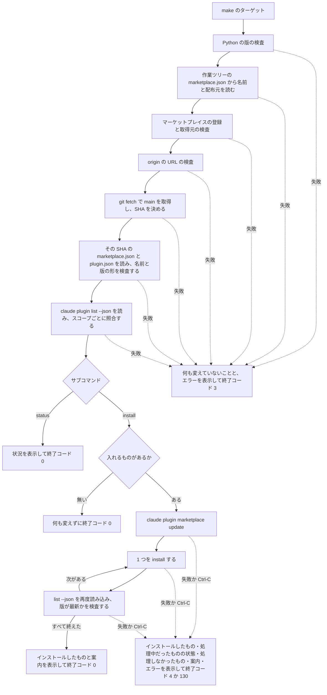

# プラグインのインストール状況の表示と、まとめてのインストール (make のターゲット) - Plan

要件の出所は GitHub の Issue [akm/claude-plugins#168](https://github.com/akm/claude-plugins/issues/168) の本文と、2026-11-02 の会話で利用者が決めた事項 (Product Contract の Key Decisions と、Planning Contract の KTD1・KTD7・KTD12)。Issue の本文は当初 3 つのターゲット (状況の表示・インストール・更新) を求めていたが、会話で、更新のターゲットは作らず、マーケットプレイスの自動更新に任せると決め (KD4)、本文を直した (経緯は [Issue のコメント](https://github.com/akm/claude-plugins/issues/168#issuecomment-6575785182))。

この計画で使う語:

- **対象のプラグイン**: `origin/main` のファイル `.claude-plugin/marketplace.json` に載っているプラグイン。make の変数 `PLUGINS` で名前を指定したときは、そのうちの指定したものだけ (R1)。
- **最新の版**: `origin/main` にある、各プラグインのファイル `<source.path>/.claude-plugin/plugin.json` の `version` (R3)。
- **インストール済みの版**: コマンド `claude plugin list --json` が返す、スコープごとの `version`。
- **配布元**: ファイル `CONCEPTS.md` の語。このリポジトリでは GitHub の akm/claude-plugins (ホスト `github.com`・所有者 `akm`・リポジトリ `claude-plugins` の組)。
- **展開先**: ファイル `CONCEPTS.md` の語。`claude plugin list --json` の `installPath`。版ごとにディレクトリが分かれる。
- **マーケットプレイスの clone**: Claude Code が、登録したマーケットプレイスを手元に clone したディレクトリ (`claude plugin marketplace list --json` の `installLocation`)。インストールと更新は、ここにある版を入れる。
- **マーケットプレイスの自動更新**: Claude Code の機能。マーケットプレイスごとに有効にでき、サードパーティのマーケットプレイスはデフォルトで無効。有効にすると、対話のセッションで最初のメッセージを送った後に (最大 10 分の待機の後)、マーケットプレイスの clone を取得し直し、インストール済みのプラグインを新しい版に更新する。インストールされていないプラグインは入れない。
- **前提の検査**: プラグインを変える操作の前に行う検査 (R1・R3〜R7)。これらがすべて成り立ってから変える操作を始めることは、R8 が定める。
- **変える操作**: 手元の Claude Code の状態を変える `claude` のコマンド。`claude plugin marketplace update` と `claude plugin install` の 2 つ。
- **偽の claude**: テストで本物のコマンド `claude` の代わりに PATH に置く、ファイル `scripts/tests/fake-claude` (KTD12)。

---

## Goal Capsule

- **目的**: このリポジトリを clone して開発する人が、手元の Claude Code に入っているこのリポジトリのプラグインが `main` より古いかを、1 つのコマンドで確認できる。入っていないものは、1 つのコマンドで `main` の版でインストールできる。古いものは、マーケットプレイスの自動更新で更新される。インストールの途中で失敗したら、その場で中止し、どのプラグインが変わり、どれを処理しなかったかが出力から分かる。
- **手段**: リポジトリのルートの Makefile の 2 つのターゲットが、ファイル `scripts/plugins.py` を実行する。スクリプトは `claude plugin` のコマンドと git だけを使って状態を読み書きする (KTD1・KTD2)。自動更新を有効にする手順は README に書く (R20)。
- **SSOT の優先順位**: 製品の振る舞いは Product Contract の R-ID が SSOT。実装の選び方は Planning Contract の KTD が SSOT。実装単位 (U-ID) はどちらも書き換えない。実装で R や KTD と合わないことが分かったときは、単位の記述ではなく R と KTD を直す。
- **利用者に判断を求める条件**: 次のどれかが分かったら、設計を変えずに実装を停止し、利用者に判断を求める。
  - 本物の `claude` で、`claude plugin install` が、標準入出力が端末でないときに確認を求めて失敗する。`-y` を付ければ通るとしても、付けずに利用者に判断を求める (KTD7)。これは、実装と通し確認でこの失敗が起きたときに、実装するセッションが実装を停止して利用者に判断を求める条件である。スクリプトの実行時の振る舞い (直し方で進め方を示して中止する) は KTD7 に書いた。
  - ほかのプラグインのディレクトリ・`.claude-plugin/marketplace.json`・`.github/workflows/test.yml`・ディレクトリ `.claude/` を変えなければ実装できない。
- **進め方**: 単位ごとに、テストを先に書く。テストは偽の claude と手元の一時的なリポジトリで動かし、本物の `claude` を実行せず、GitHub に接続しない (KTD12・KTD13)。本物の `claude` での確認は、すべての単位の後に、利用者の許可を得てから行う (Verification Contract の通し確認)。
- **後始末の担当**: コミットは動機ごとに分ける (規範は利用者のコミットルール)。PR の作成と、Issue #168 へのコメントは、利用者の指示を受けてから行う。
- **Product Contract の保全**: 要件の出所は Issue #168 と 2026-11-02・2026-11-03 の会話。Issue の本文に無く、会話で決めたものは KD3・KD6〜KD8・KD11・KD13〜KD16・KD18〜KD26。KD4 (更新のターゲットを作らない) は、2026-11-02 に Issue の本文にも反映した。

---

## Product Contract

### Summary

リポジトリのルートに、2 つの make のターゲットを足す。状況の表示は、対象のプラグインごとに、最新の版とスコープごとのインストール済みの版を並べて示す。インストールは、マーケットプレイスの定義を取得し直してから、user スコープに無いプラグインを 1 つずつ入れ、失敗したら中止する。更新はマーケットプレイスの自動更新に任せ、有効にする手順を README に書く。

### Problem Frame

ファイル `README.md` の節「最新版に更新する」の手順は、プラグインを 1 つずつ扱う。プラグインごとに `claude plugin update <名前>@akm-claude-plugins` を実行し、その前に `claude plugin marketplace update` が要る。`claude plugin list` はインストール済みの版を示すが、最新の版とは比べない。サードパーティのマーケットプレイスは自動更新がデフォルトで無効なので、利用者が更新しない限り古い版が使われ続ける ([#33](https://github.com/akm/claude-plugins/issues/33) で調べた)。自動更新を有効にすれば、インストール済みのプラグインは更新される。しかし、どのプラグインが古いかを一覧する手段と、入っていないプラグインをまとめて入れる手段は、Claude Code に無い。

2026-11-02 の時点で、手元の user スコープの 9 個は、すべて `origin/main` (41e9c622) より古かった。たとえば review-triage は 0.23.0 で、`origin/main` は 0.28.4 だった。

### Key Decisions

- KD1. **取得元は GitHub の `main` だけにする** (session-settled: user-directed。退けた案: 手元の作業ツリーから入れる・GitHub と手元を切り替える。理由: マージ前の変更を試す手段は、必要になったら別の Issue で扱う)。Governs R2。
- KD2. **最新の版は `origin/main` の plugin.json から読む** (session-settled: user-directed。退けた案: マーケットプレイスの定義を取得し直してから clone の版と比べる・手元の clone の版のまま比べる。理由: clone は古いことがあり、取得し直すと状況の表示が手元の状態を変える)。Governs R3, R12。
- KD3. **対象の一覧は `origin/main` の marketplace.json から作る** (session-settled: user-approved。退けた案: 作業ツリーの marketplace.json から作る。理由: 作業中のブランチで足したプラグインは、`origin/main` にもマーケットプレイスの clone にも無い)。Governs R1。
- KD4. **make の 2 つのターゲット (状況の表示・インストール) が Python のスクリプトを実行する。更新のターゲットは作らず、マーケットプレイスの自動更新に任せる。`make help` は作らない** (session-settled: user-directed。退けた案: 更新も含む 3 つのターゲット・Python のスクリプトだけ・スキル。理由: 自動更新はインストール済みのプラグインを新しい版に更新するので、更新のターゲットと同じことをする。状況の表示とインストールは、代わりになる機能が無い)。Governs R13, R20。
- KD5. **状況の表示はすべてのスコープ、インストールは user スコープだけ** (session-settled: user-directed。退けた案: 表示も変える操作も user スコープだけ・すべてのスコープを表示し変える。理由: project / local スコープへの操作は、そのプロジェクトのディレクトリで `--scope` を付けて実行する必要がある)。Governs R9, R13。
- KD6. **有効か無効かは、user スコープの分だけ表示する** (session-settled: user-directed。退けた案: プラグインごとに「このリポジトリで有効か」を表示する・スコープごとに設定ファイルを直接読む。理由: `claude plugin list --json` の `enabled` は、スコープごとの値ではなく、コマンドを実行したディレクトリで有効かを表す)。Governs R10。
- KD7. **名前はカンマで区切って複数指定する** (session-settled: user-directed。退けた案: 空白で区切る。理由: プラグインの名前にカンマは使わない)。Governs R1。
- KD8. **版は X.Y.Z の形だけを扱い、それ以外はエラーにする** (session-settled: user-directed。退けた案: SemVer の pre-release も扱う。理由: git の履歴にある plugin.json の版 106 件がすべて X.Y.Z で、pre-release を使うことになったら、このツールのエラーで分かる)。Governs R3。
- KD9. **マーケットプレイスが登録されていなければ、登録せずにエラーにする** (session-settled: user-directed。退けた案: 登録してから続ける。理由: 登録は利用者の環境に設定を足す操作なので、利用者が実行する)。Governs R4。
- KD10. **remote `origin` が配布元を指していなければ、エラーにする** (session-settled: user-approved。退けた案: そのまま続ける。理由: 最新の版を読む `origin/main` が、配布元の `main` でなくなる)。Governs R6。
- KD11. **インストールの前にも、マーケットプレイスの定義を取得し直す** (session-settled: user-directed。退けた案: 取得し直さない・取得し直さずに clone が `origin/main` と違えばエラーにする。理由: clone が古いと古い版が入り、clone を取得した後に足したプラグインは見つからずに失敗する)。Governs R13。
- KD12. **`claude` コマンドが失敗したら、その時点で中止する** (session-settled: user-directed。退けた案: 残りを続けて処理し、最後にまとめて報告する。理由: 失敗を見てから次に進むかを利用者が決める)。Governs R15。
- KD13. **登録済みのマーケットプレイスの取得元が配布元でなければ、エラーにする** (session-settled: user-approved。退けた案: そのまま続ける。理由: fork や手元のディレクトリから登録していると、インストールの取得元が `main` でなくなる)。Governs R5。
- KD14. **成功を返しても版が最新にならなければ、エラーにして中止する** (session-settled: user-approved。退けた案: 成功として扱う。理由: 利用者に知らせずに古い版が残る)。Governs R16, R18。
- KD15. **インストール済みの版の方が新しいときは「新しい」と示す** (session-settled: user-approved。退けた案: エラーにする)。Governs R9。
- KD16. **Ctrl-C で中断したときも、中止と同じく、それまでの変更を案内する** (session-settled: user-approved。退けた案: 何も表示せずに終える)。Governs R17, R18。
- KD17. **インストールに伴う手順 (実行中のセッションへの読み込みと、wording-guard の `wording_lint.py setup`) は、案内を表示するだけにする** (session-settled: user-directed。退けた案: `wording_lint.py setup` まで実行する・扱わない。理由: `wording_lint.py setup` は npm で約 380 個のパッケージを取得する)。読み込みの案内は、読み込みの方法と時期を書かずに、公式ドキュメントの節を示す (理由: 読み込みの方法と時期は Claude Code の振る舞いで、変わりうる。2026-11-03 のレビューで決めた)。Governs R18。
- KD18. **状況の表示は、古いものがあっても終了コード 0 で終える** (session-settled: user-approved。退けた案: 古いものがあれば 0 以外で終える)。Governs R12。
- KD19. **中止・中断したときは、処理中だったプラグインの版と、処理しなかったプラグインの名前を示す。前提の検査でエラーになったときは、何も変えていないことを書く** (session-settled: user-approved。退けた案: 処理中だったものはいつも「版が変わったか分からない」と示し、処理しなかったものは `make plugins-status` で確認してもらう。理由: `claude` の処理の途中で中止すると版が変わっていることがあり、make を通すと終了コードはどれも 2 になって区別できない)。Governs R8, R15, R17, R18。
- KD20. **入れるものが 1 つも無いときは、マーケットプレイスの定義も取得し直さない** (session-settled: user-approved。退けた案: 入れるものが無くても取得し直す。理由: 入れるものが無いのに、手元の clone を変えるだけになる)。Governs R13。
- KD21. **URL の形で登録したマーケットプレイスも、取得元が配布元なら受け付ける** (session-settled: user-approved。退けた案: `akm/claude-plugins` の形の登録だけを受け付ける。理由: README の節「user レベルでインストールする」が、`https://….git` や `git@…` の形の登録を案内している)。Governs R5。
- KD22. **自動更新が有効かは判定せず、確認する方法と公式ドキュメントの URL を、状況の表示の最後に示す** (session-settled: user-directed。退けた案: 自動更新が有効かを示さない。理由: 自動更新の設定は 3 か所 (設定ファイルの `extraKnownMarketplaces`・Claude Code が内部に持つファイル・管理者の設定) にあり、`claude` の CLI の出力からは判定できないが、更新を自動更新に任せる以上、利用者が確認できる必要がある)。Governs R21。
- KD23. **状況の表示の最後に、user スコープの「版が古いもの」「インストールされていないもの」「無効なもの」の名前をまとめて示す** (session-settled: user-approved。退けた案: プラグインごとの行だけを示す。理由: 対象のプラグインが多いと、どれが古いかを一目で読み取りにくい。2026-11-02 の実装の後に決めた)。Governs R22。
- KD24. **インストールの最初に、user スコープにインストール済みで扱わないものを示し、中止したときの「処理しなかったもの」は、当てはまるものが無くても「なし」と示す** (session-settled: user-approved。退けた案: どちらも示さない。理由: インストールのターゲットが古いものを更新しないことと、処理しなかったものが無いことが、出力から分かる。2026-11-02 の実装の後に決めた)。Governs R15, R23。
- KD25. **インストールが失敗して中止した後に記録を読み込み、処理中だったプラグインが user スコープに入っていれば、版が最新でなくても読み込みの案内を出す** (session-settled: user-approved。退けた案: インストールしたものと「版が変わったか分からない」ものがあるときだけ出す。理由: 手元の状態が変わっていて、実行中のセッションに読み込む必要がある。2026-11-02 の実装の後に決めた)。Governs R18。
- KD26. **標準出力を読むプロセスが先に終了したときは、変える操作を始めた後なら中止と同じく扱って終了コード 4 で終え、何も変えていなければ表示を途中でやめたことを書いて終了コード 0 で終える** (session-settled: user-approved。退けた案: 新しい終了コードを足して 0 以外で終える・状況の表示はトレースバックのまま残す。理由: 何も変えておらず、表示を短くしたのは利用者の操作なので、make がエラーとして表示しないほうがよい。2026-11-03 のレビューで決めた)。Governs R24。

### Requirements

**対象と取得元**

- R1. 対象は、`origin/main` の `.claude-plugin/marketplace.json` に載っているプラグインとする。make の変数 `PLUGINS` でカンマ区切りの名前を指定したときは、その名前だけを対象にする。載っていない名前か、空の要素 (`a,,b`) があれば、エラーにして何も変えない。
- R2. インストールの取得元は、marketplace.json の `source` が指す配布元の `main` だけとする。
- R3. 最新の版は、`git fetch` の後の `origin/main` にある `<source.path>/.claude-plugin/plugin.json` の `version` とする。版は X.Y.Z (3 つの 10 進の整数) の形だけを扱い、それ以外の形はエラーにする。

**前提の検査 (2 つのターゲットに共通)**

- R4. マーケットプレイス akm-claude-plugins が登録されていなければ、登録せずに、登録するコマンド (`claude plugin marketplace add akm/claude-plugins`) を標準エラー出力に表示して、終了コード 0 以外で終える。
- R5. 登録されていても、その取得元が配布元でなければ、エラーにする。取得元は、`akm/claude-plugins` の形で登録したものも、URL の形 (`https://github.com/akm/claude-plugins.git`・`git@github.com:akm/claude-plugins.git` など) で登録したものも、表記の違いをそろえてから比べる。
- R6. remote `origin` の URL が配布元を指していなければ、エラーにする。
- R7. `git fetch` が失敗したら、エラーにする。手元にある古い `origin/main` は使わない。
- R8. 前提の検査 (R1・R3〜R7) がすべて成り立ってから、変える操作を始める。成り立たなければ、何も変えずに終え、何も変えていないことをエラーの文に書く。

**状況の表示**

- R9. 対象のプラグインごとに、最新の版と、スコープ (user / project / local) ごとのインストール済みの版と、最新の版と比べた結果 (同じ・古い・新しい) を表示する。project / local スコープのものは、プロジェクトのパスも表示する。
- R10. 有効か無効かは、user スコープの分だけ表示する。
- R11. user スコープにインストールされていないプラグインは、インストールされていないことが分かるように表示する。
- R12. 状況の表示は、インストール済みのプラグインもマーケットプレイスの clone も変えない。古いものがあっても終了コード 0 で終える。
- R22. 状況の表示で、user スコープの「版が古いもの」「インストールされていないもの」「無効なもの」の名前を、それぞれ 1 行にまとめて示す。当てはまるものが無いときは「なし」と示す。
- R21. 状況の表示の最後に、次を示す。古いプラグインはマーケットプレイス akm-claude-plugins の自動更新で更新されること。自動更新が有効かは、Claude Code のセッションで `/plugin` を開き、Marketplaces タブで akm-claude-plugins を選ぶと確認でき、そこで有効と無効を切り替えられること。すぐに更新したいときは、同じ画面で「Update marketplace」を選べること。公式ドキュメントの URL (https://code.claude.com/docs/ja/plugins/install#turn-auto-update-on-or-off-for-a-marketplace)。

**インストール**

- R13. マーケットプレイスの定義を取得し直してから、user スコープにインストールされていないプラグインを、user スコープにインストールする。user スコープにインストール済みのプラグインは、古くても扱わない。入れるものが 1 つも無いときは、マーケットプレイスの定義も取得し直さず、何も変えずに終了コード 0 で終える。
- R23. インストールの最初に、対象のうち user スコープにインストール済みで扱わないものの名前を示す。

**失敗と中止**

- R15. `claude` コマンドが失敗したら、その時点で中止し、残りのプラグインは処理しない。失敗したプラグイン (マーケットプレイスの定義の取得し直しが失敗したときはマーケットプレイス) と、エラーの内容を標準エラー出力に表示し、終了コード 0 以外で終える。インストールが失敗したときは、インストールの記録を再度読み込み、そのプラグインの実際の版 (入っていなければ、入っていないこと) を示す。処理しなかったプラグインの名前も示す。当てはまるものが無いときは「なし」と示す。
- R16. `claude` コマンドが成功を返しても、インストールの後の user スコープの版が最新の版と同じでなければ、R15 と同じく中止する。
- R17. Ctrl-C で中断したときも、中止として扱う。ただし、それ以上コマンドを実行せず、処理中だったプラグインを「版が変わったか分からない」と示し、`make plugins-status` で確認するよう案内する。処理しなかったプラグインの名前も示す。
- R24. 標準出力を読むプロセスが先に終了したとき (`make plugins-install | head` など)、インストールで変える操作を始めた後なら、R15 と同じく中止として扱い、それ以上コマンドを実行せずに、インストールしたものなどを標準エラー出力に示して終了コード 4 で終える。変える操作を始める前と状況の表示では、表示を途中でやめたことと何も変えていないことを標準エラー出力に示し、終了コード 0 で終える。

**実行の後の案内**

- R18. 新しくインストールしたプラグインがあれば、実行の最後に次を表示する。中止・中断したときも、それまでにインストールしたものか、版が変わったか分からないものか、再度読み込んだ結果 user スコープに入っていた処理中のもの (版が最新でなくても) があれば表示する。どちらも実行はしない。
  - インストールしたプラグインを実行中のセッションに読み込む方法を書いた、公式ドキュメントのページ[プラグインのインストールと管理](https://code.claude.com/docs/ja/plugins/install)の節[シェルからインストール](https://code.claude.com/docs/ja/plugins/install#install-from-your-shell)の URL (読み込みの案内。KD17)
  - インストールしたものに wording-guard があれば、textlint を入れるコマンド `python3 <展開先>/scripts/wording_lint.py setup`。展開先は、インストールの後に再度読み込んだ実際のパス

**テストと文書**

- R19. スクリプトの単体テストを CI で実行する。テストは本物の `claude` を実行せず、GitHub に接続せず、手元のインストールを変えない。
- R20. README.md の節「最新版に更新する」に、2 つの make のターゲットを使う手順と、マーケットプレイス akm-claude-plugins の自動更新を有効にする手順を書く。

### Success Criteria

- 2026-11-02 の手元の状態 (user スコープの 9 個がすべて古い) で状況の表示のターゲットを実行すると、9 個すべてが「古い」と示される。README の手順で自動更新を有効にし、更新が完了してから Claude Code を再起動すると、状況の表示で 9 個すべての user スコープの版が最新の版と同じと示される。
- user スコープから外したプラグインが、インストールのターゲットで最新の版で入る。
- 前提の検査でエラーになって終了したときと、インストールの途中で中止したときに、利用者が出力だけを読んで、何も変わっていないのか、どのプラグインが変わり、どれを処理しなかったのかを判断できる。

### Scope Boundaries

- 手元の作業ツリーのプラグインを入れること (KD1)
- 更新のターゲット。更新はマーケットプレイスの自動更新に任せる (KD4)
- project / local スコープへのインストール (KD5)
- 状況の表示で、自動更新が有効かを判定して示すこと。代わりに、確認する方法と公式ドキュメントの URL を示す (KD22)
- marketplace.json に載っていない、開発中のプラグイン (ディレクトリ `issue-dispatch/` など)
- `wording_lint.py setup` の実行と、実行中のセッションへの読み込み (KD17)
- 有効か無効かを切り替えること (`claude plugin enable` / `claude plugin disable`)
- pre-release の付いた版 (KD8)
- `make help` (KD4)

#### Deferred to Follow-Up Work

- README.md の節「最新版に更新する」は、`plugin update` の `--scope` のデフォルト値を user スコープと書いている。しかし、`claude plugin update --help` (2.1.285) は auto-detect と示す。記述が古いかは確認していない。U6 では手作業で更新する手順の記述は変えず、別に確認する。
- ファイル `.github/workflows/test.yml` の冒頭のコメントは、テストを「各プラグインの」と書いている。`scripts/tests` はプラグインのテストではない。ワークフローはこの計画では変えない (利用者に判断を求める条件) ので、文言の見直しは別に行う。

### Sources / Research

- Issue #168 の本文 (要望・いまの状態・要件・対象外)。
- ファイル `docs/solutions/tooling-decisions/require-explicit-basis-for-relative-paths.md`: 基準のディレクトリを cwd から決めない (KTD3)。
- ファイル `docs/solutions/conventions/plugin-cannot-resolve-its-own-source.md`: 状態は CLI から読み、`~/.claude/plugins/` の下のファイルを直接読まない (KTD7)。
- ファイル `docs/solutions/architecture-patterns/fail-soft-by-data-class.md`: 出力の形の誤りを 0 件として扱わない。「無い」と「読めない」を分ける (KTD5・KTD7)。
- ファイル `docs/solutions/tooling-decisions/avoid-dual-parser-implementations.md`: 比べ方と読み方を 1 つにし、ほかの手段への分岐を作らない (KTD6・KTD7)。
- マーケットプレイスの自動更新 (公式ドキュメント https://code.claude.com/docs/en/ の `plugins/install.md` の節「Keep plugins updated」、`plugins/loading.md` の節「When auto-update runs」、`settings-reference.md` の `extraKnownMarketplaces`。2026-11-02 に確認): 有効にする方法は、`/plugin` の Marketplaces タブの「Enable auto-update」か、設定ファイルの `extraKnownMarketplaces.<名前>.autoUpdate`。インストール済みのプラグインだけを更新し、反映は `/reload-plugins` か次の起動。古い版を一覧する手段は記載が無い (KD4)。日本語版のページ (https://code.claude.com/docs/ja/plugins/install#turn-auto-update-on-or-off-for-a-marketplace) も、同じ節の名前 (slug) を持つ (KD22)。
- 偽のコマンドの先例: ファイル `issue-dispatch/tests/fake-gh` と `issue-dispatch/tests/fixtures/gh/README.md`、ファイル `review-triage/tests/fake-claude`、ファイル `review-triage/tests/test_review_loop_worker.py` のクラス `WorkerTestBase` (KTD12)。
- git のテストと URL の正規化の先例: ファイル `issue-dispatch/tests/test_repo.py` の関数 `_git` と `make_clone`、ファイル `issue-dispatch/scripts/issue_dispatch/repo.py` の関数 `parse_origin_url` (KTD4・KTD13)。
- 外部コマンドの実行を 1 つの関数に限る先例: ファイル `issue-dispatch/scripts/issue_dispatch/gh.py` の関数 `run`。失敗を例外にする先例: ファイル `pr-teeth/scripts/prteeth/repos.py` の関数 `_run` (KTD2)。
- スクリプトの形の先例: ファイル `wording-guard/scripts/wording_lint.py` (サブコマンド・終了コードの定数・関数 `python_too_old`。KTD9・KTD10)。
- Makefile の書き方の先例: ファイル `review-triage/tools/triagecheck/README.md` の節「Makefile に置く例」と、ファイル `work-log-gh-comment/skills/work-log-gh-comment/evals/Makefile` (KTD11)。
- CLI 2.1.285 の観察 (2026-11-02。読み取りだけのコマンドと、存在しない名前での `install` / `update` で確認):
  - `claude plugin list --json` は配列。要素のキーは `id`・`scope`・`version`・`enabled`・`projectEnabled`・`installPath`・`installedAt`・`lastUpdated`。project スコープの要素には `projectPath` もある。
  - `enabled` は、コマンドを実行したディレクトリで有効かを表す。別のプロジェクトの project スコープの要素も、このリポジトリで有効かどうかの値になる。
  - `claude plugin marketplace list --json` は配列。要素のキーは `name`・`source`・`repo`・`installLocation`。URL の形で登録すると、`source` が `git` になり、`repo` の代わりに `url` を持つ (CLI の実装を読んで確認。KD21)。ref (ブランチやタグ) を付けて登録すると、`ref` も持つ。`source` が `github` と `git` の要素は、登録の `path` (リポジトリの中の marketplace.json のパス) を出力しない (2026-11-03 のレビューで、利用者の手元での実行と CLI の実装を読んで確認)。
  - `claude plugin list --json` は、ディレクトリ `.claude/skills/` に置いたプラグインの要素も返す。その要素には `projectPath` が無いことがある (CLI の実装を読んで確認)。
  - `claude plugin install` / `update` に `--json` を付けると、結果を 1 行の JSON で標準出力に出す。失敗の終了コードは 1。`claude plugin marketplace update` は `--json` を持たない。
  - 存在しない名前で `install` / `update` を実行した直後に、マーケットプレイスの clone が取得し直されていた (どちらのコマンドによるものかは分かっていない)。
- `insteadOf` の挙動 (2026-11-02 に一時的なリポジトリで確認): `git config --get remote.origin.url` は書き換える前の URL を、`git remote get-url origin` は書き換えた後のパスを返す。`git fetch` は書き換えた後のパスから取得する。`GIT_ALLOW_PROTOCOL=file` のとき、https での取得は失敗する。

---

## Planning Contract

### Key Technical Decisions

- KTD1. **ドメインは「プラグインの状況と版」の 1 つで、読み取りとインストールはその操作にする** (session-settled: user-directed。退けた案: 状況の読み取りとインストールを別々のドメインにする。理由: どちらも同じ状況と版に対する操作で、インストールは読み取りの結果を使う)。コードはファイル `scripts/plugins.py` の 1 つにまとめ、サブコマンド `status`・`install` を持たせる。読み取りの結果 (プラグインごとの最新の版と、スコープごとのインストール済みの版) を 1 つのデータにし、2 つの操作がそれを使う。配置先はディレクトリ `scripts/` (session-settled: user-approved。退けた案: どれかのプラグインのディレクトリの中。理由: どのプラグインにも属さない)。
- KTD2. **外部コマンドは 2 つの関数だけが実行する。** `claude` を実行する関数と、`git` を実行する関数。
  - 失敗 (終了コード 0 以外・タイムアウト・コマンドが見つからない) は例外にし、呼び出し元で中止する。
  - タイムアウトは、読み取り (`plugin list`・`plugin marketplace list`) が 60 秒、`git fetch` が 120 秒、変える操作が 300 秒 (pr-teeth の `CLONE_TIMEOUT` と同じ)。
  - `claude` は、実行のたびに作る空の一時ディレクトリを cwd にして実行し、実行が終了したら一時ディレクトリを消す (session-settled: user-approved。退けた案: ホームディレクトリ・リポジトリのルート。理由: `plugin list --json` の `enabled` は実行したディレクトリの設定も反映する。空のディレクトリなら user スコープの設定の値そのものになる。ホームディレクトリでは、プロジェクトの設定ファイルの場所が user スコープの設定ファイルと重なる)。2026-11-02 の手元では、空のディレクトリで `plugin list --json` を実行しても、ファイルは作られなかった。
  - git は `-C <ルート>` で実行する。実行先のリポジトリを変える環境変数 (`GIT_DIR`・`GIT_WORK_TREE`・`GIT_INDEX_FILE` など) は消す。git のフックの中から make を実行すると、`GIT_DIR` が別のリポジトリを指していることがあるため。`GIT_ALLOW_PROTOCOL`・`GIT_CONFIG_GLOBAL` のように実行先を変えない変数は残す (テストの安全策に使う。KTD13)。
- KTD3. **リポジトリのルートは、スクリプトの実体の位置から決める。** `os.getcwd()` や `$PWD` は使わない。基準を取り違えると、実在する別のリポジトリの `origin/main` を読んで、成功として終了してしまうため。テストは、スクリプトと Makefile を一時的なリポジトリにコピーして実行し、別の cwd から実行してもコピーした先のリポジトリを読むことを確認する。テスト専用の引数は作らない。
- KTD4. **配布元は作業ツリーの marketplace.json から決め、`origin` の URL は設定値そのものを正規化して比べる。**
  1. 作業ツリーの `.claude-plugin/marketplace.json` から、マーケットプレイスの名前と、各プラグインの `source.url` が指す配布元を読む。配布元が 1 つでなければエラーにする。名前と配布元をスクリプトに定数として書かない (SSOT は marketplace.json)。
  2. `origin` の URL は `git config --get remote.origin.url` で読む。`git remote get-url` は `insteadOf` で書き換えた後の値を返すため使わない。書き換える前の値を読むのは、テストで取得先を手元のリポジトリに向けるため (KTD13)。そのため、利用者が git の設定 `insteadOf` で取得先をミラーや fork に向けている環境では、この検査を通っても、配布元でない所から取得する。この環境は検出できない (Risks)。
  3. URL は scp 形式・`ssh://`・`https://`・`git://` を受け付け、末尾の `.git` と `/` を除き、大文字と小文字を区別せずに、ホスト・所有者・リポジトリを比べる。SSH の設定の Host の別名は解決せず、`github.com` 以外のホストはエラーにする。正規化の形は `issue-dispatch/scripts/issue_dispatch/repo.py` の関数 `parse_origin_url` をコピーする (issue-dispatch は配布していないので import しない)。
  4. fetch の後の `origin/main` の marketplace.json の名前と配布元が、1 の値と違えばエラーにする。
- KTD5. **`main` だけを取得し、取得した直後の SHA から読む。**
  1. `git fetch` で `main` だけを取得し、`origin/main` の SHA を 1 回だけ決める。
  2. marketplace.json と各 plugin.json は、その SHA から読む。読み取りの途中で `origin/main` が動いても、別のコミットの内容が混ざらない。
  3. plugin.json のパスは、プラグインの名前ではなく `source.path` から作る。
  4. 各プラグインの `source` が `git-subdir`・配布元の URL・`ref` が `main` でなければ、エラーにする。`sha` (取得するコミットを指定するキー) があるときもエラーにする。`sha` があると、`main` の先端ではなく、そのコミットを取得するため (2026-11-03 のレビューで足した)。
  5. plugin.json が無い場合と、JSON として読めない・`version` が無い場合は、別の文言でエラーにする。
- KTD6. **版の比較は、X.Y.Z の 3 つの整数の組で行う** (KD8)。最新の版と、対象のプラグインのインストール済みの版の両方を `^[0-9]+\.[0-9]+\.[0-9]+$` で検査し、合わなければエラーにする。比べた結果は「同じ」「古い」「新しい」の 3 つ。標準ライブラリだけで書き、ほかのライブラリがあれば使うという分岐は作らない。
- KTD7. **`claude` の出力は必要なキーを検査して読み、変える操作の出力は解析しない。**
  - `plugin list --json`: 配列であることと、すべての要素に `id` があることを検査する。ほかのキーは、`id` が `@<マーケットプレイスの名前>` で終わる要素 (このリポジトリのプラグイン) にだけ検査する。その要素に `scope`・`version`・`installPath` があること、user スコープの要素に真偽値の `enabled` があること、project / local スコープの要素に `projectPath` があること。無ければエラーにし、0 件として扱わない。ほかの要素は使わない。`.claude/skills/` のプラグインの要素には `projectPath` が無いことがあるので、すべての要素を検査すると、そうしたプラグインがあるだけでエラーになる (session-settled: user-approved。退けた案: すべての要素のキーを検査する)。知らないキーは無視する (CLI の版が上がってキーが増えてもエラーにならないように)。
  - `plugin marketplace list --json`: 配列で、各要素に `name` と `source` があること。名前の一致する要素について、`source` が `github` なら `repo` を、`git` なら `url` を、KTD4 の 3 と同じ方法で正規化して配布元と比べる。要素に `ref` があり、`main` でなければエラーにする。登録の `path` は、`github` と `git` の要素では出力されない (出力のキーは Sources / Research の CLI の観察) ので、検査できない (2026-11-03 のレビューで決めた)。ほかの `source` (手元のディレクトリなど) はエラーにする (R4・R5・KD21)。
  - `plugin install` は `--json` を付けて実行し、成否は終了コードと、その後の再度の読み込み (KTD8) で判定する。出力は解析せず、失敗したときに標準出力と標準エラー出力の末尾をそのまま表示する。変える操作 (`plugin marketplace update` と `plugin install`) の標準出力は、UTF-8 として読めるかも見ない (2026-11-03 のレビューで決めた)。
  - `-y` は付けない。付けると、マーケットプレイスが宣言したコマンドを、利用者の確認なしに受け入れるため (利用者に判断を求める条件)。そのため、宣言したコマンドを持つプラグインのインストールは失敗する。`claude` が終了コード 0 以外で終了し、再度読み込んでもインストールされていると分からなかったときは、直し方に、端末で `claude plugin install` を実行し、表示されたコマンドを確認してからインストールする進め方を添える (2026-11-02 のレビューで決めた)。
  - `~/.claude/plugins/` の下のファイル (`installed_plugins.json` など) は直接読まない。Claude Code の内部の実装で、公式の記載が無いため。
- KTD8. **インストールは 1 つずつ行い、そのたびに `plugin list --json` を再度読み込む。**
  - 対象は marketplace.json に書かれた順に 1 つずつ扱う。成功したら再度読み込み、user スコープの版が最新の版と同じかを検査する (R16)。
  - 再度読み込んだ展開先を、案内の `wording_lint.py setup` のパスに使う。展開先は版ごとに変わるので、前の値や組み立てたパスは使わない。
  - 入れるものが 1 つも無いときは、マーケットプレイスの定義も取得し直さず、何も変えずに終了コード 0 で終える (R13)。
  - `claude plugin install` が失敗して中止したときは、`plugin list --json` を再度読み込み、処理中だったプラグインの実際の状態を示す。この読み込みも失敗したら、「版が変わったか分からない」と示す (R15)。
  - Ctrl-C で中断したときは、それ以上コマンドを実行しない (R17)。
  - 中止・中断したときは、インストールしたものの一覧・処理中だったプラグインの状態・処理しなかったプラグインの名前と、案内 (R18) を表示してから、エラーを表示して終える。
- KTD9. **終了コードで、何かを変えたかを区別する。**
  - `0`: 成功。
  - `3`: 前提の検査か読み取りでエラーになり、何も変えずに終了した。
  - `4`: 変える操作の途中で中止した。一部が変わっている可能性がある。
  - `130`: Ctrl-C で中断した。
  - `1` と `2` は Python 自身 (捕まえていない例外・引数の誤り) が使うので、専用の終了コードには使わない (ファイル `issue-dispatch/scripts/issue_dispatch.py` と同じ考え)。
  - エラーの文は、プログラム名を前に付けて標準エラー出力に書き、直し方を添える。終了コード 3 で終えるときは、何も変えていないことも書く (R8)。make を通すと、スクリプトの終了コードが 0 以外ならどれも make の終了コード 2 になるため、何を変えたかは文で伝える。
- KTD10. **Python は 3.11 以上を前提にする。** CI の版 (3.11) と同じ。古い版で実行されたら、使っている版と 3.11 以上が要ることを表示して、終了コード 3 で終える (`wording_lint.py` の関数 `python_too_old` と同じ形)。macOS に付属の `/usr/bin/python3` は 3.9 なので、この検査が実行されるように、スクリプトは 3.9 でも構文エラーにならない書き方にする (`match` 文などを使わない)。
- KTD11. **Makefile は 2 つのターゲットと 1 つの変数を持つ。**
  - ターゲット `plugins-status`・`plugins-install` が、Makefile のあるディレクトリから求めた `scripts/plugins.py` を `python3` で実行する。
  - 変数 `PLUGINS` は、make のコマンドラインで指定したときだけスクリプトに渡す。同じ名前の環境変数は取り込まない (`$(origin PLUGINS)` で判定する)。空の値は「指定しない」と同じに扱う。
  - `.PHONY` をターゲットごとに書き、`ターゲット: ## 日本語の説明` の形で説明を添える。
  - GNU Make 3.81 (macOS に付属) で動く書き方にする。
- KTD12. **偽の claude を使う前に、偽物であることを毎回確認する** (session-settled: user-directed。退けた案: 確認せずに PATH の偽物を使う・スクリプトの中の関数をテストで差し替える。理由: 本物の `claude` を実行しないことを、使う前に保証する)。確認の順と安全策は session-settled: user-approved (退けた案: 固有のオプションの実行だけで確認する。理由: 本物の `claude` は、知らない語をプロンプトとして受け取って会話を始める可能性がある)。
  1. 偽の claude は、状態のファイル (登録したマーケットプレイス・マーケットプレイスの clone にある版・配布元にある版・インストール済みのプラグイン) を読み書きする。`plugin list --json` などを状態から返す。`plugin marketplace update` は配布元の版を clone に反映し、`plugin install` は clone の版をインストール済みにする。
  2. 偽の claude は、受けた引数と cwd を 1 行ずつ記録する。状態のファイルで指定した場面では、失敗する (終了コード 1) か、成功を返して版を変えない。知らない引数は終了コード 99 で終える (`issue-dispatch/tests/fake-gh` と同じ)。状態のファイルで指定した呼び出しでは、親のプロセス (スクリプト) に SIGINT (Ctrl-C と同じシグナル) を送る。Ctrl-C のテストに使う。状態のファイルで指定した呼び出しでは、UTF-8 として読めない標準出力を書いて終了コード 0 で終える。変える操作の標準出力を読まないことと、読み取りのコマンドの出力を読めないときに中止することのテストに使う (2026-11-02 のレビューで足し、2026-11-03 のレビューで使い方を変えた)。
  3. 偽の claude だけが持つオプション `--fake-claude-identity` を受けると、決めた文字列を出力する。
  4. テストの共通の準備は、偽の claude を使う前に、次の 2 つを順に確認する。どちらかが違えば、その場でテストを失敗させる。
     1. テストで使う PATH で `claude` を探し (`shutil.which`)、見つかったファイルの実体のパスが偽の claude の実体と同じであること
     2. 同じ環境変数で `claude --fake-claude-identity` を実行し、決めた文字列が返ること
  5. 二重の安全策として、`HOME` と `CLAUDE_CONFIG_DIR` を一時ディレクトリにする。`HOME` を変えると asdf などの `python3` が起動しなくなるので、`bin/python3` に `sys.executable` へのシンボリックリンクを作る (`review-triage/tests/test_review_loop_worker.py` と同じ)。
  6. 偽の claude が返す `plugin list --json` が、本物から取った固定データ (ファイル `scripts/tests/fixtures/plugin-list.json`) と同じキーを持つことをテストで確認する。固定データの出所 (取った日・CLI の版) と、別のプロジェクトのパスを置き換えたことを、ファイル `scripts/tests/fixtures/README.md` に書く。
- KTD13. **git のテストは一時的なリポジトリで行い、GitHub に接続しない。**
  - 配布元の代わりの bare リポジトリ (marketplace.json と plugin.json を持つ) と、作業用のリポジトリを作る。作業用のリポジトリには、スクリプトと Makefile をコピーする (KTD3)。
  - 作業用のリポジトリの `remote.origin.url` は GitHub の URL にし、`url.<bare のパス>.insteadOf` で取得先を bare に向ける。
  - 環境変数は、`GIT_ALLOW_PROTOCOL=file` (GitHub へ接続しようとすれば失敗する)・`GIT_CONFIG_GLOBAL=/dev/null`・`GIT_CONFIG_NOSYSTEM=1`・`GIT_AUTHOR_*` と `GIT_COMMITTER_*` にし、`GIT_DIR` などを消す (`issue-dispatch/tests/test_repo.py` の関数 `_git` と同じ形)。
- KTD14. **テストはディレクトリ `scripts/tests/` に置き、CI の対象の一覧に 1 行足す。** ファイル `.github/test-targets.txt` に `python scripts/tests` を足す。ワークフローは変えない。テストの共通の準備 (KTD12・KTD13) はファイル `scripts/tests/plugintest.py` に置く。名前が `test_` で始まらないので、それ自体はテストとして集められない。

### High-Level Technical Design

2 つのサブコマンドに共通の流れと、終了の仕方 (KTD9) を示す。



### Open Questions

どれも実装を始めることを妨げない (deferred)。

- local スコープの要素に `projectPath` があるかは確認していない (手元に local スコープの要素が無い)。KTD7 では必須として検査する。無いことが分かったら、エラーの内容を見て KTD7 を直す。
- 本物の `claude` での振る舞いのうち、偽の claude では確認できないものは、通し確認 (Verification Contract) で確認する。`-y` が要らないこと、空の一時ディレクトリで `plugin` のコマンドが問題なく動くこと、R21 が示す確認の方法が実際の画面と合うこと。

### Sequencing

ドメイン「プラグインの状況と版」の中で、テストの環境 (U1) → 前提の検査と最新の版 (U2) → 状況の表示 (U3) → インストール (U4) → README (U6) の順に進める。U5 (更新) は、更新のターゲットを作らないことにしたので無い (KD4)。本物の `claude` での通し確認は U6 の後に行う。

### System-Wide Impact

- CI: `scripts/tests` が新しい対象になる。ubuntu の runner には `claude` が無いので、偽の claude を PATH に置けていなければ、KTD12 の確認で先に失敗する。
- ほかのプラグインのディレクトリと marketplace.json は変えないので、プラグインの版を上げるコミットは要らない。
- 利用者の手元: プラグインの更新は、このスクリプトではなく Claude Code の自動更新が行う。

### Risks

| リスク | 対処 |
| --- | --- |
| `claude` の JSON の形は公式に記載が無く、CLI の版で変わりうる | KTD7 の検査でエラーにして終了する。直すときは、固定データを取り直して偽の claude を合わせる |
| `enabled` は、コマンドを実行したディレクトリの設定も反映する | `claude` を空の一時ディレクトリで実行する (KTD2) |
| git の設定 `insteadOf` で取得先をミラーや fork に向けた環境では、`origin` の検査を通っても、配布元でない所の `main` を最新の版として読む | 検出できないことを KTD4 に書く。このリポジトリの開発環境で `insteadOf` を使う人がいれば、扱いを決め直す |
| 公式ドキュメントの URL や `/plugin` の画面の項目の名前が変わると、R21 の表示が古くなる | URL と項目の名前は、スクリプトの定数を SSOT にする。README.md の手順にも同じものを書き、両方の一致をテストで確認する (2026-11-02 のレビューで変えた)。通し確認で、実際の画面と合うことを確認する |
| make の変数と同じ名前の環境変数 `PLUGINS` が、対象を気づかないうちに絞る | コマンドラインで指定したときだけ渡す (KTD11) |
| 通し確認は、利用者の手元のプラグインを実際にインストールし、自動更新を有効にする | 始める前に、行うことを示して利用者の許可を得る (Verification Contract) |

---

## Output Structure

```text
.
├── Makefile                        # 2 つのターゲット (U3・U4)
├── scripts/
│   ├── plugins.py                  # 読み取りとインストール (U2〜U4)
│   └── tests/
│       ├── fake-claude             # 偽の claude (U1。mode 100755)
│       ├── plugintest.py           # テストの共通の準備 (U1)
│       ├── fixtures/
│       │   ├── README.md           # 固定データの出所 (U1)
│       │   └── plugin-list.json    # 本物の plugin list --json の出力 (U1)
│       ├── test_fake_claude.py     # U1
│       ├── test_preconditions.py   # U2
│       ├── test_status.py          # U3
│       ├── test_install.py         # U4
│       └── test_makefile.py        # U3・U4
├── .github/test-targets.txt        # 1 行足す (U1)
└── README.md                       # U6
```

---

## Implementation Units

### U1. テストの環境 (偽の claude と一時的なリポジトリ)

- **Goal:** テストが、本物の `claude` を実行せず、GitHub に接続せずに、スクリプトを動かせる環境を作る。
- **Requirements:** R19。KTD12・KTD13・KTD14。
- **Dependencies:** なし。
- **Files:** 作る: `scripts/tests/fake-claude`・`scripts/tests/plugintest.py`・`scripts/tests/fixtures/plugin-list.json`・`scripts/tests/fixtures/README.md`・`scripts/tests/test_fake_claude.py`。変える: `.github/test-targets.txt`。
- **Approach:**
  1. 偽の claude を Python で書く (KTD12 の 1〜3)。状態のファイルと記録のファイルのパスは、環境変数で受ける。
  2. 本物の `claude plugin list --json` の出力を固定データにする。別のプロジェクトのパスは置き換える (公開の場に、ほかのプロジェクトの名前を書かない)。
  3. 共通の準備 (`plugintest.py`) に、偽の claude の確認 (KTD12 の 4・5)、bare リポジトリと作業用のリポジトリの作成、配布元に新しい版をコミットする補助の関数を書く (KTD13)。
  4. `.github/test-targets.txt` の 1 行は、最初のテストと同じコミットに入れる (一覧にあってテストが無いと、CI の discover ジョブが失敗するため)。
- **Patterns to follow:** `issue-dispatch/tests/fake-gh`・`issue-dispatch/tests/fixtures/gh/README.md`・`review-triage/tests/fake-claude`・`review-triage/tests/test_review_loop_worker.py` のクラス `WorkerTestBase`・`issue-dispatch/tests/test_repo.py` の関数 `_git` と `make_clone`。
- **Test scenarios:**
  - PATH の先頭のディレクトリに偽の claude へのリンクを作った準備では、2 つの確認が通り、`claude --fake-claude-identity` が決めた文字列を返す。
  - PATH で見つかる `claude` が偽の claude でない別のファイル (実行されたら記録を残すスクリプト) のとき、1 つ目の確認で失敗し、そのファイルは実行されない。
  - 実体の確認は通るが、固有のオプションが決めた文字列を返さないとき、2 つ目の確認で失敗する。
  - 準備の後の環境では、`HOME` と `CLAUDE_CONFIG_DIR` が一時ディレクトリを指し、`FAKE_` で始まる環境変数が前のテストから残っていない。
  - 偽の claude の `plugin list --json` は、状態のファイルのインストール済みのプラグインを返し、その要素のキーが固定データの要素のキーと同じである。
  - `plugin marketplace update akm-claude-plugins` の後、clone の版が配布元の版になる。続く `plugin install` で、その版がインストール済みになり、展開先が版を含むパスになる。
  - 状態のファイルで失敗を指定したコマンドは終了コード 1 を返し、「成功を返して版を変えない」を指定したコマンドは終了コード 0 で状態を変えない。SIGINT を指定したコマンドは親のプロセスに SIGINT を送り、UTF-8 として読めない出力を指定したコマンドは、そのバイト列を書いて終了コード 0 で終える (bad_utf8 は 2026-11-02 のレビューで足した)。
  - 知らない引数を受けると終了コード 99 で終え、引数を標準エラー出力に書く。
  - 受けた引数と cwd が、呼び出しの順に記録される。
  - 作業用のリポジトリで、`git config --get remote.origin.url` は GitHub の URL を返し、`git fetch` は bare リポジトリから取得できる。
  - `insteadOf` の設定を外した作業用のリポジトリでは、`GIT_ALLOW_PROTOCOL=file` によって `git fetch` が失敗する (GitHub に接続しないことの確認)。
- **Verification:** `python3 -m unittest discover -s scripts/tests` がすべて成功する。`.github/test-targets.txt` と、CI の discover ジョブが見つける対象が一致する。

### U2. 前提の検査と最新の版の読み取り

- **Goal:** 2 つのサブコマンドが共通に使う、前提の検査と、対象のプラグインと最新の版の読み取りを作る。
- **Requirements:** R1〜R8。KD2・KD3・KD7〜KD10・KD13・KD19・KD21。KTD2〜KTD7・KTD9・KTD10。
- **Dependencies:** U1。
- **Files:** 作る: `scripts/plugins.py`・`scripts/tests/test_preconditions.py`。
- **Approach:**
  1. スクリプトの入り口 (サブコマンド `status`・`install` と、オプションで受けるカンマ区切りの名前)、Python の版の検査 (KTD10)、ルートの決め方 (KTD3) を作る。
  2. 作業ツリーの marketplace.json から名前と配布元を読む (KTD4 の 1)。
  3. マーケットプレイスの登録と取得元を検査する (R4・R5。KTD7)。
  4. `origin` の URL を検査する (R6。KTD4 の 2・3)。
  5. `main` を取得し、SHA から marketplace.json と plugin.json を読み、名前と版の形を検査する (R1・R3・R7。KTD4 の 4・KTD5・KTD6)。
  6. ここまでの失敗は、何も変えていないことをエラーの文に書き、終了コード 3 で終える (R8。KTD9)。
  7. モジュールの docstring に、サブコマンドと `PLUGINS` の渡し方・前提の検査・終了コード (KTD9) を書く。U6 の README は、この docstring を参照する。
- **Patterns to follow:** `wording-guard/scripts/wording_lint.py` (サブコマンドと終了コードの定数・モジュールごとの例外クラス・エラーの文)、`issue-dispatch/scripts/issue_dispatch/repo.py` の関数 `parse_origin_url`。
- **Test scenarios:**
  - 登録済みで、`origin` が scp 形式の配布元の URL のとき、`origin/main` の plugin.json の版が最新の版として読まれる。作業ツリーの plugin.json の版を変えておいても、`origin/main` の版が使われる。
  - 準備の後に配布元へ新しい版をコミットすると、次の実行でその版が最新の版になる (`git fetch` を実行していることの確認)。
  - 作業ツリーの marketplace.json にだけあるプラグインは対象にならず、`origin/main` の marketplace.json にあるものが対象になる (KD3)。
  - `PLUGINS` に `a,b` を指定すると、対象は a と b だけになる。
  - 載っていない名前や、空の要素 (`a,,b`) を指定すると終了コード 3 で終え、偽の claude の記録に変える操作が無い。
  - マーケットプレイスが登録されていないとき、終了コード 3 で終え、標準エラー出力に `claude plugin marketplace add akm/claude-plugins` と、何も変えていないことが含まれる。
  - URL の形 (`source` が `git` で、`url` が `https://github.com/akm/claude-plugins.git` か `git@github.com:akm/claude-plugins.git`) で登録されているときは、エラーにならない (KD21)。
  - 同じ名前で登録されているが、取得元が別の GitHub のリポジトリ (fork。`github` の形と URL の形の両方) のときと、`source` が `github` でも `git` でもない (手元のディレクトリ) ときと、`ref` が `main` でないときは、終了コード 3 で終える。
  - URL の正規化の関数は、scp 形式・`ssh://`・`https://` (末尾の `.git` と `/` の有無)・大文字を含む URL を同じ配布元と判定し、別のホスト・別の所有者・別のリポジトリ・SSH の Host の別名を違うと判定する。
  - `origin` が無いときと、別のリポジトリを指すときは、終了コード 3 で終える。
  - `git fetch` が失敗する (bare リポジトリを消した) とき、終了コード 3 で終え、前に取得してあった `origin/main` を使わない。
  - `origin/main` に対象の plugin.json が無いときと、JSON として読めない・`version` が無いときは、違う文言で終了コード 3 で終える。
  - 版が `0.29.0-alpha1` や `1.2` のとき、終了コード 3 で終える。
  - `origin/main` の marketplace.json の名前か配布元が作業ツリーのものと違うとき、プラグインの `source` が `git-subdir` でないとき、`ref` が `main` でないとき、`sha` があるときは、終了コード 3 で終える。
  - 作業用のリポジトリにコピーしたスクリプトを、別のディレクトリを cwd にして実行しても、コピーした先のリポジトリの `origin` を読む (KTD3)。
  - 環境変数 `GIT_DIR` が別のリポジトリを指していても、スクリプトのルートのリポジトリを読む (KTD2)。
  - 偽の claude の記録の cwd が、リポジトリのルートでも呼び出した側の cwd でもない空のディレクトリで、実行の後にそのディレクトリが残っていない (KTD2)。
  - Python の版の検査の関数は、3.10 の版を渡すと案内を返し、3.11 の版を渡すと何も返さない。
- **Verification:** U2 のテストがすべて成功する。前提の検査の失敗で、偽の claude の記録に `plugin list` と `plugin marketplace list` 以外が無い。

### U3. 状況の表示 (読み取りの操作)

- **Goal:** インストール済みの版と最新の版を照合して状況を表示する。Makefile とターゲット `plugins-status` を作る。
- **Requirements:** R9〜R12・R21・R22・R24。KD5・KD6・KD15・KD18・KD22・KD23・KD26。KTD7・KTD11。
- **Dependencies:** U2。
- **Files:** 作る: `Makefile`・`scripts/tests/test_status.py`・`scripts/tests/test_makefile.py`。変える: `scripts/plugins.py`。
- **Approach:**
  1. `plugin list --json` を検査して読み (KTD7)、対象のプラグインごと・スコープごとにまとめ、最新の版と比べる (KTD6)。
  2. 表示は、プラグインごとに最新の版を出し、その下にスコープごとの行 (版・比べた結果、user スコープは有効か無効か、project / local スコープはプロジェクトのパス) を並べる。具体的な書式は実装で決める。
  3. Makefile を作り、`plugins-status` を足す (KTD11)。
  4. モジュールの docstring に、状況の表示で示すもの (R9〜R12・R21) を書き足す。
- **Patterns to follow:** `review-triage/tools/triagecheck/README.md` の節「Makefile に置く例」。
- **Test scenarios:**
  - user スコープの版が古いもの・同じもの・新しいものが、それぞれ「古い」「同じ」「新しい」と表示される。
  - user スコープに無いプラグインは、インストールされていないと表示される。
  - 同じプラグインが user スコープと別のプロジェクトの project スコープの両方にあるとき、両方の行が出て、project スコープの行にはプロジェクトのパスが出て、有効か無効かは出ない。
  - user スコープの要素の `enabled` が false のとき、無効と表示される。
  - ほかのマーケットプレイスの要素と、対象でない (marketplace.json に無い・`PLUGINS` で絞った外の) プラグインの要素は表示されない。
  - `plugin list --json` が空の配列のとき、すべてがインストールされていないと表示され、終了コード 0 で終える。
  - `plugin list --json` が配列でないとき、このリポジトリのプラグインの要素に `version` が無いとき、その user スコープの要素に `enabled` が無いときは、終了コード 3 で終える。
  - ほかのマーケットプレイスの要素や `.claude/skills/` のプラグインの要素に `projectPath` などが無くても、エラーにならない。`id` が無い要素があるときは、終了コード 3 で終える。
  - インストール済みの版が X.Y.Z の形でないとき、終了コード 3 で終える。
  - 古いものがあっても終了コード 0 で終え、偽の claude の記録に `plugin list` と `plugin marketplace list` 以外が無い。
  - 表示の最後に、自動更新が有効かを確認する方法と、公式ドキュメントの URL (https://code.claude.com/docs/ja/plugins/install#turn-auto-update-on-or-off-for-a-marketplace) が出る (R21)。
  - 別のディレクトリから `make -C <作業用のリポジトリ> plugins-status` を実行すると、その作業用のリポジトリの状況が表示される。
  - `make plugins-status PLUGINS=a,b` は a と b だけを表示し、`PLUGINS=` (空) はすべてを表示する。
  - 環境変数 `PLUGINS` を設定して `make plugins-status` を実行しても、すべてが表示される (KTD11)。
  - `make plugins-status PLUGINS=no-such` は、make が終了コード 0 以外で終える。
  - 標準出力を読むプロセスが先に終了すると、標準エラー出力に表示を途中でやめたことと何も変えていないことが出て、終了コード 0 で終える (R24。2026-11-03 のレビューで足した)。
- **Verification:** U3 のテストがすべて成功する。

### U4. インストール (変える操作の共通部分を含む)

- **Goal:** user スコープに無いプラグインをインストールする。中止と中断の扱いと案内を含め、ターゲット `plugins-install` を足す。
- **Requirements:** R13・R15〜R18・R23・R24。KD11・KD12・KD14・KD16・KD17・KD19・KD20・KD24〜KD26。KTD7〜KTD9・KTD11。
- **Dependencies:** U3。
- **Files:** 作る: `scripts/tests/test_install.py`。変える: `scripts/plugins.py`・`Makefile`・`scripts/tests/test_makefile.py`。
- **Approach:**
  1. 前提の検査と読み取り (U2・U3) の後、user スコープに無いプラグインを選ぶ。無ければ何も変えずに終える (KTD8)。
  2. `claude plugin marketplace update <名前>` を実行する。
  3. 対象を 1 つずつ `claude plugin install <名前>@<マーケットプレイス> --scope user --json` でインストールし、再度読み込んで版を検査する (KTD8)。
  4. 最後に、インストールしたものの一覧と案内 (R18) を表示する。中止・中断したときは、KTD8 の表示をする (KTD8・KTD9)。
  5. モジュールの docstring に、インストールと、中止・中断したときの扱い (R13・R15〜R18) を書き足す。
- **Execution note:** Ctrl-C での中断は、偽の claude に、指定した呼び出しで親のプロセスへ SIGINT を送らせ、作業用のリポジトリにコピーしたスクリプトをプロセスとして実行して確認する。スクリプトの中の関数をテストで差し替えない (KTD12)。
- **Test scenarios:**
  - user スコープに無いものが 2 つ、古いものが 1 つあるとき、無い 2 つだけが marketplace.json の順にインストールされ、古いものは扱われない。記録では、`plugin marketplace update` が 1 回、インストールより前にあり、`plugin install` には `--scope user` が付いている。`plugin update`・`plugin enable`・`plugin disable` は無い。
  - インストールの後、インストールしたものの一覧と、読み込みの案内が表示され、終了コード 0 で終える。
  - wording-guard をインストールしたとき、`python3 <展開先>/scripts/wording_lint.py setup` が表示され、展開先はインストール後に再度読み込んだ値である。wording-guard を変えなかったときは表示されない。
  - user スコープに無いものが無いとき、`plugin marketplace update` も含めて変える操作を 1 つも実行せず、読み込みの案内も出さずに、終了コード 0 で終える (KD20)。
  - `plugin marketplace update` が失敗すると、インストールを実行せずに終了コード 4 で終え、標準エラー出力にマーケットプレイスの名前と失敗の出力が出る。読み込みの案内は出ない。
  - 3 つのうち 2 つ目のインストールが失敗すると、3 つ目は実行されず、終了コード 4 で終える。標準エラー出力に 2 つ目の名前と失敗の出力が出る。1 つ目をインストールしたことと読み込みの案内、再度読み込んだ 2 つ目の実際の状態、処理しなかった 3 つ目の名前も出る。
  - 2 つ目のインストールが失敗した後の再度の読み込みも失敗すると、2 つ目は「版が変わったか分からない」と示され、読み込みの案内も出る。
  - 2 つ目のインストールが失敗したが、再度読み込むと 2 つ目が最新の版で入っているとき、2 つ目もインストールしたものとして示される。
  - インストールが失敗したときの直し方に、確認の進め方 (端末で `claude plugin install` を実行して確認してからインストールする) を添えるのは、`claude` が終了コード 0 以外で終了し、再度読み込んだ結果がインストールされていない・読み込めなかったときだけ。最新の版か古い版で入っていたときと、`claude` が終了コードを返さなかった (どの場合かは、スクリプトのクラス `CommandError` の docstring に書いた) ときは添えない (KTD7。2026-11-02 のレビューで足した)。
  - インストールが成功を返したのに版が変わらないとき、終了コード 4 で終え、その名前が標準エラー出力に出る (R16)。
  - 偽の claude が 2 つ目のインストールで親のプロセスに SIGINT を送ると、それ以上コマンドを実行せず、1 つ目をインストールしたこと・2 つ目は「版が変わったか分からない」こと・処理しなかった 3 つ目の名前・`make plugins-status` での確認の案内・読み込みの案内を表示して、終了コード 130 で終える。
  - 前提の検査でエラーになったとき、変える操作は 1 つも実行されない。
  - `make plugins-install PLUGINS=a` は a だけを対象にする。
  - 変える操作を始める前に標準出力を読むプロセスが先に終了すると、変える操作を 1 つも実行せず、表示を途中でやめたことと何も変えていないことが標準エラー出力に出て、終了コード 0 で終える (R24。2026-11-03 のレビューで足した)。
  - 1 つ目をインストールした後に標準出力を読むプロセスが先に終了すると、それ以上コマンドを実行せず、1 つ目をインストールしたことと読み込みの案内が標準エラー出力に出て、終了コード 4 で終える (R24。2026-11-03 のレビューで足した)。
- **Verification:** U4 のテストがすべて成功する。

### U6. README の更新

- **Goal:** README.md に、make のターゲットを使う手順と、新しいファイルの配置先を書く。
- **Requirements:** R20。
- **Dependencies:** U4。
- **Files:** 変える: `README.md`。
- **Approach:**
  1. 節「最新版に更新する」の初めに、このリポジトリを clone している人向けの手順として、2 つのターゲットと `PLUGINS` (カンマ区切り) を書く。
  2. マーケットプレイス akm-claude-plugins の自動更新を有効にする手順 (`/plugin` の Marketplaces タブの「Enable auto-update」か、`~/.claude/settings.json` の `extraKnownMarketplaces.akm-claude-plugins.autoUpdate`) を書く。更新した版がいつ読み込まれるかは書かず、公式ドキュメントの節を示す (KD17 と同じ理由。2026-11-03 のレビューで決めた)。wording-guard の版が変わったら `wording_lint.py setup` を実行し直すことは、`wording-guard/README.md` を参照する形で書く。
  3. 手作業で更新する手順は、自動更新を使わない人向けとして残す (Deferred to Follow-Up Work の記述は変えない)。
  4. 振る舞いの詳細は書き写さず、SSOT として、U2〜U4 で書いたスクリプトのモジュールの docstring を参照する。
  5. 節「構成」のツリーに `Makefile` と `scripts/` (テストの実行コマンドを添える) を足す。節「自動テスト」の、テストをプラグインのものに限る書き方を、`scripts/tests` も含む書き方に直す。
- **Test expectation:** none (文書だけの変更)。
- **Verification:** 変えた範囲に対して、スキル `wording-guard` で避ける語が無い。リンクと、節の名前の参照が実在する。README が参照する docstring に、参照している内容 (サブコマンド・状況の表示・インストール・終了コード) が書かれている。

---

## Verification Contract

| 検査 | コマンド / 手段 | 対象の単位 | 証明するもの |
| --- | --- | --- | --- |
| 単体テスト | `python3 -m unittest discover -s scripts/tests` (偽の claude と一時的なリポジトリ。本物の `claude` を実行せず、GitHub に接続しない) | U1〜U4 | R1〜R13・R15〜R19・R21〜R24 |
| CI の対象の一覧 | `.github/workflows/test.yml` の discover ジョブ (PR を開いたときと、PR への push で実行される。ブランチへの push だけでは実行されない) | U1 | `.github/test-targets.txt` と実際の対象が一致する |
| 変えないものの差分 | `git diff --stat main -- commit-rules-guard pr-teeth doc-dag mermaid-preview commit-squash review-triage work-log-gh-comment wording-guard session-handoff issue-dispatch .claude-plugin .github/workflows .claude` | U1〜U4・U6 | 差分が無い (利用者に判断を求める条件) |
| 表現 | 変えた Markdown と、Python の日本語のコメント・docstring・テストのメッセージを、スキル `wording-guard` (Markdown 以外は `wording_lint.py check --stdin`) と目視で検査する | U1〜U4・U6 | 避ける語が無い。日本語の文中で、理由や補足を続けるダッシュを使っていない |
| 通し確認 (本物の `claude`) | 利用者の許可を得てから、このリポジトリで行う。手順は下の表 | U2〜U4・U6 | Success Criteria。利用者に判断を求める条件に当たらないこと。Open Questions への回答 |

通し確認の手順 (順に行う。結果は PR の本文に書く):

| # | 手順 | 期待 |
| --- | --- | --- |
| 1 | `make plugins-status` | 表示が `claude plugin list` と一致する。別のプロジェクトの project スコープの要素がパス付きで出る。表示の最後の URL が開け、そこに書かれた確認の方法 (`/plugin` の Marketplaces タブ) が実際の画面と合う。終了コード 0 |
| 2 | `make plugins-status PLUGINS=no-such` | 終了コード 0 以外。手元のプラグインが変わらない |
| 3 | 利用者が選んだ 1 つを `claude plugin uninstall <名前>@akm-claude-plugins --scope user` で外してから、`make plugins-install PLUGINS=<名前>` | user スコープに最新の版で入る。確認を求められずに終了する (`-y` が要らない)。読み込みの案内が出る。wording-guard を選んだときは `wording_lint.py setup` の案内が出て、そのパスが実在する |
| 4 | README の手順 (U6) で、マーケットプレイス akm-claude-plugins の自動更新を有効にする。Claude Code を起動して最初のメッセージを送り、更新の表示 (Plugin updated) が出るまで待機してから、Claude Code を再起動する | 9 個のプラグインが更新される |
| 5 | 別のディレクトリで `make -C <リポジトリのルート> plugins-status` | 9 個すべての user スコープの版が最新の版と同じ |

---

## Definition of Done

- U1〜U4・U6 がすべて完了し、Verification Contract の全項目が成功している。通し確認で利用者が行わないと決めた手順があれば、その手順と理由が PR の本文にある。
- R1〜R13・R15〜R19・R21〜R24 のそれぞれが、単体テストか通し確認のどれかで確認されている。R20 (README) は、U6 の確認 (表現の検査・リンクと節の名前の実在・docstring の内容) で確認されている。
- ほかのプラグインのディレクトリ・`.claude-plugin/marketplace.json`・`.github/workflows/`・`.claude/` に差分が無い。
- 単位ごとに、動機でコミットが分かれている。`.github/test-targets.txt` の 1 行は最初のテストのコミットに入っている。計画のコミットは実装と分かれている。
- 実装が計画と合わなかったところは、計画の R と KTD が実装に合わせて直され、直した理由が PR の本文にある。Open Questions への回答が、KTD7 か PR の本文に書かれている。
- 試行錯誤で残した文面・スクリプト・テストの名残が差分に無い。
