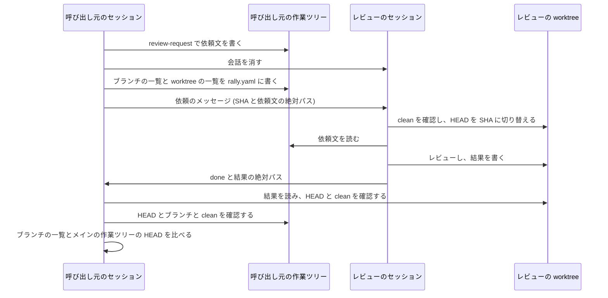

# review-rally を worktree で動くセッションから使えるようにする - Plan

要件の出所は GitHub の Issue [akm/claude-plugins#170](https://github.com/akm/claude-plugins/issues/170) の本文と、2026-11-05 の会話で利用者が決めた事項 (Product Contract の Key Decisions と、Planning Contract の KTD1〜KTD4・KTD9)。

この計画で使う語:

- **呼び出し元のセッション**: スキル `review-rally` を呼び出したセッション。worktree で動く場合と、メインの作業ツリーで動く場合がある。今の文書の「メインのセッション」を、この語に変える (KD5)。
- **メインの作業ツリー**: `git worktree add` で追加したものではない、元の作業ツリー。コマンド `git worktree list --porcelain` の最初の項目にあたる。
- **レビューのセッション**: 呼び出し元のセッションがツール `start_session` で起動し、レビューを任せるセッション。
- **レビューの worktree**: レビューのセッションが動く、アプリが作る git worktree。
- **ループのディレクトリ**: 呼び出し元のセッションの作業ツリーの `tmp/review-rally/<ループの id>/`。
- **結果のディレクトリ**: レビューの worktree の `tmp/review-rally/<ループの id>/`。今の文書の「依頼のディレクトリ」に代わる語。
- **突き合わせ**: ファイル `review-triage/skills/review-rally/references/round.md` の手順で、結果を受け取った後に、結果のファイルと、作業ツリーと、ブランチの状態を確認すること。

---

## Goal Capsule

- **目的**: 利用者が、worktree で動くセッションからも review-rally を開始し、レビューから修正までのループを回せる。メインの作業ツリーを別のセッションが使っているときも、待機せずに開始できる。ただし、そのセッションがレビューの最中にコミットするかブランチを切り替えると、ループは停止する (KD3・KD4)。メインの作業ツリーで動くセッションからの使い方は変わらない。
- **手段**: 各セッションが自分の作業ツリーにだけ書き、受け渡しは絶対パスで行う (KD1)。
- **SSOT の優先順位**: 製品の振る舞いは Product Contract の R-ID が SSOT。実装の選び方は Planning Contract の KTD が SSOT。実装単位 (U-ID) はどちらも書き換えない。実装で R や KTD と合わないことが分かったときは、単位の記述ではなく R と KTD を直す。
- **利用者に判断を求める条件**: 次のどれかが分かったら、設計を変えずに実装を停止し、利用者に判断を求める。
  - 通し確認で、利用者が `/review-rally` を依頼した worktree のセッションでも、`start_session` が拒否される。
  - 通し確認で、レビューのセッションが依頼文を読めない、呼び出し元のセッションが結果を読めない、またはレビューのセッションが自分の worktree の HEAD を切り替えられない。
  - ディレクトリ `review-triage/skills/review-rally/`・ディレクトリ `review-triage/skills/review-request/`・ファイル `review-triage/README.md`・ファイル `review-triage/.claude-plugin/plugin.json` の外を変えなければ実装できない。
- **進め方**: この変更はスクリプトを持たない。単位ごとに、確認の方法を決めてから文書を変える。単体テストの代わりに、一時的なリポジトリで git の振る舞いを確認し、文書の手順を辿る。実際のセッションでの確認は、すべての単位の後に、利用者の許可を得てから行う (U8)。
- **後始末の担当**: コミットは動機ごとに分ける。PR の作成と Issue #170 へのコメントは、利用者の指示を受けてから行う。
- **Product Contract の保全**: 要件の出所は Issue #170 と 2026-11-05 の会話。Issue の「検討の結果」の 1〜4 を KD1〜KD4 に、5 を KD5 と KD6 に写した。

---

## Product Contract

### Summary

スキル `review-rally` の開始の前提から「worktree で動いていないこと」を外す。依頼文は呼び出し元のセッションの作業ツリーに、結果はレビューの worktree に置き、絶対パスで受け渡す。レビューの worktree の HEAD は、レビューのセッションが切り替える。突き合わせは、別のセッションの作業ではループを停止しない形に変える。

### Problem Frame

スキル `review-rally` は、呼び出し元のセッションが worktree で動いていると開始できない ([#170](https://github.com/akm/claude-plugins/issues/170))。メインの作業ツリーを別のセッションが使っているときは、そのセッションの作業が完了するまで待機するか、別の clone で行う必要がある。

開始の前提を消すだけでは動かない。今の形では、呼び出し元のセッションがレビューの worktree に依頼文を書くが、Claude のデスクトップアプリの hook は、worktree で動くセッションから別の作業ツリーへの Write ツールの書き込みを拒否する。2026-11-05 の試験で、別の作業ツリーの Read と、自分の作業ツリーへの Write と、メッセージの送信と会話の消去は成功すると確認した (試験の結果は Issue #170)。

worktree で動くセッションから使うときは、ほかの worktree でも同時に作業していることが多いと考えられる。今の突き合わせはすべてのブランチを比べるので、別のセッションがコミットしただけでループが停止する。review-rally には再開の引数が無いので、停止したら新しいループを始めることになる。

### Key Decisions

- KD1. **依頼文は呼び出し元のセッションの作業ツリーに、結果はレビューの worktree に書き、絶対パスで受け渡す** (session-settled: user-directed。退けた案: レビューのセッションを呼び出し元のセッションと同じ worktree で動かす案。理由: 2 つのセッションが別の作業ツリーを持つ設計を保ったまま、worktree かどうかの分岐を無くせる)。Governs R2, R4。
- KD2. **レビューの worktree の HEAD は、レビューのセッションが切り替える** (session-settled: user-directed。退けた案: 呼び出し元のセッションが `git -C` で切り替える案。理由: `git -C` は拒否されないが、別の作業ツリーのファイルを変える操作で、hook の拒否の文面の趣旨に反する)。Governs R5。
- KD3. **ブランチの一覧の突き合わせでは、依頼の前か後に、メインの作業ツリー以外の worktree がチェックアウトしていたブランチを除く** (session-settled: user-directed。退けた案: すべてのブランチを比べる案、差があっても停止せず報告だけする案、メインの作業ツリーのブランチも除く案。理由: メインの作業ツリー以外の worktree で動くセッションのコミットでは停止せず、レビュアによるブランチの変更の多くを検出して停止できる。メインの作業ツリーのブランチも除くと、レビュアのテストが `main` にコミットしても検出できない)。Governs R8。
- KD4. **メインの作業ツリーの HEAD が指すブランチの名前も比べる** (session-settled: user-directed。退けた案: 比べない案、作業ツリーの状態も比べる案。理由: 既存のブランチへの切り替えだけの変更を検出できる。作業ツリーの状態まで比べると、メインの作業ツリーを編集するたびに停止する)。Governs R9。
- KD5. **「メインのセッション」を「呼び出し元のセッション」に変える** (session-settled: user-directed。退けた案: 語を変えない案。理由: worktree で動くセッションも含むようになると、「メインの作業ツリー」と区別しにくい)。Governs R11。
- KD6. **#151 の計画の文書の語は変えない** (session-settled: user-directed。退けた案: 変える案。理由: 完了した作業の記録で、今の作業には影響しない)。Governs R12。

### Requirements

**開始**

- R1. worktree で動くセッションから `/review-rally` を呼び出したとき、開始の前提で拒否しない。
- R2. 呼び出し元のセッションが worktree で動くかどうかで、手順を分岐しない。
- R3. 開始の前提の clean と、git に無視されているかの確認は、呼び出し元のセッションの作業ツリーについて行う。メインの作業ツリーの状態は開始の条件にしない。

**受け渡し**

- R4. 依頼文は呼び出し元のセッションの作業ツリーに、結果はレビューの worktree に書く。メッセージで渡すパスは絶対パスにする。各セッションは自分の作業ツリーにだけ Write ツールで書く。
- R5. レビューのセッションは、依頼のメッセージに書かれたコミットに、自分の作業ツリーの HEAD を切り替えてからレビューする。切り替える前に、作業ツリーが clean であることを確認する。
- R6. レビューの worktree が clean でないか、切り替えに失敗したら、レビューのセッションは `failed` で報告し、呼び出し元のセッションはレビュー不成立 (停止ノード RR1) として停止する。
- R7. 停止するときは、結果のディレクトリの結果をループのディレクトリに複製する。ループのディレクトリと記録は呼び出し元のセッションの作業ツリーにあり、その作業ツリーが片付けられると一緒に消えることを、停止の報告の片付けの案内に常に書く。

**突き合わせ**

- R8. ブランチの一覧は、KD3 の範囲で比べる。
- R9. メインの作業ツリーの HEAD が指すブランチの名前 (detached HEAD なら SHA) を、依頼の前と後で比べる。インデックスの変更は検出の対象にしない。
- R10. R8 か R9 で差があれば RR1 で停止し、差があったブランチと、依頼の前と後の値を報告する。戻すかどうかは人間が決める。

**語と説明**

- R11. スキル `review-rally` の文書の「メインのセッション」を「呼び出し元のセッション」に変える。「メインの作業ツリー」は、git の元の作業ツリーの意味だけに使う。
- R12. ファイル `docs/plans/2026-10-29-0852-feat-review-rally-plan.md` は変更しない。
- R13. スキル `review-rally` の description と、ファイル `review-triage/README.md` の説明から、worktree ではない作業ツリーに限る記述を消す。

**ほかのスキルへの影響**

- R14. スキル `review-request` の、引数 `--target-dir` を渡さないときの振る舞いは変えない。スキル `review-loop` のワーカーは変更しない。

### Success Criteria

- worktree で動くセッションから開始したループが、少なくとも 2 回のレビュー (2 回目は会話を消した後) を経て、収束か、RR1〜RR4 (review-rally 固有の停止) 以外の停止に達する。
- メインの作業ツリーで動くセッションから開始したループが、少なくとも 1 回のレビューを完了する。
- レビューの最中にメインの作業ツリー以外の worktree でコミットしても、ループが停止しない。

### Scope Boundaries

- スキル `review-triage` とスキル `review-triage-fix` は変更しない。
- 権限モード auto 以外での動作は確認しない (Risks に記録する)。

#### Deferred to Follow-Up Work

- ファイル `review-triage/skills/review-rally/references/stops.md` の片付けの案内の「アーカイブで worktree も片付けられる」が実態と違う可能性は、別の Issue にする (session-settled: user-approved。退けた案: この計画に含める案。理由: アーカイブの後の worktree の扱いの調査が要り、動機も違う)。2026-11-05 に試験のセッションをアーカイブしたとき、worktree のディレクトリは残った。 [#172](https://github.com/akm/claude-plugins/issues/172) に記録した。
- 片付けの案内のそのほかの場合 (`session.reused` が空のままになる、依頼の前の停止で `rm -r` の対象が無い、アプリが worktree を新しいブランチに切り替えずに返す) も、[#172](https://github.com/akm/claude-plugins/issues/172) に記録した (session-settled: user-directed。退けた案: このブランチで直してレビューを続ける案。理由: レビューの結果を受け取るループが、前の回の修正の近くで指摘が続くことを検出して 2 度停止した)。

### Sources / Research

- [#170](https://github.com/akm/claude-plugins/issues/170): 問題と試験の結果と検討の結果。
- ファイル `docs/plans/2026-10-29-0852-feat-review-rally-plan.md` の D2 と Q2: 今の配置を決めた理由。この変更は D2 のうち、呼び出し元のセッションが HEAD を切り替える部分を変える。
- ファイル `review-triage/skills/review-request/SKILL.md` の手順 1 の `--target-dir` の確認: 同じリポジトリの worktree のルートであることの確認の仕方。KTD8 で流用する。

外部の調査は行っていない。ローカルの文書と 2026-11-05 の試験で足りるため。

---

## Planning Contract

### Key Technical Decisions

- KTD1. **結果の書き込み先を指定する引数を足さず、`--target-dir` の意味を変える** (session-settled: user-approved。退けた案: 結果のディレクトリを指定する新しい引数を足す案。理由: 指定が増えず、`--target-dir` を使うのは `review-rally` だけである)。`--target-dir` があるとき、依頼文は `--dir` のディレクトリに書き、結果の出力先は `<--target-dir>/<--dir の相対パス>/review-<識別子>.yaml` にする。`--dir` の相対パスは、依頼元の作業ツリーのルートからの相対パス。出力先のディレクトリは、レビュアが作る (雛形にそう書いてある)。Governs R4, R14。
- KTD2. **結果のディレクトリが git に無視されているかの確認は、依頼元の作業ツリーでの 1 回にする** (session-settled: user-approved。退けた案: レビューのセッションが切り替えの後に確認する案。理由: 相対パスが同じで、切り替えの後のコミットも同じなので、判定も同じになる)。`.git/info/exclude` は worktree で共有される。万一無視されていなければ、突き合わせの `git status --porcelain` で検出して RR1 になる。
- KTD3. **切り替えの前の clean の確認は、レビューのセッションだけが行う** (session-settled: user-approved。退けた案: 呼び出し元のセッションも依頼の前に確認する案。理由: 確認が 2 か所になる)。今の停止ノード RR2 の「レビューの worktree が clean でない」は、RR1 の「失敗の通知」に変わる。結果を受け取った後の、レビューの worktree の HEAD と clean の確認は、呼び出し元のセッションに残す。レビュアが worktree を変えていないことを確認するため。Governs R6。
- KTD4. **通し確認は、マージの前に、ブランチの文書を直接読む形で行う** (session-settled: user-approved。退けた案: マージの後にインストール済みの版で確認する案。理由: インストール済みのプラグインは古い版なので Skill ツールでは新しい手順を読めない。壊れた手順をマージしない)。
- KTD5. **round.md の「1 回のレビュー」の手順 1 を消し、手順の番号を詰める。** 切り替えはレビューのセッションのメッセージに移るので、呼び出し元のセッションの手順としては不要になる。手順の番号を指す参照 (round.md・ファイル `references/arguments.md`・ファイル `references/session.md`・ファイル `references/stops.md`) をすべて直す。
- KTD6. **`rally.yaml` の `waiting` に 2 つのキーを足す。** `main_head` はメインの作業ツリーの HEAD が指すブランチの名前 (detached HEAD なら SHA)。`worktree_branches` はメインの作業ツリー以外の worktree がチェックアウトしていたブランチの名前の配列。どちらも、依頼を送る直前に `git worktree list --porcelain` の 1 回の出力から取る。比べるときは、`worktree_branches` と、結果を受け取ったときの同じ一覧の和集合を除く。
- KTD7. **`.claude/worktrees/` が無視されているかの確認は、呼び出し元のセッションの作業ツリーで無条件に行う。** worktree で動く呼び出し元のセッションにとっては必須ではないが、分岐を作らないため (R2)。無視されていないリポジトリでは、メインの作業ツリーで動くセッションと同じ案内を出す。
- KTD8. **`get_session` の `worktreePath` の確認を、`--target-dir` と同じ条件に変える。** 同じリポジトリの worktree のルートであることに加えて、次の 2 つを確認する。`git rev-parse` の `--git-dir` と `--git-common-dir` が違うこと (メインの作業ツリーではないこと) と、呼び出し元のセッションの作業ツリーと違うこと。レビューのセッションがその作業ツリーの HEAD を切り替えるため。`.claude/worktrees/` の下にあることは確認しない。位置はアプリが決めることで、スキルの手順はその位置に依存せず、呼び出し元のセッションが worktree かどうかで分岐しないため (R2)。
- KTD9. **レビューのセッションは `git checkout -B <レビューのセッションのブランチ> <SHA>` で切り替える** (session-settled: user-directed。退けた案: `git checkout --detach <SHA>` のまま、2 つのループを同時に動かしたときの停止を受け入れる案。理由: ブランチがチェックアウトされたまま残るので、別のループの突き合わせ (KD3) で除かれ、そのループが停止しない)。このブランチはレビューのセッション専用で、指定のコミットに移しても困らない。Governs R5。
- KTD10. **起動の手順は、`worktreePath` の確認 → `worktree`・`branch`・再利用の判定を `session` に書く → 残りの値を書いて確認する、の順にする。片付けの案内は、停止ノードの名前ではなく `session` の値があるかどうかで分ける** (session-settled: user-directed。退けた案: RR2 の案内を具体化する案。理由: 再利用の判定の手順が 2 か所になる)。確認に通っていない値を案内が使わないようにするため。`session.branch` は `get_session` の値ではなく `git -C <worktreePath> branch --show-current` の出力にする。`git checkout -B` が動かし、片付けの案内の `git branch -D` が消すブランチなので、実際にチェックアウトされているブランチを書く。
- KTD11. **ブランチの名前は、同じ名前のタグがあっても形が変わらない方法で取る。** ブランチの一覧は `%(refname:lstrip=2)`、worktree の一覧のブランチは `branch` の行の値から `refs/heads/` を除いた名前、現在のブランチは `git branch --show-current` にする。`%(refname:short)` と `git symbolic-ref --short` は、同じ名前のタグがあると `heads/<名前>` を出力し、突き合わせが一致しなくなるため。

### High-Level Technical Design

1 回のレビューのやり取り (会話を消すのは 2 回目以降):

ファイルと書き込み元:

| ディレクトリ | 置くもの | Write ツールで書くセッション | 読むセッション |
| --- | --- | --- | --- |
| ループのディレクトリ | `rally.yaml`・依頼文・停止のときの結果の複製 | 呼び出し元のセッション (依頼文はスキル `review-request` を通して) | 呼び出し元のセッション・レビューのセッション (依頼文だけ) |
| 結果のディレクトリ | 結果 | レビューのセッション | 呼び出し元のセッション |

突き合わせの判定 (R8・R9。呼び出し元のセッションのブランチは、今の手順の「呼び出し元のセッションの作業ツリーの HEAD の確認」で別に検出する):

| レビューの間に起きたこと | 結果 |
| --- | --- |
| メインの作業ツリー以外の worktree がチェックアウトしているブランチにコミットした | 停止しない |
| 別のセッションが起動し、新しいブランチを worktree でチェックアウトした | 停止しない |
| どの worktree もチェックアウトしていないブランチの SHA が変わった | RR1 |
| どの worktree もチェックアウトしていないブランチが増えたか消えた | RR1 |
| メインの作業ツリーのブランチの SHA が変わった | RR1 |
| メインの作業ツリーの HEAD が別のブランチに替わった | RR1 |

### Sequencing

U1 → U2 → U3 → U4 → U5 → U6 → U7 → U8 の順に進める。worktree で動くセッションからの開始を許可する単位 (U6) を、受け渡しと突き合わせの後に置く。途中のコミットで、worktree から開始できて動かない状態を作らないため。

### System-Wide Impact

- スキル `review-request` の `--target-dir` の意味が変わる。この引数を使うのは `review-rally` だけである (同スキルの「引数」の節)。
- 記録 (`tmp/review-triages/`) とループのディレクトリは、呼び出し元のセッションの作業ツリーごとにある。別の作業ツリーで同じブランチのループを始めると、記録が無いものとして扱われ、回の番号は 1 から振られ、全量の回から始まる。

### Risks

| リスク | 扱い |
| --- | --- |
| メインの作業ツリーで動く別のセッションが、レビューの最中にコミット・pull・ブランチの切り替えをすると、RR1 で停止する | レビュアのテストによる変更と区別できないので、KD3 と KD4 の範囲として受け入れる。停止の報告に差があったブランチが出る |
| 権限モード auto 以外では、自分の作業ツリーの外の Read が承認待ちになる可能性がある。この変更で、メインの作業ツリーで動く場合も、レビューのセッションが依頼文を読むときに作業ツリーの外を読むようになる | auto だけで確認し、未確認であることを PR に書く。承認待ちは今の RR1・RR3 の報告で案内される |
| `start_session` が auto mode の分類器に拒否されることがある。人間の依頼が無いセッションで拒否され、依頼の後は成功した (原因は推測) | 拒否されたら今の RR2 で停止する。通し確認で、利用者が依頼したセッションから成功することを確認する |
| アプリの hook が今後 Read も拒否すると、この形は動かない | そうなったら RR1 か RR2 で停止する。対応はそのときに決める |
| 別のセッションが作ったブランチを、チェックアウトをやめた状態でレビューの間に残すと RR1 で停止する | KD3 の範囲として受け入れる。停止の報告に差があったブランチが出る |
| ほかの worktree がチェックアウトしているブランチをレビュアのテストが変更しても検出できない | KD3 の範囲として受け入れる。2026-10-05 の実例は、増えたブランチで検出できる |

---

## Implementation Units

### U1. 語を変える

**Goal:** 「メインのセッション」を「呼び出し元のセッション」に変え、「メインの作業ツリー」のうち呼び出し元のセッションの作業ツリーを指す箇所を書き換える。振る舞いは変えない。

**Requirements:** R11, R12

**Dependencies:** なし

**Files:**
- `review-triage/skills/review-rally/SKILL.md`
- `review-triage/skills/review-rally/references/arguments.md`
- `review-triage/skills/review-rally/references/round.md`
- `review-triage/skills/review-rally/references/session.md`
- `review-triage/skills/review-rally/references/stops.md`

**Approach:**
1. SKILL.md の 8 行目を「このスキルを呼び出したセッション (以下「呼び出し元のセッション」)」にする。
2. 「メインのセッション」の 12 行を変える。メッセージの雛形の `<メインのセッションの id>` も変える。
3. 「メインの作業ツリー」の 14 行のうち、呼び出し元のセッションの作業ツリーを指す行を変える。開始の前提の 1 と、`worktreePath` の確認と、description は U6 で変えるので、ここでは変えない。
4. 「メインのリポジトリ」は「リポジトリ」にする。worktree はブランチを共有するので、「メインの」が要らないため。

**Test scenarios:**
- Test expectation: none -- 語だけを変え、振る舞いを変えない。

**Verification:** この 5 ファイルで「メインのセッション」が 0 件で、「メインの作業ツリー」が U6 で変える行だけに残る。差分に語の変更以外が無い。

### U2. review-request の結果の出力先

**Goal:** `--target-dir` があるときに、結果の出力先を対象の作業ツリーの中にする。

**Requirements:** R4, R14 (KTD1・KTD2)

**Dependencies:** なし

**Files:**
- `review-triage/skills/review-request/SKILL.md`

**Approach:**
1. 引数の表の `--dir` と `--target-dir` の行に、依頼文と結果を書き込むディレクトリを書く。
2. 手順 2 の無視の確認に、`--target-dir` があるときも依頼元の作業ツリーで確認すれば足りる理由を書く (KTD2)。
3. 手順 3 と手順 4 の出力先と `output_path` を KTD1 に合わせる。手順 3 の「既に存在すれば上書きしない」は、依頼文と結果のそれぞれの場所で確認する。
4. 手順 4 の「ディレクトリが無ければ作る」は、依頼文のディレクトリだけにする。
5. 手順 5 の報告と description を合わせる。`--target-dir` の行の「依頼元が `head` に合わせる」は、依頼元がレビューの開始までに合わせる (自分で切り替えるか、レビュアに指示する) と書く。

**Test scenarios** (スキルの手順を、一時的なリポジトリと worktree で辿る):
- `--target-dir` が無く `--dir` も無いとき、依頼文と結果はどちらも依頼元の `tmp/` になる (今と同じ)。
- `--target-dir <worktree>` と `--dir tmp/review-rally/x` のとき、依頼文は `<依頼元>/tmp/review-rally/x/`、`output_path` は `<worktree>/tmp/review-rally/x/review-<識別子>.yaml` になる。
- `--dir` が依頼元の作業ツリーの中の絶対パスのとき、同じ相対パスで出力先が決まる。
- `--dir` が依頼元の作業ツリーの外なら、今と同じく受け付けない。
- 結果と同じ名前のファイルが `<worktree>` に既にあれば、生成せずに報告する。
- `git -C <worktree> check-ignore` を実行しなくても、依頼元と worktree が同じコミットなら判定が同じであることを、一時的なリポジトリの `.gitignore` と `.git/info/exclude` の両方で確認する。

**Verification:** 手順を辿った結果が上のとおりになる。`review-loop` の文書 (ディレクトリ `review-triage/skills/review-loop/`) に `--target-dir` の使用が無い。

### U3. 依頼文と結果の配置

**Goal:** review-rally を、依頼文をループのディレクトリに、結果を結果のディレクトリに書く形に変える。

**Requirements:** R4, R7 (KD1)

**Dependencies:** U1, U2

**Files:**
- `review-triage/skills/review-rally/references/round.md`
- `review-triage/skills/review-rally/references/stops.md`
- `review-triage/skills/review-rally/references/session.md`

**Approach:**
1. round.md の節「ファイルのディレクトリ」を、High-Level Technical Design の「ファイルと書き込み元」の表に合わせる。「依頼のディレクトリ」の語を「結果のディレクトリ」に変える。
2. `review-request` に渡す `--dir` を `tmp/review-rally/<ループの id>` にする。
3. レビューの worktree での `check-ignore` の確認を消す (KTD2)。
4. 突き合わせと再入の手順の結果のファイルの場所を、結果のディレクトリにする。
5. stops.md の「停止のときに行うこと」の 1 を、結果だけをループのディレクトリに複製する形にする。依頼文は既にループのディレクトリにある。
6. stops.md の RR1・RR4 の報告と、片付けの案内の `rm -r` のパスを合わせる。

**Test scenarios** (一時的なリポジトリで辿る):
- 依頼文のパスと結果のパスが High-Level Technical Design の「ファイルと書き込み元」の表のとおりになり、メッセージにどちらも絶対パスで書かれる。
- 結果が 2 回分あるときに停止すると、2 つとも複製され、`rally.yaml` は上書きされない。
- 結果が 1 つも無いときに停止すると、複製せず、報告にその旨が書かれる。依頼文はループのディレクトリに残る。

**Verification:** 文書の手順を辿って、Write ツールで別の作業ツリーに書く手順が無い。複製は Bash ツールの `cp` で自分の作業ツリーに書く形である (試験で成功した操作)。

### U4. HEAD の切り替え

**Goal:** レビューの worktree の HEAD を、レビューのセッションが切り替える形に変える。

**Requirements:** R5, R6 (KD2・KTD3・KTD5・KTD9)

**Dependencies:** U3

**Files:**
- `review-triage/skills/review-rally/references/round.md`
- `review-triage/skills/review-rally/references/stops.md`
- `review-triage/skills/review-rally/references/session.md`
- `review-triage/skills/review-rally/references/arguments.md`

**Approach:**
1. round.md の「1 回のレビュー」の手順 1 を消し、番号を詰める (KTD5)。
2. 依頼のメッセージの最初に、次の手順を足す。`git status --porcelain` が空であることを確認し、`git checkout -B <ブランチ> <SHA>` を実行する (KTD9)。どちらかが失敗したら、依頼文を読まずに `failed <理由>` を送る。`<ブランチ>` は `rally.yaml` の `session.branch`、`<SHA>` は呼び出し元のセッションの `git rev-parse HEAD` の結果。
3. stops.md の RR2 の行から、レビューの worktree が clean でないときの記述を消す。RR1 の失敗の通知で扱う。
4. 手順の番号を指す参照をすべて直す。

**Test scenarios** (一時的なリポジトリと worktree で、メッセージの手順を実行する):
- clean な worktree で、ブランチが指定の SHA に移り、チェックアウトされたままになる (1 回目の状態)。
- 前の回より後のコミットを指定すると、同じブランチのまま移る (2 回目以降の状態)。
- `tmp/` に無視されたファイルがあっても `git status --porcelain` は空で、切り替わる。
- 未追跡のファイルがあると、切り替えずに `failed` になる。
- 存在しない SHA では、`git checkout` が失敗して `failed` になる。

**Verification:** 会話を消した後も、メッセージだけで切り替えからレビューまでの手順が読める。呼び出し元のセッションの手順に、レビューの worktree を変える操作が無い。

### U5. 突き合わせ

**Goal:** ブランチの一覧の比べ方を変え、メインの作業ツリーの HEAD の確認を足す。

**Requirements:** R8, R9, R10 (KD3・KD4・KTD6)

**Dependencies:** U4

**Files:**
- `review-triage/skills/review-rally/references/round.md`
- `review-triage/skills/review-rally/references/session.md`
- `review-triage/skills/review-rally/references/stops.md`

**Approach:**
1. 依頼を送る直前の手順で、`git worktree list --porcelain` の出力から `main_head` と `worktree_branches` を取り、`waiting` に書く (KTD6)。
2. 突き合わせのブランチの一覧の項目を、除く範囲を書いた形に変える。
3. 突き合わせに、メインの作業ツリーの HEAD の項目を足す。
4. session.md の `rally.yaml` の例と表に、2 つのキーを足す。
5. stops.md の RR1 の報告に、メインの作業ツリーの HEAD の差を足す。

**Test scenarios** (一時的なリポジトリに、メインの作業ツリーと 2 つの worktree を作り、依頼の前と後の出力を比べる):
- High-Level Technical Design の「突き合わせの判定」の表の 6 行すべて。
- メインの作業ツリーが detached HEAD のとき、SHA で比べる。
- 呼び出し元のセッションがメインの作業ツリーで動くとき、HEAD の項目は手順の既存の確認と同じ値を見て、通る。
- 呼び出し元のセッションが worktree で動くとき、自分のブランチは除かれるが、既存の HEAD の確認で検出できる。
- 依頼の後に worktree が消えて、ブランチだけが残ったとき、依頼の前の一覧で除かれて停止しない。
- 結果待ちの間に別のループのレビューのセッションが起動し、`git checkout -B` で切り替えても、チェックアウトされたままなので停止しない。
- 2026-10-05 の実例と同じ、`GIT_DIR=<共通の .git>` でのコミットとブランチの作成を検出して RR1 になる。

**Verification:** 表のとおりに判定できる。比べる範囲を文書だけで決められ、別の説明を要しない。

### U6. 開始の前提と説明

**Goal:** worktree で動くセッションからの開始を許可し、説明を合わせる。

**Requirements:** R1, R2, R3, R7, R13 (KTD7・KTD8)

**Dependencies:** U3, U4, U5

**Files:**
- `review-triage/skills/review-rally/references/session.md`
- `review-triage/skills/review-rally/references/stops.md`
- `review-triage/skills/review-rally/SKILL.md`
- `review-triage/README.md`

**Approach:**
1. session.md の開始の前提の 1 を消し、番号を詰める。残りの確認は呼び出し元のセッションの作業ツリーについて行う形に書く。
2. session.md の「起動」の 2 の `worktreePath` の確認を KTD8 に変える。
3. session.md の `repo_dir` の説明を、呼び出し元のセッションの作業ツリーのルートにする。
4. stops.md の片付けの案内に、R7 の記述を足す。
5. SKILL.md の description と `review-triage/README.md` の 14 行目から、worktree ではない作業ツリーに限る記述を消す。

**Test scenarios** (一時的なリポジトリで開始の前提を辿る):
- worktree の呼び出し元で、メインの作業ツリーに未追跡のファイルがあっても、すべて通る。
- メインの作業ツリーの呼び出し元で、今と同じ結果になる。
- 呼び出し元の作業ツリーに変更があると、clean の確認で拒否し、直し方を報告する。
- `worktreePath` が呼び出し元の作業ツリーと同じか、メインの作業ツリーか、別のリポジトリなら RR2 になる。

**Verification:** 文書のどこにも、worktree かどうかで手順を分ける記述が無い。「メインの作業ツリー」が git の元の作業ツリーの意味だけで使われている。

### U7. プラグインの版を上げる

**Goal:** review-triage の版を 0.29.0 に上げる。

**Requirements:** なし (配布に必要な作業)

**Dependencies:** U6

**Files:**
- `review-triage/.claude-plugin/plugin.json`

**Approach:** 版だけを変えるコミットにする。

**Test scenarios:**
- Test expectation: none -- 版の文字列だけを変える。

**Verification:** `git diff` が 1 行だけである。

### U8. 通し確認

**Goal:** 実際のセッションで、Success Criteria が成り立つことを確認する。

**Requirements:** Success Criteria, R1〜R10 (KTD4)

**Dependencies:** U1〜U7

**Files:** なし (結果は PR の本文に書く)

**Execution note:** 始める前に、回数・費用・手順を利用者に示して許可を得る。セッションは利用者が依頼して起動する。スキル `review-rally` とスキル `review-request` は、compact の後の再入も含めて、ブランチのファイルを Read ツールで読んで実行する (KTD4)。変更しないスキル `review-triage` とスキル `review-triage-fix` は Skill ツールで呼ぶ。この例外を通し確認の記録に書く。メインの作業ツリーが clean でなければ、手順 4 の前に利用者に対処を依頼する。

**Approach:**
1. worktree で動くセッションで、レビューで採択される欠陥を意図的に入れた小さな変更のブランチに対してループを開始する。このブランチはマージしない。
2. 少なくとも 2 回のレビュー (2 回目は会話を消した後) と、収束か停止までを通す。
3. レビューの最中に、メインの作業ツリー以外の worktree でコミットする。
4. メインの作業ツリーで動くセッションで、少なくとも 1 回のレビューを通す。
5. 権限モードと、確認できなかったことを記録する。

**Test scenarios:**
- 依頼文がループのディレクトリに、結果が結果のディレクトリにできる。
- レビューのセッションが HEAD を切り替えてレビューし、`done` のメッセージの絶対パスから呼び出し元のセッションが結果を読める。
- 手順 3 のコミットでループが停止しない。
- 停止したときに、結果がループのディレクトリに複製され、R7 で足した案内の記述が報告に出る。アーカイブの後の worktree の扱いは確認しない (節 `Deferred to Follow-Up Work`)。
- 記録の `notes` の行が固定書式のとおりである。

**Verification:** Success Criteria の 3 項目が成り立つ。成り立たなければ、Goal Capsule の条件に当たるかを判断し、当たれば利用者に判断を求める。

---

## Verification Contract

| 検査 | コマンド / 手段 | 対象の単位 | 証明するもの |
| --- | --- | --- | --- |
| git の振る舞い | 一時的なリポジトリで各単位の Test scenarios を実行する (スクラッチパッドに置き、コミットしない) | U2〜U6 | KTD2・KTD6 と R5・R6・R8・R9 |
| 既存のテスト | `python3 -m unittest discover -s review-triage/tests` | U2 | `review-loop` のワーカーのテストが影響を受けない (R14) |
| 表現 | 変えた Markdown をスキル `wording-guard` と目視で検査する。コミットメッセージは `python3 wording-guard/scripts/wording_lint.py check --stdin --filename x.md` で検査する | U1〜U7 | リポジトリの `CLAUDE.md` の規則 |
| 文書の構造 | スキル `doc-dag` をディレクトリ `review-triage/skills/review-rally/` とファイル `review-triage/skills/review-request/SKILL.md` に実行する | U1〜U6 | 同じ事実の重複と、壊れたリンクが無い |
| 変えないものの差分 | `git diff --stat main` の対象が、Goal Capsule の 4 か所と、この計画の文書だけである | U1〜U7 | R12・R14 |
| 通し確認 | U8 の手順 (利用者の許可を得てから) | U8 | Success Criteria |

---

## Definition of Done

- U1〜U8 がすべて完了し、Verification Contract の全項目が成功している。
- R1〜R14 のそれぞれが、単位の Test scenarios か通し確認のどれかで確認されている。
- 通し確認の結果 (権限モードと、確認できなかったことを含む) が PR の本文にある。
- 単位ごとに、動機でコミットが分かれている。語の変更 (U1) と版の更新 (U7) は、それぞれ独立したコミットである。
- 実装が計画と合わなかったところは、計画の R と KTD を実装に合わせて直し、直した理由が PR の本文にある。
- 一時的なリポジトリと、試験で残したファイルが差分に無い。
- 節 `Deferred to Follow-Up Work` の項目が別の Issue に記録されている。
