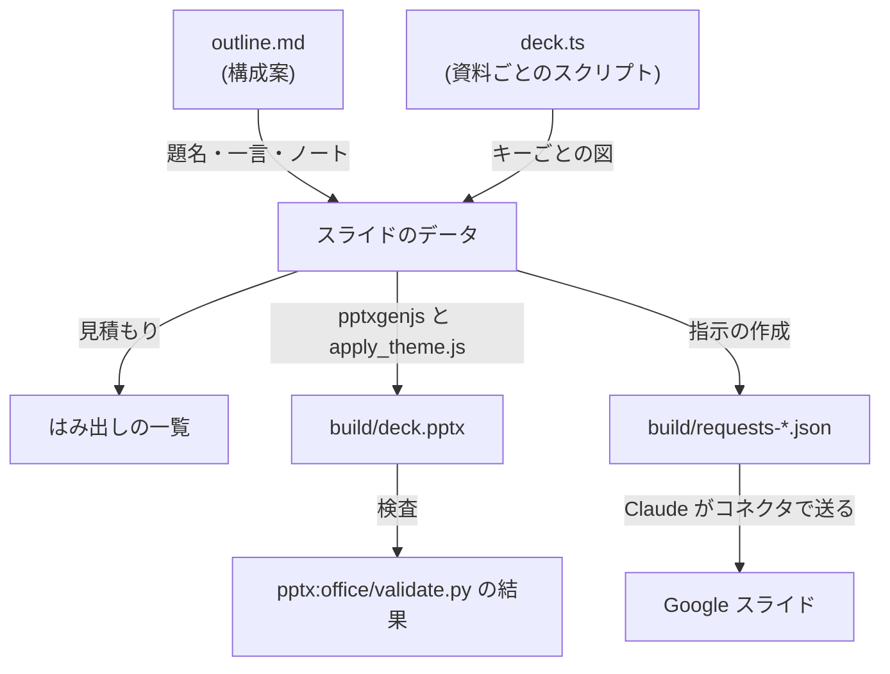
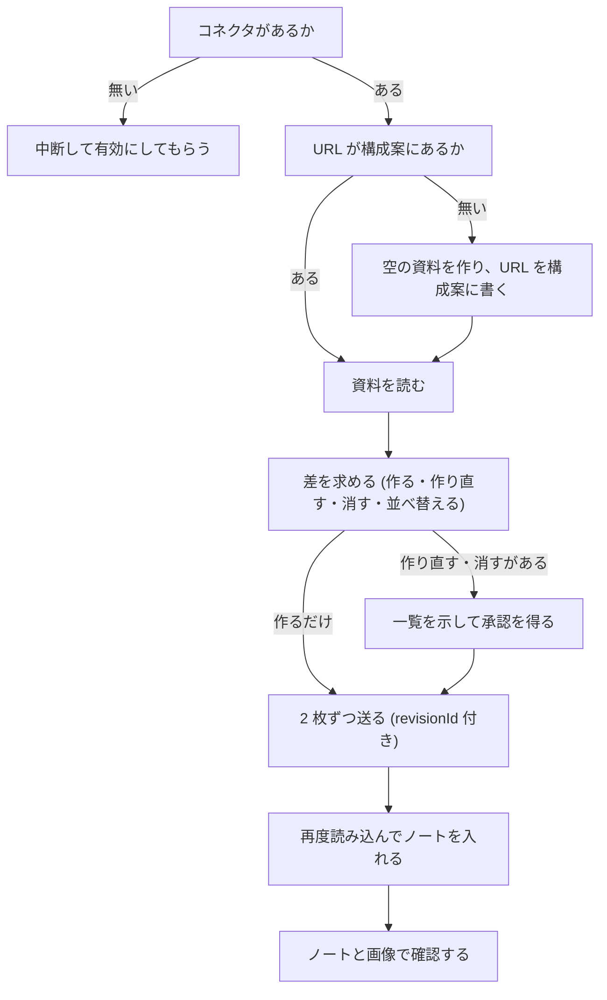
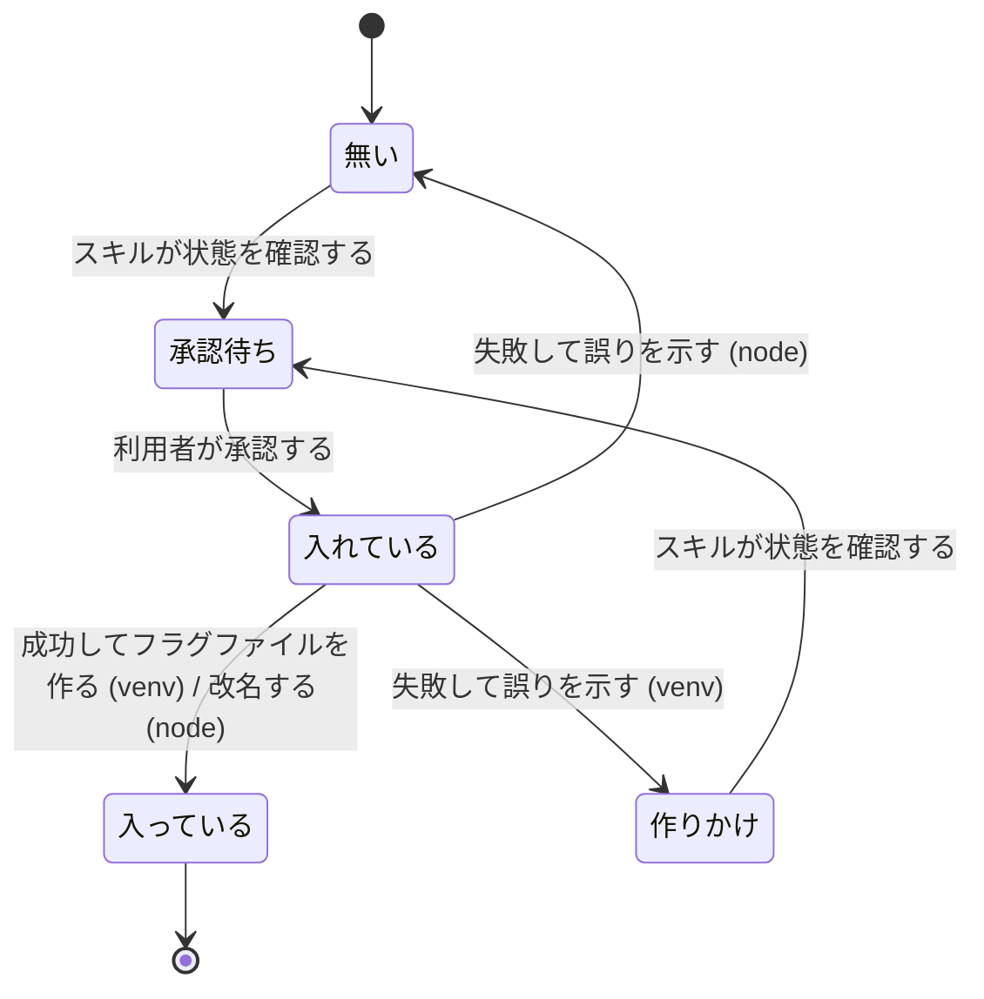

# 図を中心にした説明資料を作るプラグイン slide-deck - Plan

要件の出所は GitHub の Issue [akm/claude-plugins#242](https://github.com/akm/claude-plugins/issues/242) の本文と、論点の決定のコメント ([#242 のコメント](https://github.com/akm/claude-plugins/issues/242#issuecomment-6736780855))、2026-11-09 の会話で利用者が決めた事項 (Product Contract の Key Decisions と、Planning Contract の session-settled の KTD)。コメントを投稿した後の会話で、構造 (KTD1)・はみ出しの見積もり (KTD6)・venv の作り方 (KTD8)・スライドの ID (KTD9) を決め直したので、コメントのうちこれらに関わる部分は古い。

元にするのは、あるプロジェクトのセッションで資料を作ったときのスクリプトとツール (`build.js`・`gslides.js`・`fitcheck.py`・`grid2.py`・`outline.md`)。どのリポジトリでも管理していないので、この計画では中身を必要なだけ書く。

この計画で使う語:

- **資料のディレクトリ**: 利用者のプロジェクトの中で、1 つの資料の `outline.md` と `deck.ts` を作るディレクトリ。スキル `outline` が毎回利用者に質問する (R1)。
- **構成案**: 資料のディレクトリのファイル `outline.md`。資料の情報と、スライドごとのキー・題名・一言・図の説明・発表者ノートを持つ (R2)。
- **キー**: スライドを指す名前。構成案で決め、並べ替えても変わらない (例: `cutover`)。
- **資料ごとのスクリプト**: 資料のディレクトリのファイル `deck.ts`。キーごとの図を、部品の関数でスライドのデータとして作る (R7)。
- **スライドのデータ**: 資料ごとのスクリプトと構成案から作る、型で形を決めた値。図形・線・文字・発表者ノート・テーマの色の名前を持つ。2 つの書き出しの処理が読む (KTD1)。
- **2 つの書き出しの処理**: スライドのデータから PowerPoint のファイルを書く処理と、Google スライドの API のメソッド `presentations.batchUpdate` に渡す指示の配列を書く処理。
- **キャッシュのディレクトリ**: ライブラリを入れる、利用者のディレクトリ `~/.cache/akm-claude-plugins/slide-deck/` (KTD8)。
- **pptx のスキル**・**google-workspace のスキル**: Anthropic の公式のスキル。pptx はデスクトップアプリが配るもの (スキルの一覧での名前は `anthropic-skills:pptx`) を使う。マーケットプレイス `anthropic-agent-skills` のプラグイン `document-skills` が配る pptx には、`scripts/apply_theme.js` が無い。
- **表記 `pptx:<パス>`・`pptx[desktop]:<パス>`・`google-workspace:<パス>`**: スキルのディレクトリ `scripts/` からの相対パスで、スキルのファイルを指す。`[desktop]` は、デスクトップアプリが配る版にだけあるファイル (例: `pptx[desktop]:apply_theme.js` は pptx のスキルの `scripts/apply_theme.js`)。

---

## Goal Capsule

- **目的**: どのリポジトリの Claude Code のセッションでも、図を中心にした説明資料を、同じ手順で PowerPoint のファイルと Google スライドの両方に作れる。作った資料の一部のスライドを、ほかのスライドに影響させずに直せる。前回の試行錯誤 (ライブラリの入れ直し・API の挙動の調べ直し) を繰り返さない。
- **手段**: 新しいプラグイン `slide-deck` に、フェーズごとの 3 つのスキル (`outline`・`build`・`publish`) と、TypeScript と Python のツールを同梱する (KD2・KTD1)。
- **SSOT の優先順位**: 製品の振る舞いは Product Contract の R-ID が SSOT。実装の選び方は Planning Contract の KTD が SSOT。実装単位 (U-ID) はどちらも書き換えない。実装で R や KTD と合わないことが分かったときは、単位の記述ではなく R と KTD を直す。
- **利用者に判断を求める条件**: 次のどれかが分かったら、設計を変えずに実装を停止し、利用者に判断を求める。
  - Google スライドのコネクタで、マスターの配色の変更 (KTD14) や、`writeControl.requiredRevisionId` 付きの書き込みができない。
  - pptx のスキルの `scripts/apply_theme.js` か `scripts/office/validate.py` の呼び出し方が、この計画の前提 (U5) と違う。
  - ほかのプラグインのディレクトリを変えなければ実装できない。
- **進め方**: ドメインごとに、必要なものを用意し、テストを書き、実装する (利用者の CLAUDE.md の「実装計画を立てるとき」)。本物の Google スライドへの書き込みは、U6 の前の前提の確認 (U11) と、すべての単位の後の通し確認 (U10) の 2 回だけ、それぞれ利用者の許可を得てから行う。
- **後始末の担当**: コミットは動機ごとに分ける (規範は利用者のコミットルール)。PR の作成と、Issue #242 へのコメントは、利用者の指示を受けてから行う。Issue #242 の論点の決定のコメントは、この計画の決定に合わせて書き換える (利用者の許可を得てから)。
- **Product Contract の保全**: 要件の出所は Issue #242 と 2026-11-09 の会話。Issue の本文に無く会話で決めたものは KD1〜KD10 のすべて。

---

## Product Contract

### Summary

新しいプラグイン `slide-deck` を作る。スキル `outline` が構成案を作り、スキル `build` が資料ごとのスクリプトから PowerPoint のファイルを作って検査し、スキル `publish` が Google スライドに作って確認する。直すときも同じ 3 つのスキルを使い、内容が変わったスライドだけを作り直す。

### Problem Frame

利用者は、あるプロジェクトのセッションで、27 枚の技術説明の資料を Google スライドで作った (2026-10-28〜29)。作る途中で、資料を作るスクリプト・Google スライドの API の指示に変換するツール・文字のはみ出しを見積もるツール・スライドの画像をまとめるツールを作り、Google スライドの API の挙動への対処を見つけた。

これらは、そのプロジェクトの git で管理しないディレクトリと、セッションごとの一時ディレクトリと、そのプロジェクトの自動メモリにしか無い。ライブラリ (pptxgenjs・python-pptx など) は一時ディレクトリに入れたので、セッションが変わると消え、入れ直した。ほかのリポジトリで資料を作るときは、同じ試行錯誤を繰り返すことになる。

### Requirements

**構成案 (スキル `outline`)**

- R1. スキル `outline` は、資料のディレクトリを毎回利用者に質問する。案として `tmp/slides/<資料名>/` を添える。
- R2. 構成案は、資料の情報 (読者・ねらい・形・固有名を一般化するか・Google スライドの URL・最後に publish したプラグインの版) と、スライドごとのキー・題名・一言・図の説明・発表者ノートを持つ。書式は KTD13。
- R3. 依頼に無いスライドには【提案】を付け、まとめて利用者に採否を質問する。採用したものは【提案】を外し、採用しなかったものは構成案から消す。
- R4. 実測の値などの事例を、プロジェクトの名前と一緒に書くか、一般化して書くかを利用者に質問し、回答を構成案に記録する。記録があれば、次から質問しない。
- R5. 依頼で指定された語でウェブを検索し、参考にした資料を最後のスライドに載せる。載せる前に一覧を利用者に示す。
- R6. 修正の依頼は、まず構成案に反映してから、スライドを直す。
- R7. 利用者の文章の規約 (使わない表現・語彙の選び方) を、スライドの文と発表者ノートにも適用する。プロジェクトに wording-guard の設定があれば、構成案をその検査にかける。

**PowerPoint のファイル (スキル `build`)**

- R8. 資料ごとのスクリプトは、キーごとの図を、部品の関数でスライドのデータとして作るだけにする。題名・一言・発表者ノートは構成案から読み込む (KTD1・KTD2)。
- R9. 構成案と資料ごとのスクリプトのキーが一致しないとき (片方にしか無いキー・重複したキー) は、PowerPoint のファイルを作らずに、不一致を一覧にして中断する。
- R10. PowerPoint のファイルを作る前に、資料ごとのスクリプトを `tsc` と typescript-eslint で検査し、誤りがあれば作らない。
- R11. テーマの 6 つのアクセント色に、資料ごとに意味 (例: 新しいもの・古いもの・失敗・成功) を割り当て、図形の色はテーマの色で指定する。PowerPoint のファイルにも、テーマの色を書き込む。
- R12. 作った PowerPoint のファイルを、`pptx:office/validate.py` (pptx のスキルのファイル `scripts/office/validate.py`) で検査する。
- R13. 文字が箱からはみ出しそうな箇所を、スライドのデータから見積もって一覧にする (KTD6)。

**Google スライド (スキル `publish`)**

- R14. Google スライドのコネクタが無ければ中断し、有効にするよう利用者に求める。PowerPoint のファイルを渡すのは、利用者が選んだときだけ。
- R15. 新しく作るときは、Google ドライブのコネクタで空の資料を作り、URL を構成案の先頭に書き込む。空の資料に最初からあるタイトルのスライドは、最初の書き込みで消す。次からは、その URL の資料を使う。
- R16. Google スライドへの書き込みは、どれも直前に読み込んだ資料の版の ID (`revisionId`) を指定して送る (google-workspace のスキルの規則)。
- R17. 内容が変わったスライドだけを、同じ位置に作り直す。足したスライドは、構成案の順序の位置に挿入する。構成案から消したスライドは消す。構成案で順序を入れ替えたスライドは、資料でも並べ替える。キーの無いスライド (利用者が足したもの) は、内容を変えず、直前にあるキーのあるスライドに続けて置く (そのスライドと一緒に動く)。
- R18. スライドを作り直す・消す・並べ替える前に、対象のキーの一覧と、手で直した内容は失われることを示して、利用者の承認を得る。
- R19. 途中で失敗したときは、もう一度実行すれば、残りの作業だけを行う。
- R20. 発表者ノートを入れ、Google スライドから読み込んだ文が構成案の文と一致することを、キーごとに確認する。
- R21. スライドの画像を取得し、複数枚を 1 枚にまとめて見る。見つけた問題 (最後の 1 文字だけの行・はみ出し・位置のずれ) は、資料ごとのスクリプトか構成案を直して、`build` からやり直す。
- R22. スライド番号は、利用者にメニューの「挿入 > スライド番号」で付けてもらう。`publish` の最後に、そのことを伝える。

**ライブラリと実行環境**

- R23. ライブラリは、同梱したロックファイルのバージョンで、キャッシュのディレクトリに入れる。ロックファイルを変えないバージョンのプラグインどうしは、同じものを使う。
- R24. ライブラリが入っていないときは、取得するものと入れる場所を示して、利用者の承認を得てから入れる。入っているときは質問しない。
- R25. uv か Node.js が無いとき、pptx のスキルか google-workspace のスキルが無いときは、別の方法を試さずに、何が無いかと入れ方を示して中断する。

**品質**

- R26. TypeScript のコードは strict で書き、`tsc` と typescript-eslint で検査する。明示の `any` を使わない。Python のコードは `mypy --strict` で検査し、`Any` を使わない。
- R27. テストは、TypeScript が node:test、Python が unittest で書き、CI で実行する。
- R28. どのプロジェクトの話でもない、3〜5 枚の見本の資料を同梱し、スキルの手順の例とテストの入力に使う。

### Key Decisions

- KD1. **pptx と google-workspace のスキルに依存する** (session-settled: user-directed; chosen over 必要な部分をこのプラグインに同梱すること: Claude で使う想定で、Anthropic の公式のスキルなので保守が続くと見込めるため)。Governs R12, R16, R25。
- KD2. **スキルはフェーズごとの `outline`・`build`・`publish` の 3 つ** (session-settled: user-directed; chosen over 1 つのスキル・作ると直すの 2 つ: コネクタが無ければ `build` まで、など場面に合わせて組み合わせられ、各スキルの入力と出力がはっきりするため)。Governs R1〜R22。
- KD3. **資料のディレクトリは毎回質問する** (session-settled: user-approved; chosen over `tmp/slides/` か `docs/slides/` に決めること: git で管理するかはプロジェクトごとに違うため)。Governs R1。
- KD4. **発表者ノートも構成案に書く** (session-settled: user-approved; chosen over 資料ごとのスクリプトや別の Markdown に書くこと: 文がすべて Markdown にあり、文章の規約の検査をそのままかけられるため)。Governs R2, R7, R20。
- KD5. **見本の資料を新しく作って同梱する** (session-settled: user-approved; chosen over 元の 27 枚の資料を一般化して同梱すること・同梱しないこと)。Governs R28。
- KD6. **コネクタが無ければ中断し、有効にしてもらう** (session-settled: user-approved; chosen over PowerPoint のファイルを渡して終えること・Google ドライブでアップロードして変換すること: google-workspace の規則と同じで、その後の修正も同じファイルに反映できるため)。Governs R14。
- KD7. **新しいプラグイン `slide-deck` にする** (session-settled: user-approved; chosen over 既存のプラグインに含めること: 目的の近いものが無く、Node.js・uv・コネクタへの依存がほかのプラグインの利用者に及ばないため)。
- KD8. **Google スライドの URL は構成案の先頭に書く** (session-settled: user-approved; chosen over 別のファイルに書くこと・毎回質問すること)。Governs R2, R15。
- KD9. **作り直す前に一覧を示して承認を得る** (session-settled: user-approved; chosen over 毎回上書きすること)。Governs R18。
- KD10. **ライブラリの取得の前に承認を得る** (session-settled: user-approved; chosen over 質問せずに取得すること: wording-guard のセットアップと同じ扱い)。Governs R24。

### Scope Boundaries

- Keynote で PDF に書き出す確認はしない (元のセッションで 2 回とも失敗した)。
- スライド番号を API で付けない (R22)。レイアウト `BLANK` のスライドに、スライド番号のプレースホルダーを作れないため。
- スライドのデータは、表・画像・グラフを持たない。2 つの書き出しの処理の両方が扱える要素 (KTD1) だけにする。
- マーケットプレイスの版の pptx のスキル (`apply_theme.js` が無い) では、`build` は動かない (R25 で中断する)。

#### Deferred to Follow-Up Work

- キャッシュのディレクトリに残る、古いハッシュ値のディレクトリを消す手段。
- 表・画像・グラフを、スライドのデータに足すこと。
- 元の 27 枚の資料を、新しい形に移すこと (そのプロジェクトで行う)。

---

## Planning Contract

### Key Technical Decisions

- KTD1. **資料ごとのスクリプトと 2 つの書き出しの処理の間に、スライドのデータを挟む** (session-settled: user-directed; chosen over 資料ごとのスクリプトが pptxgenjs で描き、Google スライド用には記録用の偽物を渡すこと: 利用者は「できるだけ素直な構造に」と求め、差し替えの仕掛けが要らず、両方が対応しない機能は型で書けなくなるため)。元の `gslides.js` は、`Module._load` を書き換えて pptxgenjs の呼び出しを記録していた。この方法は ESM (JavaScript の標準のモジュールの形式) の `.ts` では機能しないことを、実験で確認した。スライドのデータが持つ要素は、角の丸い四角・四角・円・円柱・山形・五角形の矢印・文字の箱・線 (矢印の有無・破線) と、文字の一部ずつの書式 (太字・大きさ・色・リンク)・箇条書き・発表者ノート。Governs R8, R11。
- KTD2. **資料ごとのスクリプトは、部品の関数の集まりを引数で受け取る関数を、default export で書き出す**。関数は、資料のテーマ (型 `Theme`) と、キーごとの図の配列を返す。図は、部品の関数の集まりの `slide("<キー>")` で作り、ほかの部品の関数で要素を足す (session-settled: user-approved; chosen over テーマを名前付きの export にすること: 書き出しの処理が関数の戻り値だけを読めばよいため)。一言の部品 (元の関数 `takeaway`) は、部品の関数の集まりに入れない (session-settled: user-approved; chosen over 資料ごとのスクリプトにも渡すこと: 一言は構成案から読む (R8) ので、資料ごとのスクリプトに同じ一言を書けないようにするため)。文字を受け取る部品の関数 (`box`・`text`) は、文字列を受け取る形と、書式の違う部分の配列を受け取る形の、2 つのオーバーロードにする (session-settled: user-approved; chosen over 配列をオブジェクト `{ runs: [...] }` で包むこと: 元の `build.js` と同じ書き方で書けるため)。引数の型を 1 つの和の型 (`string | RunInput[]`) にすると、配列に書いた `bold` や `link` を、typescript-eslint の規則 `no-deprecated` が `String.prototype` の非推奨のメソッドとして誤って指摘するためである。この規則は資料ごとのスクリプトにも適用する (KTD4) ので、和の型にすると、資料ごとのスクリプトの作者がその指摘を受けることになる。スクリプトは、プラグインのモジュールを実行時に import しない。型は `import type` で名前 `slide-deck` から読み込み、`build` が資料のディレクトリの `build/tsconfig.json` に、その名前をプラグインのディレクトリ (展開先) に対応させる `paths` を書く。プラグインの展開先はバージョンごとに変わり、資料ごとのスクリプトに書けないため ([docs/solutions/conventions/plugin-cannot-resolve-its-own-source.md](../solutions/conventions/plugin-cannot-resolve-its-own-source.md))。
- KTD3. **TypeScript は Node.js 24 で変換せずに実行し、`tsc --noEmit` で検査する** (session-settled: user-directed; chosen over JavaScript のまま書くこと: 型の検査で誤りを実行の前に見つけるため)。`tsconfig.json` は、`module: preserve`・`moduleResolution: bundler`・`strict`・`noEmit`・`allowImportingTsExtensions`・`erasableSyntaxOnly`・`verbatimModuleSyntax`・`noUncheckedIndexedAccess`・`exactOptionalPropertyTypes`・`noImplicitOverride`・`noPropertyAccessFromIndexSignature` にする。`module: nodenext` では、`import pptxgen from "pptxgenjs"` が型エラーになる (実験で確認した)。`package.json` に `"type": "module"` を書き、相対 import には拡張子 `.ts` を付け、型だけの import は `import type` にする。
- KTD4. **TypeScript の明示の `any` を typescript-eslint で禁止する** (session-settled: user-approved; chosen over `tsc` の strict だけにすること)。設定は flat config で `tseslint.configs.strictTypeChecked` と `projectService`。プラグインのコードは CI で、資料ごとのスクリプトは `build` で、同じ規則で検査する。資料ごとのスクリプトを検査するときだけ、`projectService` の代わりに `parserOptions.project` で資料のディレクトリの `build/tsconfig.json` を指定する (`projectService` は検査するファイルから上のディレクトリの `tsconfig.json` を使うので、下にある `build/tsconfig.json` を使わない) (session-settled: user-approved; chosen over 資料ごとのスクリプトは `tsc` だけにすること)。
- KTD5. **Python は、画像をまとめるツールと、`pptx:office/validate.py` の実行環境だけに使う**。Python のコードは mypy strict で検査し、`Any` を使わない (session-settled: user-directed; chosen over 型を検査しない Python: 利用者の要望)。mypy の設定は `strict` に加えて `disallow_any_explicit`・`disallow_any_expr`・`disallow_any_decorated`・`disallow_any_unimported`。Pillow は、この設定を通ることを実験で確認した。
- KTD6. **はみ出しの見積もりは、TypeScript でスライドのデータに対して行う** (session-settled: user-approved; chosen over Python で PowerPoint のファイルを読むこと: python-pptx 1.0.2 の `prs.slides` などが `Any` になり、KTD5 の設定を通らないため)。見積もりの式は元の `fitcheck.py` のもの (全角の文字を 1、半角の文字を 0.58、空白を 0.3 文字分の幅とし、行の高さを文字の大きさの 1.25 倍とする)。
- KTD7. **ライブラリのバージョンは `uv.lock` と `package-lock.json` で決め、`uv sync --frozen --no-dev` と `npm ci --omit=dev` で入れる** (session-settled: user-directed; chosen over pip と `requirements.txt`・利用者が手で入れること: `uv.lock` を配布する案は利用者の提案で、間接的に使うライブラリまでバージョンが決まるため)。npm の実行時の依存は pptxgenjs・typescript・eslint・`@eslint/js`・typescript-eslint (`build` が資料ごとのスクリプトを検査するので、typescript と eslint も実行時に要る)。Python の実行時の依存は Pillow・lxml・defusedxml (lxml と defusedxml は `pptx:office/validate.py` が使う)。開発のときだけ使う依存は `@types/node` と mypy。Python のバージョンはファイル `.python-version` で決め、uv が用意する (指定しないと uv は最新の 3.14 を選ぶ)。
- KTD8. **キャッシュのディレクトリを、ロックファイルのハッシュ値ごとに分ける** (session-settled: user-approved; chosen over プラグインのバージョンごとに分けること・1 つだけにすること: ライブラリを変えない細かな修正でも入れ直さないため)。venv は `venv-<uv.lock と .python-version のハッシュ値>/` にその場で作り、作り終えたらフラグファイルを作る (uv の venv は、中のスクリプトが作ったときの絶対パスを持つので改名しない。同時の実行は uv が環境の中の `.lock` で排他する)。ファイル `.python-version` もハッシュ値に含めるのは、`uv.lock` に含まれず、Python のバージョンだけを変えたときにも別の venv にするため (session-settled: user-approved; chosen over `uv.lock` だけにすること)。`uv sync` が失敗したら、venv をフラグファイルを作らずに残し、次の実行が `uv sync` をやり直す (session-settled: user-approved; chosen over 失敗したら消すこと: 消すと、同じ venv を同時に入れている別の実行の venv も消えるため)。`node_modules` は wording-guard と同じく、一時的な名前のディレクトリで `npm ci` してから `node-<package-lock.json のハッシュ値>/` に改名する (`.bin` のリンクは相対パスで、改名しても動く)。ハッシュ値は、wording-guard と同じく SHA-256 の先頭 16 文字 (venv は、2 つのファイルの内容を続けたものから求める)。キャッシュのディレクトリは、wording-guard と doc-structured と同じく、環境変数 `XDG_CACHE_HOME` があれば `~/.cache` の代わりにその下を使う (session-settled: user-approved; chosen over 常に `~/.cache` の下にすること)。プラグインのコードは展開先にあり、Node.js は読み込むファイルの位置から `node_modules` を探すので、キャッシュのライブラリは場所を明示して読み込む: pptxgenjs はキャッシュの `node_modules` を起点にした `createRequire` で読み込み、`tsc` と eslint はキャッシュの `node_modules/.bin` のものを、プラグインの設定ファイルを指定して実行し、`pptx[desktop]:apply_theme.js` は環境変数 `NODE_PATH` にキャッシュの `node_modules` を指定した子プロセスで実行する (session-settled: user-approved; chosen over 実行のたびにプラグインのコードをキャッシュにコピーすること: 版の違うセッションが同時に動くと、コピーしたコードを上書きし合うため)。この作り方も利用者が選んだ (session-settled: user-approved; chosen over 両方をその場に作ること)。
- KTD9. **Google スライドのスライドの ID は `sd_<キー>_<内容のハッシュ値>`** (session-settled: user-approved; chosen over `<キー>_<作り直した回数>`: 作り直すスライドと、途中で失敗した後に残る作業が、資料を読むだけで機械的に決まるため)。内容のハッシュ値は、そのスライドのデータ (図形・線・文字・題名・一言) から計算し、ID・位置・発表者ノートを含めない (session-settled: user-approved; chosen over 指示の配列から計算すること: ノートだけの修正・前へのスライドの挿入・指示の作り方の修正で、変えていないスライドまで作り直しにならないため)。発表者ノートは ID に含めず、KTD10 のとおり文を比べて入れ直す。接頭辞 `sd_` は、キーの無いスライドと判別するためと、ID の長さの下限 (5 文字) を満たすため。図形の ID は `<スライドの ID>_<番号>`。キーは `[a-z0-9-]` の 1〜32 文字、ハッシュ値は 16 進数の 10 文字、図形の番号は 3 桁まで (Google スライドの objectId の上限 50 文字に収まる: 3+32+1+10+1+3=50)。
- KTD10. **`publish` は、読む → 差を求める → 承認を得る → 送る → 確認する、の順にする**。差は、構成案のキーと順序・新しいハッシュ値と、資料から読んだ ID を比べて求め、作る・作り直す・消す・並べ替えるキーに分ける。発表者ノートは、資料から読んだ文と構成案の文をキーごとに比べ、違うキーだけ入れ直す (欄が空でなければ、文を消してから入れる。空の欄の文を消す指示は失敗するため)。構成案の先頭に、最後に `publish` したプラグインの版を記録し、今の版と違うときは、すべてのスライドを作り直すかを利用者に質問する (指示の作り方の修正は、ハッシュ値を変えないため)。指示のファイルは 2 枚ずつに分ける (1 枚分の指示は約 1 万字で、Bash の出力の上限の約 3 万字を超えないため)。資料を読むときは、google-workspace のスキルが勧める項目の指定 (field mask) で、スライドの ID の順序・ノートの欄の ID と文・マスターの ID・`revisionId` だけを読み、Claude がその結果を資料のディレクトリの `build/presentation.json` に書いてツールに渡す (session-settled: user-approved; chosen over ツールを使わず Claude が比べること: ID の取り違えをテストで防ぐため。[docs/solutions/design-patterns/extract-identifiers-in-code-not-llm.md](../solutions/design-patterns/extract-identifiers-in-code-not-llm.md))。発表者ノートの欄の ID はスライドを作った後でないと分からないので、作った後に再度読み込んでから入れる。
- KTD11. **pptx のスキルのディレクトリは、スキル `build` が明示して渡す**。`build` は Claude にスキル `anthropic-skills:pptx` を読み込ませ、示されるスキルのディレクトリ (Base directory) を、ツールの引数で渡す。ツールは `scripts/apply_theme.js` と `scripts/office/validate.py` があることを確認し、無ければ中断する。`~/.claude` の下を探さない (配置は公式に決まっていないため)。
- KTD12. **テストは node:test と unittest で書き、CI に種類 `node` と `uv` を足す** (session-settled: user-approved; chosen over すべて Python の unittest で書くこと)。ワークフロー `.github/workflows/test.yml` の discover ジョブが、追跡ファイルから対象を見つけ (種類 `node` は `tests/*.test.ts` と `package-lock.json` を持つディレクトリ、種類 `uv` は `uv.lock` を持つディレクトリ。`package-lock.json` だけを持つ `wording-guard/textlint/` は対象にしない)、`.github/test-targets.txt` の一覧と比べる。`uv.lock` のあるディレクトリでは、Python のテストを `python/tests` の直下に置き (下のディレクトリに置くと discover が失敗する)、`python/tests` (種類 `uv` が実行するディレクトリ) を既存の種類 `python` の対象から除く。
- KTD13. **構成案の書式**。先頭の `# <資料の題名>` の後に、資料の情報を `- <項目>: <値>` の行で書く (読者・ねらい・形・固有名・Google スライド・slide-deck の版)。章は `## <章の名前>`、スライドは `### <キー>: <題名>`、採否を質問するスライドは `### 【提案】<キー>: <題名>`。スライドの見出しの下に `- 図: …` と `- 一言: …` の行を書き、その後の段落を発表者ノートにする。スライドの順序は、構成案の見出しの順序で決める。書式に合わない行は、行番号を付けた誤りにする ([docs/solutions/design-patterns/typed-contract-for-agent-input.md](../solutions/design-patterns/typed-contract-for-agent-input.md))。
- KTD14. **Issue の表にある Google スライドの API の挙動への対処は、Google スライドの指示を作る処理で行う**。対処ごとに、理由をコードのコメントに書き、テストで期待の指示を確認する。対象は、基準の大きさと拡大率・円などの中の文字を重ねた文字の箱に分けること・内側の余白の分だけ箱を広げること・大きな箱を四角で描くこと・箇条書きの字下げ 16 ポイント・書式の範囲に改行の文字を含めること・逆向きの線を負の拡大率で描くこと・マスターの配色を `updatePageProperties` の `colorScheme` で変えること。`createLine` には、非推奨の `lineCategory` ではなく `category` を使う。
- KTD15. **資料のディレクトリの `build/` に、内容が `*` のファイル `.gitignore` を書く**。生成したファイルが、プロジェクトのコミットに入らないようにする。プロジェクトの `.gitignore` は変えない。
- KTD16. **セットアップのツールは、Node.js の標準の機能だけで書いた TypeScript にする**。ライブラリを入れる前に動く必要があり、Node.js は前提にしているため。
- KTD17. **入口のサブコマンドごとの `--help` を、引数・出力・終了コードの SSOT にする**。入口は、ファイル `slide-deck/src/cli.ts` のサブコマンド (`setup status`・`setup install`・`check`・`pptx`・`requests`) と、画像をまとめるファイル `slide-deck/python/slide_deck_tools/thumbs_grid.py`。終了コードは、どの入口も、成功 0・検査の指摘あり 1・実行の誤り (ライブラリが無い・入力の形が違うなど) 2 に分ける。3 つのスキルの SKILL.md と `references/` は、引数や終了コードを書かずに `--help` を参照する。サブコマンドを作る単位で `--help` も書き、テストで、`--help` が引数・出力・終了コードの 3 つを示すことを確認する。スキルは U9 で書くので、それまでの単位の間に、スキルに書く引数と入口の引数が合わなくなることを防ぐため。

### High-Level Technical Design

ファイルとデータの流れ:



スキル `publish` の手順:



キャッシュのディレクトリの状態 (venv と `node_modules` のそれぞれ):



### System-Wide Impact

- **CI**: ワークフロー `.github/workflows/test.yml` の discover ジョブと `.github/test-targets.txt` に、種類 `node` と `uv` を足す (KTD12)。ほかのプラグインのテストの見つけ方は変えない。種類 `python` の探し方から `uv.lock` のあるディレクトリの `python/tests` を除く変更は、既存の対象が 1 つも減らないことを、一覧との比較で確認する。
- **マーケットプレイス**: U9 で `.claude-plugin/marketplace.json` に項目が増える。それまでは載せない。ルートの `Makefile` のターゲット `plugins-status`・`plugins-install` (ファイル `scripts/plugins.py`) は marketplace.json から対象を作るので、変更は要らない。
- **利用者の環境**: キャッシュのディレクトリに、typescript (約 24MB)・pptxgenjs (約 5MB) などと Python の venv が入る。取得の前に承認を得る (R24)。

### Risks & Dependencies

| リスク | 対処 |
| --- | --- |
| Anthropic が pptx のスキルの `scripts/apply_theme.js` や `scripts/office/validate.py` の場所・引数を変える | ツールが実行の前にファイルの有無を確認し、無ければパスを示して中断する (KTD11)。引数が変わったときは、ツールの誤りの出力を利用者に示して中断する。利用者に判断を求める条件 (Goal Capsule) にも当たる |
| Google スライドの API やコネクタの挙動が変わり、KTD14 の対処が合わなくなる | 対処ごとに理由のコメントとテストを書く (KTD14)。U10 で本物の資料で確認する。変わったことは、`publish` の画像の確認 (R21) で見つかる |
| Google スライドのコネクタが、デスクトップアプリ以外 (CLI) で使えない | `publish` は中断する (R14)。`outline` と `build` は使える |
| 文字のはみ出しの見積もり (KTD6) が実際の描画と合わない | 見積もりは一覧を示すだけで、最終の判断は `publish` の画像の確認 (R21) で行う |
| pptxgenjs・typescript-eslint などの新しいバージョンで、型や設定が変わる | ロックファイルでバージョンを決める (KTD7)。上げるときは、ロックファイルを更新してテストを通してから、プラグインのバージョンを上げる |

### Assumptions

- 元の資料を作ったセッションで、マスターの配色の変更 (`updatePageProperties` の `colorScheme`) は Google スライドのコネクタで動いた (Issue #242 の要望 2)。公式の文書では確認していない。

---

## Output Structure

```text
slide-deck/
├── .claude-plugin/plugin.json
├── README.md
├── package.json / package-lock.json / tsconfig.json / eslint.config.mjs
├── pyproject.toml / uv.lock / .python-version
├── src/
│   ├── index.ts       # 名前 slide-deck で読み込む型
│   ├── data/          # スライドのデータの型・テーマ・部品の関数
│   ├── outline/       # 構成案の読み込みと、キーの突き合わせ
│   ├── fit/           # はみ出しの見積もり
│   ├── check/         # tsc と eslint の実行 (資料ごとのスクリプトの検査)
│   ├── pptx/          # PowerPoint の書き出し
│   ├── gslides/       # Google スライドの指示の作成
│   ├── setup/         # キャッシュのディレクトリへのインストール
│   └── cli.ts         # スキルが実行する入口
├── python/
│   ├── slide_deck_tools/thumbs_grid.py
│   └── tests/
├── tests/             # node:test のテスト
├── examples/sample/   # 見本の資料 (outline.md と deck.ts)
├── references/        # 3 つのスキルが参照する説明 (構成案の書式・deck.ts の書き方・API の挙動)
└── skills/
    ├── outline/SKILL.md
    ├── build/SKILL.md
    └── publish/SKILL.md
```

---

## Implementation Units

表と節は、進める順に並べる。

| U-ID | 内容 | 主なファイル | 依存 |
| --- | --- | --- | --- |
| U1 | プラグインのディレクトリと検査の設定・CI | `slide-deck/package.json`・`.github/workflows/test.yml` | - |
| U2 | スライドのデータ・テーマ・部品の関数 | `slide-deck/src/data/` | U1 |
| U3 | 構成案の読み込みとキーの突き合わせ・見本の資料 | `slide-deck/src/outline/`・`slide-deck/examples/sample/` | U2 |
| U4 | はみ出しの見積もり | `slide-deck/src/fit/` | U2 |
| U8 | キャッシュのディレクトリへのインストール | `slide-deck/src/setup/`・`slide-deck/src/cli.ts` | U1 |
| U5 | PowerPoint の書き出しと検査の入口 | `slide-deck/src/pptx/`・`slide-deck/src/cli.ts` | U2, U3, U4, U8 |
| U11 | Google スライドの API の前提の確認 | - | U1 |
| U6 | Google スライドの指示の作成 | `slide-deck/src/gslides/` | U2, U3, U11 |
| U7 | 画像をまとめるツール | `slide-deck/python/` | U1 |
| U9 | 3 つのスキル・説明・README・公開 | `slide-deck/skills/`・`slide-deck/references/`・`.claude-plugin/marketplace.json` | U5, U6, U7, U8 |
| U10 | 本物の Google スライドでの通し確認 | - | U9 |

### 単位の進め方とクローズ条件

- 単位ごとに、Issue #242 の sub-issue を 1 つ作る。U10 と U11 を除く単位は、1 つの単位を 1 つの PR にし、PR の本文に `Closes #<sub-issue の番号>` を書く。
- どの単位も、次のすべてを満たしたら閉じる。単位の節の Verification は、これに加えて満たす条件。
  - CI のすべてのジョブが成功している。取り消されたジョブは、成功として扱わない。
  - 変えた Markdown・コードの日本語のコメントと docstring・コミットメッセージを wording-guard で検査し、指摘が無い。
  - サブコマンドを作った単位では、`--help` が KTD17 のとおり引数・出力・終了コードを示す。
  - 実装で R や KTD と合わないことが分かったときは、同じ PR で計画の R と KTD を直してある (Goal Capsule の「SSOT の優先順位」)。
- PR をマージした後も sub-issue が開いたままなら、PR への参照を付けたコメントを書いて、手で閉じる。
- U10 と U11 は、変えるファイルが無いので PR を作らない。結果を sub-issue のコメントに書いて閉じる。確認で見つかった問題は、新しい Issue に記録し、Issue #242 の sub-issue に足す。
- プラグインは、3 つのスキルがそろう U9 で公開する。U1〜U8 の間は、`.claude-plugin/marketplace.json` に載せず、プラグインのバージョンを 0.0.1 のまま上げない。公開していないので、利用者がインストールすることはない。U9 で、バージョンを 0.1.0 にし、marketplace.json とルートの `README.md` に載せる。

### U1. プラグインのディレクトリと検査の設定・CI

- **Goal**: 中身の無いプラグインで、`tsc`・eslint・node:test・mypy・unittest が CI で実行される状態にする。
- **Requirements**: R26, R27, KD7, KTD3, KTD4, KTD5, KTD7, KTD12
- **Dependencies**: なし
- **Files**:
  - `slide-deck/.claude-plugin/plugin.json` (バージョン 0.0.1。U9 まで上げない)
  - `slide-deck/package.json`・`slide-deck/package-lock.json`・`slide-deck/tsconfig.json`・`slide-deck/eslint.config.mjs`
  - `slide-deck/pyproject.toml`・`slide-deck/uv.lock`・`slide-deck/.python-version`
  - `.github/workflows/test.yml`・`.github/test-targets.txt`
  - `slide-deck/tests/smoke.test.ts`・`slide-deck/python/tests/test_smoke.py`
- **Approach**:
  1. npm と uv のロックファイルを、KTD7 の依存で作る。
  2. CI の discover ジョブに、種類 `node` と `uv` を、KTD12 の探し方で足す。`node` は `npm ci` の後に `npm test` (tsc・eslint・node --test を続けて実行する npm のスクリプト) を、`uv` は `uv sync --frozen` の後に mypy と unittest を実行する。
  3. 既存の種類 `python` の探し方から、`uv.lock` のあるディレクトリの `python/tests` を除く (KTD12)。
  4. 2 つの新しいジョブは、Node.js 24 (`.ts` をそのまま実行できる版) と uv を、GitHub Actions のセットアップの action で用意する。
- **Patterns to follow**: `.github/workflows/test.yml` の、対象を見つけて期待の一覧と比べる形と、テストが 0 件なら失敗にする確認。
- **Test scenarios**:
  - Test expectation: ディレクトリと設定だけなので、振る舞いのテストは無い。`smoke.test.ts` と `test_smoke.py` が 1 件ずつ成功し、CI の 2 つの新しいジョブがそれを実行することで確認する。
- **Verification**: CI の discover が `node slide-deck` と `uv slide-deck` を見つけ、一覧と一致する。既存の種類 `python` の対象は変わらない。

### U2. スライドのデータ・テーマ・部品の関数

- **Goal**: 資料ごとのスクリプトが使う、型で形を決めたスライドのデータと、部品の関数を作る。
- **Requirements**: R8, R11, KTD1, KTD2
- **Dependencies**: U1
- **Files**: `slide-deck/src/data/types.ts`・`slide-deck/src/data/theme.ts`・`slide-deck/src/data/parts.ts`・`slide-deck/src/index.ts` (名前 `slide-deck` で読み込む型)・`slide-deck/tests/data.test.ts`
- **Approach**:
  1. 要素の型 (KTD1 の要素) と、テーマの色の名前 (`dk1`・`lt1`・`dk2`・`lt2`・`accent1`〜`accent6`) を決める。位置と大きさはインチで持つ。
  2. テーマは、資料ごとに 6 つのアクセント色の値と意味の名前・フォントを持つ。図形の色は、色の値ではなくテーマの色の名前で指定する。
  3. 部品の関数 (文字の入った箱・文字・矢印・番号の入った円・一言・背景のカード・箇条書き) は、元の `build.js` の関数 `box`・`text`・`arrow`・`badge`・`takeaway`・`card`・`bullets` の引数と既定値を引き継ぐ。矢印は、始点と終点から向きを決める。
  4. 資料ごとのスクリプトに渡す、部品の関数の集まりの型を書き出す (KTD2)。
- **Patterns to follow**: 元の `build.js` の部品の関数。
- **Test scenarios**:
  - 箱の部品に位置・大きさ・文字・テーマの色を渡すと、同じ値を持つ要素が 1 つ作られる。
  - 右から左へ向かう矢印は、左右を反転するフラグを持つ線になる。下から上も同じ。
  - 番号の入った円は、文字の大きさ・太字・中央揃えの既定値を持つ。
  - 一言の部品は、スライドの下の決まった位置の文字の箱になる。
  - 1 枚のスライドに要素を足した順序が、データの順序 (重なりの順序) になる。
  - テーマに、アクセント色の値が 6 つ揃っていないと、型エラーになる (型の検査で確認するテスト)。
- **Verification**: 部品の関数のテストが成功する。見本の資料の図が部品の関数だけで書けることは、見本の資料を作る U3 で確認する。

### U3. 構成案の読み込みとキーの突き合わせ・見本の資料

- **Goal**: 構成案を読み、資料の情報とスライドごとの題名・一言・ノートを取り出し、資料ごとのスクリプトのキーと突き合わせる。後の単位のテストの入力にする見本の資料を作る。
- **Requirements**: R2, R3, R4, R9, R15, R28, KD4, KD5, KD8, KTD13
- **Dependencies**: U2
- **Files**: `slide-deck/src/outline/parse.ts`・`slide-deck/src/outline/match.ts`・`slide-deck/src/outline/url.ts` (Google スライドの URL の行を書き込む)・`slide-deck/tests/outline.test.ts`・`slide-deck/tests/fixtures/outline/`・`slide-deck/examples/sample/outline.md`・`slide-deck/examples/sample/deck.ts`
- **Approach**:
  1. 見本の資料 (3〜5 枚) を作る。どのプロジェクトの話でもない題材にし、部品の関数を一通り使う (KD5)。U4・U5・U6 のテストと U9 のスキルの手順の例は、この見本の資料を使う。`slide-deck/tsconfig.json` の `paths` に、名前 `slide-deck` を `src/index.ts` に対応させる設定を足し、`examples/` も `tsc` と eslint の検査の対象に入れる。
  2. KTD13 の書式を読み、誤りは行番号を付けてすべて集めてから返す (最初の 1 件で中断しない)。
  3. 【提案】が付いたスライドが残っているときは、`build` が中断できるよう、その一覧を返す。
  4. 資料ごとのスクリプトのキーと突き合わせ、片方にしか無いキーを一覧にする (R9)。
  5. Google スライドの URL の行と slide-deck の版の行を書き込むときは、ほかの行を 1 文字も変えない。
- **Patterns to follow**: [docs/solutions/design-patterns/typed-contract-for-agent-input.md](../solutions/design-patterns/typed-contract-for-agent-input.md) (形が違えば期待する形を示して誤りにする)。
- **Test scenarios**:
  - 見本の構成案から、資料の情報・キーの順序・題名・一言・ノートが取り出せる。
  - ノートが複数の段落のとき、段落の区切りを保って取り出す。
  - 同じキーが 2 回あると、2 つの行番号を示す誤りになる。
  - キーに使えない文字 (大文字・空白) や、33 文字以上のキーは誤りになる。
  - `- 一言:` の行が無いスライドは誤りになる。
  - 【提案】が付いたスライドは、一覧として返る。
  - 構成案にだけあるキーと、資料ごとのスクリプトにだけあるキーが、別々の一覧になる。
  - Google スライドの URL の行が無い構成案に URL を書き込むと、資料の情報の最後に 1 行が足され、ほかの行は変わらない。既にあれば、その行だけが置き換わる。
  - 固有名の項目が「一般化する」「そのまま書く」以外の値なら誤りになる。
  - 見本の資料の構成案と資料ごとのスクリプトのキーが一致する。
- **Verification**: 誤りのある構成案で、すべての誤りが行番号付きで 1 回で報告される。見本の資料の `deck.ts` が、部品の関数だけで書かれ、`tsc` と eslint の検査を通る。

### U4. はみ出しの見積もり

- **Goal**: スライドのデータから、文字が箱からはみ出しそうな箇所を一覧にする。
- **Requirements**: R13, KTD6
- **Dependencies**: U2
- **Files**: `slide-deck/src/fit/estimate.ts`・`slide-deck/tests/fit.test.ts`
- **Approach**:
  1. 元の `fitcheck.py` の式 (KTD6) を、文字の箱・図形の中の文字・重ねた文字の箱に当てる。
  2. 内側の余白は、PowerPoint と Google スライドの大きい方 (左右 0.1 インチ・上下 0.05 インチ) で見積もる。
  3. 結果は、スライドのキー・要素の番号・要る高さ・箱の高さ・文字の先頭を持つ一覧にする。
- **Patterns to follow**: 元の `fitcheck.py`。
- **Test scenarios**:
  - 全角 10 文字・14 ポイントの文字が幅 2 インチの箱に 1 行で入るとき、一覧は空になる。
  - 同じ文字が幅 1 インチの箱で 2 行になり、高さが 1 行分しか無いとき、一覧に 1 件出る。
  - 改行を含む文字は、行ごとに見積もる。
  - 半角の英数字は 0.58 文字分の幅で数える。
  - 一部ずつ大きさの違う文字は、行ごとに最も大きい文字で見積もる。
  - 幅が余白より狭い箱は、一覧に出る。
- **Verification**: 見本の資料で一覧が空になる。わざと狭くした箱で一覧に出る。

### U8. キャッシュのディレクトリへのインストール

- **Goal**: ライブラリが入っているかを確認し、入っていなければ (承認の後に) キャッシュのディレクトリに入れる入口を作る。
- **Requirements**: R23, R24, R25, KD10, KTD7, KTD8, KTD16
- **Dependencies**: U1
- **Files**: `slide-deck/src/setup/setup.ts`・`slide-deck/src/cli.ts` (サブコマンド `setup status` と `setup install`)・`slide-deck/tests/setup.test.ts`
- **Approach**:
  1. `setup status` は、uv と Node.js の有無、venv と `node_modules` のディレクトリの状態 (無い・入っている・作りかけ (venv)・壊れている (`node_modules`)) と、取得するものを示す。何も入れない。終了コードは、どちらも入っていれば 0、入れるものがあれば 1、入れられない (Node.js が 24 未満・入れるのに要る uv か npm が無い・`node_modules` が壊れている) なら 2 (session-settled: user-approved; chosen over 状態を示せたら 0 にすること: スキルが終了コードで承認を求めるかを分けられるため)。uv は venv を、npm は `node_modules` を入れるときだけ要るので、入っているものに要るツールが無くても 2 にしない。
  2. `setup install` は、無いものだけを KTD8 の形で入れる。スキルは、`setup status` の結果を利用者に示して承認を得てから、`setup install` を実行する (KD10)。
  3. ディレクトリがあるのにフラグファイルが無い venv は、もう一度 `uv sync` で作る (uv の同期は何度実行しても同じ結果になるため)。`node_modules` は、wording-guard と同じく、壊れていれば消すよう案内して中断する。
  4. 環境変数 `SLIDE_DECK_CACHE_DIR` を設定すると、キャッシュのディレクトリ (`~/.cache/akm-claude-plugins/slide-deck/`。`XDG_CACHE_HOME` があればその下。KTD8) の代わりに、その場所そのものを使う (テストと開発のため)。キャッシュのディレクトリと、venv と `node_modules` のディレクトリのパスを求める関数は、U5 も使うので、`setup.ts` から書き出す。
  5. 取得に失敗したら、別の方法を試さずに誤りを示す。`npm ci` の失敗では一時的なディレクトリを消し、`uv sync` の失敗では venv をフラグファイルを作らずに残す (KTD8)。
  6. 入口 `slide-deck/src/cli.ts` は、この単位で作る。サブコマンド `setup status` と `setup install` の `--help` を書く (KTD17)。
- **Patterns to follow**: `wording-guard/scripts/wordingguard/textlint.py` の `setup` (一時的なディレクトリで `npm ci` して改名する・同時に実行した別の setup が先に入れた場合の扱い)。`doc-structured/bin/doc-structured` (フラグファイル)。
- **Test scenarios**:
  - 偽の `uv` と `npm` (PATH の先頭に置いたスクリプト) で、何も無い状態から `setup install` を実行すると、2 つのディレクトリができ、venv にフラグファイルがある。
  - 入っている状態で `setup status` を実行すると「入っている」と示し、`setup install` は何も実行しない。
  - `package-lock.json` を変えると、別のハッシュ値のディレクトリを入れる対象になる。
  - `uv` が PATH に無いと、入れ方を示して終了コード 2 になる。Node.js が古い (24 未満) ときも同じ。
  - `npm ci` が失敗すると、一時的なディレクトリが残らず、`node-<ハッシュ値>/` も作られない。
  - 改名の直前に、別の実行が `node-<ハッシュ値>/` を作り終えていたら、入ったものとして扱う。
  - フラグファイルの無い venv のディレクトリがあると、もう一度 `uv sync` を実行してフラグファイルを作る。
  - `uv sync` が失敗すると、venv にフラグファイルを作らず、`node_modules` も入れない。
  - `.python-version` だけを変えても、別のハッシュ値の venv のディレクトリになる。
  - `node_modules` のディレクトリが壊れていると、消すよう案内して終了コード 2 になり、何も入れない。
  - `SLIDE_DECK_CACHE_DIR` を設定すると、パスを求める関数がその場所の下のパスを返す。無ければ `XDG_CACHE_HOME` の下、それも無ければ `~/.cache` の下を返す。
  - `setup status --help` と `setup install --help` が、引数・出力・終了コードを示す。
- **Verification**: 手元の uv と npm で、空のキャッシュのディレクトリから入れられ、2 回目は何もしない。

### U5. PowerPoint の書き出しと検査の入口

- **Goal**: 資料ごとのスクリプトを検査して、PowerPoint のファイルを書き、形式とはみ出しを検査する入口を作る。
- **Requirements**: R8, R9, R10, R11, R12, R13, R25, KTD2, KTD4, KTD11, KTD15
- **Dependencies**: U2, U3, U4, U8
- **Files**: `slide-deck/src/pptx/write.ts`・`slide-deck/src/cli.ts`・`slide-deck/src/check/deck.ts` (tsc と eslint の実行)・`slide-deck/tests/pptx.test.ts`・`slide-deck/tests/cli.test.ts`・`slide-deck/tests/helpers/cache.ts` (テストのキャッシュのディレクトリを作る補助)・`slide-deck/tests/fixtures/pptx-skill/` (テストの偽の pptx のスキル)
- **Approach**:
  1. 入口のサブコマンド `check` は、資料のディレクトリの `build/tsconfig.json` を書き (KTD2)、`tsc` と eslint を実行し、構成案を読んでキーを突き合わせ、はみ出しを見積もる。
  2. サブコマンド `pptx` は、`check` が成功したときだけ PowerPoint のファイルを書き、`pptx[desktop]:apply_theme.js` でテーマの色を書き込み、`pptx:office/validate.py` を venv の Python で実行する。pptx のスキルのディレクトリは引数で受け取る (KTD11)。
  3. テーマの色を書き込む処理は、テストで差し替えられるよう、関数として渡す。
  4. ライブラリは、KTD8 のとおり、キャッシュのディレクトリから場所を明示して読み込む。キャッシュの場所は、U8 の関数で求める。
  5. `build/.gitignore` を書く (KTD15)。
  6. 終了コードは KTD17 のとおりに分け、サブコマンド `check` と `pptx` の `--help` を書く。
  7. テストでは、補助の関数が、一時的なディレクトリを `SLIDE_DECK_CACHE_DIR` に設定し、その下に U8 と同じ名前 (`node-<ハッシュ値>/`) で、CI が `npm ci` で入れた `slide-deck/node_modules` へのシンボリックリンクを作る。venv は、フラグファイルと、引数を記録するだけの `bin/python` を持つ偽物を作る。pptx のスキルは、引数を記録するだけの `scripts/apply_theme.js` と `scripts/office/validate.py` を持つ偽のディレクトリを使う。CI には pptx のスキルが無いため。
- **Patterns to follow**: 元の `build.js` の最後の数行 (`writeFile` の後に `applyTheme`)。wording-guard の `wording_lint.py` の、終了コードの分け方。
- **Test scenarios**:
  - 見本の資料から PowerPoint のファイルができ、スライドの数・各スライドの文字・発表者ノートが構成案と一致する (ファイルの XML を読んで確認する)。
  - 図形の色が、テーマの色 (`schemeClr`) で書かれている。
  - 資料ごとのスクリプトに `any` を書くと、`check` が eslint の指摘を示して終了コード 1 を返し、PowerPoint のファイルを書かない。
  - 型の誤り (部品の関数の引数の誤り) で、`check` が tsc の指摘を示して終了コード 1 を返す。
  - キーが一致しないと、`check` が一覧を示して終了コード 1 を返す。
  - 【提案】が残っていると、`check` が一覧を示して終了コード 1 を返す。
  - pptx のスキルのディレクトリに `scripts/apply_theme.js` が無いと、終了コード 2 で、無いファイルのパスを示す。
  - `build/.gitignore` が書かれる。
  - プラグインのディレクトリに `node_modules` が無く、ライブラリがキャッシュのディレクトリ (別の場所) にだけある状態で、`check` と `pptx` が成功する。
  - 資料のディレクトリより上 (プロジェクトのルート) に別の `tsconfig.json` があっても、`check` が `build/tsconfig.json` で検査して成功する。
  - `pptx` が、偽の pptx のスキルの `scripts/apply_theme.js` を `NODE_PATH` 付きで、`scripts/office/validate.py` を venv の `bin/python` で実行する (記録した引数で確認する)。
  - `check --help` と `pptx --help` が、引数・出力・終了コードを示す。
- **Verification**: 単位のテストが成功する。加えて、Claude のデスクトップアプリが配る pptx のスキルがある手元で、見本の資料に `check` と `pptx` を実行し、成功することと、`pptx:office/validate.py` が誤りを出さないことを確認し、実行したコマンドと結果を PR の本文に書く。

### U11. Google スライドの API の前提の確認

- **Goal**: 計画が前提にしているコネクタの 3 つの使い方が、本物の Google スライドで動くことを、U6 を作る前に確認する。
- **Requirements**: R16, KTD10, KTD14
- **Dependencies**: U1
- **Files**: なし (結果は sub-issue のコメントに書く)
- **Approach**:
  1. 利用者の許可を得てから、Claude のデスクトップアプリのセッションで、Google ドライブのコネクタで空の資料を 1 つ作る。
  2. 次の 3 つを 1 回ずつ行う: 項目を指定した読み込み (KTD10 の項目)・`writeControl.requiredRevisionId` 付きの書き込み・マスターの `colorScheme` の変更。
  3. どれかが動かなければ、Goal Capsule の「利用者に判断を求める条件」に従い、U6 に進まずに利用者に判断を求める。
  4. 確認し終えた資料を消すかは、利用者に質問する。
  5. 3 つの使い方ごとに、送った内容と結果を sub-issue のコメントに書く。読み込みの結果の例は、U6 のテストの入力 (`build/presentation.json` の形) の元にする。
- **Test scenarios**:
  - Test expectation: none -- 手で行う確認。結果は sub-issue のコメントに書く。
- **Verification**: 3 つの使い方がそれぞれ成功し、読み込みの結果が KTD10 の項目を持つ。

### U6. Google スライドの指示の作成

- **Goal**: スライドのデータから、Google スライドの `batchUpdate` に渡す指示の配列を、作る・作り直す・消す・並べ替える・ノートを入れる場面ごとに書く。
- **Requirements**: R11, R16, R17, R19, R20, KTD9, KTD10, KTD14
- **Dependencies**: U2, U3, U11
- **Files**: `slide-deck/src/gslides/requests.ts`・`slide-deck/src/gslides/plan.ts` (差を求める)・`slide-deck/src/gslides/notes.ts`・`slide-deck/src/gslides/presentation.ts` (読み込みの結果の型と検査)・`slide-deck/src/cli.ts` (サブコマンド `requests`)・`slide-deck/tests/gslides.test.ts`・`slide-deck/tests/fixtures/gslides/` (期待の指示の配列)
- **Approach**:
  1. 要素ごとの指示は、元の `gslides.js` の変換を引き継ぎ、KTD14 の対処をすべて入れる。
  2. スライドの ID と図形の ID は KTD9 の形にする。
  3. 差を求める処理は、Claude が保存した資料の読み込みの結果 (`build/presentation.json`。KTD10 の項目だけを持つ) と構成案を受け取り、キーごとに「作る」「作り直す」「消す」「そのまま」と、並べ替えの要否を返す。キーの無いスライドは「触れない」として返し、直前のキーのあるスライドに続けて置く (R17)。
  4. 指示のファイルは 2 枚ずつに分け (KTD10)、作り直しは「新しい ID で同じ位置に作り、古いスライドを消す」を 1 つのファイルに入れる。
  5. ノートの指示は、再度読み込んだ資料の結果から、各スライドのノートの欄の ID と文を取り出し、構成案の文と違うキーだけについて作る (KTD10)。
  6. マスターの配色の指示は、読み込みの結果のマスターの ID を使う。
  7. 新しく作った資料では、最初の指示のファイルの先頭に、最初からあるタイトルのスライドを消す指示を入れる (R15)。
  8. 指示のファイルに `revisionId` は書かない。Claude が送る直前に読んだ値を付ける (R16)。
  9. `build/presentation.json` の形は、`presentation.ts` の型で決める。読み込みで指定する項目 (field mask) の文字列も同じファイルで定め、サブコマンド `requests` の `--help` で示す (KTD17)。U11 の読み込みの結果の例に合わせる。Claude がコネクタの結果から `build/presentation.json` を書く手順は、U9 の `references/google-slides.md` に書く。
- **Patterns to follow**: 元の `gslides.js` の関数 `slideRequests`・`lineRequests`・`textRequests`・`colorSchemeRequest`。
- **Test scenarios**:
  - 見本の資料の指示の配列が、期待のファイルと一致する。
  - 円の中の文字は、図形と、その上に重ねた文字の箱の 2 つになる (重ねた文字の箱は余白の分だけ広がる)。
  - 幅と高さのどちらも 1 インチより大きい角の丸い四角は、四角になる。
  - 右から左への線は、`scaleX` が負になる。
  - 一部ずつ書式の違う文字は、書式の範囲が改行の文字を含む。
  - 箇条書きは、`indentStart` が 16 ポイントになる。
  - `createLine` が `category` を使う。
  - 図形の大きさは、基準の大きさ (3,000,000 EMU) と拡大率で表され、拡大率から求めた大きさがデータの大きさと一致する。
  - マスターの配色の指示は、読み込みの結果のマスターの ID に対する `updatePageProperties` の `colorScheme` で、テーマの 12 色を持つ。
  - 内容を変えていないスライドは、ハッシュ値が変わらず、差が「そのまま」になる。
  - 図の文字を 1 文字だけ変えたスライドは、差が「作り直す」になる。
  - 発表者ノートだけを変えたスライドは、差が「そのまま」で、ノートの指示だけが作られる。
  - 前にスライドを 1 枚足しても、後ろのスライドのハッシュ値は変わらない。
  - 資料にあって構成案に無いキーは「消す」、キーの無いスライドは「触れない」になる。
  - 構成案で 2 つのキーの順序を入れ替えると、ハッシュ値は変わらず、並べ替えの指示だけが作られる。
  - キーの無いスライドが 2 つのキーのあるスライドの間にあるとき、前のスライドを並べ替えると、キーの無いスライドも一緒に動く。間にスライドを挿入すると、キーの無いスライドの後に入る。
  - 6 枚を作るとき、指示のファイルが 3 つになる。
  - 新しく作った資料 (スライドがタイトルの 1 枚だけ) では、最初の指示のファイルがそのスライドを消す指示を持つ。既存の資料では持たない。
  - 32 文字のキーで、スライドの ID と図形の ID が 50 文字以下になる。図形が 1000 個を超えるスライドは、誤りになる。
  - 途中まで作った資料 (ハッシュ値の一致するスライドが 4 枚ある) では、残りの 2 枚だけが「作る」になる。
  - ノートの指示は、再度読み込んだ結果のノートの欄の ID を使い、構成案のノートの文を入れる。欄に文があれば、消す指示を先に入れ、空なら消す指示を入れない。
  - スライドを作った後、ノートを入れる前に失敗した資料 (ハッシュ値は一致し、ノートが空) をもう一度処理すると、そのスライドのノートの指示が作られる。
  - 読み込みの結果に必要なキー (スライドの一覧・マスター) が無ければ、期待する形を示して誤りになる。
  - U11 で得た読み込みの結果の例が、`presentation.ts` の検査を通る。
  - `requests --help` が、引数・出力・終了コードと、読み込みで指定する項目を示す。
- **Verification**: 見本の資料で、作る・作り直す・途中からの再開の 3 つの場面の指示の配列が、期待と一致する。

### U7. 画像をまとめるツール

- **Goal**: スライドの画像の URL を受け取り、2 列に並べた 1 枚の画像を作る。
- **Requirements**: R21, KTD5
- **Dependencies**: U1
- **Files**: `slide-deck/python/slide_deck_tools/thumbs_grid.py`・`slide-deck/python/tests/test_thumbs_grid.py`
- **Approach**:
  1. 元の `grid2.py` を引き継ぎ、取得の失敗を、どの URL かを示した誤りにする (一部を飛ばさない)。1 つの URL の取得では、応答まで待機する時間の上限を 30 秒にし、超えたら取得の失敗として扱う (元の `grid2.py` は応答が来るまで待機し続ける)。
  2. 大きさの違う画像は、最初の画像の大きさにそろえて (拡大か縮小して) 並べる。
  3. 枚数が奇数のときは、最後の行の右を空ける。
  4. 終了コードは KTD17 のとおりに分け、`--help` を書く。
- **Patterns to follow**: 元の `grid2.py`。
- **Test scenarios**:
  - 同じ大きさの画像 3 枚から、2 列 2 行の画像ができ、右下が空いている。
  - 大きさの違う画像を渡すと、最初の画像の大きさにそろえて並ぶ。
  - 取得できない URL があると、その URL を示して終了コード 2 で終了し、画像を書かない。
  - mypy の検査 (KTD5 の設定) が通る。
  - `--help` が、引数・出力・終了コードを示す。
- **Verification**: ローカルのファイルの URL (`file://`) で作った画像を、目で確認する。

### U9. 3 つのスキル・説明・README・公開

- **Goal**: スキル `outline`・`build`・`publish` の手順と、共通の説明・README を書き、プラグインを公開する。
- **Requirements**: R1〜R7, R14〜R22, R24, R25, R28, KD1〜KD10, KTD10, KTD11, KTD17
- **Dependencies**: U5, U6, U7, U8
- **Files**:
  - `slide-deck/skills/outline/SKILL.md`・`slide-deck/skills/build/SKILL.md`・`slide-deck/skills/publish/SKILL.md`
  - `slide-deck/references/outline-format.md` (構成案の書式。KTD13 の SSOT)
  - `slide-deck/references/deck-script.md` (資料ごとのスクリプトの書き方と部品の関数)
  - `slide-deck/references/google-slides.md` (コネクタの使い方・`build/presentation.json` の書き方・KTD14 の対処の一覧・ID の形)
  - `slide-deck/README.md`
  - `slide-deck/.claude-plugin/plugin.json` (バージョンを 0.1.0 にする)
  - `.claude-plugin/marketplace.json` (項目を足す)
  - `README.md` (プラグインの一覧と構成の図に足す)
- **Approach**:
  1. `outline` は R1〜R7 を手順にする。文章の規約は、利用者とプロジェクトの規約に従い、プロジェクトに wording-guard の設定があれば構成案を検査する (R7)。
  2. `build` は、最初に `setup status` を実行し、R24 の承認を得る。続けて、pptx のスキルを読み込んでディレクトリを得て (KTD11)、資料ごとのスクリプトを書き、`check` と `pptx` を実行する。
  3. `publish` は、High-Level Technical Design の節にある、スキル `publish` の手順の図のとおりにする。google-workspace のスキルを読み込み、その書き込みの規則に従う。
  4. 共通の説明は `references/` に 1 回だけ書き、3 つのスキルから参照する。入口の引数と終了コードは書かず、`--help` を参照する (KTD17)。
  5. スキルの手順の例には、U3 で作った見本の資料を使う。
  6. 3 つの SKILL.md に、「このスキルがしないこと」の節を書く (既存のスキルの形)。
  7. プラグインのバージョンを 0.1.0 にし、`.claude-plugin/marketplace.json` とルートの `README.md` に載せる (「単位の進め方とクローズ条件」の公開の時期)。
- **Patterns to follow**: `doc-structured/skills/generate/SKILL.md` (手順・終了コードごとの扱い・しないこと)。wording-guard の README の、セットアップの承認の書き方。
- **Test scenarios**:
  - Test expectation: 手順の文書なので、振る舞いのテストは無い。
- **Verification**: 3 つのスキルの手順が、High-Level Technical Design の節の図と R1〜R25 を漏れなく扱っている (目で確認する)。SKILL.md と `references/` に書いたサブコマンドと引数が、`--help` の内容と一致する。

### U10. 本物の Google スライドでの通し確認

- **Goal**: 公開したプラグインで、見本の題材の資料を、本物の Google スライドで、作る・直す・足す・途中から再開する、の 4 つの場面で確認する。スキル `outline` の手順 (R1・R4〜R7) も確認する。
- **Requirements**: R1, R4〜R7, R14〜R22
- **Dependencies**: U9
- **Files**: なし (結果は sub-issue のコメントに書く)
- **Approach**:
  1. 利用者の許可を得てから、Claude のデスクトップアプリのセッションで、マーケットプレイスから入れた版の 3 つのスキルを順に使う。スキル `outline` は、見本の題材で構成案を作るところから使う。
  2. KTD14 の対処ごとに、画像で機能していることを確認する。
  3. 場面ごとの結果と、確認できなかったものを、sub-issue のコメントに書く。見つかった問題は、新しい Issue に記録し、Issue #242 の sub-issue に足す。
  4. 確認し終えた資料を消すかは、利用者に質問する。
- **Test scenarios**:
  - Test expectation: none -- 手で行う確認。結果は sub-issue のコメントに場面ごとに書く。
- **Verification**: 4 つの場面で、発表者ノートが構成案と一致し、キーの無いスライドが残っている。

---

## Verification Contract

| 確認すること | 方法 | 対象の単位 |
| --- | --- | --- |
| TypeScript の型 | `slide-deck/` で `npm ci` の後に `npx tsc --noEmit` | U1〜U6, U8 |
| `any` の禁止 | `npx eslint .` | U1〜U6, U8 |
| TypeScript のテスト | `node --test` (npm のスクリプト `test` が tsc と eslint の後に実行する) | U2〜U6, U8 |
| Python の型 | `slide-deck/` で `uv sync --frozen` の後に `uv run mypy python` | U7 |
| Python のテスト | `uv run python -m unittest discover -s python/tests` | U7 |
| CI | ワークフロー `.github/workflows/test.yml` の種類 `node`・`uv` のジョブが成功し、既存のジョブも成功する | U1 |
| 入口の契約 | `--help` が引数・出力・終了コードを示すことを、テストで確認する (KTD17) | U5〜U8 |
| 文書の表現 | 変えた Markdown・コードの日本語のコメントと docstring・コミットメッセージを wording-guard で検査する | U1〜U9 |
| pptx のスキルとの結合 | pptx のスキルがある手元で、見本の資料に `check` と `pptx` を実行する。結果は PR の本文に書く | U5 |
| 本物の Google スライド | U11 の 3 つの使い方と、U10 の 4 つの場面。結果は sub-issue のコメントに書く | U11, U10 |

---

## Definition of Done

- R1〜R28 を、単位のテストか U10 の確認で確認した。R1・R4〜R7 (スキル `outline` の手順) は、U10 で見本の題材でスキル `outline` を手で実行して確認し、結果を U10 の sub-issue のコメントに書いた。
- 11 の sub-issue が、「単位の進め方とクローズ条件」のとおりに閉じている。
- Verification Contract の検査がすべて成功している。
- プラグインの `version` を 0.1.0 にし、`.claude-plugin/marketplace.json` とルートの `README.md` に載せた。
- 試して使わなかった実装 (差し替えの仕掛けなど) が、差分に残っていない。
- Issue #242 の論点の決定のコメントを、この計画の決定に合わせて書き換えた (利用者の許可を得てから)。
