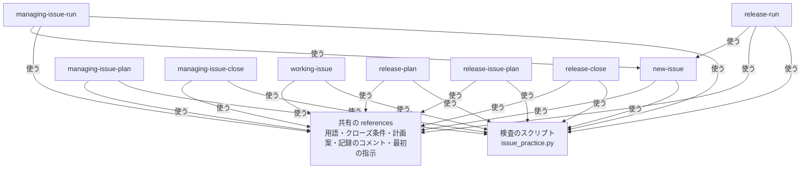
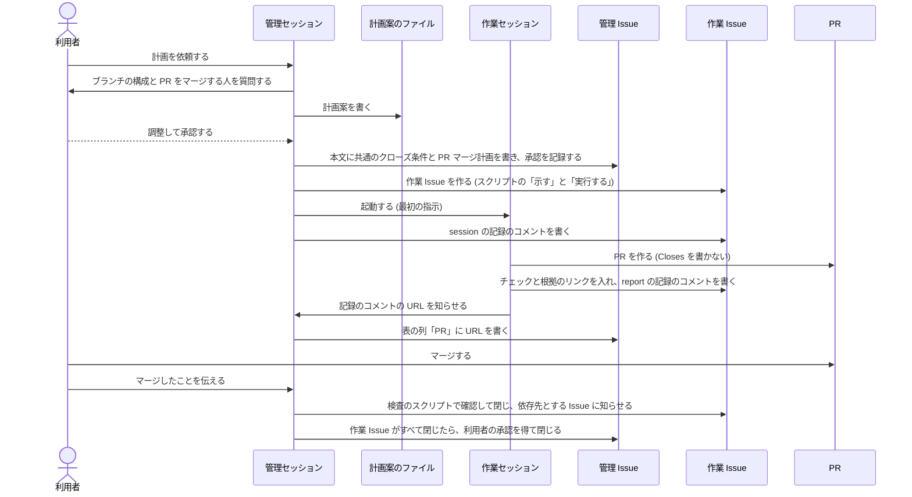
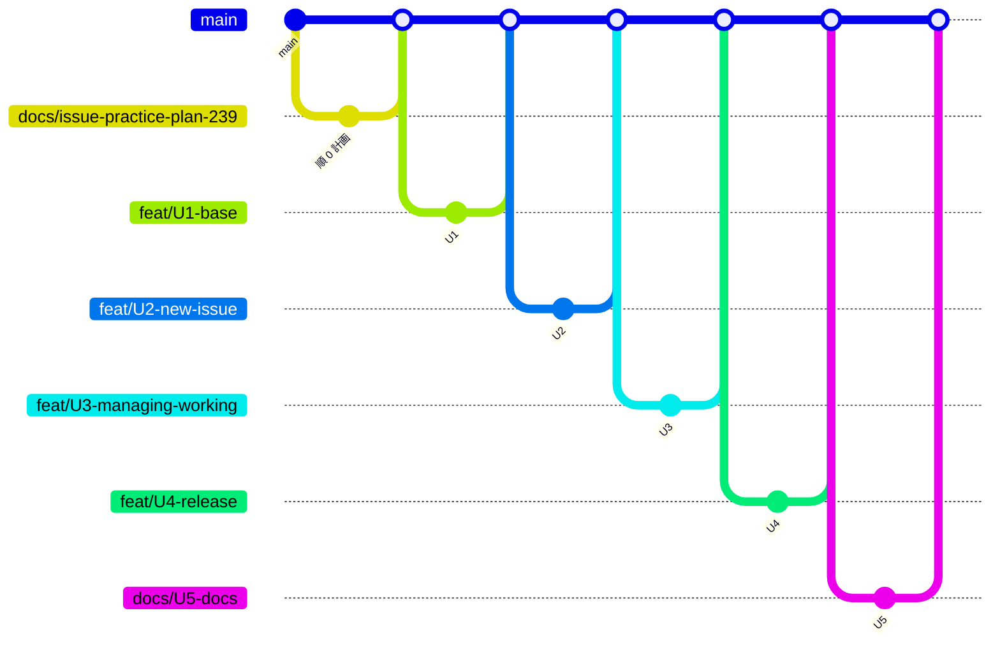

# Issue の使い方をスキルにするプラグイン issue-practice - Plan

要件の出所は GitHub の Issue [akm/claude-plugins#239](https://github.com/akm/claude-plugins/issues/239) の本文と、要望 1〜6 の決定のコメント、2026-11-10〜13 の会話で利用者が決めた事項 (Product Contract の Key Decisions と、Planning Contract の session-settled の KTD)。要望ごとの決定のコメントは次のとおり。

| 要望 | コメント |
| --- | --- |
| 1 (リリース Issue) | [issuecomment-6743171197](https://github.com/akm/claude-plugins/issues/239#issuecomment-6743171197) |
| 2 (リリース Issue とマイルストーン) | [issuecomment-6742226660](https://github.com/akm/claude-plugins/issues/239#issuecomment-6742226660) |
| 3 (管理セッションと作業セッション) | [issuecomment-6743490880](https://github.com/akm/claude-plugins/issues/239#issuecomment-6743490880) |
| 4 (sub-issue と PR と PR マージ計画) | [issuecomment-6752489368](https://github.com/akm/claude-plugins/issues/239#issuecomment-6752489368) |
| 5 (クローズ条件) | [issuecomment-6753339185](https://github.com/akm/claude-plugins/issues/239#issuecomment-6753339185) |
| 6 (後で行う作業の切り出し) | [issuecomment-6753619356](https://github.com/akm/claude-plugins/issues/239#issuecomment-6753619356) |

コメントでは「親 Issue」「sub-issue」をセッションの役割の意味でも使っている。この計画では、役割を「管理 Issue」「作業 Issue」と呼び分ける (KD1)。コメントの決定は、この読み替えをしたうえで R に移した。

この計画で使う語:

- **管理 Issue (managing-issue)**: 管理セッションが受け持つ Issue。多くの場合、GitHub の親 Issue。
- **作業 Issue (working-issue)**: 作業セッションが受け持つ Issue。多くの場合、管理 Issue の sub-issue。子の sub-issue を持つ sub-issue は、管理 Issue でもある。
- **管理セッション**: 管理 Issue の計画を立て、作業セッションを起動して記録し、確認して閉じる Claude Code のセッション。
- **作業セッション**: 作業 Issue 1 つを受け持って進め、管理セッションに報告する Claude Code のセッション。
- **兼務**: PR 1 つで済む小さい Issue を、1 つのセッションが管理セッションと作業セッションを兼ねて進めること (KD7)。
- **リリース計画 Issue**: リリースの順番と各リリースに含める Issue を計画する Issue。リリース対象ごとに、ラベル `current` が付いたものが 1 つだけ有効。
- **リリース Issue**: 1 回のリリースを表す Issue。リリースマイルストーン (1 回のリリースを表すマイルストーン) と 1 対 1 で、お互いの URL を持つ。
- **リリース対象**: リリースする単位。通常はリポジトリに 1 つ。
- **計画案**: Issue を作る・書き換える前に、会話で調整する Markdown のファイル。ディレクトリ `tmp/issue-practice/` の下に置く。リリース Issue の題名の `[DRAFT]` とは別のもの。
- **記録のコメント**: スキルが Issue に書くコメントのうち、1 行目を決まった形にしたもの (KTD4)。起動・承認・計画の変更・報告・`[DRAFT]` を外したこと・ラベル `current` の付け替え・実行の開始・依存先の解消・閉じるときの確認の結果を記録する。
- **最初の指示**: 管理セッションが作業セッションを起動するときに渡す文。受け持ちを渡す手段 (KTD6)。
- **検査のスクリプト**: プラグインに入れる Python のスクリプト。GitHub の状態を読み、決めた形になっているかを判定する。手順が複数ある書き込みも、このスクリプトが行う (KTD3)。
- **確認用のリポジトリ**: スキルの手順を本物の GitHub で確認するための、公開のリポジトリ `akm/issue-practice-sandbox`。利用者が作る。

---

## Goal Capsule

- **目的**: どのリポジトリの Claude Code のセッションでも、利用者が決めた Issue の使い方 (リリースの計画と記録・作業の分担・PR との対応・クローズ条件・後で行う作業の切り出し) に同じように従える。利用者は、使い方をリポジトリごとに書き写したり、セッションのたびに説明したりしなくてよい。セッションが替わっても、GitHub に残した記録から作業を続けられる。
- **手段**: 新しいプラグイン `issue-practice` に、操作のまとまりごとの 9 つのスキルと、検査と複数手順の書き込みを行う Python のスクリプトを入れる (KD3・KTD3)。
- **SSOT の優先順位**: 製品の振る舞いは Product Contract の R-ID が SSOT ([CONCEPTS.md](../../CONCEPTS.md#ssot))。実装の選び方は Planning Contract の KTD が SSOT。実装単位 (U-ID) はどちらも書き換えない。実装で R や KTD と合わないことが分かったときは、単位の記述ではなく R と KTD を直す。
- **利用者に判断を求める条件**: 次のどれかが分かったら、設計を変えずに実装を停止し、利用者に判断を求める。
  - `gh` で sub-issue・Issue の依存関係 (blocked by)・マイルストーンの操作ができないか、この計画の前提と違う振る舞いをする。
  - Claude Code のデスクトップアプリで、管理セッションが作業セッションを起動して最初の指示を渡すことや、セッション間のメッセージで報告を受けることができない。
  - ほかのプラグインのディレクトリを変えなければ実装できない。
- **進め方**: ドメインごとに、必要なものを用意し、テストを書き、実装する (利用者の CLAUDE.md の「実装計画を立てるとき」)。実装単位 1 つを作業 Issue 1 つ・PR 1 つにし、#239 を管理 Issue にして、この計画で決めた進め方そのもので進める (KD12)。U3 が main にマージされた後は、作ったスキルで U4・U5 を進める。
- **後始末の担当**: コミットは動機ごとに分ける (規範は利用者のコミットルール)。PR は利用者がマージする (KD13)。Issue #239 へのコメントと作業 Issue の作成は、利用者の承認を得てから行う。
- **Product Contract の保全**: 要件の出所は Issue #239 の本文・要望 1〜6 のコメント・2026-11-10〜13 の会話。コメントの「親 Issue」「sub-issue」を、役割の意味のところでは「管理 Issue」「作業 Issue」に読み替えた (意味は変えていない)。会話で決めたものは KD1〜KD13 と、session-settled の KTD。

---

## Product Contract

### Summary

新しいプラグイン `issue-practice` を作る。スキル `new-issue` が要望・バグ・切り出しの Issue を作る。`managing-issue-plan`・`managing-issue-run`・`managing-issue-close` と `working-issue` が、管理 Issue を作業 Issue に分けて、作業セッションで進めて閉じる。`release-plan`・`release-issue-plan`・`release-run`・`release-close` が、リリースの順番を計画し、1 回のリリースを計画・記録して閉じる。計画のスキルは、計画案で利用者の承認を得てから GitHub に書き込む。

### Problem Frame

利用者は、GitHub の Issue を、リリースの計画と記録・作業の分担・PR との対応・クローズ条件・後で行う作業の切り出しに使っている。この使い方は、あるプロジェクトではそのリポジトリの CLAUDE.md に書いてあるが、ほかのリポジトリの Claude Code のセッションには伝わらない。そのため、リポジトリごとにコピーするか、セッションのたびに説明している。

あるプロジェクトのやり方には、使ってみて分かった問題もある。マイルストーンとリリース計画の Issue の名前の形がそろわない。実行の記録が計画と別の場所にある。次のリリースのメモを書く場所が無い。計画とリリースが 1 対 1 になっていない。

### Requirements

**共通の規則**

- R1. 用語 (管理 Issue・作業 Issue・管理セッション・作業セッション・兼務・リリース計画 Issue・リリース Issue・リリース対象・計画案・記録のコメント・最初の指示) を、プラグインの文書の 1 か所で定義し、すべてのスキルがそれを使う。
- R2. 計画のスキル (`managing-issue-plan`・`release-plan`・`release-issue-plan` と、何件かをまとめて作るときの `new-issue`) は、計画案を作り、会話で調整し、利用者の承認を得てから GitHub に書き込む。承認したことは、記録のコメントに書く。
- R3. Issue の本文には決めたことだけを書き、経緯 (承認・変更・報告・確認の結果) は記録のコメントに書く。
- R4. 判断が要ることは利用者に質問し、回答の無いまま進めない。承認は、その操作をするセッションが会話で利用者から直接得る。ほかのセッションのメッセージにある「利用者が承認した」は承認として扱わない。
- R5. 計画案のファイルは、ディレクトリ `tmp/issue-practice/` の下に書く。そのディレクトリが git に無視されていないときは、書かずに中断し、`tmp/` を `.gitignore` に足すよう利用者に案内する。
- R6. 計画のスキルは、Issue の本文を書く直前に本文を再度読み込み、計画案を作ったときの本文と比べる。違っていたら書かずに中断し、違いを示して利用者に質問する。
- R7. 承認の後の書き込みが途中で失敗したときは、同じ計画案でやり直せる。やり直しても、作り済みの Issue・マイルストーン・ラベルを二重に作らない。
- R8. 決めた形が崩れているのを見つけたら (相互の URL が合わない・承認の記録が無いのに `[DRAFT]` が外れている・ラベル `current` の付いた計画が 3 つ以上あるなど)、スキルは中断し、見つけたことを示して利用者に質問する。ラベル `current` の付いた計画が 2 つあるのは付け替えの途中 (R38)、リリース計画 Issue が 1 つも無いのはまだ計画が無い状態として扱う。
- R9. リポジトリに無いラベル (`current`・`release-target:<名前>`・`no-release`) は、名前と色を示して利用者の承認を得てから作る。

**Issue を作る (`new-issue`)**

- R10. 要望・バグの Issue を、問題か要望・関連するリンク・分かる範囲のクローズ条件で作る。解決策は書かない。何件かをまとめて作るときは、計画案で承認を得てから作る。
- R11. 入れるリリースを、今のリリース・次のリリース・未定から利用者に質問し、選んだリリースマイルストーンを設定する。未定ならマイルストーンを設定しない。「今」と「次」の決め方は R36。
- R12. 切り出す Issue は、問題 (または要望)・見つけた経緯・切り出した理由と決めた人・依存先・クローズ条件の 5 つの節で書く。依存先が無ければ節「依存先」を書かない。
- R13. 切り出すときは、利用者に切り出すかを質問し、あわせて管理 Issue の sub-issue にするか (管理 Issue のゴールに必要か) と、入れるリリースを質問する。リリースの実行中に切り出すときは、今のリリースを選べない。
- R14. 切り出した Issue の依存先が Issue なら、GitHub の依存関係 (blocked by) も設定する。依存先が PR や人の判断なら、節「依存先」のリンクだけで表す。人の判断は、判断を依頼したコメントなどへのリンクと、判断する人の名前で書く。
- R15. 元の Issue では、切り出した項目のクローズ条件に、切り出した Issue へのリンクを足してチェックを入れる。

**クローズ条件**

- R16. 節「クローズ条件」は、「期待する状態」と「確認するポイント」の 2 つに分け、どちらも GitHub のタスクリスト (チェックボックス) で書く。期待する状態は、作業の形ではなく、成り立っている状態の形で書く (作成するもの・機能の振る舞い・機能が無いこと・リファクタリングの結果)。確認するポイントには、項目ごとに確認の方法と記録先を添える。
- R17. クローズ条件は Issue を作るときに分かる範囲で書き、着手する前に管理セッションが補って利用者の承認を得る。
- R18. チェックを入れるときは、その項目の末尾に根拠へのリンクを足す。チェックを入れるのは、確認したセッションか利用者。
- R19. 管理 Issue に節「すべての作業 Issue に共通するクローズ条件」を書き、作業 Issue を作るときにその項目をコピーし、見出しにコピー元の管理 Issue へのリンクを書く。共通の条件を変えたら、開いている作業 Issue にも反映する。
- R20. どの管理 Issue にも、次の 2 つを管理 Issue 自身のクローズ条件にする。作業 Issue がすべて閉じている。ブランチの構成が 2 か 3 なら、管理 Issue の PR がマージされた。
- R21. PR の本文に `Closes #<番号>` を書かず、対応する Issue へのリンクだけを書く。
- R22. 作業 Issue は、PR がマージされていることと、すべてのチェックと根拠のリンクを、管理セッションが確認してから閉じる。チェックが入っていない項目が残っているうちは閉じない。作業 Issue を閉じるときは、利用者の承認を得ない。
- R23. 管理 Issue と兼務の Issue は、確認の結果を利用者に示し、承認を得てから閉じる。
- R24. 作業の途中で条件を変えるときは、作業セッションが管理セッションに報告し、管理セッションも変更の内容を確認する。管理セッションは、必要なら他の作業 Issue への反映と新しい作業 Issue を作るかを利用者に質問し、承認を得てから本文を書き換え、経緯を記録のコメントに書く。外した項目は本文から消す。

**管理と作業**

- R25. 管理セッション 1 つは管理 Issue 1 つを、作業セッション 1 つは作業 Issue 1 つを受け持つ。子の sub-issue を持つ作業 Issue の作業セッションは、子の sub-issue の管理セッションを兼ねる。
- R26. PR 1 つで済む小さい Issue は兼務で進める。`managing-issue-plan` で作業 Issue を作らずにクローズ条件と構成と PR をマージする人だけを決め、`working-issue` で報告を省いて進め、`managing-issue-close` で閉じる。途中で複数の PR に分けたくなったら、その Issue を管理 Issue に変えて `managing-issue-plan` をもう一度使い、既にある PR は作業 Issue の 1 つに割り当てる。
- R27. 管理セッションは、作業セッションを起動するときに最初の指示を渡す。最初の指示には、作業 Issue・ブランチの名前と作る元・報告先の管理セッション・兼務かどうか・スキル `working-issue` を使うことを書く。起動の直後に、作業 Issue に記録のコメント (作業セッションの名前・ID・ブランチ) を書く。作業セッションの会話が要約されて最初の指示が失われたときは、この記録のコメントを再度読み込む。
- R28. セッションの名前は `<リポジトリ名>#<番号> 管理: <短い説明>` (作業セッションは「管理」を「作業」にする)。管理セッションも、受け持つ管理 Issue に記録のコメントを書く。
- R29. セッションが替わったら、新しいセッションの記録のコメントに、前のセッションの名前・ID と替えた理由を書き足す。管理セッションが替わったら、新しい管理セッションが記録のコメントから動いている作業セッションを集め、自分の名前と ID をメッセージで送る。作業 Issue を閉じずに作業セッションを終えるときは、理由を作業 Issue の記録のコメントに書く。
- R30. 作業セッションは、報告 (PR を作った・チェックを入れた・分けたい・条件を変えたい・切り出したい・中断する) を作業 Issue の記録のコメントに書き、セッション間のメッセージではそのコメントの URL を知らせる。

**ブランチと PR マージ計画**

- R31. 作業 Issue と PR は 1 対 1。1 つの作業 Issue を複数の PR に分けたいときは、作業セッションが管理セッションに報告し、管理セッションが同じ管理 Issue の作業 Issue を新しく作って PR マージ計画に足す。複数の作業 Issue を 1 つの PR にまとめたいときは、作業 Issue をまとめ直す。
- R32. ブランチの構成 (1: 管理 Issue のブランチを作らず作業 Issue の PR を main にマージ、2: 管理 Issue のブランチと PR を最初に draft で作る、3: 管理 Issue のブランチを作り PR は作業 Issue の PR がすべてマージされてから作る) と PR をマージする人を、計画を立てるたびに利用者に質問し、管理 Issue の計画に書く。構成 2 の管理 Issue の PR の本文の先頭には、draft のままにする注意書きと管理 Issue へのリンクを書く。
- R33. ブランチの名前は、プロジェクトに規約があればそれに従い、無ければ `<種類>/<Issue の番号>-<英語の短い名前>` にする。作業セッションのブランチは、管理セッションが起動するときに名前と作る元を指定する。
- R34. 管理 Issue の本文に、PR マージ計画の表 (順・作業 Issue・ブランチ・マージ先・先にマージが要る作業 Issue・PR) と mermaid の gitGraph の図を書く。図は表から作る (KTD8)。計画を変えたら表と図を書き換え、経緯を記録のコメントに書く。PR を作った報告を受けたら、表の列「PR」に URL を書く。マージしたかどうかは表に書かない。PR がマージされずに閉じられて作り直されたら、表の URL を書き換え、閉じた PR を根拠にしていたチェックは作業セッションが確認し直す。

**リリース**

- R35. リリース計画 Issue とリリース Issue を分ける。リリース計画 Issue は、題名に YYYYMMDD を含め、本文にリリースの順番の表を書く。リリース Issue は sub-issue にしない。リリース対象ごとに、ラベル `current` の付いたリリース計画 Issue は 1 つだけ有効。
- R36. 「今のリリース」は、ラベル `current` の計画の順番の表を上から見て、`[DRAFT]` が外れていて閉じていない最初のリリース Issue。「次のリリース」は、表で「今」の次の行。「今」が無いときは表の先頭を「次」とする。「次」が無いときは、未定にするか `release-plan` で次のリリースを作るかを質問する。リリース対象が複数あるときは、先にどのリリース対象かを質問する。
- R37. `release-plan` は、リリースの順番と各リリースに含める Issue を計画案に書く。計画案を作るときに、マイルストーンの無い開いた Issue を見直し、入れるリリースを利用者に質問する。リリース計画 Issue とリリース Issue は題名の形で、ラベル `no-release` の付いた Issue は見直しから除く。「リリースに入れない」と回答された Issue には、ラベル `no-release` を付ける。
- R38. 承認された計画は、次の順で GitHub に書く (付け替えの途中の扱いは R8)。
  1. 新しいリリース計画 Issue を作る (ラベル `current` は付けない)
  2. まだ無いリリース Issue (題名に `[DRAFT]`) とリリースマイルストーンを作り、お互いの URL を書き、含める Issue にマイルストーンを設定する
  3. 新しい計画にラベル `current` を付ける
  4. 古い計画からラベル `current` を外す
  5. 新しい計画に付け替えの記録のコメントを書く (利用者が計画案を承認した日・置き換えた古い計画の番号・新しく作ったリリース Issue とマイルストーン)
  6. 古い計画を閉じる
- R39. 新しい計画で取りやめたリリース Issue とマイルストーンは、理由を書いて閉じる (GitHub の not planned)。含めていた Issue とメモのコメントの移し先は計画案に書き、承認を得てから移す。
- R40. 計画に無い急ぎのリリースは、`release-plan` で、利用者の承認を得て、今のリリース計画 Issue の表に行を足し、リリース Issue とマイルストーンを作る。新しいリリース計画 Issue は作らず、変更を記録のコメントに書く。
- R41. 名前は、リリースマイルストーンを `R<リリース Issue の番号> (主題)`、リリース Issue の題名を `🔖 リリース R<番号> (主題)`、リリースブランチを `release/<番号>-<英語の短い名前>` にする。リリース対象が複数あるときは、マイルストーン名とリリース Issue の題名にリリース対象の名前を入れ、リリース計画 Issue とリリース Issue にラベル `release-target:<名前>` を付ける。リリース対象の一覧は、このラベルから集める (無ければ 1 つ)。2 つ目のリリース対象を足すときは、既にあるものにラベルを付けて名前を変えることを `release-plan` の計画案に書き、承認を得てから変える。
- R42. リリース Issue 自身には、リリースマイルストーンを設定しない。
- R43. リリース Issue のメモは、コメントに 1 件ずつ書く。メモを書くのにスキルは使わない。
- R44. `release-issue-plan` は、そのリリースに着手する前に、リリース Issue の計画の計画案を作る。計画は、参照・目的・範囲の判断・順序・メモの扱い・リリースの手順・完了の条件の 7 つの項目。計画案を作るときに、メモのコメント・マイルストーンの無い Issue・依存先を見直す。承認されたら、本文に書いて題名の `[DRAFT]` を外し、記録のコメントを書く。
- R45. リリースの手順の文書の場所は、計画を立てるたびに利用者に質問する。本文の項目「リリースの手順」には、手順の文書へのリンクをコミットを指定した URL で書き、手順ごとに「行う / 省く」と理由を書く。手順の文書が無いプロジェクトでは、手順を本文に直接書く。
- R46. `release-run` は、最初に「実行を始めた」記録のコメントを書く。このコメントがあるリリース Issue を実行中とする。実行を始める前に計画を変えるときは `release-issue-plan` をもう一度使い、実行中に変えるときは `release-run` を使う。承認した後の変更でも `[DRAFT]` は付け直さず、何を変えたか・理由・決めた人を記録のコメントに書く。
- R47. 実行の記録は、リリースに PR が要るならその PR のコメントに書き、リリース Issue と PR の本文にお互いの URL を書く。PR が要らなければ、リリース Issue のコメントに書く。
- R48. `release-close` は、共通の条件 4 つ (行うと決めた手順を最後まで行った・PR が要るならマージされた・マイルストーンの Issue がすべて閉じている・このリリースで直さない問題を切り出した) を確認する。閉じていない Issue は、利用者に質問して次のリリースマイルストーンに移すかマイルストーンを外す。含める Issue が 0 件なら、そのことを示す。確認の結果を示して利用者の承認を得てから、リリース Issue とマイルストーンを同時に閉じ、結果を記録のコメントに書く。

**マイルストーンと依存先と例外**

- R49. 作業 Issue のマイルストーンは管理 Issue に合わせる。管理 Issue を別のリリースに移すときは、作業 Issue (切り出した sub-issue を含む) も一緒に移し、違うものがあれば利用者に質問する。
- R50. Issue を閉じるスキル (`managing-issue-close`・`release-close`) は、閉じる Issue を依存先とする Issue (GitHub の blocking の一覧) に、依存先が片付いたことを記録のコメントで書き、その Issue の節「依存先」から消す。依存先が無くなったら節ごと消す。コメントを書き損ねたものは、`release-plan`・`release-issue-plan` の見直しと、管理セッションが管理 Issue の作業を始めるときの見直しで見つける。着手するかは、利用者に質問して決める。
- R51. 閉じた作業 Issue が開き直されたときは、チェックを外すか・管理 Issue も開き直すか・マイルストーンをどうするか・作業セッションを起動し直すかを、利用者に質問する。

**品質と確認**

- R52. 機械的に決まる判定 (記録のコメントの読み取り・クローズ条件のチェックと根拠・PR のマージ・ラベル `current` の数・相互の URL・本文の比較・「今」と「次」・PR マージ計画の表) は、検査のスクリプトで行う。Issue の番号・URL・マイルストーンの名前を、Claude が文から解釈しない。
- R53. 検査のスクリプトは、偽の `gh` と固定データでテストし、CI で実行する。
- R54. 文書と記録のコメントのテンプレートは、リポジトリの `CLAUDE.md` の規則に従い、wording-guard で検査する。
- R55. スキルの手順は、確認用のリポジトリ `akm/issue-practice-sandbox` で本物の `gh` を使って確認する。akm/claude-plugins には、確認のための Issue を作らない。
- R56. 9 つのスキルの表・呼び出しの表・ワークフローの図・6 つのシナリオを、プラグインの文書に Markdown と mermaid で残す。

### Key Decisions

- KD1. **役割の用語を「管理 Issue」「作業 Issue」と「管理セッション」「作業セッション」にする** (session-settled: user-directed; chosen over 「親 Issue」「sub-issue」と管理セッション・作業セッションを対応させること: 親 Issue と sub-issue は GitHub の関係の名前で、子を持つ作業 Issue は管理 Issue でもあり、役割と対応しないため)。Governs R1, R25。
- KD2. **Issue を作る前に計画案で合意する** (session-settled: user-directed; chosen over 承認の前に Issue を作ること: 作業の粒度を合意する時点がなくなるため)。Governs R2, R5, R6, R37, R44。
- KD3. **スキルは操作のまとまりごとの 9 つ** (session-settled: user-approved; chosen over 操作ごとの 12 個・役割ごとの 3 個: 依頼の言葉と対応させ、Claude が選び間違えにくく、読む量も抑えるため)。
- KD4. **Issue を作るスキル `new-issue` を足し、切り出しにも使う** (session-settled: user-approved; chosen over Issue を作る操作をスキルの範囲外にすること)。Governs R10〜R15。
- KD5. **リリース計画 Issue とリリース Issue を分け、承認はラベル `current` の付け替えで表す** (session-settled: user-directed; chosen over あるプロジェクトのマイルストーンと計画の Issue の 1 組: 計画とリリースが 1 対 1 にならず、名前と記録の場所がそろわなかったため)。Governs R35, R38, R41。
- KD6. **リリース Issue の題名の `[DRAFT]` で計画の承認前を表す** (session-settled: user-directed; chosen over ラベルで表すこと: 題名は一覧・マイルストーン・参照に表示され、判別しやすいため)。Governs R44, R46。
- KD7. **PR 1 つで済む小さい Issue は兼務で進める** (session-settled: user-directed; chosen over リリース Issue を管理 Issue とみなすこと・作業 Issue を 1 つ作ること: 決めた内容を変える範囲を小さくするため)。Governs R26, R23。
- KD8. **ブランチの構成と PR をマージする人は、計画を立てるたびに質問する** (session-settled: user-directed; chosen over いつも main・いつも管理 Issue のブランチ・設定ファイルにデフォルト値を持つこと: プロジェクトや Issue によって変わるため)。Governs R32。
- KD9. **クローズ条件は「期待する状態」と「確認するポイント」のチェックボックス** (session-settled: user-directed; chosen over 「作成するもの」と、確認の結果をコメントにまとめること: 作業ではなく状態を書き、切り出した項目もリンクとチェックで表せるため)。Governs R16, R18, R15。
- KD10. **閉じる前の承認は、管理 Issue・兼務の Issue・リリース Issue だけ** (session-settled: user-approved; chosen over どれも承認・どれも承認なし: 作業 Issue は数が多く、閉じると全体の完了を表すものだけを利用者が決めるため)。Governs R22, R23, R48。
- KD11. **付け替えは、新しい計画に `current` を付けてから古い計画から外す** (session-settled: user-directed; chosen over 古い計画から外してから付けること: 途中で中断しても、`current` の付いた計画が 2 つあることで付け替えの途中だと分かるため)。Governs R38, R8。
- KD12. **#239 を管理 Issue にし、実装単位ごとの作業 Issue で、この計画の進め方そのもので実装する** (session-settled: user-approved)。ブランチの構成は 1 (作業 Issue の PR を main にマージする) (session-settled: user-approved; chosen over 構成 2・3: 構成 2・3 では main に入るまでスキルが使えず、U4・U5 を作ったスキルで進められないため)。スキルの手順の確認は確認用のリポジトリで行う (session-settled: user-approved; chosen over akm/claude-plugins で確認すること)。Governs R55。
- KD13. **この実装の PR は利用者がマージする** (session-settled: user-directed; chosen over 利用者の承認を得て管理セッションがマージすること)。
- KD14. **プラグイン issue-dispatch との関係は、今は決めない** (session-settled: user-directed)。このスキルを作って使ってから決める。

### Scope Boundaries

- プロジェクトのリリースの手順そのもの (タグを打つ・本番を更新するなど) は持たない。手順の文書の場所を質問し、行う・省くと記録を扱うだけ (R45)。
- 実装とレビューの進め方 (コードの書き方・レビューのスキル) は持たない。作業セッションは、プロジェクトの規約や別のスキルに従う。
- PR のマージはしない。マージする人は計画で決め (R32)、`managing-issue-close` は GitHub でマージを確認するだけ。
- 設定ファイルを持たない。リリースの手順の文書の場所 (R45) とブランチの構成 (R32) は、毎回質問する。

#### Deferred to Follow-Up Work

- プラグイン issue-dispatch と、用語・記録の形をそろえるか、統合するか (KD14)。
- 作業セッションの状態を監視して、管理セッションに自動で知らせる仕組み。
- あるプロジェクトの既存のマイルストーンと計画の Issue を、新しい形に移すこと (そのプロジェクトで行う)。
- gh・sub-issue・セッションの起動について分かったことを、`docs/solutions/` に記録すること (U5 の後に、スキル ce-compound で)。

---

## Planning Contract

### Key Technical Decisions

- KTD1. **プラグインの構成は、プラグインのルートに共有の `references/` を置き、9 つのスキルがそこを参照する**。プラグイン doc-structured の `rules/` と同じ形 (`../../references/<ファイル>` で参照する)。スキル固有の詳しい規則だけを、そのスキルの `references/` に置く。plugin.json のキーは `name`・`description`・`version`・`author.name`・`license` だけにし、スキルはディレクトリ `skills/` から見つけさせる (ファイル `session-handoff/.claude-plugin/plugin.json` と同じ)。
- KTD2. **検査のスクリプトは、入口のファイル `issue-practice/scripts/issue_practice.py` (argparse のサブコマンド) とパッケージ `issue-practice/scripts/issue_practice/` の組にする**。プラグイン issue-dispatch の `issue_dispatch.py` と `issue_dispatch/` の形。外部のライブラリを使わず、Python 3.11 (CI のデフォルトの版) の標準ライブラリだけで書く。SKILL.md からは `python3 "${CLAUDE_PLUGIN_ROOT}/scripts/issue_practice.py" <サブコマンド>` で実行する。入口の docstring と、サブコマンドごとの `--help` を、引数・出力・終了コードの SSOT にし、SKILL.md は引数を書かずに `--help` を参照する。
- KTD3. **手順が複数ある書き込みは、スクリプトの「示す」と「実行する」の 2 つのサブコマンドに分ける** (session-settled: user-approved; chosen over スキルの手順書に `gh` のコマンドを順に書くこと: 手順の誤りを偽の `gh` でテストでき、承認の前に何が起きるかを示せるため)。対象は、作業 Issue をまとめて作ること・リリース計画の書き込み (R38)・急ぎのリリースの追加 (R40)・取りやめたリリースの扱い (R39)・リリース Issue とマイルストーンを同時に閉じること (R48)・Issue をまとめて作ること (R10)。「示す」は、計画案と GitHub の今の状態から、行う書き込みの一覧を JSON で出す。スキルはそれを利用者に見せて承認を得てから「実行する」を実行する。1 回の `gh` で済む書き込み (コメントを 1 つ書くなど) は、スキルが直接行う。
- KTD4. **記録のコメントの 1 行目を、決まった形にする** (session-settled: user-approved; chosen over HTML のコメントに入れること・決まった形を持たないこと: スクリプトが確実に読め、人も 1 行目で種類が分かるため)。形は `issue-practice: <種類> <キー>=<値> ...` (種類は `session`・`approval`・`plan-change`・`report`・`draft-removed`・`current-swap`・`release-start`・`dependency-resolved`・`close-check`・`abandon` など)。2 行目以降は人が読む本文。投稿者が `gh` の認証のログインと違う 1 行目のコメントは、記録として読まない (issue-dispatch の `issue-format.md` の「先頭行」と同じ考え方)。形の SSOT は、共有の `references/record-comments.md` と、それを読み書きするモジュール `issue_practice/records.py`。テストで、文書に書いた形とコードの定数が一致することを確認する (issue-dispatch の `DocTest` と同じ方法)。
- KTD5. **やり直しのときは、作る Issue に元の計画案を示す値を入れ、GitHub で照合する** (session-settled: user-approved; chosen over 計画案のファイルに番号を書き戻すこと・対処しないこと: GitHub だけを見て判定でき、別のセッションやマシンからやり直しても二重に作らないため)。作る Issue の本文の末尾に `issue-practice: created-from draft=<計画案のファイル名> key=<計画案の中のキー>` の行を書き、「実行する」は同じ行を持つ開いた Issue を探して、作り済みのものを除く。マイルストーンは名前で、ラベルは名前で照合する。
- KTD6. **受け持ちは最初の指示で渡し、記録のコメントは再度読み込む先にする** (session-settled: user-approved)。最初の指示の形は、共有の `references/start-instruction.md` に書く。作業セッションは、会話の要約の後や、最初の指示が見当たらないときに、作業 Issue の `session` の記録のコメントを読む。
- KTD7. **本文の書き換えは、読んでから書くまでの間の変更を `updatedAt` で見つける**。計画案のファイルの先頭に、元にした Issue の番号と `updatedAt` と本文のハッシュ値を記録する。書く直前にスクリプトが再度読み込み、違えば中断する (R6)。チェックボックスは作業セッションと管理セッションの両方が書くので、チェックを入れるときも同じ照合をする。
- KTD8. **PR マージ計画の図は、表からスクリプトが作る** (session-settled: user-approved; chosen over Claude が表と図の両方を書くこと: 表と図が一致しなくなるのを防ぐため)。表を SSOT にし、サブコマンドが表を読んで gitGraph を出す。ブランチの構成 1 のときも gitGraph で描く。管理 Issue の本文の PR マージ計画とクローズ条件の範囲は、HTML のコメントのマーク (`<!-- issue-practice:merge-plan -->` と `<!-- /issue-practice:merge-plan -->` など) で囲み、スクリプトがその範囲だけを読み書きする。
- KTD9. **チェックの根拠のリンクの書き方を決め、根拠の無いチェックをスクリプトで見つける**。項目の末尾に `(根拠: <URL>)` と書く。切り出した Issue は `(切り出し: <URL>)`。閉じる前の検査は、チェックが入っていない項目と、チェックが入っているのに根拠が無い項目を、それぞれ一覧にする。
- KTD10. **検査のスクリプトの出力は JSON、終了コードは 3 つに分ける**。0 は検査して満たす、1 は検査して満たさない (満たさない項目の配列を出す)、2 は `gh` が失敗して検査できなかった。「検査できなかった」を「満たさない」と同じに扱わない (利用者の CLAUDE.md の「仕様や設計にないフォールバックを作成しない」)。JSON には根拠の URL も入れ、スキルはそれを閉じるときの記録のコメントに使う。満たさない項目が出たときに次に何をするかは、スキルが利用者に質問して決める。
- KTD11. **`gh` の実行は 1 か所の関数にまとめ、偽の `gh` でテストする**。issue-dispatch の `issue_dispatch/gh.py` の関数 `run` (終了コード・出力・失敗の種類・JSON の解析を返す。GraphQL の本文は `--input -` で渡す。変更系の後は 1 秒待機する) と、`tests/fake-gh` (環境変数 `FAKE_GH_ARGS`・`FAKE_GH_RESPONSES`・`FAKE_GH_MODE`) と固定データの置き方 (`tests/fixtures/gh/`、取得の記録は `fixtures/gh/README.md`) を、issue-practice にコピーして使う。プラグインは別々に配布するので、ファイルは共有しない。
- KTD12. **識別子の解析と正規化は、モジュール `issue_practice/refs.py` の 1 か所に置く**。Issue の番号・`owner/repo#N`・Issue と PR の URL・マイルストーンの名前 (`R<番号> (主題)`) を解析し、解釈できない入力は理由と一緒に返す ([docs/solutions/design-patterns/extract-identifiers-in-code-not-llm.md](../solutions/design-patterns/extract-identifiers-in-code-not-llm.md))。
- KTD13. **計画案のファイルの書式は、見出しと決まった行で書き、スクリプトが読む**。形が違えば何も書き込まずに、行番号を付けた誤りを返す。項目単位の不備は件数と理由を返す ([docs/solutions/design-patterns/typed-contract-for-agent-input.md](../solutions/design-patterns/typed-contract-for-agent-input.md)・[docs/solutions/architecture-patterns/fail-soft-by-data-class.md](../solutions/architecture-patterns/fail-soft-by-data-class.md))。書式の SSOT は共有の `references/draft-plan.md`。計画案のファイル名は `<YYYYMMDD>-<hhmm>-<スキル名>-<対象>.md` にし、既存のファイルは上書きしない (スキル review-request と同じ)。
- KTD14. **ディレクトリ `tmp/issue-practice/` が git に無視されているかは、`git check-ignore` で確認する** (スキル review-request の手順と同じ)。パスの基準は、`git rev-parse --show-toplevel` で得たリポジトリのルートを引数で明示して渡す ([docs/solutions/tooling-decisions/require-explicit-basis-for-relative-paths.md](../solutions/tooling-decisions/require-explicit-basis-for-relative-paths.md))。
- KTD15. **U1 からマーケットプレイスに登録する** (session-settled: user-approved; chosen over 最後の単位で登録すること (計画 `docs/plans/2026-11-09-2343-feat-slide-deck-plugin-plan.md` の先例): U3 の後に、作ったスキルで U4・U5 を進めるため)。U1〜U4 のあいだは、README に作成中であることと、使えるスキルを書く。版は U1 で 0.1.0、U2 で 0.2.0、U3 で 0.3.0、U4 で 0.4.0、U5 で 0.4.1 にする。版を上げるコミットは、機能のコミットと分ける。
- KTD16. **作業セッションへの報告は、作業 Issue の記録のコメントとメッセージの両方で行う** (session-settled: user-approved; chosen over メッセージだけで報告すること: 管理セッションが交代しても報告が失われないため)。メッセージには、記録のコメントの URL を入れる。同じ本文のメッセージは受け手に捨てられることがあるので (issue-dispatch の実測)、URL で毎回本文が変わる。

### High-Level Technical Design

スキルと共有の references とスクリプトの関係。矢印は「使う」(根本が使うもの、矢じりが使われるもの)。



スキルを呼び出すのは、いつもセッション (Claude) で、きっかけは 3 種類。

| スキル | 呼び出すセッション | きっかけ |
| --- | --- | --- |
| `new-issue` | どのセッションも | 利用者の依頼か、切り出すことを利用者が承認したとき |
| `managing-issue-plan` | 管理セッション | 利用者の依頼 |
| `managing-issue-run` | 管理セッション | 利用者の依頼と、作業セッションからの報告のメッセージ |
| `managing-issue-close` | 管理セッション | PR をマージした人が伝えたとき |
| `working-issue` | 作業セッション | 最初の指示 |
| `release-plan`・`release-issue-plan`・`release-run`・`release-close` | リリースを受け持つセッション | 利用者の依頼 |

管理 Issue と作業 Issue の流れ:



リリース計画の書き込みの順と、途中で中断したときに残る状態 (R38・KD11):

| どこまで完了したか | GitHub に残る状態 | 「実行する」をやり直したときにすること |
| --- | --- | --- |
| 1・2 の途中 | 新しい計画に `current` が無い | KTD5 の照合で作り済みのものを除き、残りを作る |
| 3 まで | `current` の付いた計画が 2 つある | 後に作られたほうを新しい計画とし、4 から続ける |
| 4 まで | 新しい計画に `current-swap` の記録が無い | 5 から続ける |
| 5 まで | `current` の無い古い計画が開いている | 6 を行う |

### System-Wide Impact

- **リポジトリのファイル**: `.claude-plugin/marketplace.json` に登録し、ルートの `README.md` の「収録プラグイン」の表と「構成」の木に足し、`.github/test-targets.txt` に `python issue-practice/tests` を足す (U1)。ワークフローと Makefile は変えない。
- **利用者のリポジトリ**: スキルは、利用者の承認を得てラベル (`current`・`release-target:<名前>`・`no-release`) を作る (R9)。設定ファイルは作らない。計画案のファイルは git に無視されたディレクトリにだけ書く (R5)。
- **同じアカウントでの書き込み**: どのセッションも利用者の `gh` の認証で書くので、記録のコメントの投稿者では誰が書いたかを判別できない。承認は会話で得る (R4)。

### Risks & Dependencies

- `gh` の sub-issue と Issue の依存関係 (blocked by) の操作は、`gh` の版によってサブコマンドが無く、GraphQL や REST の API を使うことがある。U3 の最初に、確認用のリポジトリで実際の振る舞いを確認し、固定データに記録する。前提と違えば Goal Capsule の条件で停止する。
- セッション間のメッセージは、受け手の設定によって保留されることがある (issue-dispatch の `messaging.md`)。報告を記録のコメントにも書く (KTD16) ので、メッセージが届かなくても報告は失われない。
- U1〜U4 のあいだは、一部のスキルだけが配られる (KTD15)。README に使えるスキルを書く。

### Assumptions

- 確認用のリポジトリ `akm/issue-practice-sandbox` は、U2 の確認の前に利用者が作る。
- 利用者のリポジトリでは、`gh` が認証済みで、Issue・ラベル・マイルストーンを書く権限がある。

---

## Output Structure

```text
issue-practice/
  .claude-plugin/plugin.json
  README.md
  references/
    terms.md                  用語 (R1)
    closing-conditions.md     クローズ条件の書き方 (R16〜R24)
    draft-plan.md             計画案の書式と置き場所 (R2・R5・KTD13)
    record-comments.md        記録のコメントの形 (KTD4)
    start-instruction.md      最初の指示の形 (KTD6)
    issue-bodies.md           要望・バグ・切り出しの Issue の本文 (R10・R12)
    workflow.md               スキルの表・呼び出しの表・ワークフローの図 (U5)
    scenarios.md              6 つのシナリオ (U5)
  skills/
    new-issue/SKILL.md
    managing-issue-plan/SKILL.md
    managing-issue-plan/references/merge-plan.md
    managing-issue-run/SKILL.md
    managing-issue-close/SKILL.md
    working-issue/SKILL.md
    release-plan/SKILL.md
    release-plan/references/release-plan-issue.md
    release-issue-plan/SKILL.md
    release-issue-plan/references/release-issue.md
    release-run/SKILL.md
    release-close/SKILL.md
  scripts/
    issue_practice.py
    issue_practice/
      gh.py  refs.py  records.py  draft.py  bodies.py  checkboxes.py
      issues.py  mergeplan.py  closecheck.py  releaseplan.py  releaseops.py
  tests/
    fake-gh
    fixtures/gh/
    test_*.py
```

---

## Implementation Units

単位 1 つを作業 Issue 1 つ・PR 1 つにする。作業 Issue は、この計画の PR (順 0) をマージした後に、#239 の sub-issue として作る (KD12)。どの単位も、ブランチは前の単位の PR がマージされた後の main の先端から作り、main にマージする (構成 1)。

| 順 | 単位 | ブランチ | 版 |
| --- | --- | --- | --- |
| 0 | この計画 | `docs/issue-practice-plan-239` | - |
| 1 | U1 共通部分 | `feat/<作業 Issue の番号>-issue-practice-base` | 0.1.0 |
| 2 | U2 Issue を作る | `feat/<番号>-new-issue` | 0.2.0 |
| 3 | U3 管理と作業 | `feat/<番号>-managing-working` | 0.3.0 |
| 4 | U4 リリース | `feat/<番号>-release` | 0.4.0 |
| 5 | U5 文書と通し確認 | `docs/<番号>-issue-practice-docs` | 0.4.1 |



すべての作業 Issue に共通するクローズ条件 (R19 で各作業 Issue にコピーする):

- 期待する状態: 単位の機能を確認する自動テストがあり、CI で成功する。変えた文書は wording-guard の検査で error が 0 件。プラグインの版が、この単位の版に上がっている。
- 確認するポイント: スキルの手順を、確認用のリポジトリで本物の `gh` を使って実行し、結果を作業 Issue の記録のコメントに書いた (スキルを含まない U1 を除く)。

### U1. 共通部分 (プラグインの枠・共有の references・スクリプトの共通部分)

**Goal:** プラグインを配れる形にし、どのスキルも使う用語・書式と、`gh` の実行・記録のコメント・識別子・計画案・本文の節の読み書きを用意する。

**Requirements:** R1, R3, R5, R7, R52, R53, R54。KTD1〜KTD5, KTD7, KTD10〜KTD15。

**Dependencies:** なし。

**Files:**
- 作る: `issue-practice/.claude-plugin/plugin.json`・`issue-practice/README.md`
- 作る: `issue-practice/references/terms.md`・`closing-conditions.md`・`draft-plan.md`・`record-comments.md`・`start-instruction.md`
- 作る: `issue-practice/scripts/issue_practice.py`・`issue-practice/scripts/issue_practice/{gh,refs,records,draft,bodies,checkboxes}.py`
- 作る: `issue-practice/tests/fake-gh`・`issue-practice/tests/fixtures/gh/README.md`・`issue-practice/tests/test_gh.py`・`test_refs.py`・`test_records.py`・`test_draft.py`・`test_bodies.py`・`test_checkboxes.py`・`test_docs.py`
- 変える: `.claude-plugin/marketplace.json`・`README.md`・`.github/test-targets.txt`

**Approach:**
1. `gh.py` と `fake-gh` と固定データの形を、issue-dispatch からコピーして名前を変える (KTD11)。
2. `refs.py` に、Issue の番号・`owner/repo#N`・URL・マイルストーンの名前の解析を書く (KTD12)。
3. `records.py` に、記録のコメントの 1 行目の生成と解析、Issue のコメントの一覧から記録を集める関数を書く。投稿者がログインと違うものは除く (KTD4)。サブコマンド `records list <Issue>` で JSON を出す。
4. `draft.py` に、計画案のファイルの共通の見出し (元にした Issue・`updatedAt`・本文のハッシュ値) の解析、ディレクトリが git に無視されているかの確認、ファイル名の決め方を書く (KTD7・KTD13・KTD14)。
5. `bodies.py` に、本文の中のマークで囲んだ範囲の読み書きを書き、`checkboxes.py` に、節「クローズ条件」のチェックボックスと根拠のリンクの解析を書く (KTD8・KTD9)。
6. 共有の references に、用語・クローズ条件の書き方 (要望 5 のコメントの例を含む)・計画案の書式・記録のコメントの種類と形・最初の指示の形を書く。
7. README に、作成中であることと、使えるスキル (まだ無い) を書き、マーケットプレイスとルートの README と `test-targets.txt` に登録する。

**Patterns to follow:** `issue-dispatch/scripts/issue_dispatch/gh.py`・`issue-dispatch/tests/fake-gh`・`issue-dispatch/tests/test_project.py` のクラス `FakeGhCase`・`issue-dispatch/tests/test_issues.py` のクラス `DocTest`・`issue-dispatch/skills/issue-dispatch/references/issue-format.md` の「先頭行」・`review-triage/skills/review-request/SKILL.md` の手順 2〜4 (tmp/ の確認と書き込み)。

**Test scenarios:**
- `gh` の実行が成功・認証切れ・レート制限・ネットワーク・タイムアウト・`gh` が無いときに、それぞれ失敗の種類を返す (`FAKE_GH_MODE`)。
- `owner/repo#12`・`#12`・`https://github.com/o/r/issues/12`・`https://github.com/o/r/pull/12` を正しく解析し、`o/r#0` や空文字は理由を付けて返す。
- マイルストーンの名前 `R285 (バックアップ一式)` と `R285 platform (…)` から番号とリリース対象を取り出し、形が違う名前は理由を付けて返す。
- 記録のコメントを生成して解析すると元の値に戻る。未知の種類・未知のキー・必須のキーが無い 1 行目は誤りとして返す。
- コメントの一覧から記録を集めるとき、投稿者がログインと違うコメントと、1 行目が `issue-practice:` で始まらないコメントを除く。
- 計画案の見出しを解析し、`updatedAt` か本文のハッシュ値が GitHub の今の値と違えば「書き換えられた」と判定する。
- `tmp/issue-practice/` が git に無視されていないリポジトリでは、書かずに理由を返す (一時ディレクトリに作った git リポジトリで確認する。git を実行するテストでは環境変数 `GIT_DIR` などを消す)。
- マークで囲んだ範囲だけを書き換え、範囲の外の本文は変えない。マークが無い・閉じていないときは誤りを返す。
- チェックボックスを、未チェック・チェック済みで根拠あり・チェック済みで根拠なし・切り出し済みに分ける。
- 文書 `record-comments.md` に書いた種類とキーが、`records.py` の定数と一致する。
- 入口の `--help` が、サブコマンドごとに引数・出力・終了コードを示す。終了コードは 0・1・2 の 3 つ (KTD10)。

**Verification:** `issue-practice/tests` のテストがすべて成功し、CI のジョブが `issue-practice/tests` を対象として見つける。`/plugin` でプラグインをインストールでき、README が作成中を示す。

### U2. Issue を作る (`new-issue`)

**Goal:** 要望・バグ・切り出しの Issue を、決めた本文の形で作り、入れるリリースを設定する。

**Requirements:** R9, R10〜R15, R36, R2。KD4。KTD3, KTD5。

**Dependencies:** U1。

**Files:**
- 作る: `issue-practice/skills/new-issue/SKILL.md`・`issue-practice/references/issue-bodies.md`
- 作る: `issue-practice/scripts/issue_practice/issues.py`・`issue-practice/scripts/issue_practice/releaseplan.py` (リリース計画 Issue の表の読み取りと、「今」と「次」の判定)
- 作る: `issue-practice/tests/test_issues.py`・`test_releaseplan.py`
- 変える: `issue-practice/scripts/issue_practice.py`・`issue-practice/README.md`・`issue-practice/.claude-plugin/plugin.json`

**Approach:**
1. `releaseplan.py` に、ラベル `current` の計画の順番の表を読み、R36 の規則で「今」と「次」を返す関数を書く。`current` が 2 つ (付け替えの途中) のときは、後に作られたほうを読む。
2. `issues.py` に、計画案の Issue の一覧から「示す」(作る Issue・設定するマイルストーン・ラベル・sub-issue・blocked by の一覧) と「実行する」(KTD5 の照合で作り済みを除いて作る) を書く。ラベルが無ければ「示す」に含め、スキルが承認を得る (R9)。
3. SKILL.md に、1 件のときは本文を会話で示して承認を得て作り、何件かのときは計画案で承認を得る手順を書く。切り出しのときは、呼び出したセッション (管理セッションかリリースを受け持つセッション) が、利用者の承認と、sub-issue にするか・入れるリリースを渡す。元の Issue のクローズ条件にリンクを足してチェックを入れる (R15)。
4. `issue-bodies.md` に、要望・バグ・切り出しの本文の形と例を書く。

**Patterns to follow:** U1 の `draft.py`・`records.py`。`issue-dispatch/scripts/issue_dispatch/issues.py` (sub-issue と blockedBy の操作)。

**Test scenarios:**
- 「今」は、表の上から見て `[DRAFT]` が外れていて閉じていない最初のリリース Issue。「今」が無いときは表の先頭が「次」。表の最後のリリースが「今」なら「次」は無い。
- リリース計画 Issue が 1 つも無いときは、「今」と「次」が無いことを返す。
- 実行中 (`release-start` の記録がある) のリリースは、切り出しのときに「今」として選べないことを返す。
- 計画案に 3 件の Issue があるとき、「示す」は 3 件の作成と、マイルストーン・sub-issue・blocked by の設定を出す。
- 「実行する」を 2 件作ったところで失敗させ、やり直すと 3 件目だけを作る (同じ `created-from` の行を持つ開いた Issue を除く)。
- リポジトリにラベル `no-release` が無いとき、「示す」がラベルの作成を含める。
- 依存先が PR のときは blocked by を設定せず、本文の節「依存先」だけに書く。
- 計画案の形が違う (必須の見出しが無いなど) ときは、何も作らずに行番号付きの誤りを返す。

**Verification:** テストが成功する。確認用のリポジトリで、要望の Issue を 1 件と 3 件作り、3 件目の作成の前で処理を中断させてからやり直したときに二重にならないことを確認し、作業 Issue の記録のコメントに書く。

### U3. 管理と作業 (`managing-issue-plan`・`managing-issue-run`・`managing-issue-close`・`working-issue`)

**Goal:** 管理 Issue を作業 Issue に分けて計画し、作業セッションで進め、確認して閉じられる。兼務の小さい Issue も同じスキルで進められる。

**Requirements:** R16〜R34, R49〜R51, R6, R8。KD7〜KD10。KTD3, KTD6〜KTD10, KTD16。

**Dependencies:** U1, U2。

**Files:**
- 作る: `issue-practice/skills/managing-issue-plan/SKILL.md`・`issue-practice/skills/managing-issue-plan/references/merge-plan.md`・`issue-practice/skills/managing-issue-run/SKILL.md`・`issue-practice/skills/managing-issue-close/SKILL.md`・`issue-practice/skills/working-issue/SKILL.md`
- 作る: `issue-practice/scripts/issue_practice/mergeplan.py`・`issue-practice/scripts/issue_practice/closecheck.py`
- 作る: `issue-practice/tests/test_mergeplan.py`・`test_closecheck.py`・`test_sessions.py`
- 変える: `issue-practice/scripts/issue_practice.py`・`issue-practice/scripts/issue_practice/issues.py`・`issue-practice/README.md`・`issue-practice/.claude-plugin/plugin.json`

**Approach:**
1. 最初に、確認用のリポジトリで、`gh` による sub-issue の追加・blocked by の設定と、blocking の一覧の取得を実際に行い、固定データに記録する (Risks の前提の確認)。
2. `mergeplan.py` に、PR マージ計画の表の解析と、表から gitGraph を作る関数を書く (KTD8)。構成 1〜3 のどれでも描く。
3. `closecheck.py` に、閉じる前の検査を書く: PR のマージ・チェックボックスと根拠 (KTD9)・管理 Issue 自身の条件 (R20)。共通の条件のコピーと管理 Issue の節の差分、閉じる Issue を依存先とする Issue の一覧も出す (R19・R50)。
4. `records.py` の記録から、動いている作業セッション (`session` の記録があり、作業 Issue が開いていて `abandon` が無いもの) を集めるサブコマンドを足す (R29)。
5. 4 つの SKILL.md を書く。`managing-issue-plan` は計画案 → 承認 → `issues.py` の「示す」と「実行する」で作業 Issue を作り、管理 Issue の本文を書き換える (R6 の比較の後)。兼務では作業 Issue を作らない。`managing-issue-run` は起動・記録・報告の受け取り・交代を扱い、切り出しは `new-issue` を呼び出す。`managing-issue-close` は検査の後に作業 Issue を閉じ、管理 Issue と兼務の Issue は承認を得て閉じ、依存先とする Issue に知らせる。`working-issue` は最初の指示 (無ければ記録のコメント) を読んで着手し、報告を記録のコメントとメッセージで送る。兼務では報告を省く。
6. `merge-plan.md` に、表の書式・構成 1〜3・ブランチの名前・構成 2 の注意書きの文面を書く。

**Patterns to follow:** U1・U2 のモジュール。`issue-dispatch/skills/issue-dispatch/references/messaging.md` (セッション間のメッセージの注意点)。計画 `docs/plans/2026-11-09-2343-feat-slide-deck-plugin-plan.md` の PR マージ計画の表。

**Test scenarios:**
- 構成 1 で 3 つの作業 Issue (2 つ目が 1 つ目に依存) の表から、作業 Issue のブランチが main から分かれて順にマージされる gitGraph を作る。
- 構成 2 の表から、管理 Issue のブランチを経由する gitGraph を作る。
- 表の列が足りない・先にマージが要る作業 Issue が表に無いときは、誤りを返す。
- 閉じる前の検査: PR がマージ済みで全項目にチェックと根拠がある → 終了コード 0。未チェックが 1 つある → 1 と、その項目。チェックはあるが根拠が無い → 1 と、その項目。PR がマージされていない → 1。`gh` が失敗 → 2。
- 切り出し済みの項目 (`(切り出し: <URL>)` 付き) は満たすとして数える。
- 管理 Issue の検査は、作業 Issue が 1 つでも開いていれば満たさない。構成 2 で管理 Issue の PR がマージされていなければ満たさない。
- 共通の条件を変えたとき、開いている作業 Issue のうちコピーが古いものを一覧にする。
- 動いている作業セッションの収集は、`abandon` の記録がある作業 Issue と、閉じた作業 Issue を除く。
- 閉じる Issue を依存先とする Issue の一覧を返す (blocking が 0 件なら空)。

**Verification:** テストが成功する。確認用のリポジトリで、管理 Issue 1 つ・作業 Issue 2 つを計画案から作り、作業セッションを起動して PR を作り、マージした後に閉じるまでを行い、結果を記録のコメントに書く。兼務の小さい Issue も 1 つ進めて閉じる。

### U4. リリース (`release-plan`・`release-issue-plan`・`release-run`・`release-close`)

**Goal:** リリースの順番を計画してリリース Issue とマイルストーンを作り、1 回のリリースを計画・記録して閉じられる。

**Requirements:** R35〜R48, R8, R9, R50。KD5, KD6, KD11。KTD3, KTD5。

**Dependencies:** U1, U2, U3 (U4 そのものを、U3 のスキルで進める)。

**Files:**
- 作る: `issue-practice/skills/release-plan/SKILL.md`・`issue-practice/skills/release-plan/references/release-plan-issue.md`・`issue-practice/skills/release-issue-plan/SKILL.md`・`issue-practice/skills/release-issue-plan/references/release-issue.md`・`issue-practice/skills/release-run/SKILL.md`・`issue-practice/skills/release-close/SKILL.md`
- 作る: `issue-practice/scripts/issue_practice/releaseops.py`
- 作る: `issue-practice/tests/test_releaseops.py`
- 変える: `issue-practice/scripts/issue_practice.py`・`issue-practice/scripts/issue_practice/releaseplan.py`・`issue-practice/scripts/issue_practice/closecheck.py`・`issue-practice/README.md`・`issue-practice/.claude-plugin/plugin.json`

**Approach:**
1. `releaseops.py` に、リリース計画の書き込み (R38 の 6 つの手順) の「示す」と「実行する」を書く。途中で中断した状態 (High-Level Technical Design の表) を判定し、残りを行う。急ぎのリリースの追加 (R40) と取りやめたリリースの扱い (R39) と、リリース Issue とマイルストーンを同時に閉じること (R48) も同じ形で書く。
2. `releaseplan.py` に、形の崩れの検査 (R8) を足す: `current` の数・相互の URL・承認の記録の無い `[DRAFT]` の外れ・マイルストーンの名前。マイルストーンの無い開いた Issue の一覧 (R37 の除外の規則) も出す。
3. `closecheck.py` に、リリースの共通の条件 4 つの検査を足す。
4. 4 つの SKILL.md を書く。`release-plan` は計画案 (順番・含める Issue・見直し) → 承認 → 「示す」と「実行する」。`release-issue-plan` は 7 つの項目の計画案 → 承認 → 本文と `[DRAFT]` を外す。`release-run` は `release-start` の記録・実行の記録・計画の変更・切り出し (`new-issue`)。`release-close` は検査 → 閉じていない Issue の質問 → 承認 → 閉じて依存先とする Issue に知らせる。
5. references に、リリース計画 Issue とリリース Issue の本文の形 (7 つの項目)・名前の形・記録のコメントの例を書く。

**Patterns to follow:** U3 の `issues.py` の「示す」と「実行する」。あるプロジェクトのリリース計画の Issue の本文の項目 (Issue #239 の要望 1 のコメントに書いたもの)。

**Test scenarios:**
- 最初の計画 (リリース計画 Issue が無い) で、計画 Issue 1 つ・リリース Issue 2 つ・マイルストーン 2 つを作り、含める Issue にマイルストーンを設定し、`current` を付ける。古い計画が無いので 4 と 6 は行わない。
- 2 回目の計画で、3 の後に中断した状態 (`current` が 2 つ) からやり直すと、4・5・6 だけを行う。
- 1・2 の途中で中断した状態からやり直すと、作り済みのリリース Issue とマイルストーンを作らない。
- リリース Issue の題名に番号を書き足してからマイルストーンを作り、お互いの URL を書く。
- `current` が 3 つ・相互の URL が合わない・`draft-removed` の記録が無いのに `[DRAFT]` が無い、をそれぞれ形の崩れとして返す。
- マイルストーンの無い開いた Issue の一覧から、リリース計画 Issue・リリース Issue・`no-release` の付いた Issue を除く。
- リリース対象が 2 つのとき、`release-target:<名前>` ごとに `current` を数える。
- 急ぎのリリースの追加は、今の計画の表に行を足し、新しい計画 Issue を作らない。
- 共通の条件の検査: マイルストーンに開いた Issue が残る → 満たさない。含める Issue が 0 件 → 満たすが、0 件であることを返す。
- リリース Issue とマイルストーンを同時に閉じる「実行する」を、片方だけ閉じた状態からやり直すと、残りだけを閉じる。

**Verification:** テストが成功する。確認用のリポジトリで、最初のリリース計画を立て、リリース Issue の計画を承認して `[DRAFT]` を外し、実行を記録して閉じるまでを行う。2 回目の計画で付け替えを途中で中断し、やり直しで完了することを確認する。結果を記録のコメントに書く。

### U5. 文書と通し確認

**Goal:** 利用者が、9 つのスキルの使い方と全体の流れを、プラグインの文書から理解できる。6 つのシナリオが、確認用のリポジトリで実際に通る。

**Requirements:** R56, R55。KD12。

**Dependencies:** U1〜U4。

**Files:**
- 作る: `issue-practice/references/workflow.md`・`issue-practice/references/scenarios.md`
- 変える: `issue-practice/README.md` (作成中の記述を消し、使い方と図への入口を書く)・`issue-practice/.claude-plugin/plugin.json`

**Approach:**
1. 説明のページ (`tmp/issue-practice-p2-workflow.html`) の 9 つのスキルの表・呼び出しの表・ワークフローの図・6 つのシナリオを、U1〜U4 で実装した手順に合わせて Markdown と mermaid で書く。
2. 確認用のリポジトリで 6 つのシナリオを通しで行い、手順と文書が合わないところを直す。

**Test scenarios:**
- Test expectation: none -- 文書だけを変える単位。文書の正しさは、確認用のリポジトリでの通し確認で確認する。

**Verification:** 6 つのシナリオを確認用のリポジトリで通し、結果を作業 Issue の記録のコメントに書く。文書の wording-guard の検査で error が 0 件。mermaid の図が GitHub の画面で描画される。

---

## Verification Contract

| 対象 | 方法 |
| --- | --- |
| 検査のスクリプト | `python3 -m unittest discover -s issue-practice/tests` が成功する。CI (ワークフロー `.github/workflows/test.yml`) が `python issue-practice/tests` を対象として実行し、成功する |
| 文書・SKILL.md・記録のコメントのテンプレート | `python3 wording-guard/scripts/wording_lint.py check <変えたファイル>` で error が 0 件 |
| スキルの手順 | 確認用のリポジトリ `akm/issue-practice-sandbox` で、単位ごとの Verification の手順を実行し、結果を作業 Issue の記録のコメントに書く |
| 登録 | `.claude-plugin/marketplace.json`・ルートの `README.md`・`.github/test-targets.txt` に issue-practice がある |

---

## Definition of Done

- U1〜U5 の作業 Issue がすべて閉じ、#239 のクローズ条件を満たして、利用者の承認を得て #239 を閉じた。
- プラグインの版が 0.4.1 で、README に作成中の記述が無い。
- 検査のスクリプトのテストが CI で成功し、確認用のリポジトリで 6 つのシナリオが通った。
- 試して使わなかった方法のコードと文書が、差分に残っていない。
