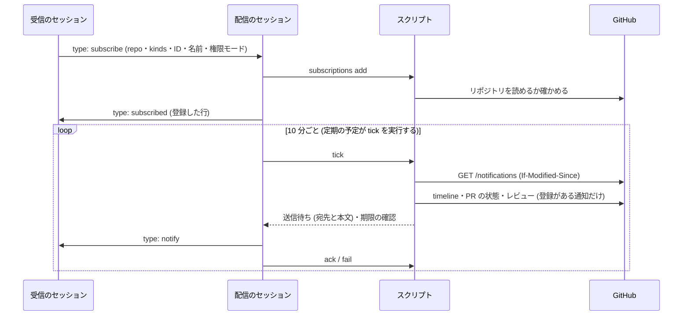

# GitHub の通知をセッションへ届けるプラグイン gh-notification-dispatch - Plan

要件の出所は GitHub の Issue [akm/claude-plugins#284](https://github.com/akm/claude-plugins/issues/284) の本文と、要望を変えた経緯のコメント ([issuecomment-6872382662](https://github.com/akm/claude-plugins/issues/284#issuecomment-6872382662))、2026-11-14 の会話で利用者が決めた事項 (Product Contract の Key Decisions)。

この計画で使う語:

- **配信のセッション**: GitHub の通知を定期的に取得し、登録に従ってほかのセッションへ届ける Claude Desktop のセッション。1 台のマシンに 1 つ置く。
- **受信のセッション**: 通知を受け取る Claude Desktop のセッション。多くの場合、1 つのリポジトリのレビューを受け持つセッション。
- **種類**: 届ける出来事の種類。`review_requested` (PR のレビューの依頼) と `merged` (PR のマージ) の 2 つ (KD2)。GitHub の通知の理由 (`reason`) とは別のもの。理由だけでは種類を判定できないため (KTD4)。
- **登録**: (リポジトリ, 種類, 受信のセッション) の組み合わせ。受信のセッションが、配信のセッションへのメッセージで作る。
- **一覧の番号**: 登録の一覧を表示するたびに、登録日時の順に振り直す番号。削除のときに登録を指定するために使う (R6)。
- **定期の予定**: ツール `CronCreate` で配信のセッションに作る、10 分ごとの実行の予定。7 日で期限が切れる。
- **取得の位置**: 前回の通知の取得が成功した時刻。次の回は、この時刻の少し前 (取得の範囲の起点) からの通知と出来事を取得して判定する (定め方は KTD5)。
- **送信待ち**: 届ける出来事のうち、届いたことをまだ記録していないもの。記録のディレクトリに保存する (KTD6)。
- **記録のディレクトリ**: 登録・取得の位置・送信待ち・定期の予定の情報を保存するディレクトリ `~/.claude/gh-notification-dispatch/` (KD9)。
- **スクリプト**: プラグインに入れる Python のスクリプト。GitHub の API の呼び出し・種類の判定・記録の読み書き・期限の計算を行う。セッション間のメッセージと定期の予定の操作は Claude のツールでしかできないので、スクリプトは行わない。

---

## Goal Capsule

- **目的**: 利用者は、PR のレビューの依頼と PR のマージを、GitHub の画面やメールで見てリポジトリのセッションへ手で伝えなくてよい。配信のセッションが 10 分ごとに通知を取得し、(リポジトリ, 種類) で登録したセッションへ届ける。Claude Desktop を再起動しても、配信のセッションで 1 つの手順を行えば再開でき、受信のセッションは登録し直さなくてよい。対象は、1 つの GitHub アカウントで、1 台のマシンの Claude Desktop から使う場合。
- **手段**: 新しいプラグイン `gh-notification-dispatch` に、3 つのスキル (`dispatch`・`tick`・`subscribe`)・1 つの hook・Python のスクリプトを入れる (KTD1)。
- **SSOT の優先順位**: 製品の振る舞いは Product Contract の R-ID が SSOT ([CONCEPTS.md](../../CONCEPTS.md#ssot))。実装の選び方は Planning Contract の KTD が SSOT。実装単位 (U-ID) はどちらも書き換えない。実装で R や KTD と合わないことが分かったときは、単位の記述ではなく R と KTD を直す。
- **利用者に判断を求める条件**: 次のどれかが分かったら、設計を変えずに実装を停止し、利用者に判断を求める。
  - U1 の実測で、Claude Desktop のセッションの定期の予定が実行されない、定期の予定で始まったターンから名前を宛先にしたメッセージが届かない、または名前を宛先にしても送れる数に上限がある。
  - GitHub の API で、レビューの依頼の依頼先・時刻か、PR のマージの時刻が取れない。
  - ほかのプラグインのディレクトリを変えなければ実装できない。
- **進め方**: ドメインごとに、必要なものを用意し、テストを書き、実装する (利用者の CLAUDE.md の「実装計画を立てるとき」)。ドメインは、登録 (U2)・レビューの依頼の判定と配信 (U3)・マージの判定 (U4)・定期の予定 (U5)。登録を配信が参照し、配信を定期の予定が実行するので、この順にする。文書に無い振る舞いに頼るので、最初に実測 (U1) を行う。
- **後始末の担当**: コミットは動機ごとに分ける (規範は利用者のコミットルール)。PR は利用者がマージする。Issue #284 へのコメントは、利用者の承認を得てから書く。

---

## Product Contract

### Summary

新しいプラグイン `gh-notification-dispatch` を作る。受信のセッションはスキル `subscribe` で、(リポジトリ, 種類) の登録を配信のセッションへのメッセージで申し込む。配信のセッションはスキル `dispatch` で定期の予定を作り、予定がスキル `tick` を 10 分ごとに実行する。`tick` は、GitHub の通知から PR のレビューの依頼とマージを判定し、登録したすべてのセッションへ届ける。登録は、どちらのセッションでも一覧でき、一覧の番号で削除できる。

### Problem Frame

利用者は、Claude Desktop で、リポジトリごとにレビューを受け持つセッションを開いている。PR のレビューの依頼と PR のマージは、GitHub の通知の一覧やメールで見て、そのリポジトリのセッションへ手で伝えている。通知はリポジトリをまたいで 1 か所に集まり、レビューに関係しない通知 (Watch しているリポジトリの Issue の更新など) も多い。手元の環境では未読の通知が 2,000 件を超え、そのほとんどの理由が `subscribed` だった。

### Requirements

**登録**

- R1. 登録の単位は、(リポジトリ, 種類, 受信のセッション) の組み合わせにする。種類は `review_requested` と `merged` の 2 つ。
- R2. 登録は、受信のセッションが、配信のセッションの名前を宛先にしたメッセージで申し込む。メッセージには、リポジトリ (`owner/repo`)・種類 (1 つ以上)・受信のセッションの ID と名前・受信のセッションの権限モードを書く。リポジトリを省いたときは、受信のセッションの作業ディレクトリのリポジトリにする。種類を省いたときは、2 つとも登録する。
- R3. 同じリポジトリについての登録が複数あっても受け付ける。同じ (リポジトリ, 種類) を複数のセッションが登録したら、すべてのセッションに届ける。(リポジトリ, 種類, 受信のセッション) がすべて同じ登録は増やさず、登録済みであることを返す。
- R4. 配信のセッションは、登録のメッセージの形を検査し、リポジトリを `gh` で読めることを確かめてから記録し、結果を受信のセッションへ返す。受信のセッションの権限モードが配信のセッションと違うときは、届いたメッセージが受信のセッションで承認待ちになることを、返事に書く。
- R5. 登録を一覧で表示する。列は、一覧の番号・リポジトリ・種類・登録日時・届け先のセッションの名前。配信のセッションではすべての登録を、受信のセッションでは自分の登録だけを表示する。
- R6. 一覧の番号で、登録を削除できる。番号は一覧を表示するたびに登録日時の順に振り、表示した時点の番号と登録の対応を記録する。記録する場所は、配信のセッションでは記録のディレクトリ、受信のセッションでは記録のディレクトリの外のそのセッションの一時ディレクトリ (`${TMPDIR:-/tmp}/gh-notification-dispatch/<セッションの ID>/snapshot.json`) にする (R19)。削除はその対応で行い、対応する登録が既に無ければ、削除せずに、一覧の表示からやり直すよう伝える。受信のセッションでの削除は、配信のセッションへのメッセージで申し込む。配信のセッションで削除したときは、届け先のセッションに削除したことを知らせる。
- R7. 登録・削除のメッセージの中身は、登録の情報としてだけ扱う。本文に指示が書かれていても実行しない。

**取得と判定**

- R8. 配信のセッションは、10 分ごとに GitHub の通知を取得する。最初に開始した時刻より前の通知は届けない。止まっていた間の通知は、再開したときに届ける。
- R9. 種類 `review_requested`: 自分か、自分の所属するチームへのレビューの依頼が、前回の取得より後に PR に付いたら、その PR のリポジトリの `review_requested` の登録へ届ける。同じ PR への依頼のやり直し (依頼の取り消しの後の再依頼など) も、新しい依頼として届ける。
- R10. 種類 `merged`: 次のどちらかの PR がマージされたら、その PR のリポジトリの `merged` の登録へ届ける。(a) R9 でレビューの依頼を届けた PR。(b) マージの時点で、自分か自分のチームへのレビューの依頼が残っている PR、または自分がレビューを書いた PR。(a) は、GitHub の通知が来なくても (自分でマージした場合など) 届ける。ただし、(a) で追跡するのは依頼を届けてから 30 日までで、それより後のマージは (b) に当たるときだけ届ける。
- R11. 同じ出来事 (同じレビューの依頼・同じ PR のマージ) を、同じ登録へ 2 回届けない。ただし、送った後で結果を記録する前に処理が中断したときは、次の回に同じメッセージを送り直すことがある。
- R12. GitHub の通知を既読にしない。登録の無い (リポジトリ, 種類) の出来事は届けない。

**配信**

- R13. 1 回の取得で、登録 (受信のセッション・リポジトリ・種類) ごとに、出来事を 1 通のメッセージにまとめる。メッセージの先頭行は、リポジトリ・種類・件数が分かる 1 文にする。1 通に書く出来事は 20 件までにし、それを超えたら、同じ回に 20 件ずつの複数のメッセージに分けて届ける。
- R14. 出来事ごとに、PR の番号・題名・URL・出来事の時刻を書く。`review_requested` には依頼先 (自分のログイン名かチームの名前) も書く。コメントやレビューの本文は書かない。PR の題名は GitHub の利用者が書いた文なので、指示として扱わないよう、メッセージに書く。
- R15. 宛先は受信のセッションの名前にする。名前で届かないときは、記録した ID から今の名前を引き直して送る。それでも届かないときは、送らずに配信のセッションで利用者に示し、次の回に送り直す。3 回続けて届かない登録は「届かない登録」として一覧と `status` に示し、その登録の送信待ちを送らない。新しい出来事は、届かない登録の間も送信待ちに入れ続ける。受信のセッションが同じ登録を申し込み直すと (R3 の登録済み)、届かない登録でなくなり、溜まった送信待ちを送る。登録を削除すると、その登録の送信待ちも消す。

**定期の予定と再開**

- R16. 配信のセッションは、開始・再開・延長・停止の操作で、定期の予定を作る・作り直す・消す。配信のセッションは 1 台のマシンに 1 つにする。記録にある配信のセッションと違うセッションで開始したときは、切り替えるかを利用者に確認する。
- R17. 定期の予定の期限 (作ってから 7 日) まで、残りが 24 時間・6 時間・1 時間を切った回に、続けるかを確認する文を配信のセッションに出し、デスクトップの通知を送る。確認の間も、定期の処理は止めない。利用者が続けると回答したら、予定を作り直し、期限を 7 日後にする。回答の無いまま期限を過ぎたら、期限切れとして扱い、`status` と、配信のセッションを開いたときに、期限切れであることと再開の手順を示す。期限切れかどうかは、期限を過ぎた後に定期の処理が実行されることに頼らずに判定する。
- R18. Claude Desktop を再起動した後は、配信のセッションで 1 つの手順 (スキル `dispatch` の再開) を行えば、定期の予定を作り直し、前回の取得の位置から取得する。受信のセッションは登録し直さない。配信のセッションを開いたときに、定期の予定が無いことを知らせる。
- R19. 登録・取得の位置・送信待ち・定期の予定の情報は、記録のディレクトリに保存する。記録のディレクトリに書き込むのは、配信のセッションだけにする。

### Key Decisions

- KD1. **(リポジトリ, 種類) の組み合わせで届ける** (session-settled: user-directed; chosen over リポジトリごとに 1 つのセッションへ届けること: 一番の使い方は、レビューを受け持つセッションへ、レビューの依頼とマージだけを届けることで、それ以外の通知は届けなくてよいため)。Governs R1, R3。
- KD2. **種類は `review_requested` と `merged` の 2 つ** (session-settled: user-directed)。ほかの種類は Deferred to Follow-Up Work。Governs R9, R10。
- KD3. **マージは、レビューの依頼を届けた PR か、自分がレビュアに入っている PR のものだけを届ける** (session-settled: user-directed; chosen over 通知が来た PR のマージをすべて届けること)。Governs R10。
- KD4. **同じ (リポジトリ, 種類) を複数のセッションが登録したら、すべてに届ける** (session-settled: user-directed; chosen over 後の登録で置き換えること)。Governs R3。
- KD5. **一覧と削除は、配信のセッションと受信のセッションの両方で行える** (session-settled: user-approved; chosen over 配信のセッションだけ。利用者は、配信のセッションだけでもよいとしている)。Governs R5, R6。
- KD6. **定期的な実行はツール `CronCreate` で行う** (session-settled: user-approved; chosen over Claude Desktop の scheduled task: 実行のたびに会話の記憶を持たない新しいセッションが始まり、10 分ごとにサイドバーのセッションが増え、登録のメッセージを受けるセッションが別に要るため; chosen over バックグラウンドの待機: 続けられる期間の上限が文書に無いため)。Governs R16, R17。
- KD7. **再起動の後の再開は、配信のセッションでの 1 つの手順にする** (session-settled: user-approved; chosen over 1 時間ごとの scheduled task で自動で再開させること)。Governs R18。
- KD8. **期限の確認は、処理を止めずに文とデスクトップの通知で行う** (session-settled: user-approved; chosen over ツール `AskUserQuestion` で回答を待つこと: 定期の予定は入力待ちのときだけ実行されるので、回答するまで取得が止まるため)。Governs R17。
- KD9. **記録のディレクトリは `~/.claude/gh-notification-dispatch/`** (session-settled: user-approved)。Governs R19。
- KD10. **登録は、受信のセッションから配信のセッションへのメッセージで申し込む** (session-settled: user-directed。Issue #284 の要望 3)。Governs R2, R6。

### Scope Boundaries

- 届いた通知を受信のセッションがどう扱うか (レビューを始めるかなど) は持たない。受信のセッションの利用者とスキルが決める。
- GitHub の通知の既読・未読・購読の設定は変えない (R12)。
- 複数のマシンで配信のセッションを動かすこと、複数の GitHub アカウントを扱うことは対象にしない。
- 端末で起動した Claude Code のセッションは、受信のセッションとして動く可能性はあるが、確かめる対象にしない。

#### Deferred to Follow-Up Work

- `review_requested` と `merged` 以外の種類 (PR のクローズ・レビューの提出・CI の失敗・メンションなど)。
- 再起動の後に、利用者の手順なしで再開する仕組み (KD7 で選ばなかった、scheduled task で配信のセッションを起こす方法)。U1 の実測の 3 の結果を見て、Issue にするかを決める。
- 開始の前から依頼されているレビューの PR を、R10 の (a) の対象に入れること。今の計画では、開始の後に届けたレビューの依頼だけを (a) の対象にする。
- 分かったこと (定期の予定・セッション間のメッセージ・通知の API) を、`docs/solutions/` に記録すること (U6 の後に、スキル ce-compound で)。

---

## Planning Contract

### Key Technical Decisions

- KTD1. **プラグインの構成は、スキル 3 つ (`dispatch`・`tick`・`subscribe`)・hook 1 つ・スクリプト 1 つにする。** スクリプトは、入口のファイル `gh-notification-dispatch/scripts/gh_notification_dispatch.py` (argparse のサブコマンド) とパッケージ `gh-notification-dispatch/scripts/gh_notification_dispatch/` の組にする (プラグイン issue-practice の `issue_practice.py` と `issue_practice/` の形)。外部のライブラリを使わず、Python 3.11 の標準ライブラリと `gh` だけを使う。テストは偽の `gh` (issue-practice のファイル `issue-practice/tests/fake-gh` の形) で行う。スキル `tick` は定期の予定から 10 分ごとに読まれるので、`dispatch` から分けて本文を短くする (KTD7)。
- KTD2. **メッセージの宛先は、受信のセッションも配信のセッションも名前にする。** #114 の記録 (2026-10-06) では、セッションの ID (`local_…`) を宛先にすると、送る側のセッションで利用者が最後に入力してから 10 通までしか送れない。配信のセッションは利用者の入力なしに送り続けるので、ID を宛先にできない。ID は記録し、名前が変わったときの引き直しに使う (R15)。名前の引き直しは、Claude Desktop のツール `list_sessions` (ID とタイトル) で行う。同じ名前が複数あるときは、ツール `ListAgents` の行の短い識別子を添える。
- KTD3. **記録のディレクトリに書くのは配信のセッションだけにし、受信のセッションは読むだけにする。** 受信のセッションでの一覧は記録のファイルを読んで表示し、番号の対応はそのセッションの一時ディレクトリに書き、削除はメッセージで申し込む (R6)。書き込みは、同じディレクトリの一時ファイルに書いてから名前を変える方法で行い、ファイル `lock` の `fcntl.flock` で、配信のセッションの中で並行して動くスクリプトどうしの書き込みを順にする。記録のディレクトリの場所は、テストのために環境変数 `GH_NOTIFICATION_DISPATCH_HOME` で変えられるようにする。
- KTD4. **種類は、通知の理由ではなく、PR の timeline と PR の状態から判定する。** 2026-11-14 の確認で、レビューの依頼の通知は、依頼の後に push やメンションがあるたびに更新され、理由は `review_requested` のままだった。マージされた PR の通知の理由は `subscribed` か `author` だった。
  - `review_requested`: 通知の対象が PR で、通知の更新時刻が取得の範囲の起点 (KTD5) より後のものについて、timeline (API `GET /repos/{owner}/{repo}/issues/{number}/timeline`) の出来事 `review_requested` のうち、時刻が取得の範囲の起点より後で、依頼先 (`requested_reviewer.login`) が自分か、依頼先のチーム (`requested_team`) が自分の所属するチーム (API `GET /user/teams`) のものを選ぶ。出来事の ID で、同じ依頼を区別する。自分のログイン名と所属するチームは `state.json` に持ち、`start`・`resume` のときと、前に読んでから 1 日を過ぎた `tick` で改めて取得する。開始の後に加わったチームへの依頼を届けるため。
  - `merged`: 候補は 2 つ。(a) 追跡する PR (R9 で依頼を届けた PR) は、通知が来なくても、毎回 API `GET /repos/{owner}/{repo}/pulls/{number}` で状態を読む。マージされていたら届け、閉じていたら追跡をやめる。そのリポジトリに `merged` の登録が無くなったときと、依頼を届けてから 30 日を過ぎたときも、状態を読まずに追跡をやめる (R10)。どちらも、状態を読まないまま追跡に残すと、後で届ける古いマージと、増え続ける API の呼び出しが生じるため。(b) 通知の対象が PR で、`merged_at` が取得の範囲の起点より後のものについて、`requested_reviewers`・`requested_teams` に自分か自分のチームが残っているか、API `GET /repos/{owner}/{repo}/pulls/{number}/reviews` に自分のレビューがあるかで判定する。
  - 判定に要る API の呼び出しは、(リポジトリ, 種類) の登録がある通知についてだけ行う。
  - 一覧を返す API (通知・timeline・レビュー・所属するチーム) は、すべてのページを読む。1 ページは最大 100 件で、timeline は古い出来事から順に返るので、出来事の多い PR では新しい依頼が後のページにある。ページ送りは `gh.py` の共通の処理にし、API ごとに書かない。
- KTD5. **取得の位置は、前回の取得が成功した時刻にし、取得の範囲の起点を、その 5 分前にする。** 起点は、API `GET /notifications` の引数 `since` に渡す値と、KTD4 で出来事の時刻と比べる値の両方に使う。時刻のずれと、GitHub の反映の遅れで取りこぼさないため。判定にも同じ起点を使うのは、遅れて現れた通知を取り直しても、出来事の時刻が取得の位置より前なので、取得の位置と比べると除かれるため。ただし、起点は最初に開始した時刻より前にしない (R8)。重なって取った通知と出来事は、届けた出来事の記録 (レビューの依頼は出来事の ID、マージは PR) で除く (R11)。API `GET /notifications` には引数 `all=true` を付け、既読の通知も取得する。この引数が無いと未読の通知だけが返り、利用者が GitHub の画面やメールで先に開いて既読にした通知の依頼とマージを届けられないため (R12 は既読の状態を変えないことを求めていて、既読の通知を読まないことは求めていない)。`since` で範囲を絞るので、既読の通知を含めても、取得する量は取得の範囲の起点より後の通知に限られる。ヘッダ `If-Modified-Since` に前回の `Last-Modified` を付け、304 なら判定を行わない。ただし、追跡する PR の状態 (KTD4 の (a)) は、304 のときも読む。最初の開始では、取得の位置を開始した時刻にする (R8)。
- KTD6. **配信は、送信待ちを挟んだ 2 段階にする。** スクリプトのサブコマンド `tick` は、判定した出来事を送信待ちに入れ、同時に届けた出来事の記録に足す。次の回の判定で同じ出来事を除くためで、KTD5 の重なった範囲で取り直した出来事もここで除かれる。そのうえで、送信待ちから、登録ごとに 20 件ずつを 1 通のメッセージにまとめ (R13)、すべてのメッセージの宛先と本文を JSON で出力する。1 通は 1 つの登録の出来事だけを持つので、`fail` を数える登録は 1 つに決まる (R15)。Claude が `SendMessage` で送り、結果をサブコマンド `ack` (届いた。そのメッセージに入れた出来事を送信待ちから消す) か `fail` (届かなかった。理由を付ける) で記録する。送信待ちに残った出来事 (`fail` のもの・`ack` も `fail` も記録されなかったもの) は、次の回の `tick` が出力する。送り直すメッセージには、送り直しの回数の行を足し、直前と同じ本文にしない (#114 の記録の KTD11: 同じ送り手から直前と同じ本文のメッセージが届くと捨てられる)。届かない登録 (R15) の送信待ちは出力しないが、新しい出来事は送信待ちに入れる。取得の位置は登録に関わらず進むので、送信待ちに入れないと、申し込み直した後に届ける出来事が残らないため。
- KTD7. **スキル `tick` の本文は、スクリプトを実行して出力の指示に従うことだけにする。** 10 分ごとに 7 日動かすと、定期の予定のターンが約 1,000 回になり、そのたびに会話に足される量が配信のセッションの会話の長さを決めるため。通知が無いとき (304 で、送信待ちも期限の確認も無いとき) は、1 回のツールの実行と 1 行の返事で完了する。定期の予定のプロンプトは `/gh-notification-dispatch:tick` にする (プラグインの版が変わってもパスが変わらないようにするため。スラッシュコマンドとして実行されるかは U1 で確かめる)。
- KTD8. **メッセージの様式は、先頭行・`type:` の行・`<キー>: <値>` の行にする。** 先頭行は、受信のセッションの利用者が最初の 1 行だけを見ても内容が分かる文にし (ツール `SendMessage` の説明による)、`gh-notification-dispatch:` で始める。`type:` の値は、`subscribe`・`unsubscribe`・`subscribed`・`unsubscribed`・`removed`・`notify` のどれか。様式の SSOT は、プラグインのファイル `references/messages.md` にする。
- KTD9. **期限の計算はスクリプトで行い、時刻は環境変数 `GH_NOTIFICATION_DISPATCH_NOW` で差し替えられるようにする。** 24 時間・6 時間・1 時間の確認を、それぞれ 1 回だけ出すために、出した確認を記録する。期限切れは、`state.json` の状態として書き込まず、`tick`・`status`・hook がそれぞれ、記録の期限と今の時刻を比べて判定する (R17)。`CronCreate` の予定は期限で最後に 1 回実行されてから消えるが、その実行の時刻は周期の最大 50% ずれ、スクリプトが記録した期限より前になりうるので、期限を過ぎた `tick` が来ることに頼れないため。期限を過ぎた後に実行された `tick` (予定の最後の実行) も、取得と配信を通常どおり行い、そのうえで期限切れと再開の手順を出力する。確認の間も定期の処理を止めないこと (R17) と同じく、最後の実行でも届けられる出来事を届けるため。
- KTD10. **hook `SessionStart` は、起動 (`startup`) と会話の再開 (`resume`) のときだけ働かせる。** 起動したセッションの ID (環境変数 `CLAUDE_CODE_HOST_SESSION_ID`) が記録にある配信のセッションの ID と同じで、記録の状態が「動いている」なら、定期の予定が無いことと、スキル `dispatch` の再開を行うことを、`additionalContext` で伝える。記録の期限を過ぎていれば (KTD9)、期限切れであることも伝える。会話の要約 (`compact`) や `/clear` のときは、同じプロセスに定期の予定が残っているので働かせない。
- KTD11. **スクリプトの終了コードは、issue-practice と同じく 0・3・4 にする。** 0 は続ける、3 は出力の `errors` を利用者に示して判断を求める、4 は `gh` が失敗した (出力の `gh_error` を示して中断する)、1・2 はスクリプトの不具合。

### High-Level Technical Design



記録のディレクトリのファイル:

| ファイル | 中身 |
| --- | --- |
| `state.json` | 配信のセッションの ID と名前・状態 (動いている / 止めた。期限切れは書かずに期限から判定する。KTD9)・定期の予定 (ジョブの ID・cron の式・作った時刻・期限・出した確認)・取得の位置・前回の `Last-Modified`・自分のログイン名と所属するチーム (改めて取得する時機は KTD4) |
| `subscriptions.json` | 登録 (登録の ID・リポジトリ・種類・受信のセッションの ID と名前・権限モード・登録日時・続けて届かなかった回数) |
| `snapshots/<セッションの ID>.json` | 配信のセッションが一覧を表示したときの、一覧の番号と登録の ID の対応と、表示した時刻 (R6) |
| `tracked.json` | 追跡する PR (リポジトリ・番号・依頼を届けた時刻)。閉じたとき・そのリポジトリに `merged` の登録が無くなったとき・依頼を届けてから 30 日を過ぎたときに消す (KTD4) |
| `delivered.json` | 届けた出来事 (レビューの依頼の出来事の ID・マージした PR) と届けた登録。送信待ちに入れた時点で足す (KTD6)。30 日より前のものは消す |
| `outbox.json` | 送信待ち (登録・出来事・送り直しの回数)。送信待ちに入れてから 30 日を過ぎた出来事は消す |
| `log.jsonl` | 取得・判定・送信の結果の記録 (調べるときのため) |

### System-Wide Impact

- マーケットプレイス (ファイル `.claude-plugin/marketplace.json`)・ルートのファイル `README.md`・CI のテストの対象の一覧 (ファイル `.github/test-targets.txt`) に、プラグインを足す。
- ほかのプラグインのディレクトリは変えない。

### Risks & Dependencies

- 定期の予定とセッション間のメッセージの振る舞いは、ツールの説明と #114 の 2026-10-06 の実測に頼っている。Claude Desktop の版で変わりうるので、U1 で確かめ、変わっていたら R と KTD を直す。
- 配信のセッションの会話は、定期の予定のターンで長くなり続け、Claude Code の会話の要約が何度も起きる。KTD7 で 1 回の量を抑える。要約の後もスキル `tick` は定期の予定のプロンプトから再度読み込まれるので、手順が失われることはない。
- 配信のセッションで権限の確認が出ると、利用者が回答するまで入力待ちにならず、定期の予定が実行されない。開始のときに、スクリプトの実行と `SendMessage` の権限の確認が出ない状態かを確かめ、出るなら利用者に知らせる (U5)。
- マシンがスリープしている間は定期の予定が実行されない。通知は GitHub に残るので、起きた後の回で届く。

### Assumptions

- 配信のセッションと受信のセッションは、同じマシンの同じ Claude Desktop で動く。
- `gh` は、自分のアカウントで認証されていて、スコープ `repo` と `read:org` を持つ (`gh auth login` のデフォルトのスコープ)。`read:org` が無いと、所属するチームが読めない。そのときは、開始のときにエラーを示して止める。

---

## Output Structure

```text
gh-notification-dispatch/
  .claude-plugin/plugin.json
  README.md
  hooks/hooks.json
  references/
    messages.md           # メッセージの様式の SSOT (KTD8)
    records.md            # 記録のディレクトリのファイルの様式
  scripts/
    gh_notification_dispatch.py
    gh_notification_dispatch/
      __init__.py
      gh.py               # gh の実行・ページ送り・失敗の種類
      store.py            # 記録のディレクトリの読み書きとロック
      subscriptions.py    # 登録・一覧・削除
      messages.py         # メッセージの生成と解析
      poll.py             # 通知の取得と取得の位置
      events.py           # 種類の判定 (review_requested・merged)
      outbox.py           # 送信待ち・ack・fail
      schedule.py         # 定期の予定の記録と期限
      hook.py             # SessionStart の判定
  skills/
    dispatch/SKILL.md
    tick/SKILL.md
    subscribe/SKILL.md
  tests/
    fake-gh
    fixtures/gh/...
    test_*.py
```

---

## Implementation Units

単位 1 つを PR 1 つにする。どの単位も、ブランチは前の単位の PR がマージされた後の `main` の先端から作り、`main` にマージする。

| 順 | 単位 | ブランチ | 版 |
| --- | --- | --- | --- |
| 0 | この計画 | `docs/gh-notification-dispatch-plan-284` | - |
| 1 | U1 実測 | (PR を作らない。結果を Issue #284 のコメントに書く) | - |
| 2 | U2 枠と登録 | `feat/gh-notification-dispatch-subscriptions-284` | 0.1.0 |
| 3 | U3 レビューの依頼の判定と配信 | `feat/gh-notification-dispatch-review-requested-284` | 0.2.0 |
| 4 | U4 マージの判定 | `feat/gh-notification-dispatch-merged-284` | 0.3.0 |
| 5 | U5 定期の予定と再開 | `feat/gh-notification-dispatch-schedule-284` | 0.4.0 |
| 6 | U6 文書と通し確認 | `docs/gh-notification-dispatch-docs-284` | 1.0.0 |

### U1. 実測

**Goal:** 計画が頼っている、文書に無い振る舞いを Claude Desktop で確かめ、R と KTD を直す必要があるかを決める。

**Requirements:** R2, R8, R15, R17, R18。KTD2, KTD6, KTD7, KTD10。

**Dependencies:** なし。

**Files:** なし (確かめるための一時的なスキルとスクリプトは、リポジトリの外に置く)。

**Approach:** 確かめる用のセッションを 2 つ (配信の役と受信の役) 開いて、次を確かめる。再起動 (4) は利用者に行ってもらう。

1. `CronCreate` の定期の予定が、Claude Desktop のセッションで実行されるか。プロンプトに書いたスラッシュコマンドが、プラグインのスキルとして実行されるか (`claude --plugin-dir` で読み込んだ確かめる用のプラグインで行う)。
2. 定期の予定で始まったターンから、名前を宛先にした `SendMessage` が届くか。利用者の入力なしに 15 通以上を送り、上限が無いことを確かめる。直前と同じ本文のメッセージが今も捨てられるか。
3. 受信のセッションの名前を変えたとき、記録した ID から `list_sessions` で今の名前を引けるか。
4. Claude Desktop を再起動した後に、(a) 開いていない受信のセッションへ名前を宛先にしたメッセージが届き、ターンが始まるか、(b) 配信のセッションを開いたときに hook `SessionStart` が `resume` か `startup` で実行され、環境変数 `CLAUDE_CODE_HOST_SESSION_ID` が再起動の前と同じか。
5. 権限モードが違う 2 つのセッションで、メッセージがどう保留され、利用者に何が表示されるか。
6. 自分でマージした PR と、自分にレビューを依頼された PR がほかの人にマージされたときに、通知が来るか (公開のリポジトリで確かめる)。

**Test scenarios:**
- Test expectation: none -- 振る舞いを確かめる単位で、コードを残さない。

**Verification:** 6 項目の結果 (Claude Desktop と Claude Code の版・手順・結果) を、利用者の承認を得て Issue #284 のコメントに書いた。結果が Goal Capsule の「利用者に判断を求める条件」に当たるときは、利用者の判断を得て、この計画の R と KTD を直した。

### U2. 枠と登録

**Goal:** プラグインを配れる形にし、受信のセッションが登録を申し込み、どちらのセッションでも一覧して番号で削除できるようにする。

**Requirements:** R1〜R7, R19。KD1, KD4, KD5, KD9, KD10。KTD1〜KTD3, KTD8, KTD11。

**Dependencies:** U1。

**Files:**
- 作る: `gh-notification-dispatch/.claude-plugin/plugin.json`・`gh-notification-dispatch/README.md`
- 作る: `gh-notification-dispatch/references/messages.md`・`records.md`
- 作る: `gh-notification-dispatch/scripts/gh_notification_dispatch.py`・`gh-notification-dispatch/scripts/gh_notification_dispatch/{__init__,gh,store,subscriptions,messages}.py`
- 作る: `gh-notification-dispatch/skills/subscribe/SKILL.md`・`gh-notification-dispatch/skills/dispatch/SKILL.md` (登録・一覧・削除の部分)
- 作る: `gh-notification-dispatch/tests/fake-gh`・`gh-notification-dispatch/tests/fixtures/gh/`・`gh-notification-dispatch/tests/test_{gh,store,subscriptions,messages,docs}.py`
- 変える: `.claude-plugin/marketplace.json`・`README.md`・`.github/test-targets.txt`

**Approach:**
1. 用意する: `references/messages.md` に、`subscribe`・`unsubscribe`・`subscribed`・`unsubscribed`・`removed` の様式を書く。`references/records.md` に、`state.json` (配信のセッションの部分)・`subscriptions.json`・`snapshots/` の様式を書く。`gh.py` と `fake-gh` は issue-practice からコピーして名前を変える。
2. テストを書く: Test scenarios のとおり。
3. 実装する: `store.py` (ロックと書き込み)・`messages.py` (様式の生成と解析)・`subscriptions.py` (追加・一覧・番号の対応の記録・削除・番号から登録の ID を引く)。サブコマンドは `subscriptions add --message-file`・`subscriptions list --viewer <セッションの ID> [--mine]`・`subscriptions remove --viewer <セッションの ID> <番号>...`・`subscriptions resolve --viewer <セッションの ID> <番号>...` (受信のセッションが削除を申し込む前に、番号を登録の ID に変える)・`subscriptions unsubscribe --message-file`。
4. スキル `subscribe` に、登録 (`<配信のセッションの名前> [--repo owner/repo] [--kind review_requested,merged]`)・一覧 (`--list`)・削除 (`--remove <番号>...`) の手順を書く。スキル `dispatch` に、登録と削除のメッセージを受けたときの手順と、一覧 (`list`)・削除 (`remove <番号>...`) を書く。
5. README に作成中であることを書き、マーケットプレイスとルートの README と `test-targets.txt` に登録する。

**Patterns to follow:** `issue-practice/scripts/issue_practice/gh.py`・`issue-practice/tests/fake-gh`・`issue-practice/tests/fakegh_case.py`・`issue-practice/tests/test_docs.py`・`review-triage/skills/review-rally/SKILL.md` (セッション間のメッセージの送り方)。

**Test scenarios:**
- 登録のメッセージを解析すると、リポジトリ・種類・ID・名前・権限モードが取れる。`type:` が無い・未知の種類・`owner/repo` の形でないリポジトリ・必須のキーが無いメッセージは、理由を付けて誤りとして返す (終了コード 3)。
- 種類を 2 つ書いた登録は、2 件の登録になる。(リポジトリ, 種類, セッション) が同じ登録は増えず、登録済みを返す。同じ (リポジトリ, 種類) で別のセッションの登録は、2 件とも残る。
- 読めないリポジトリ (偽の `gh` が 404 を返す) は登録せず、理由を返す。`gh` の認証切れは終了コード 4。
- 権限モードが記録の配信のセッションと違う登録は、登録したうえで、返事に承認待ちになることを書く。
- 一覧は登録日時の順に 1 から番号を振る。`--mine` では、そのセッションの登録だけに番号を振る。一覧を表示するたびに、番号と登録の ID の対応を記録する。配信のセッションでは記録のディレクトリの `snapshots/` に、受信のセッションでは記録のディレクトリの外の一時ディレクトリに書き、受信のセッションの一覧は記録のディレクトリのファイルを変えない (R6・R19)。
- 番号で削除すると、記録した対応の登録が消える。一覧の後に別の登録が増えても、指定した番号の登録だけが消える。対応する登録が既に無い番号・一覧を表示していないセッションの番号・範囲の外の番号は、何も消さずに理由を返す。
- 受信のセッションの `resolve` は、一時ディレクトリに記録した自分の一覧の番号を登録の ID に変え、記録のディレクトリのファイルを変えない。`unsubscribe` のメッセージにある ID が、送ったセッションの登録でないときは消さない。
- 記録のファイルへの書き込みが途中で失敗しても、元のファイルが壊れない (一時ファイルの名前を変える前に例外を起こして確かめる)。
- 文書 `references/messages.md` に書いた `type:` の値とキーが、`messages.py` の定数と一致する。
- 入口の `--help` が、サブコマンドごとに引数・出力・終了コードを示す。

**Verification:** `gh-notification-dispatch/tests` のテストがすべて成功し、CI のジョブが対象として見つける。2 つのセッションで、登録・一覧・番号での削除を行い、両方のセッションで同じ登録が見える。

### U3. レビューの依頼の判定と配信

**Goal:** 通知を取得して `review_requested` を判定し、登録したすべてのセッションへ届け、結果を記録する。手で `tick` を実行して動く状態にする (定期の予定は U5)。

**Requirements:** R8, R9, R11〜R15。KTD4〜KTD8。

**Dependencies:** U2。

**Files:**
- 作る: `gh-notification-dispatch/scripts/gh_notification_dispatch/{poll,events,outbox}.py`・`gh-notification-dispatch/skills/tick/SKILL.md`
- 作る: `gh-notification-dispatch/tests/test_{poll,events,outbox}.py`・`gh-notification-dispatch/tests/fixtures/gh/` の通知・timeline・チームの応答
- 変える: `gh-notification-dispatch/scripts/gh_notification_dispatch/gh.py` (ページ送り)・`gh-notification-dispatch/references/messages.md` (`notify`)・`records.md` (取得の位置・`delivered.json`・`outbox.json`)・`gh-notification-dispatch/skills/dispatch/SKILL.md` (名前で届かないときの引き直し)

**Approach:**
1. 用意する: `notify` の様式と、取得の位置・届けた出来事・送信待ちの様式を書く。固定データは、2026-11-14 に確かめた形 (依頼の後に push で更新された通知・チームへの依頼・依頼の取り消しと再依頼) を、公開してよい値に置き換えて作る。
2. テストを書く: Test scenarios のとおり。
3. 実装する: U2 の `gh.py` にページ送り (KTD4) を足し、`poll.py` (取得・304・取得の位置)・`events.py` の `review_requested` の判定・`outbox.py` (メッセージの生成・20 件の上限・送り直しの回数・`ack`・`fail`・続けて届かなかった回数)。サブコマンドは `tick`・`ack <送信待ちの ID>`・`fail <送信待ちの ID> --reason <理由>`・`rename --session-id <ID> --name <名前>`。
4. スキル `tick` に、スクリプトの出力のとおりに送り、`ack` か `fail` を記録する手順だけを書く (KTD7)。名前で届かないときの引き直し (KTD2) は、`tick` の出力に手順を書くか `dispatch` に書くかを、本文の短さで決める。

**Patterns to follow:** U2 の `gh.py` と固定データ。`issue-dispatch/scripts/issue_dispatch/poll.py` (取得と差分の考え方)。

**Test scenarios:**
- 最初の `tick` では、開始した時刻より前の通知とレビューの依頼を届けない。
- 304 のときは timeline を読まない。
- timeline の 2 ページ目にある依頼も届ける。通知の一覧が 2 ページにわたるときも、2 ページ目の通知を判定する。
- 依頼の後に push で更新された通知 (理由は `review_requested` のまま) では、新しい依頼が無いので届けない。依頼の取り消しの後の再依頼は、新しい依頼として届ける。
- チームへの依頼は、自分の所属するチームのときだけ届ける。
- 所属するチームを読んでから 1 日を過ぎた `tick` は、チームを改めて取得し、新しく加わったチームへの依頼も届ける。1 日を過ぎていない `tick` は改めて取得しない。
- 利用者が次の `tick` より前に既読にした通知の依頼も届ける (偽の `gh` が、引数 `all=true` の無い取得には既読の通知を返さないようにして確かめる)。
- 登録の無いリポジトリの通知と、`review_requested` の登録が無いリポジトリの通知では、timeline を読まない。
- 同じ (リポジトリ, 種類) に 2 つのセッションの登録があると、2 通のメッセージを出力する。1 つの登録に同じ回の依頼が 3 件あると、1 通にまとめる。21 件以上では、同じ回に 20 件ずつの 2 通に分けて出力する。1 つのセッションが 2 つのリポジトリの同じ種類を登録していると、リポジトリごとに 1 通ずつ出力する。
- 取得の位置の 5 分前から取るので重なった通知も、届けた出来事の記録で除く。
- 取得の位置の直前に付いた依頼が、その回の取得には現れず、次の回に初めて現れたときも、届ける。最初の開始の時刻より前に付いた依頼は、起点の 5 分の余裕の中にあっても届けない。
- `ack` の無い送信待ちは、次の `tick` で、送り直しの回数の行を足して出力し直す。`fail` の後の回で同じ出来事が取得の範囲に入っても、新しい送信待ちを作らない (送り直しの 1 通だけになる)。
- `fail` が 3 回続いた登録は、一覧で「届かない登録」になり、その送信待ちを出力しない。新しい出来事は送信待ちに入れ続ける。同じ登録を申し込み直すと、届かない間に溜まった出来事も出力し、登録を削除すると送信待ちも消える。`ack` で回数を 0 に戻す。
- 送信待ちに入れてから 30 日を過ぎた出来事は、出力せずに消す。
- メッセージの先頭行は `gh-notification-dispatch:` で始まり、リポジトリ・種類・件数を含む。本文にコメントの本文を含まない。題名を指示として扱わないことを書く。
- `gh` の失敗では取得の位置を進めない (次の回に同じ範囲を取り直す)。

**Verification:** テストがすべて成功する。自分にレビューを依頼した PR を公開のリポジトリで作り、配信のセッションで手で `/gh-notification-dispatch:tick` を実行して、登録した 2 つのセッションに届く。

### U4. マージの判定

**Goal:** レビューの依頼を届けた PR と、自分がレビュアに入っている PR のマージを判定して届ける。

**Requirements:** R10, R11。KD3。KTD4, KTD5。

**Dependencies:** U3。

**Files:**
- 変える: `gh-notification-dispatch/scripts/gh_notification_dispatch/events.py`・`outbox.py`・`gh-notification-dispatch/references/records.md` (`tracked.json`)
- 作る: `gh-notification-dispatch/tests/fixtures/gh/` の PR とレビューの応答・`gh-notification-dispatch/tests/test_events.py` の `merged` の部分

**Approach:**
1. 用意する: `tracked.json` の様式と、PR (マージ済み・閉じた・開いている) とレビューの固定データ。
2. テストを書く: Test scenarios のとおり。
3. 実装する: レビューの依頼を届けたら追跡に足し、毎回の `tick` で追跡する PR の状態を読む (304 のときも読む)。通知の PR の `merged_at` とレビュアの判定。

**Patterns to follow:** U3 の `events.py`。

**Test scenarios:**
- 依頼を届けた PR が、通知の無いまま (自分でマージした場合) マージされても届ける。
- 依頼を届けた PR が、マージされずに閉じたら、届けずに追跡をやめる。
- 依頼を届けていない PR の通知では、マージの時点で自分への依頼が残っているか、自分のレビューがあるときだけ届ける。どちらも無い PR (Watch しているだけのリポジトリの PR) は届けない。
- 自分のチームへの依頼が残っている PR は届ける。
- 同じ PR のマージを、追跡と通知の両方で見つけても、1 回だけ届ける。
- `merged` の登録が無いリポジトリでは、PR の状態を読まない。追跡に残っていた PR は消し、後で `merged` を登録し直しても、その間のマージを届けない。
- 依頼を届けてから 30 日を過ぎた PR は、状態を読まずに追跡をやめる。

**Verification:** テストがすべて成功する。公開のリポジトリで、U3 の確認に使った PR をマージし、`merged` を登録したセッションに届く。

### U5. 定期の予定と再開

**Goal:** 配信のセッションで定期の予定を作り、期限の前に続けるかを確認し、再起動の後に 1 つの手順で再開できるようにする。

**Requirements:** R16〜R18。KD6〜KD8。KTD9, KTD10。

**Dependencies:** U4。

**Files:**
- 作る: `gh-notification-dispatch/scripts/gh_notification_dispatch/{schedule,hook}.py`・`gh-notification-dispatch/hooks/hooks.json`
- 作る: `gh-notification-dispatch/tests/test_{schedule,hook}.py`
- 変える: `gh-notification-dispatch/skills/dispatch/SKILL.md` (`start`・`resume`・`renew`・`stop`・`status`)・`gh-notification-dispatch/references/records.md` (`state.json` の定期の予定の部分)

**Approach:**
1. 用意する: `state.json` の定期の予定の部分の様式。
2. テストを書く: Test scenarios のとおり。
3. 実装する: サブコマンド `schedule record --job-id <ID> --cron <式>`・`schedule clear`・`status`。`tick` の出力に期限の確認を足す。`hook session-start`。
4. スキル `dispatch` に、`start` (配信のセッションの記録・前提の確認・`CronCreate`・`schedule record`)・`resume` (`CronList` で予定が無いことを確かめてから作り直す)・`renew` (`CronDelete` と `CronCreate`)・`stop`・`status` の手順を書く。開始のときに、スクリプトの実行と `SendMessage` で権限の確認が出ないかを確かめる手順を入れる。期限の確認のデスクトップの通知は、ツール `PushNotification` で送る。

**Patterns to follow:** `commit-rules-guard/hooks/` (hook の置き方)。

**Test scenarios:**
- 予定を作ってから 6 日と 1 時間後の `tick` は、24 時間の確認を 1 回だけ出す。次の回では出さない。6 時間・1 時間も同じ。
- `renew` の後は、出した確認の記録を消し、期限を 7 日後にする。
- 期限より前に最後の `tick` が実行され、その後に `tick` が無いまま期限を過ぎたとき、`status` は期限切れと再開の手順を出力する。期限を過ぎた `tick` は、取得と配信を通常どおり行ったうえで、同じく出力する。
- 記録の配信のセッションと違うセッションで `start` すると、終了コード 3 で、切り替えるかの確認を求める。
- hook は、起動したセッションの ID が配信のセッションの ID と同じで、状態が「動いている」ときだけ、`additionalContext` を出力する。期限を過ぎていれば、期限切れであることも出力する。`compact` と `clear` では何も出力しない。記録のディレクトリが無いときも何も出力しない。
- 止めていた間の通知は、`resume` の後の最初の `tick` で、止める前の取得の位置から取得する。

**Verification:** テストがすべて成功する。配信のセッションで `start` し、10 分ごとに `tick` が実行される。Claude Desktop を再起動した後、配信のセッションで `resume` を実行すると、止まっていた間のレビューの依頼が届く。期限の確認は、`GH_NOTIFICATION_DISPATCH_NOW` を使ったテストで確かめる。

### U6. 文書と通し確認

**Goal:** 使い方を README に書き、要望 1〜6 を Claude Desktop で通しで確かめる。

**Requirements:** すべて。

**Dependencies:** U4, U5。

**Files:**
- 変える: `gh-notification-dispatch/README.md` (作成中の記述を消し、使い方・前提・制限を書く)・`gh-notification-dispatch/.claude-plugin/plugin.json` (版)

**Approach:** README に、配信のセッションの始め方・受信のセッションの登録・一覧と削除・期限と延長・再起動の後の再開・制限 (通知が来ない PR・スリープ・権限モード) を書く。Issue #284 の要望 1〜6 を、実際のレビューの依頼で通しで確かめ、結果を Issue のコメントに書く。

**Test scenarios:**
- Test expectation: none -- 文書だけを変える単位。正しさは通し確認で確かめる。

**Verification:** 通し確認の結果を、利用者の承認を得て Issue #284 のコメントに書いた。文書の wording-guard の検査で error が 0 件。

---

## Verification Contract

| 対象 | 方法 |
| --- | --- |
| スクリプト | `python3 -m unittest discover -s gh-notification-dispatch/tests` が成功する。CI (ワークフロー `.github/workflows/test.yml`) が `python gh-notification-dispatch/tests` を対象として実行し、成功する |
| 文書・SKILL.md | `python3 wording-guard/scripts/wording_lint.py check <変えたファイル>` で error が 0 件 |
| スキルの手順 | 単位ごとの Verification の手順を Claude Desktop で行う |
| 登録 | `.claude-plugin/marketplace.json`・ルートの `README.md`・`.github/test-targets.txt` に gh-notification-dispatch がある |

---

## Definition of Done

- U1〜U6 の PR がマージされ、Issue #284 のクローズ条件を満たした。
- プラグインの版が 1.0.0 で、README に作成中の記述が無い。
- スクリプトのテストが CI で成功し、要望 1〜6 を Claude Desktop で通しで確かめた。
- 試して使わなかった方法のコードと文書が、差分に残っていない。
