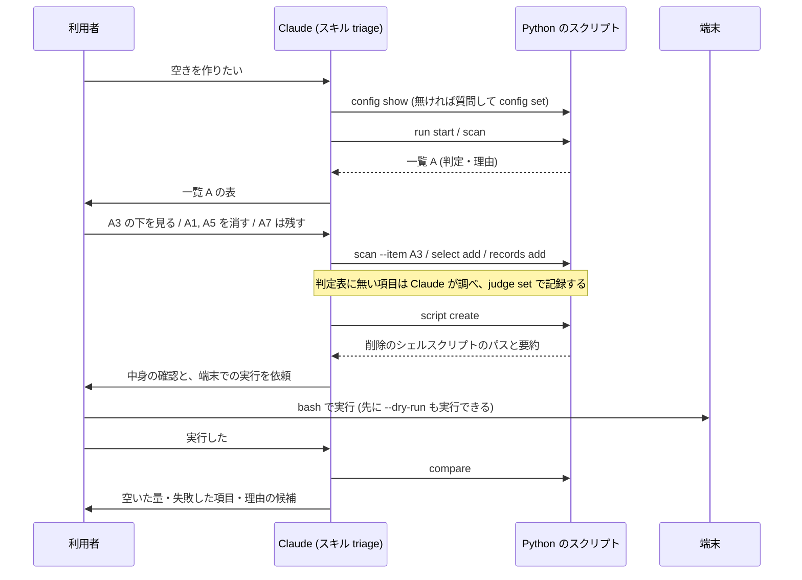
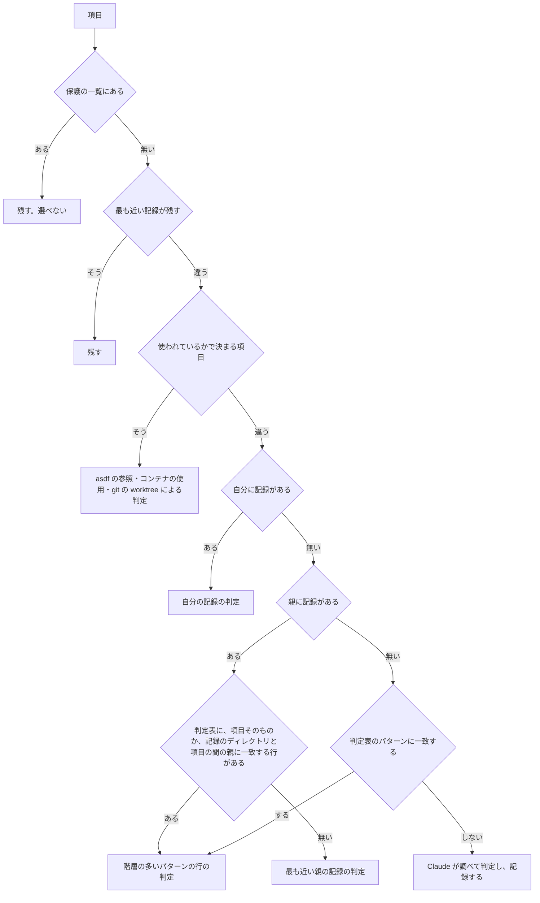

# 容量の大きいディレクトリを確認して削除するプラグイン disk-usage-triage - Plan

要件の出所は GitHub の Issue [akm/claude-plugins#310](https://github.com/akm/claude-plugins/issues/310) の本文と、2026-11-22 の会話で利用者が決めた事項 (Product Contract の Key Decisions)。Issue の要望 5 (アプリの worktree の削除の方法) は、会話で変えた (KD5)。

この計画で使う語:

- **項目**: 一覧の 1 行が表すもの。ディレクトリ・asdf の版・Go のモジュールのキャッシュ・Docker のボリューム・image・停止しているコンテナ・ビルドキャッシュのどれか。
- **判定**: 項目を消してよいかの判断。「消してよい」「確認が要る」「残す」の 3 つ。
- **判定表**: よく知られたディレクトリ (各ツールのキャッシュなど) について、判定・理由・消したときの影響・消すコマンドを書いた、プラグインが持つ表 (KTD5)。
- **保護の一覧**: 消す対象に選べない場所の一覧。プラグインに組み込み、記録で除けない (R14)。
- **記録**: 利用者と Claude が決めた判定を、次回の判定に使うために保存したもの (R18〜R22)。
- **調べるディレクトリ**: 利用者が引数か設定で指定し、`du -d 1` と同じ深さで調べるディレクトリ (R1)。
- **プロジェクトのディレクトリ**: asdf の版の参照 (ファイル `.tool-versions` など) を探すディレクトリ (R2)。
- **トリアージ**: 調べ始めてから、削除の後の比較までの 1 回分の作業。ID は始めた日時。ファイルは、トリアージのディレクトリ `~/.claude/disk-usage-triage/runs/<ID>/` に置く。
- **専用の一覧**: ディレクトリの一覧とは別に作る、asdf の版の一覧と Docker の一覧。
- **選んだ項目**: 利用者が消すと選んだ項目。1 つのトリアージの中で、複数の一覧にまたがって保存する (R10)。
- **削除のシェルスクリプト**: 選んだ項目を消すコマンドを並べたシェルスクリプト。ファイル名は `disk-usage-triage-delete.sh`。利用者が中身を確認してから端末で実行する。
- **Python のスクリプト**: プラグインに入れる Python のスクリプト。項目を調べ、判定し、記録し、一覧にし、削除のシェルスクリプトを作り、比較する。会話・Web などでの調査・Claude Desktop の MCP ツールの呼び出しは Claude が行う。
- **アプリの worktree**: Claude Desktop が Code のセッションのために、リポジトリの下のディレクトリ `.claude/worktrees/` に作った worktree。
- **残された worktree**: アプリの worktree のうち、セッションをアーカイブしたときにコミットしていない変更があったために、アプリが消さずに残したもの。
- **Claude が書いたコマンド**: 判定表に無い項目について、Claude が調べて書いたツールのコマンド (R16)。

---

## Goal Capsule

- **目的**: 利用者は、ディスクの空きが足りなくなったときに、`du -d 1` を手作業で繰り返さずに、容量の大きい項目を、消してよいかの判定と一緒に一覧で見られる。選んだ項目を、中身を確認した削除のシェルスクリプトで消し、空いた量を確認できる。対象は、macOS の Claude Desktop の Code タブのセッションから使う場合。
- **手段**: 新しいプラグイン `disk-usage-triage` に、スキル 1 つ (`triage`)・hook 1 つ・Python のスクリプトを入れる (KTD1)。
- **SSOT の優先順位**: 製品の振る舞いは Product Contract の R-ID が SSOT ([CONCEPTS.md](../../CONCEPTS.md#ssot))。実装の選び方は Planning Contract の KTD が SSOT。実装単位 (U-ID) はどちらも書き換えない。実装で R や KTD と合わないことが分かったときは、単位の記述ではなく R と KTD を直す。
- **利用者に判断を求める条件**: 次のどれかが分かったら、設計を変えずに実装を停止し、利用者に判断を求める。
  - U1 で、利用者がアプリの Terminal パネルで実行したコマンドにも、環境変数 `CLAUDECODE=1` が付く (R38 の検査が、利用者の実行も拒否するため)。
  - U1 で、ディレクトリ `~/Library/Containers` の下を `du` で調べると、macOS の確認のダイアログが出るか、時間の上限 (R4) までに終了しない。
  - U1 で、MCP ツール `mcp__terminal__run_in_terminal` が実行中のコマンドに入力を送れる (R38 の端末からの入力の確認を、Claude が先に進められるため)。
  - U1 で、MCP ツール `mcp__ccd_host__get_storage_usage` と `mcp__ccd_host__discard_kept_worktree` が、R34・R35 の使い方をできない。
  - 削除のコマンドを Claude が実行しなければ確認できない振る舞いがある。
  - ほかのプラグインのディレクトリを変えなければ実装できない。
- **進め方**: ドメインごとに、必要なものを用意し、テストを書き、実装する (利用者の CLAUDE.md の「実装計画を立てるとき」)。ドメインは、設定 (U2)・Claude による実行の拒否 (U8)・判定表と保護の一覧 (U3)・記録 (U4)・ディレクトリの調査 (U5)・一覧と選んだ項目 (U6)・削除のシェルスクリプト (U7)・比較 (U9)・asdf (U10)・Docker (U11)・worktree (U12)。判定が設定と記録を参照し、一覧が判定を参照し、削除のシェルスクリプトが選んだ項目を参照するので、この順にする。Claude による実行の拒否は、削除のシェルスクリプトを作れる版より前に配るために、設定の直後に置く。asdf・Docker・worktree は、ディレクトリだけで最初から最後まで動く状態にしてから足す。文書に無い振る舞いに頼るので、最初に実測 (U1) を行う。
- **後始末の担当**: コミットは動機ごとに分ける (規範は利用者のコミットルール)。PR は利用者がマージする。Issue #310 へのコメントと本文の変更は、利用者の承認を得てから行う。削除のコマンドは、実測と確認の中でも、利用者が端末で実行する。

---

## Product Contract

### Summary

新しいプラグイン `disk-usage-triage` を作る。スキル `triage` は、調べるディレクトリを `du -d 1` と同じ深さで調べ、項目を使用量の多い順に、判定・理由と一緒に一覧で示す。判定は、保護の一覧・記録・判定表で決め、どれにも無い項目は Claude が調べる。asdf の版と Docker の中身は専用の一覧で、アプリの worktree は Claude Desktop の設定の画面への案内で扱う。利用者が選んだ項目から削除のシェルスクリプトを作り、利用者が端末で実行した後に、空いた量を比較して示す。

### Problem Frame

Claude Code で git worktree を使うようになり、worktree ごとに Docker のコンテナを起動したり、言語の処理系やそのライブラリをインストールしたりするようになった。そのため、ディスクの空きが足りなくなる頻度が増えた。利用者は、空きが足りなくなるたびに、使用量が多そうなディレクトリ (`~/.asdf`・`~/Library/Caches` など) で `du -d 1` を実行し、量の多い順に消しても問題ないかを確認して、手作業で消している。

利用者の Mac 1 台 (2026-11-22) では、ホームディレクトリ全体が 284.0 GB で、ディスクの空きは 24.2 GB だった。最も大きい `~/Library/Containers` (116.3 GB) はほぼすべてが Docker Desktop のディスクイメージのファイル `Docker.raw` で、`du` ではその中で何が容量を使っているかが分からない。Docker の中では、どのコンテナからも使われていないボリュームが 1,143 個 (174.5 GB) あった。`~/.asdf` (16.9 GB) には 15 個のツールの 36 個の版があり、ホームディレクトリ全体の版の指定 (ファイル `~/.tool-versions`) が参照しているのは 8 個だけだった。

### Requirements

**設定と調べる範囲**

- R1. 調べるディレクトリは、利用者が引数か設定で指定したディレクトリだけにする。設定が無いときは、最初に利用者に質問して設定に保存する。
- R2. asdf の版の参照を探すプロジェクトのディレクトリも、設定に持つ。設定が無いときは、R1 と同じく質問して保存する。
- R3. 設定・記録・トリアージのファイルは、ディレクトリ `~/.claude/disk-usage-triage/` の下に置く。
- R4. 調べるディレクトリごとに、時間の上限を設ける。デフォルト値は 300 秒で、設定で変えられる。上限を超えたディレクトリは結果を出さずに「時間内に完了しなかった」と示し、ほかのディレクトリの結果は出す。Docker の調査と、asdf の版の参照の探索 (R23) にも同じ上限を使う。

**一覧と選び方**

- R5. 最初の一覧は、調べるディレクトリのそれぞれの 1 つ下の階層の項目を、まとめて使用量の多い順に並べる。一覧の項目を指定すると、その 1 つ下の階層を同じように一覧にする。
- R6. 一覧は、会話に Markdown の表で示す。列は、番号・パス (`~` で始まる形)・使用量・判定・理由 (1 文)。消したときの影響と消すコマンドは、利用者が依頼したときと、項目を選んだときに示す。
- R7. 一覧には、使用量の多い順に 30 項目まで示し、残りは「その他 N 項目・合計 X GB」の 1 行にまとめる。利用者が依頼すれば、残りの項目も示す。
- R8. 使用量は、1 GB 以上は GB、1 GB 未満は MB で、どちらも小数 1 桁で示す。1 GB は 1,000,000,000 バイトとする。
- R9. 一覧ごとに英字を 1 つ付け、項目の番号を「英字 + 番号」(例: `B12`) にする。前に示した一覧の項目も、番号で指定できる。
- R10. 選んだ項目は、複数の一覧にまたがって 1 つにまとめて保存し、選ぶたびに、選んだ項目の数と合計の使用量を示す。Docker の項目の量は、Docker の中の量として分けて示す。Docker の一覧と選んだ項目の合計には、Docker の項目を消して macOS で空く量は、Docker の中の量より少ないことがあると注記する (理由は KTD13)。削除のシェルスクリプトは、選んだ項目から 1 つだけ作る。
- R11. 利用者が依頼したときだけ、一覧の「消してよい」の項目をすべて選ぶ。一覧の最後に、この選び方を示す。
- R12. 判定が「残す」の項目と、保護の一覧の項目は選べない。それらを含む親のディレクトリも、まとめて消す対象に選べず、下の階層を一覧にするよう示す。

**判定**

- R13. 項目ごとに、判定と、理由・消したときの影響・消すコマンドを示す。判定は、保護の一覧・記録の「残す」・使われているかどうかによる判定 (R25 の asdf の参照・R28 のコンテナの使用・R36 の git の worktree)・記録のほかの判定・判定表の順に決め、どれにも無い項目は Claude が調べて判定する。記録の「消してよい」では、使われているかどうかによる判定を変えない。記録のほかの判定は、記録が項目の親のディレクトリのもので、判定表に、項目そのもの、または記録のディレクトリと項目の間にある親のディレクトリに一致する行があれば使わず、その判定表の行を使う。
- R14. 保護の一覧は、次の場所とする。記録では保護の一覧から除けない。
  - Docker Desktop のディレクトリ `~/Library/Containers/com.docker.docker` と、ファイル `Docker.raw`
  - Claude Desktop のディレクトリ `~/Library/Application Support/Claude`
  - ディレクトリ `~/.claude`
  - プラグインを実行している Python の asdf の版
  - セッションの作業ディレクトリと、その親のディレクトリ
  - iCloud Drive のディレクトリ `~/Library/Mobile Documents` と、クラウドストレージのディレクトリ `~/Library/CloudStorage`
  - アプリの worktree と、その親のディレクトリ
  - 調べるディレクトリそのものと、ホームディレクトリ
- R15. ツールが管理しているディレクトリは、ツールのコマンドで消す。`rm` は、ツールのコマンドが無いものだけに使う。
- R16. 判定表に無い項目に Claude が書いたコマンドは、次をすべて満たすときだけ、削除のシェルスクリプトに入れる。削除のシェルスクリプトでは、そのコマンドの前に、Claude が調べて書いたコマンドであることをコメントで示す。
  - 許可した実行ファイルとサブコマンドの組 (KTD6) で始まる。
  - Docker・asdf・git のコマンドではない。これらは、それぞれのドメインで Python のスクリプトが組み立てる。
  - シェルの特殊文字を含まない。
- R17. 判定表の項目と、Claude が調べた項目には、そのキャッシュを使うアプリのプロセス名を付けられる (実行の時の扱いは R39)。

**記録**

- R18. 記録する判定は、利用者が決めるものは「残す」と「消してよい」の 2 つ、Claude が判定するもの (R20) は「確認が要る」を含む 3 つ。記録のキーは、項目の種類ごとに次のとおり。
  - ディレクトリ: 絶対パス。シンボリックリンクを解決してから記録し、パターンは使わない。
  - Docker: 名前付きのボリュームの名前・Compose のプロジェクト名 (ボリュームのラベル `com.docker.compose.project` の値)・image のリポジトリ名。
  - asdf: ツールと版の組み合わせ。
- R19. ディレクトリの記録は、その下の階層にも適用する。下の階層に別の記録があれば、その記録を使う。ただし、「残す」以外の記録は、R13 の条件に当たる判定表の行があれば、その行を優先する。
- R20. Claude の判定も、だれが決めたか (利用者か Claude か)・日付・根拠 (調べた URL や、確認したこと) と一緒に記録し、次回は調べ直さずに「Claude が <日付> に判定」と示す。Claude の判定は、「確認が要る」も記録できる。利用者が依頼したときだけ調べ直す。Claude が書いたコマンドも記録し、削除のシェルスクリプトを作るたびに、R16 の検査をもう一度行う。
- R21. 利用者が消すと選んだディレクトリの項目は、判定表と同じ判定になるものを除いて、削除のシェルスクリプトを作るときに「消してよい」と記録する。Claude の記録を置き換えるときは、Claude が書いたコマンドを残す。選んだ後に選ぶのをやめた項目は記録しない。Docker と asdf の項目と、キーの無い項目 (匿名ボリュームのまとまり・停止しているコンテナ・ビルドキャッシュ) は、選んでも記録しない。「残す」は、利用者が会話で残すと言ったときに記録する。どちらも、記録したことを会話で示す。記録は判定に使うだけで、消すかどうかは毎回利用者が選ぶ。
- R22. 記録は、一覧と削除ができる。記録のファイルの形式が壊れているときは、記録に書き込まず、記録を使う判定もせずにエラーを示す。

**asdf**

- R23. `.tool-versions` は、`~/.tool-versions` と、プロジェクトのディレクトリの下 (ディレクトリ `.git` と `node_modules` の下を除く) から探す。プロジェクトのディレクトリの下にあるアプリの worktree の `.tool-versions` も含める。
- R24. 次のものを、版の参照として数える。
  - `.tool-versions` の各行の、すべての版。1 行に複数の版が書かれていれば、すべてを数える。
  - 版が `system` と `path:<ディレクトリ>` の行は数えない。`ref:<git の参照>` は、ディレクトリ `installs/<ツール>/ref-<git の参照>` に対応させる (根拠は KTD10)。git の参照に `/` があるときは、`ref-<最初の / より前の部分>` のディレクトリ (例: `ref:feature/x` なら `ref-feature`) を、参照されている版として数える。
  - プロジェクトのディレクトリの下の Python の仮想環境のファイル `pyvenv.cfg` の `home` が、asdf の Python の版を指していれば、その版。
  - ファイル `~/.asdfrc` に `legacy_version_file = yes` があるときだけ、`.nvmrc` などのほかのツールの版のファイル。
- R25. どこからも参照されていない版は「消してよい」、参照されている版は「確認が要る」とし、参照しているファイルのパスと、探した範囲を理由に書く。どの版も参照されていないツールも、同じに扱う。参照の探索で読めないディレクトリがあったか、時間内に探すのが完了しなかったときは、参照されていないとは言えないので、どの版も「消してよい」にせず「確認が要る」とし、読めなかったディレクトリか、完了しなかったことを理由に書く。
- R26. `installs` を指定すると、すべてのツールの版を、使用量の多い順に 1 つの専用の一覧にする。各版に、判定・参照しているファイルのパス・消すと消えるグローバルなパッケージの名前を付ける。版は `asdf uninstall` で消す。
- R27. 参照されている Go の版のモジュールのキャッシュ (ディレクトリ `packages/pkg/mod`) を、版とは別の項目にして「消してよい」とする。その版の `go` で、環境変数 `GOMODCACHE` でキャッシュの場所を示して `go clean -modcache` を実行して消す。

**Docker**

- R28. ボリュームは、次のように判定する。消すコマンドは `docker volume rm <名前>` を並べ、`docker volume prune` は使わない。
  - 匿名ボリューム (ラベル `com.docker.volume.anonymous` があるもの) で、どのコンテナも使っていないもの: 「消してよい」。一覧では、まとめて 1 つの項目にする。
  - 名前付きのボリュームで、どのコンテナも使っていないもの: 「確認が要る」。Compose のプロジェクトごとにまとめて示し、1 つずつ選べるようにする。
  - コンテナ (停止しているものを含む) が使っているもの: 「残す」。
- R29. コンテナが使っていない image は「消してよい」、使っている image は「残す」とする。記録で「残す」としたリポジトリの image は残す。消すコマンドは、タグのある image はその image のすべての `<リポジトリ>:<タグ>` を並べた `docker image rm` にし、タグの無い image は `docker image rm <ID>` にする (`-f` を付けない `docker image rm <ID>` は、タグが 2 つ以上ある image を消さないため)。空く量の見込みには、その image だけが使っている量を示す。
- R30. ビルドキャッシュは 1 つの項目にして「消してよい」とし、`docker buildx prune -f` で消す。`--all` は付けない。
- R31. 停止しているコンテナは「確認が要る」とし、Compose のプロジェクトごとにまとめる。消すコマンドは `docker container rm <ID>`。そのコンテナだけが使っていたボリュームは、次のトリアージで「使われていない」と判定する。
- R32. Docker Desktop が起動していないときは、Docker の一覧を作らずに理由を示し、ほかの一覧は続ける。

**worktree**

- R33. アプリの worktree は、Claude Desktop のセッションから使うときだけ扱う。端末の Claude Code から使うときは、扱えないことを示す。
- R34. アプリの worktree は、Claude が消さない。MCP ツール `mcp__ccd_host__get_storage_usage` で worktree の数と量を示し、設定の画面 Settings › This computer › Storage の Clean up inactive sessions を案内する。`get_storage_usage` は、引数 `refresh: true` を付けて呼ぶ (理由は KTD12)。結果の `incomplete` が `true` のときは、数字の一部しか測れていないことを示す。一覧で選ぼうとした `.claude/worktrees/` の下の項目は、選んだ項目に入れず (R12)、この案内の対象にする。
- R35. 残された worktree は、コミットしていない変更が失われることを示して利用者の同意を得てから、セッションごとに MCP ツール `mcp__ccd_host__discard_kept_worktree` で消す。
- R36. アプリが作ったものでない git の worktree は「確認が要る」とし、削除のシェルスクリプトで `git worktree remove` (`--force` を付けない) で消す。

**削除のシェルスクリプト**

- R37. 利用者が消すと選んだ項目 (R34・R35 の worktree を除く) について、削除のシェルスクリプトを作る。利用者が中身を確認してから端末で実行し、Claude は実行しない。
- R38. 削除のシェルスクリプトは、冒頭で次のどれかに当てはまれば、何も消さずに終了する。
  - root で実行された (`sudo` を含む)。
  - 環境変数 `CLAUDECODE` が `1` である。
  - 作ってから 24 時間を過ぎている。このときは、作り直すよう示す。

  この検査の後、`--dry-run` でなければ、端末 (`/dev/tty`) から項目の数を入力させる。数が合わないときと、端末を開けないときは、何も消さずに終了する。
- R39. 項目ごとに、実行の直前に次の再確認をし、合わなければその項目を実行しない。
  - `rm`: パスがシンボリックリンクではないディレクトリで、作った時点と同じデバイス番号と inode 番号である。
  - `asdf uninstall`: 版のディレクトリがある。
  - `docker container rm`・`docker volume rm`・`docker image rm`・`git worktree remove`: `-f`・`--force` を付けず、使われているものとコミットしていない変更がある worktree は、Docker と git の拒否に任せる。
  - アプリのプロセス名 (R17) がある項目: そのアプリが起動していれば実行せず、アプリを終了してからもう一度実行するよう結果に書く。
- R40. 1 つの項目が失敗しても、ほかの項目を続ける。最後に、成功・失敗・実行しなかった項目のそれぞれの数と、失敗した項目を表示する。
- R41. 削除のシェルスクリプトと結果は、トリアージのディレクトリに置く。結果には項目ごとに 1 行を書き、コマンドの出力はログのファイルに書く。Ctrl-C などで中断したときは、中断したことを結果に書く。同じ削除のシェルスクリプトをもう一度実行したとき (R39) は、結果に実行ごとの開始の行を書いて追記し、前の実行の結果を上書きしない。
- R42. 引数 `--dry-run` を付けて実行すると、各項目の再確認だけを行い、実行するコマンドを表示する。何も消さず、結果のファイルにも書かない。
- R43. 削除のシェルスクリプトは、冒頭でホームディレクトリに移動し、次の順に実行する。
  1. キャッシュを消すツールのコマンド
  2. `rm`
  3. `git worktree remove`
  4. `asdf uninstall`
  5. Docker (コンテナ → ボリューム → image → ビルドキャッシュ)

  asdf の shim を経由するツールのコマンドで、`~/.tool-versions` の版ではそのコマンドを実行できないもの (`~/.tool-versions` に版が無いものを含む) には、消さずに残る版を環境変数で指定する。残る版が無いときは、消す版の 1 つを指定する (このために、ツールのコマンドを `asdf uninstall` より前に置く)。
- R44. 削除のシェルスクリプトは、プラグインのファイルに依存せず、macOS の `/bin/bash` (版 3.2) で動く。
- R45. Claude が削除のシェルスクリプトを実行することを、スキルの指示・R38 の環境変数の検査・hook で拒否する。hook は、トリアージのディレクトリ `runs` のパスか、削除のシェルスクリプトのファイル名を含むコマンドを、実行か読み取りかを問わずに拒否する。Claude が Write・Edit ツールなどで削除のシェルスクリプトを書き換えることも、hook で拒否する。

**比較**

- R46. 利用者が削除のシェルスクリプトを実行した後に、次のものを示す。
  - 消した項目ごとの、実行の前と後の使用量。失敗した項目と、実行しなかった項目とその理由。
  - ディスクの空きの、実行の前と後。
  - 空きが増えた量が消した量よりかなり少ないときは、理由の候補 (APFS のスナップショット・Time Machine のローカルスナップショット・クローンのファイル) と、確認するコマンド (`tmutil listlocalsnapshots /` など)。
- R47. 比較では、Docker の中で空いた領域を `Docker.raw` から解放するコマンド (`docker run --rm --privileged --pid=host docker/desktop-reclaim-space`) を案内しない。U1 で、Docker の中でボリュームを消すと、何もしなくても 10 秒以内に `Docker.raw` の `du` が減ることを確認したため ([Issue #310 の U1 の結果](https://github.com/akm/claude-plugins/issues/310#issuecomment-7095568105) の項目 3)。

### Key Decisions

- KD1. **削除は、利用者が端末で削除のシェルスクリプトを実行して行う** (session-settled: user-approved; chosen over Claude が権限の確認を受けて削除のコマンドを実行すること: 権限モード auto のセッションで、`~/Library/Caches` の下の削除が実行の前に拒否されたため。Issue #310 の節「作業ディレクトリの外の読み取りと削除」)。Governs R37〜R45。
- KD2. **調べるのは、指定したディレクトリだけにする** (session-settled: user-directed; chosen over ホームディレクトリ全体を調べること)。Governs R1, R5。
- KD3. **Docker の中身と Claude Desktop の worktree も対象にする** (session-settled: user-directed)。Governs R28〜R36。
- KD4. **判定は、判定表と、決めたことの記録で行う** (session-settled: user-approved; chosen over 判定表だけで判定すること・毎回 Claude が調べること)。Governs R13, R18〜R22。
- KD5. **アプリの worktree は Claude が消さず、設定の画面を案内する** (session-settled: user-directed; chosen over Claude が会話で同意を得てから MCP ツール `mcp__ccd_host__clean_up_worktrees` を呼び出すこと・auto モードでは呼び出しを拒否すること: このツールは auto モードでは承認のカードを出さずに消すことがあるため)。Issue #310 の要望 5 を変えた。Governs R33, R34。
- KD6. **残された worktree は、同意を得てから MCP ツール `mcp__ccd_host__discard_kept_worktree` で消す** (session-settled: user-directed)。Governs R35。
- KD7. **アプリが作ったものでない git の worktree は、削除のシェルスクリプトで `git worktree remove` で消す** (session-settled: user-directed)。Governs R36。
- KD8. **保護の一覧をプラグインに組み込み、記録で除けないようにする。保護の一覧の項目を含む親は選べない** (session-settled: user-approved)。Governs R12, R14。
- KD9. **判定表に無い項目には、Claude が書いたツールのコマンドも使い、Python のスクリプトが検査する** (session-settled: user-directed; chosen over `rm` だけを使うこと・ツールが管理している項目を削除のシェルスクリプトに入れないこと: ツールのコマンドは、使用中のファイル・読み取り専用のファイル・ロックを扱えるため)。Governs R15, R16, R20。
- KD10. **asdf の版は、プロジェクトのディレクトリなどからの参照で判定し、専用の一覧で示す** (session-settled: user-approved; chosen over ホームディレクトリ全体から参照を探すこと・ツールごとに下の階層を一覧にすること)。Governs R2, R23〜R27。
- KD11. **記録のキー・適用する範囲・Claude の判定の記録・記録する時機・一覧と削除** (session-settled: user-approved; chosen over パターンをキーにすること・Claude の判定を毎回調べ直すこと・記録の前に毎回選ばせること)。Governs R18〜R22。
- KD12. **Docker のボリューム・image・ビルドキャッシュ・停止しているコンテナの判定と、`Docker.raw` から空いた領域を解放するコマンドを案内しないこと** (session-settled: user-approved; chosen over 使われていないボリュームをすべて「消してよい」にすること・`docker image prune -a` でまとめて消すこと・解放するコマンドを削除のシェルスクリプトに入れること)。解放するコマンドは、計画を作った時点では案内することにしていたが、U1 の結果を受けて、案内しないことにした (2026-11-23 に利用者が決めた)。Governs R28〜R32, R47。
- KD13. **削除のシェルスクリプトの冒頭の検査・項目ごとの再確認・結果の記録・`--dry-run`・アプリの起動の確認・実行の順序** (session-settled: user-approved; chosen over 最初の失敗で中断すること・結果を記録しないこと)。Governs R17, R38〜R44。
- KD14. **Claude の実行は、スキルの指示と環境変数の検査に加えて、hook でも拒否する** (session-settled: user-directed; chosen over スキルの指示と環境変数の検査だけにすること)。hook は、実行か読み取りかを区別しない (session-settled: user-approved; chosen over 実行するコマンドだけを拒否すること: コマンドの文字列からは、実行するのかを判断しきれないため)。Governs R45。
- KD15. **一覧の示し方・番号・選び方・時間の上限・実行後の比較** (session-settled: user-approved; chosen over チェックボックスのある HTML のページで選ぶこと・すべての項目を毎回示すこと・GiB で示すこと)。Governs R4〜R11, R46。
- KD16. **設定と記録は `~/.claude/disk-usage-triage/` に置き、設定が無ければ最初に質問する** (session-settled: user-approved)。Governs R1〜R3。
- KD17. **Claude が書いたコマンドは、実行ファイルとサブコマンドの組で許可する** (session-settled: user-approved; chosen over 実行ファイルだけで許可すること: `rustup run` のように別のコマンドを起動するサブコマンドを経由して、選んだ項目の外のものを消せるため)。Governs R16。
- KD18. **自動の「消してよい」の記録はディレクトリの項目だけに行い、記録の「消してよい」では使われているかどうかによる判定を変えない** (session-settled: user-approved; chosen over 選んだ項目をすべて記録すること: 同じ名前で作り直したボリュームが、過去の記録で「消してよい」と示されるため)。Governs R13, R21。
- KD19. **削除のシェルスクリプトは、実行の前に端末から項目の数を入力させる** (session-settled: user-approved; chosen over 環境変数の検査だけにすること: Terminal パネルから実行されたときは、環境変数で利用者と Claude を区別できないため)。Governs R38。

### Scope Boundaries

- macOS だけを対象にする。
- 調べるディレクトリの外は調べない (KD2)。
- Claude は削除のコマンドを実行しない (KD1)。
- APFS のスナップショットと Time Machine のローカルスナップショットは消さない。比較で、確認するコマンドを案内するだけにする (R46)。
- 記録のキーに、パターンは使わない (R18)。パターンで判定したいものは、判定表に足す (プラグインの更新)。

#### Deferred to Follow-Up Work

- 古いトリアージのディレクトリを消す仕組み。トリアージのファイルは小さいので、今の計画では残し続ける。
- 分かったこと (macOS の `du`・Docker Desktop のディスクイメージ・asdf の参照・Claude Desktop の MCP ツール) を、ディレクトリ `docs/solutions/` に記録すること (U13 の後に、スキル ce-compound で)。

### Open Questions

どれも、計画の承認の前に決める必要はない (deferred)。U1 の結果で決め、計画の R と KTD に反映する。

- `ref:<git の参照>` の版が、`installs` の下でどの名前のディレクトリになるか (R24)。**U1 で決めた**: `installs/<ツール>/ref-<git の参照>`。R24 に対応のさせ方を、KTD10 に根拠を書いた ([Issue #310 の U1 の結果](https://github.com/akm/claude-plugins/issues/310#issuecomment-7095568105) の項目 6)。
- `docker system df -v --format json` の出力の形と、ボリューム 1,143 個のときにかかる時間 (KTD11)。**U1 で決めた**: 出力の形と読み方は KTD11 に書いた。ボリューム 1,152 個で約 2 秒だった (最初に実行した `docker system df` だけが 9.5 秒) ([Issue #310 の U1 の結果](https://github.com/akm/claude-plugins/issues/310#issuecomment-7095568105) の項目 2)。
- `docker system df` の合計 (約 206 GB) が `Docker.raw` の `du` (116 GB 前後) より大きい理由 (KTD13)。**U1 で決めた**: 領域を確保しただけで書き込んでいない部分 (ext4 の unwritten extent) を、Docker は使用量に数えるが、`Docker.raw` にはディスクが割り当てられていないため。KTD13 に理由を書き、R10 に注記を足した ([Issue #310 の U1 の結果](https://github.com/akm/claude-plugins/issues/310#issuecomment-7095568105) の項目 2)。
- Docker の中でボリュームを消したときに、`Docker.raw` の `du` が何もしなくても減るか (R47)。**U1 で決めた**: 減る。R47 を、解放するコマンドを案内しないことに直した ([Issue #310 の U1 の結果](https://github.com/akm/claude-plugins/issues/310#issuecomment-7095568105) の項目 3)。
- `mcp__ccd_host__get_storage_usage` の結果に、worktree のパスとセッションの ID が含まれるか (R34・R35)。**U1 で決めた**: 残された worktree には、セッションの ID と worktree のパスが含まれる。ほかの worktree のパスは含まれない。R34 に `refresh: true` で呼ぶことを、KTD12 に結果の形と理由を書いた ([Issue #310 の U1 の結果](https://github.com/akm/claude-plugins/issues/310#issuecomment-7095568105) の項目 4)。
- アプリの Terminal パネルで利用者が実行したコマンドに、環境変数 `CLAUDECODE` が付くか (R38)。**U1 で決めた**: 付かない。KTD9 に書いた ([Issue #310 の U1 の結果](https://github.com/akm/claude-plugins/issues/310#issuecomment-7095568105) の項目 5)。
- hook が受け取る `mcp__terminal__run_in_terminal` の入力で、コマンドの文字列がどのキーにあるか (KTD9)。**U1 で決めた**: キー `command`。セッションの記録で確認した。hook の標準入力に届く JSON そのものは、U8 の Verification で確認する。KTD9 に書いた ([Issue #310 の U1 の結果](https://github.com/akm/claude-plugins/issues/310#issuecomment-7095568105) の項目 5)。
- `mcp__terminal__run_in_terminal` が、実行中のコマンドに入力を送れるか (R38)。**U1 で決めた**: 送れない。入力待ちのタブに送ろうとすると、アプリが拒否した。計画は変えない ([Issue #310 の U1 の結果](https://github.com/akm/claude-plugins/issues/310#issuecomment-7095568105) の項目 5)。

次は、文書のレビューで残った懸念で、括弧の中の単位を実装するときに確認して、直し方を決める (deferred)。

- hook は、入力の JSON が読めないときに拒否しない。`mcp__terminal__run_in_terminal` の入力の形が変わると検出できなくなるので、入力全体を文字列にしてから KTD8 の文字列を探すかを決める (U8)。
- hook は asdf の shim の `python3` で実行される。セッションの作業ディレクトリのプロジェクトが使う Python の版を消すと hook が起動せず、Bash ツールのコマンドが拒否されないまま実行される。その扱いを決める (U8)。
- R38 の拒否の表示で、環境変数 `CLAUDECODE` を理由として示すと、検査を避ける方法を教えることになる。表示の書き方を決める (U7)。
- Claude が書いたコマンドの引数に `~` があると、クォートしたときに展開されない。削除のシェルスクリプトに書く前に絶対パスにするかを決める (U4・U7)。
- `git worktree remove` は、`--force` を付けなくても、git が無視するファイル (`.env` など) を確認せずに消す。このことを R36 の判定の理由と、削除のシェルスクリプトの要約で示すかを決める (U12)。
- R11 (「消してよい」をすべて選ぶ) が、表に示していない「その他」の項目も選ぶかを決める (U6)。
- GNU coreutils の `stat` が PATH で先に見つかると、再確認がすべて `skipped` になる。macOS では `/usr/bin/stat` を絶対パスで呼ぶかを決める (U7)。
- テストで削除のシェルスクリプトを `/bin/bash` で実行し、macOS の手元でテストを実行するたびに bash 3.2 で動くことを確認するかを決める (U7)。
- `docker system df -v` が時間の上限を超えたときの扱いを、Goal Capsule の「利用者に判断を求める条件」に入れるかを決める (U1・U11)。
- `docker buildx prune -f` は、いま選んでいる builder のキャッシュだけを消す。別の builder を選んでいるときの扱いを決める (U11)。
- git 2.48 以降で設定 `worktree.useRelativePaths` を使うと、ファイル `.git` に相対パスが書かれる。KTD12 の判別で相対パスを扱う (U12)。
- MCP ツール `mcp__ccd_host__get_storage_usage` と `mcp__ccd_host__discard_kept_worktree` は、読み込んでから呼び出すツール (Claude Code の deferred のツール) なので、スキルに読み込みの手順を書く (U12)。
- ファイル `before.json` の使用量は、一覧を作った時刻の値で、削除のシェルスクリプトを作るときに測り直さない。測り直すかを決める (U9)。

---

## Planning Contract

### Key Technical Decisions

- KTD1. **プラグインの構成は、スキル 1 つ (`triage`)・hook 1 つ (PreToolUse)・Python のスクリプトにする** (session-settled: user-approved; chosen over すべてを Claude が会話の中で行うこと: 調査・判定・記録・削除のシェルスクリプトの生成を、単体テストで確認するため)。Python のスクリプトは、入口のファイル `disk-usage-triage/scripts/disk_usage_triage.py` (argparse のサブコマンド) とパッケージ `disk-usage-triage/scripts/disk_usage_triage/` の組にする (プラグイン gh-notification-dispatch と同じ形)。Python 3.11 以上の標準ライブラリだけを使う。スキルの本文 (ファイル `disk-usage-triage/skills/triage/SKILL.md`) は全体の手順だけにし、asdf・Docker・worktree・判定表に無い項目の調べ方・比較の手順は、ディレクトリ `disk-usage-triage/skills/triage/references/` のファイルに分ける。必要なときだけ読ませて、会話に足される量を抑えるため。
- KTD2. **ファイルは `~/.claude/disk-usage-triage/` に置き、書き込みはロックと名前の変更で行う** (R3)。場所は、テストのために環境変数 `DISK_USAGE_TRIAGE_HOME` で変えられるようにする。書き込みは、同じディレクトリの一時ファイルに書いてから `os.replace` で名前を変え、ファイル `lock` の `fcntl.flock` で順にする。JSON のファイルには `version: 1` を書く。用語集の「設定ディレクトリ」([CONCEPTS.md](../../CONCEPTS.md)。配布元ごとに決まる保存先) は使わない。記録はこのマシンのパスと Docker のボリュームを指すので、ディレクトリごと同期・共有すると、別のマシンの判定を誤らせるため。壊れたファイルへの態度は、データの種類で分ける (ファイル `docs/solutions/architecture-patterns/fail-soft-by-data-class.md`)。
  - 設定が無いとき: エラーにせず、設定が無いことを出力し、スキルが利用者に質問する (R1)。
  - 設定と記録が壊れているとき: 書き込まずに終了コード 3 で示し、利用者に直してもらう (R22)。設定か記録を読むサブコマンド (`scan`・`select`・`list show`・`script create` など) も、壊れていれば処理を進めずに終了コード 3 で示す。壊れた記録を空として扱うと、利用者が「残す」と記録した項目が記録なしの判定で示されるため。
  - トリアージのファイル (一覧・選んだ項目) が壊れているとき: そのトリアージを使わずに、新しいトリアージで調べ直すよう示す。
- KTD3. **Claude から Python のスクリプトに渡すのは、一覧の番号と、型を決めた JSON だけにする。** パスとコマンドは、Python のスクリプトが一覧のファイルから組み立てる (ファイル `docs/solutions/design-patterns/extract-identifiers-in-code-not-llm.md`)。Claude が組み立てる入力 (設定・判定表に無い項目の判定・記録) は、Claude が Write ツールでファイルに書き、引数 `--input-file` で渡す。入力のファイルは、ディレクトリ `~/.claude/disk-usage-triage/inputs/` に置く。hook (KTD8) が拒否するディレクトリ `runs` の下には置かない。知らないキーは誤りにし、値を検査し、Python のスクリプトが求められる値 (パス・使用量) は受け取らない (ファイル `docs/solutions/design-patterns/typed-contract-for-agent-input.md`)。設定のパスは、絶対パスか `~` で始まるパスだけを受け付ける (ファイル `docs/solutions/tooling-decisions/require-explicit-basis-for-relative-paths.md`)。
- KTD4. **ディレクトリの使用量は、コマンド `du -k -d 1` で測る。** キロバイトの値に 1,024 を掛けてバイトにする。`du` は、読めないディレクトリがあると終了コード 1 を返すが、ほかの結果は出す。標準エラー出力の行が `Operation not permitted` か `Permission denied` だけのときは結果を使い、読めなかったディレクトリを一覧の注記に示す。それ以外の誤りと時間の上限 (R4) のときは、そのディレクトリの結果を出さない。外部のコマンドは 1 つのモジュール (ファイル `disk-usage-triage/scripts/disk_usage_triage/proc.py`) で、標準入力を空にし、時間の上限を付けて実行する。`du` の使用量は、APFS のクローンとハードリンクのために、消して空く量と一致しないことがある。このことを一覧の注記に示す。
- KTD5. **判定は、R13 の順に決める。** 判定表は、パッケージの中の JSON のファイル `disk-usage-triage/scripts/disk_usage_triage/judgment-table.json` に置く (プラグイン issue-dispatch のファイル `issue-dispatch/scripts/issue_dispatch/file-kinds.json` と同じ形)。様式の SSOT は、ファイル `disk-usage-triage/references/judgment-table.md`。
  - 判定表の行は、パスのパターン (`~` で始まり、`*` が 1 つの階層の任意の名前に一致する)・判定・理由・影響・消すコマンド・アプリのプロセス名・専用の一覧 (`asdf`・`docker`・`worktree`) を持つ。
  - 複数の行に一致したら、階層の多いパターンの行を使う。
  - 専用の一覧を持つ行に一致する項目を指定すると、下の階層の代わりにその専用の一覧を作る (例: `~/Library/Containers/com.docker.docker` は Docker の一覧)。`worktree` の行に一致する項目は、R34 の案内の対象にする。
  - 項目を選ぶときは、その項目の下にディレクトリ `.claude/worktrees` があるかを、深さを限らずに、時間の上限 (R4) の中で探す。探し方は `os.walk` で、`.git` と `node_modules` の下と、見つけた `.claude/worktrees` の下は探さない。`os.walk` は読めないディレクトリをエラーにせずに飛ばすので、引数 `onerror` で読めなかったディレクトリを集める。見つかったとき、時間内に探すのが完了しなかったとき、または読めないディレクトリがあったときは、アプリの worktree を含む親として選べないことにし、理由を示す (R12)。`du -d 1` の結果には 2 階層以上下のディレクトリが出ず、KTD12 は項目自身のパスでしか判別しないため。
  - 保護の一覧は、判定表とは別にコードに持つ。プラグインを実行している Python の版・作業ディレクトリ・調べるディレクトリのように、実行の環境で決まる場所を含むため。
  - 初期の判定表は、Issue #310 の「使用量」の表に出た場所と、KTD6 の許可した組のツールのキャッシュから作る。消すコマンドは、各ツールの文書で確認する (U3)。
- KTD6. **消すコマンドは、文字列ではなく引数の配列で持つ。** 削除のシェルスクリプトに書くときに、Python のスクリプトが引数ごとにシェルのクォートを付ける。コマンドの種類は、ツールのコマンド・`rm`・`git worktree remove`・`asdf uninstall`・Go のモジュールのキャッシュ・Docker の 4 つの削除 (コンテナ・ボリューム・image・ビルドキャッシュ)。Claude が書いたコマンド (R16) の検査は、ファイル `disk-usage-triage/scripts/disk_usage_triage/commands.py` に 1 つだけ置き、記録するときと削除のシェルスクリプトを作るときの両方で使う。
  - 許可するのは、実行ファイルとサブコマンドの組 (例: `go clean`・`brew cleanup`・`pnpm store prune`・`npm cache clean`・`uv cache prune`・`pip cache purge`・`xcrun simctl delete`・`rustup toolchain uninstall`)。実行ファイルだけで許可すると、`rustup run`・`uv run`・`pnpm exec` のように別のコマンドを起動するサブコマンドを経由して、選んだ項目の外のものを消せるため。組の一覧はコードの定数に持ち、U4 で各ツールの文書を確認して決める。増やすときはプラグインを更新する。
  - シェルの特殊文字は、`;`・`|`・`&`・`$`・バッククォート・`<`・`>`・改行。
- KTD7. **削除のシェルスクリプトは、1 つのファイルにする** (R37〜R44)。Python のスクリプトが、トリアージのディレクトリに書く。
  1. 冒頭: 作った時刻 (Unix 時刻)・トリアージの ID・項目の数を変数に書く。R38 の検査をし、引数 `--dry-run` を解析する。`--dry-run` でなければ、R38 の端末からの入力の確認をする。ホームディレクトリに移動する。`--dry-run` でなければ、`trap` で中断 (INT・TERM) を結果に書くようにし (中断の行)、ディスクの空き (`df -k "$HOME"`) を結果に書く (開始の行)。`--dry-run` のときは、結果のファイルに何も書かない。
  2. 項目ごとに、1 つの関数の呼び出しを書く。関数は、再確認 (R39) をし、コマンドを実行し、結果を 1 行追記する。`--dry-run` のときは、再確認の結果と実行するコマンドを表示するだけで、コマンドを実行せず、結果も追記しない。項目は R43 の順に並べる。
  3. 末尾: `--dry-run` でなければ、ディスクの空きを結果に書き (終了の行)、R40 の数と失敗した項目を表示する。`--dry-run` のときは、再確認に合った項目と合わなかった項目の数を表示する。

  デバイス番号と inode 番号は、`uname` が `Darwin` なら `stat -f '%d:%i'`、それ以外なら `stat -c '%d:%i'` で読む。macOS で使う前提だが、CI (Ubuntu) で同じ削除のシェルスクリプトを実行してテストするため。Python のスクリプトは、作るときに `os.stat` で同じ値を求めて書く。結果のファイル `results.tsv` には、タブで区切った行を追記し、1 列目で行の種類を分ける。開始の行 (`run-start`)・終了の行 (`run-end`)・中断の行 (`interrupted`) は、種類・時刻・ディスクの空きを書く。項目の行 (`item`) は、種類・項目の ID・結果 (`ok`・`failed`・`skipped`)・終了コード・時刻・理由を書く。コマンドの出力は、ファイル `log.txt` に書く。
- KTD8. **hook は、文字列 `disk-usage-triage/runs`・環境変数 `DISK_USAGE_TRIAGE_HOME` で変えたときの `runs` のパス・ファイル名 `disk-usage-triage-delete.sh` のどれかを含むコマンドを拒否する** (session-settled: user-directed; chosen over hook を使わないこと)。R45 と KD14 を実現する。hook の形は、プラグイン review-triage のファイル `review-triage/scripts/review-loop-worker/deny_tmp_hook.py` にならう。このリポジトリで開発するときのコマンド (例: `python3 -m unittest discover -s disk-usage-triage/tests`) を拒否しないように、テストの固定データのディレクトリに `runs` という名前を使わない。このリポジトリの開発では、ファイル名や `runs` のパスを含む文はファイルにして渡し (`git commit -F <ファイル>`・`gh pr create --body-file <ファイル>`)、検索には Bash ツールの `grep` ではなく Grep ツールを使う。Grep ツールは hook が検査する対象 (KTD9) に入らないため。
- KTD9. **hook は、Bash ツールに加えて、アプリの Terminal パネルにコマンドを送る MCP ツール `mcp__terminal__run_in_terminal` の入力も検査する。** Terminal パネルで実行したコマンドには環境変数 `CLAUDECODE` が付かず (U1 で確認した)、Bash ツールだけを検査すると、Claude が Terminal パネルから実行するのを拒否できないため。`run_in_terminal` の入力のコマンドの文字列は、キー `command` にある (U1 で、セッションの記録で確認した。[Issue #310 の U1 の結果](https://github.com/akm/claude-plugins/issues/310#issuecomment-7095568105) の項目 5)。hook の標準入力に届く JSON そのものは、U8 で、プラグインを入れた状態で確認する (2026-11-23 に利用者が決めた)。あわせて、Write・Edit・MultiEdit・NotebookEdit ツールの入力のファイルのパスも検査し、KTD8 の文字列を含むパスへの書き込みを拒否する。利用者に要約を示した後に、Claude が削除のシェルスクリプトの中身を書き換えないようにするため (R45)。
- KTD10. **asdf は、データの場所と参照を Python のスクリプトが読む** (R23〜R27)。
  - データの場所は、環境変数 `ASDF_DATA_DIR`、無ければ `~/.asdf`。版は `installs/<ツール>/<版>` のディレクトリで、使用量は `installs` で `du -k -d 2` を実行して求める。
  - `.tool-versions` は、`#` から行末をコメントとし、行の最初の語をツール、残りを版として読む。プロジェクトのディレクトリは `os.walk` で、時間の上限 (R4) の中で探し、`.git` と `node_modules` の下を探さない。`pyvenv.cfg` を見つけたディレクトリ (仮想環境) の下も探さない。読めなかったディレクトリは引数 `onerror` で集め、R25 の理由に書く。
  - `ref:<git の参照>` の版のディレクトリの名前 (R24) は、asdf 0.20.2 のソースで確認した ([Issue #310 の U1 の結果](https://github.com/akm/claude-plugins/issues/310#issuecomment-7095568105) の項目 6)。ファイル `internal/toolversions/toolversions.go` の関数 `FormatForFS` が、種類 `ref` の版を `ref-<git の参照>` にし、ファイル `internal/installs/installs.go` の関数 `InstallPath` が、それを `installs/<ツール>` の下につなぐ。つなぐのは Go の関数 `filepath.Join` なので、git の参照に `/` があると、2 階層のディレクトリになるはず。これはソースから読み取ったことで、試していない。そのため、参照されていないと誤って判定しないように、R24 では最初の階層のディレクトリを参照されている版として数える (2026-11-23 に利用者が決めた)。
  - ほかのツールの版のファイル (R24) は、asdf と同じく、各プラグインの `bin/list-legacy-filenames` のファイル名を探し、`bin/parse-legacy-file` があればそれで版を読む。
  - グローバルなパッケージの名前は、Node.js は `lib/node_modules` の下 (`npm` と `corepack` を除く)、Go は版のディレクトリの下の `bin` から読む (Go のプラグインのファイル `exec-env` が、環境変数 `GOBIN` が未設定のときに設定する場所)。Go のプラグインは、環境変数 `GOPATH` が未設定のとき、`GOPATH` を版のディレクトリの下の `packages` にする (ファイル `~/.asdf/plugins/golang/bin/exec-env`)。Go のプラグインの版を消す処理は、読み取り専用のキャッシュに書き込みの権限を付けてから消すので、`asdf uninstall` で消せる。
  - プラグインを実行している Python の版 (R14) は、`sys.executable` の実パスが `installs/python/<版>/` の下にあるときの、その版。
  - R43 の版の指定は、コマンドの実行ファイルが `<データの場所>/shims/` の下にあるとき、shim のファイルの `# asdf-plugin: <ツール> <版>` の行から行う。shim には、そのコマンドを提供するツールと版の組が 1 行ずつ書かれ、複数のツールが並ぶことがある (例: `pnpm` の shim に pnpm と nodejs)。行に現れるツールのうち、`~/.tool-versions` の版がそのツールの行に書かれていないもの (`~/.tool-versions` にツールが無いものを含む) ごとに、そのツールの行に書かれた版から残る版を選んで、環境変数で指定する。行に書かれた版はどれもそのコマンドを提供するので、asdf がどのツールの版を使っても、そのコマンドを実行できる。環境変数の名前は `ASDF_<TOOL>_VERSION` で、ツール名を大文字にし、`-` を `_` にする。残る版が複数あれば、最も新しい版にする。
- KTD11. **Docker は、コマンド `docker` の JSON の出力を読む** (R28〜R32)。起動の確認は `docker version --format json` で行い、失敗したら R32 にする。出力の形とキーは、U1 で確認した ([Issue #310 の U1 の結果](https://github.com/akm/claude-plugins/issues/310#issuecomment-7095568105) の項目 2)。
  - 使われているかどうかは、`docker system df -v --format json` の、使っているコンテナの数 (ボリュームは `Links`、image は `Containers`) で判定し、名前での突き合わせはしない。`docker ps` は、`--no-trunc` が無いとボリュームの名前を短くして出し、image はコンテナを作ったときのタグで示すので、タグを付け替えた後は突き合わせられないため。停止しているコンテナが使っているものも、使っているコンテナの数に入る (U1 で確認した)。
  - ボリュームの使用量・image だけが使っている量 (`UniqueSize`)・コンテナの使用量・ビルドキャッシュの量も、同じ出力から読む。この出力は 1 つの JSON のオブジェクトで、値はすべて文字列。サイズは `"201MB"` のような、単位 (`B`・`kB`・`MB`・`GB` など。1,000 倍ごと) の付いた文字列なので、バイトに直して使う。`UniqueSize` は負の値 (`"-5.404e+06B"` のような形) になることがある。そのときは、その image の空く量の見込みを「不明」と示す (2026-11-23 に利用者が決めた。Docker が出した値が矛盾していて、正しい量が分からないため)。
  - image のすべての `<リポジトリ>:<タグ>` (R29) は、`docker image ls --no-trunc --format json` (タグごとに 1 行) の行を ID でまとめて得る。`docker system df -v` は image ごとに 1 行で、タグを 1 つしか出さないため。
  - ラベルは、ボリュームは `docker volume inspect` の `Labels` から、停止しているコンテナは `docker container inspect` の `Config.Labels` から、JSON のオブジェクトとして読む (2026-11-23 に利用者が決めた。`docker volume ls` と `docker ps -a` の `Labels` は、`key=value` をコンマでつないだ 1 つの文字列で、値にコンマがあると読み間違えるため)。停止しているコンテナの ID は `docker ps -a --no-trunc --format json` から読む。
  - Docker の一覧は 1 つの専用の一覧にする。`docker volume rm` は、1 行に 100 個までの名前を並べる。比較のために、`Docker.raw` の `du -k` を、削除のシェルスクリプトの作成の時と比較の時に測る。
- KTD12. **git の worktree は、ディレクトリのファイル `.git` で判別する** (R36)。項目のディレクトリにファイル `.git` があり、中身の `gitdir: <パス>` が指すディレクトリ (相対パスなら項目のディレクトリから解決する) にファイル `commondir` があれば git の worktree とする。共通のディレクトリ (worktree が共有するリポジトリのデータのディレクトリ。git の用語では common dir) は、`commondir` の中身 (相対パスなら `gitdir` が指すディレクトリから解決する) から求める。メインのリポジトリは、共通のディレクトリの名前が `.git` ならその親、そうでなければ (bare リポジトリ。作業ツリーを持たないリポジトリ) 共通のディレクトリとする。消すコマンドは `git -C <メインのリポジトリ> worktree remove <パス>`。パスに `/.claude/worktrees/` を含むものは、アプリの worktree として R34 の案内の対象にする。MCP ツールの呼び出し (R34・R35) はスキルが行い、Python のスクリプトは行わない。`get_storage_usage` に引数 `refresh: true` を付けるのは、U1 で、付けずに呼ぶと 2 日前に計算した値が返ったため (ツールの説明には、約 1 分キャッシュするとある。[Issue #310 の U1 の結果](https://github.com/akm/claude-plugins/issues/310#issuecomment-7095568105) の項目 4)。結果の形も U1 で確認した。残された worktree は `code.worktrees.kept_after_archive` に 1 つずつあり、R35 で使う `session_id` と worktree のパスを持つ。ほかの worktree のパスは結果に無いが、R34 は数と量だけを使う。Claude Desktop のセッションかどうか (R33) は、スキルが MCP ツール `mcp__ccd_host__get_storage_usage` を使えるかで判断する。
- KTD13. **比較は、作成の時の値と比較の時の値で行う** (R46・R47)。削除のシェルスクリプトを作るときに、ファイル `before.json` に、選んだ項目の一覧の使用量・一覧を作った時刻・`Docker.raw` の `du` を書く。比較では、選んだ項目を測り直し、`results.tsv` を読む。消した量は、成功した項目のうち Docker の項目を除いたものの、一覧の使用量の合計とする。Docker の項目は、`Docker.raw` の `du` の前後の差で示す。Docker の使用量は Docker Desktop の仮想マシンの中の量で、macOS のディスクの空きは `Docker.raw` の `du` が減ったときにだけ増えるため。Docker の中の量には、領域を確保しただけで書き込んでいない部分 (ext4 の unwritten extent。例: MySQL の redo ログのファイル) も入る。その部分は仮想ディスクに書かれないので、`Docker.raw` にはディスクが割り当てられていない。そのため、Docker の項目を消して macOS で空く量は、Docker の中の量より少ないことがある (U1 では、この部分がボリュームの合計 174.9 GB のうち 81.3 GB だった。[Issue #310 の U1 の結果](https://github.com/akm/claude-plugins/issues/310#issuecomment-7095568105) の項目 2)。R10 の注記は、このことを示す。ディスクの空きの前と後は、削除のシェルスクリプトが `results.tsv` に書いた値を使う。同じ削除のシェルスクリプトを 2 回以上実行したとき (R41) は、項目の結果は、どれかの実行で `ok` なら `ok`、そうでなければ最後の実行の結果とする。2 回目の実行では、1 回目に消した項目が再確認 (R39) に合わず `skipped` になるため。ディスクの空きは、最初の実行の開始の行の値と、最後の実行の終了の行か中断の行の値を使う。「かなり少ない」は、空きが増えた量が消した量の 80% 未満とする。削除のシェルスクリプトを実行している間も、ほかのプロセス (Docker・ブラウザ・ビルド) がディスクに書き込むので、少しの差では理由の候補を示さないため。
- KTD14. **Python のスクリプトは、標準出力に JSON を 1 つ出し、必ずキー `errors` を持たせる。** 終了コードは gh-notification-dispatch と同じく、0 は続ける、3 は `errors` を利用者に示して判断を求める、4 は外部のコマンドが失敗した、1・2 はスクリプトの不具合と引数の誤り。サブコマンドの引数・出力のキー・終了コードの SSOT は、各サブコマンドの `--help` にする。
- KTD15. **スキルは、時間の上限 (R4) を使う処理を行うサブコマンドを、Bash ツールのバックグラウンド (引数 `run_in_background`) で実行し、完了の通知を受けてから出力を読む** (R4)。Bash ツールの時間の上限 (指定しなければ 120 秒、最大 600 秒) は、調べるディレクトリごとの上限 (R4) の合計より短いことがあり、打ち切られると一覧が出ないため。時間の上限を使う処理は、外部のコマンド (KTD4) のほか、KTD5 の `.claude/worktrees` の探索のように Python の中で時間の上限を使う処理も含む。そのようなサブコマンドを足す・変える単位は、そのサブコマンドの `--help` に、バックグラウンドで実行することを書く (KTD14)。

### High-Level Technical Design

トリアージの流れ:



判定の順 (R13・R14・R19・R21・KTD5):



ディレクトリ `~/.claude/disk-usage-triage/` のファイル (様式の SSOT はファイル `disk-usage-triage/references/files.md`):

| ファイル | 中身 |
| --- | --- |
| `config.json` | 調べるディレクトリ・プロジェクトのディレクトリ・時間の上限 (R1・R2・R4) |
| `records.json` | 記録 (キー・判定・だれが決めたか・日付・根拠・Claude が書いたコマンド・アプリのプロセス名。R18〜R22) |
| `lock` | 書き込みを順にするためのロックのファイル (KTD2) |
| `inputs/` | Claude が書いて `--input-file` で渡す入力のファイル (KTD3) |
| `runs/<ID>/lists/<英字>.json` | 一覧 (項目・番号・使用量・判定・一覧を作った時刻・元の項目。R5〜R9) |
| `runs/<ID>/selection.json` | 選んだ項目 (R10) |
| `runs/<ID>/disk-usage-triage-delete.sh` | 削除のシェルスクリプト (R37・KTD7) |
| `runs/<ID>/before.json` | 作成の時の使用量と `Docker.raw` の `du` (KTD13) |
| `runs/<ID>/results.tsv` | 削除のシェルスクリプトが書く、項目ごとの結果とディスクの空き (R41・KTD7) |
| `runs/<ID>/log.txt` | 削除のシェルスクリプトのコマンドの出力 (R41) |

### System-Wide Impact

- マーケットプレイス (ファイル `.claude-plugin/marketplace.json`)・ルートのファイル `README.md`・CI のテストの対象の一覧 (ファイル `.github/test-targets.txt`) に、プラグインを足す。
- hook (KTD8・KTD9) は、プラグインを有効にしたすべてのセッションの Bash ツールと `mcp__terminal__run_in_terminal` の呼び出しで実行される。拒否するのは KTD8 の文字列を含むコマンドだけ。
- ほかのプラグインのディレクトリは変えない。

### Risks & Dependencies

- macOS の `du` の振る舞い (プライバシーの保護で読めないディレクトリ・`~/Library/Containers` の下)、Docker Desktop の出力の形、Claude Desktop の MCP ツールの振る舞いは、版で変わりうる。U1 で確認し、変わっていたら R と KTD を直す。
- CI は Ubuntu の bash (版 5) で削除のシェルスクリプトを実行するので、macOS の `/bin/bash` (版 3.2) で動くこと (R44) は CI では確認できない。U7 と U13 で、macOS で実行して確認する。
- hook はコマンドの文字列しか見ないので、パスを別の形で書いたコマンドは検出できない (KD14 で受け入れた)。Write・Edit ツールなどで削除のシェルスクリプトを書き換える経路は、hook がファイルのパスで拒否する (KTD9)。Bash ツールの経路は、R38 の環境変数の検査で補う。Terminal パネルの経路では、コマンドが利用者のログインシェルで実行されるので、環境変数では利用者と Claude を区別できない。そのため、R38 の端末からの入力の確認で補う。疑似端末を作るコマンド (`script` など) を経由すれば入力を送れる余地は残る。
- Python のスクリプトが asdf の shim を見つけるときの環境変数 `PATH` は、Claude のセッションのもので、利用者の端末のものと違うことがある (KTD10)。
- 判定表の消すコマンドは、ツールの版で変わりうる。判定表の行ごとに、確認した文書と日付を残す (U3)。
- Claude が書いたコマンドは、R16 の検査に合っても、選んだ項目の外のものを消すことがある (例: `brew cleanup` は、キャッシュに加えて古い版の formula も消す)。削除のシェルスクリプトを作るときの要約で、Claude が書いたコマンドとその影響を利用者に示す (U7)。

### Assumptions

- Docker は Docker Desktop (コンテキスト `desktop-linux`) を使う。ほかのもの (colima など) は確認しない。
- `python3` が Python 3.11 以上を指す。古い版のときは、Python のスクリプトが版を示して終了する。
- 利用者は、削除のシェルスクリプトを、アプリの Terminal パネルか macOS のターミナルで実行する。

---

## Output Structure

```text
disk-usage-triage/
  .claude-plugin/plugin.json
  README.md
  hooks/hooks.json
  references/
    files.md              # ~/.claude/disk-usage-triage/ のファイルの様式の SSOT
    judgment-table.md     # 判定表の様式の SSOT (KTD5)
  scripts/
    disk_usage_triage.py
    disk_usage_triage/
      __init__.py
      proc.py             # 外部のコマンドの実行と時間の上限
      store.py            # 場所・ロック・書き込み
      config.py           # 設定
      judge.py            # 保護の一覧と判定の順
      judgment-table.json # 判定表
      records.py          # 記録
      commands.py         # Claude が書いたコマンドの検査
      scan.py             # du の実行と解析
      lists.py            # 一覧・番号・選んだ項目
      script.py           # 削除のシェルスクリプトの生成
      hook.py             # PreToolUse の判定
      compare.py          # 比較
      asdf.py
      docker.py
      worktree.py
  skills/
    triage/
      SKILL.md
      references/
        research.md       # 判定表に無い項目の調べ方
        asdf.md
        docker.md
        worktree.md
        compare.md
  tests/
    fakebin/              # 偽の du・docker・git・pgrep など
    fixtures/
    test_*.py
```

---

## Implementation Units

単位 1 つを PR 1 つにする。どの単位も、ブランチは前の単位の PR がマージされた後のブランチ `main` の先端から作り、`main` にマージする。

| 単位 | 主なファイル | 依存 | ブランチ | 版 |
| --- | --- | --- | --- | --- |
| この計画 | `docs/plans/` | - | `docs/disk-usage-triage-plan-310` | - |
| U1 実測 | (PR を作らない。結果を Issue #310 のコメントに書く) | - | - | - |
| U2 枠と設定 | `store.py`・`config.py`・`proc.py`・`SKILL.md` | U1 | `feat/disk-usage-triage-config-310` | 0.1.0 |
| U8 Claude による実行の拒否 | `hook.py`・`hooks.json` | U2 | `feat/disk-usage-triage-hook-310` | 0.2.0 |
| U3 判定表と保護の一覧 | `judge.py`・`judgment-table.json` | U2 | `feat/disk-usage-triage-judge-310` | 0.3.0 |
| U4 記録 | `records.py`・`commands.py` | U3 | `feat/disk-usage-triage-records-310` | 0.4.0 |
| U5 ディレクトリの調査 | `scan.py` | U2 | `feat/disk-usage-triage-scan-310` | 0.5.0 |
| U6 一覧と選んだ項目 | `lists.py` | U4, U5 | `feat/disk-usage-triage-lists-310` | 0.6.0 |
| U7 削除のシェルスクリプト | `script.py` | U6, U8 | `feat/disk-usage-triage-script-310` | 0.7.0 |
| U9 比較 | `compare.py` | U7 | `feat/disk-usage-triage-compare-310` | 0.8.0 |
| U10 asdf | `asdf.py` | U9 | `feat/disk-usage-triage-asdf-310` | 0.9.0 |
| U11 Docker | `docker.py` | U9 | `feat/disk-usage-triage-docker-310` | 0.10.0 |
| U12 worktree | `worktree.py`・`references/worktree.md` | U9 | `feat/disk-usage-triage-worktree-310` | 0.11.0 |
| U13 文書と通し確認 | `README.md` | U8, U10〜U12 | `docs/disk-usage-triage-docs-310` | 1.0.0 |

### U1. 実測

**Goal:** 計画が頼っている、文書に無い振る舞いを確認し、R と KTD を直す必要があるかを決める。

**Requirements:** R4, R24, R34, R35, R38, R47。KTD4, KTD9, KTD11。

**Dependencies:** なし。

**Files:** なし (確認のための一時的なファイルは、リポジトリの外に置く)。

**Approach:** 次を確認する。削除を伴う確認は、Claude がコマンドを示し、利用者が端末で実行する。

1. 調べるディレクトリの候補 (`~/Library/Caches`・`~/.asdf`・`~/Library/Containers`・`~/Library/Developer`・`~/.android`) で、`du -k -d 1` にかかる時間・終了コード・標準エラー出力の形。`~/Library/Containers` で、macOS の確認のダイアログが出るか。
2. `docker system df -v --format json`・`docker volume ls --format json`・`docker ps -a --no-trunc --format json` の出力の形と、かかる時間。`docker system df -v` の出力に `Links`・`Containers`・`UniqueSize` があるか。`docker system df` の合計が `Docker.raw` の `du` より大きい理由。
3. テスト用の匿名ボリュームに書き込んでから消したときに、`Docker.raw` の `du` が何もしなくても減るか。減らなければ、R47 のコマンドで減るか。
4. `mcp__ccd_host__get_storage_usage` の結果に、worktree のパスと、残された worktree のセッションの ID が含まれるか。`mcp__ccd_host__discard_kept_worktree` の引数。
5. 利用者がアプリの Terminal パネルで実行したコマンドに、環境変数 `CLAUDECODE` が付くか。hook が受け取る `mcp__terminal__run_in_terminal` の入力の形。`mcp__terminal__run_in_terminal` が、実行中のコマンドに入力を送れるか。
6. asdf で `ref:<git の参照>` の版を入れたときの、`installs` の下のディレクトリの名前 (asdf の文書かソースで確認できれば、入れない)。

**Test scenarios:**
- Test expectation: none -- 振る舞いを確認する単位で、コードを残さない。

**Verification:** 項目ごとの結果 (macOS・Claude Desktop・Docker・asdf の版・手順・結果) を、利用者の承認を得て Issue #310 のコメントに書いた。結果が Goal Capsule の「利用者に判断を求める条件」に当たるときは、利用者の判断を得て、この計画の R と KTD を直した。

### U2. 枠と設定

**Goal:** プラグインを配れる形にし、調べるディレクトリとプロジェクトのディレクトリを設定できるようにする。

**Requirements:** R1〜R4。KD16。KTD1〜KTD3, KTD14, KTD15。

**Dependencies:** U1。

**Files:**
- 作る: `disk-usage-triage/.claude-plugin/plugin.json`・`disk-usage-triage/README.md`・`disk-usage-triage/references/files.md`
- 作る: `disk-usage-triage/scripts/disk_usage_triage.py`・`disk-usage-triage/scripts/disk_usage_triage/{__init__,proc,store,config}.py`
- 作る: `disk-usage-triage/skills/triage/SKILL.md` (設定の部分)
- 作る: `disk-usage-triage/tests/test_{store,config,docs}.py`
- 変える: `.claude-plugin/marketplace.json`・`README.md`・`.github/test-targets.txt`

**Approach:**
1. 用意する: `references/files.md` に、`config.json` の様式と、Claude が入力のファイルを書き込むディレクトリ `inputs/` を書く。`proc.py` と `store.py` は gh-notification-dispatch の `gh.py` と `store.py` を元に、外部のコマンドの実行と書き込みの部分だけを持つ形にする。
2. テストを書く: Test scenarios のとおり。
3. 実装する: サブコマンド `config show`・`config set --input-file`。スキル `triage` に、設定が無いときに調べるディレクトリとプロジェクトのディレクトリを質問し、Write ツールで JSON を書いて `config set` に渡す手順を書く。KTD15 のサブコマンドの呼び方も書く。
4. README に作成中であることを書き、マーケットプレイスとルートの README と `test-targets.txt` に登録する。マーケットプレイスの説明の末尾に「(作成中)」を付ける。

**Patterns to follow:** `gh-notification-dispatch/scripts/gh_notification_dispatch/store.py`・`gh-notification-dispatch/scripts/gh_notification_dispatch/gh.py`・`gh-notification-dispatch/tests/test_docs.py`。

**Test scenarios:**
- 設定が無いとき、`config show` は終了コード 0 で、設定が無いことを出力する。
- `config set` は、絶対パスと `~` で始まるパスを受け付け、`~` を展開せずに保存する。相対パス・存在しないディレクトリ・ディレクトリでないパスは、理由を付けて終了コード 3 で返し、保存しない。
- 知らないキー・型の違う値を含む入力は、終了コード 3 で返し、保存しない。
- 時間の上限を省くと 300 秒になる。0 以下は誤りにする。
- 壊れた `config.json` があると、`config show` と `config set` は終了コード 3 で返し、ファイルを変えない。
- 環境変数 `DISK_USAGE_TRIAGE_HOME` を設定すると、その下に書く。
- 書き込みが途中で失敗しても、元のファイルが壊れない (一時ファイルの名前を変える前に例外を起こして確認する)。
- 文書 `references/files.md` の `config.json` のキーが、`config.py` の定数と一致する。
- 入口のファイルを引数 `--help` で実行した出力が、サブコマンドごとに引数・出力・終了コードを示す。

**Verification:** `disk-usage-triage/tests` のテストがすべて成功し、CI のジョブが対象として見つける。Claude Desktop で、設定の無い状態からスキル `triage` を使い、質問に回答すると `config.json` ができる。

### U8. Claude による実行の拒否

**Goal:** Claude が Bash ツールと Terminal パネルから削除のシェルスクリプトを実行することと、Write・Edit ツールなどで書き換えることを、hook で拒否する。

**Requirements:** R45。KD14。KTD8, KTD9。

**Dependencies:** U2。

**Files:**
- 作る: `disk-usage-triage/scripts/disk_usage_triage/hook.py`・`disk-usage-triage/hooks/hooks.json`・`disk-usage-triage/tests/test_hook.py`

**Approach:**
1. 用意する: U1 で確認した `mcp__terminal__run_in_terminal` の入力の形を、テストの固定データにする。
2. テストを書く: Test scenarios のとおり。
3. 実装する: サブコマンド `hook pre-tool-use`。`hooks.json` の matcher は `Bash|mcp__terminal__run_in_terminal|Write|Edit|MultiEdit|NotebookEdit`。

**Patterns to follow:** `review-triage/scripts/review-loop-worker/deny_tmp_hook.py`・`gh-notification-dispatch/hooks/hooks.json`。

**Test scenarios:**
- Bash ツールのコマンドが `disk-usage-triage/runs` を含むと、拒否の JSON を出力する。`bash ~/.claude/disk-usage-triage/runs/<ID>/disk-usage-triage-delete.sh`・`cat` で読むコマンド・`cd` してから `./disk-usage-triage-delete.sh` を実行するコマンドのどれも拒否する。
- `DISK_USAGE_TRIAGE_HOME` で変えた場所の `runs` を含むコマンドも拒否する。
- `mcp__terminal__run_in_terminal` の入力のコマンドも、同じく拒否する。
- このリポジトリの開発のコマンド (`python3 -m unittest discover -s disk-usage-triage/tests`・`python3 disk-usage-triage/scripts/disk_usage_triage.py scan --run <ID>`) は拒否しない。
- サブコマンド `config set`・`records add`・`judge set` に、`inputs/` のファイルを渡すコマンドは拒否しない。
- `git commit -F <ファイル>`・`gh pr create --body-file <ファイル>` は拒否しない (KTD8)。
- Edit ツールで `runs` の下の削除のシェルスクリプトを書き換える入力と、Write ツールで同じパスに書く入力は拒否する。`inputs/` の下のファイルへの Write は拒否しない。
- 入力の JSON が壊れているときは、拒否も許可もせず、誤りを標準エラー出力に書く。

**Verification:** テストがすべて成功する。Claude Desktop で、Claude に削除のシェルスクリプトの実行を Bash ツールで試させると、hook が拒否する (削除のシェルスクリプトは、何もしない内容のものを使う)。プラグインを入れた状態で、Claude が `mcp__terminal__run_in_terminal` で削除のシェルスクリプトを実行しようとすると hook が拒否し、そのとき hook が受け取った JSON の形が、テストの固定データと合っている (KTD9)。

### U3. 判定表と保護の一覧

**Goal:** パスから、保護の一覧と判定表で判定を決められるようにする。

**Requirements:** R12〜R15, R17。KD8。KTD5, KTD6。

**Dependencies:** U2。

**Files:**
- 作る: `disk-usage-triage/scripts/disk_usage_triage/judge.py`・`disk-usage-triage/scripts/disk_usage_triage/judgment-table.json`・`disk-usage-triage/references/judgment-table.md`
- 作る: `disk-usage-triage/tests/test_judge.py`
- 変える: `disk-usage-triage/tests/test_docs.py`

**Approach:**
1. 用意する: `references/judgment-table.md` に、判定表の行の様式 (KTD5) を書く。初期の行は、Issue #310 の「使用量」の表の場所 (`~/Library/Caches` の下の `go-build`・`ms-playwright`・`Homebrew`・`pnpm`・`Google`・`com.microsoft.VSCode.ShipIt`、`~/Library/Developer/CoreSimulator`、`~/.android` など) と、KTD6 の許可した組のツールのキャッシュから作る。行ごとに、消すコマンドを確認した文書の URL と確認した日付を書く。専用の一覧の行 (asdf の `installs`・Docker Desktop のディレクトリ・`.claude/worktrees`) も、ここで足す。
2. テストを書く: Test scenarios のとおり。
3. 実装する: `judge.py` に、保護の一覧の判定・判定表の照合・判定の順 (記録の部分は U4 で足す)・親が保護の一覧の項目を含むかの判定を書く。

**Patterns to follow:** `issue-dispatch/scripts/issue_dispatch/file-kinds.json` とその読み込み。

**Test scenarios:**
- R14 の場所のそれぞれが「残す」で、保護の一覧からの判定であることを返す。作業ディレクトリとその親・調べるディレクトリ・ホームディレクトリは、実行の環境から求める (テストでは作業ディレクトリと環境変数を変えて確認する)。
- プラグインを実行している Python が asdf の版のとき、その版のディレクトリが保護の一覧に入る。asdf の外の Python のときは入らない。
- 保護の一覧の項目を含む親 (例: `~/Library/Containers`) は、まとめて消す対象に選べないことを返す。
- 3 階層下 (例: `<項目>/<組織>/<リポジトリ>/.claude/worktrees/`) に `.claude/worktrees/` があるディレクトリは、選べないことを返す。探すのが時間の上限を超えたディレクトリも、選べないことを返す。
- 下に読めないディレクトリがあるディレクトリは、選べないことを返し、読めなかったディレクトリを理由に示す。
- 判定表のパターンで、`*` は 1 つの階層だけに一致し、2 つの階層には一致しない。
- 2 つの行に一致するときは、階層の多いパターンの行を使う。
- 専用の一覧を持つ行に一致する項目は、専用の一覧の種類を返す。
- どの行にも一致しない項目は「判定なし」を返す。
- 判定表の JSON の行が様式に合わないときは、テストが失敗する (様式の検査を、判定表のすべての行に行う)。
- 判定表のツールのコマンドは、すべて KTD6 の許可した組で始まる。
- 文書 `references/judgment-table.md` に書いた列が、`judge.py` の読む項目と一致する。

**Verification:** テストがすべて成功する。判定表の行ごとに、確認した文書と日付が書いてある。

### U4. 記録

**Goal:** 利用者と Claude が決めた判定を記録し、次回の判定に使い、一覧と削除ができるようにする。

**Requirements:** R16, R18〜R22。KD4, KD9, KD11。KTD2, KTD3, KTD6。

**Dependencies:** U3。

**Files:**
- 作る: `disk-usage-triage/scripts/disk_usage_triage/{records,commands}.py`
- 作る: `disk-usage-triage/tests/test_{records,commands}.py`
- 作る: `disk-usage-triage/skills/triage/references/research.md`
- 変える: `disk-usage-triage/scripts/disk_usage_triage/judge.py` (判定の順に記録を足す)・`disk-usage-triage/references/files.md` (`records.json`)・`disk-usage-triage/skills/triage/SKILL.md`

**Approach:**
1. 用意する: `references/files.md` に `records.json` の様式を書く。`research.md` に、判定表に無い項目の調べ方 (調べる順・根拠に残すもの・Claude が書いたコマンドの条件 (R16)・入力の JSON の形) を書く。
2. テストを書く: Test scenarios のとおり。
3. 実装する: `commands.py` (R16 の検査)・`records.py` (追加・一覧・削除・キーの正規化・最も近い記録の検索)。`judge.py` の判定の順 (R13) に、記録と、使われているかどうかによる判定を入れる位置を足す (使われているかどうかの判定そのものは U10〜U12 で足す)。サブコマンドは `records list`・`records remove <番号>...`・`records add --input-file` (利用者の「残す」)。Claude の判定の記録 (`judge set`) は、一覧の番号が要るので U6 で足す。
4. スキル `triage` に、記録の一覧と削除の依頼に応じる手順と、利用者が「残す」と言ったときに記録する手順を書く。

**Patterns to follow:** U2 の `store.py`。`docs/solutions/design-patterns/typed-contract-for-agent-input.md`。

**Test scenarios:**
- ディレクトリの記録のキーは、シンボリックリンクを解決した絶対パスになる。シンボリックリンクのパスで記録しても、解決した先のパスの判定に使われる。
- ディレクトリの記録は下の階層にも適用され、下の階層に別の記録があればそれを使う。
- 親のディレクトリに「消してよい」の記録があっても、子の項目に一致する判定表の行 (例: 「確認が要る」) があれば、判定表の行の判定になる。親の「残す」の記録は、子の判定表の行より優先する。
- 記録は判定表より優先し、保護の一覧より優先しない (保護の一覧の場所に「消してよい」を記録しようとすると、記録せずに理由を返す)。
- Docker の 3 種類のキーと、asdf のツールと版のキーで、記録して検索できる。
- Claude の判定の記録は、だれが決めたか・日付・根拠を持ち、根拠が空のときは記録しない。Claude の判定は「確認が要る」も記録でき、利用者の記録として「確認が要る」を渡すと記録しない。
- R16 の検査: 許可した組で始まるコマンドは受け付ける。許可していない組 (`rustup run`・`uv run`・`pnpm exec`・`npm exec`・`brew ruby`・`go run` など)・許可していない実行ファイル・`docker`・`asdf`・`git`・絶対パスで書いた実行ファイル・特殊文字 (`;`・`|`・`&`・`$`・バッククォート・`<`・`>`・改行) のそれぞれを含む引数は、理由を付けて拒否する。
- 引数に空白を含むパス (`~/Library/Application Support/...`) は、特殊文字ではないので拒否しない。
- 番号で記録を削除すると、その記録が消える。範囲の外の番号は、何も消さずに理由を返す。
- 壊れた `records.json` があると、`records add`・`records remove` は書き込まずに終了コード 3 で返す。`records list` も終了コード 3 で、壊れていることを示す。
- 文書 `references/files.md` の `records.json` のキーが、`records.py` の定数と一致する。

**Verification:** テストがすべて成功する。

### U5. ディレクトリの調査

**Goal:** 調べるディレクトリと、指定したディレクトリを `du` で調べ、時間の上限と読めないディレクトリを扱えるようにする。

**Requirements:** R4, R5。KD2。KTD4。

**Dependencies:** U2。

**Files:**
- 作る: `disk-usage-triage/scripts/disk_usage_triage/scan.py`・`disk-usage-triage/tests/test_scan.py`
- 作る: `disk-usage-triage/tests/fakebin/du`・`disk-usage-triage/tests/fixtures/du/` (U1 で取った macOS の出力を、公開してよい値に置き換えたもの。取ったコマンド・日付・版を、ファイル `disk-usage-triage/tests/fixtures/du/README.md` に書く)

**Approach:**
1. 用意する: 偽の `du` と固定データ。偽の `du` は、決めた引数のときだけ固定データを出し、決めていない引数では終了コード 99 で終了する (gh-notification-dispatch の偽の `gh` と同じ形)。
2. テストを書く: Test scenarios のとおり。
3. 実装する: `scan.py` に、`du -k -d 1` の実行・出力の解析・標準エラー出力の分類・時間の上限を書く。

**Patterns to follow:** `gh-notification-dispatch/tests/fake-gh`・`gh-notification-dispatch/tests/fakegh_case.py`。

**Test scenarios:**
- `du` の出力から、1 つ下の階層の項目とその使用量 (バイト) を得る。ディレクトリ自身の行は、項目に入れず合計に使う。
- 空白と日本語を含むパスを正しく読む。
- 終了コード 1 で、標準エラー出力が `Operation not permitted` の行だけのときは、結果を使い、読めなかったディレクトリを注記として返す。
- 終了コード 1 で、ほかの誤りを含むときは、そのディレクトリの結果を返さずに誤りを返す。
- 時間の上限を超えた `du` (偽の `du` が待機し続ける) は打ち切り、そのディレクトリを「時間内に完了しなかった」として返し、ほかのディレクトリの結果は返す。
- 実際の `du` で一時ディレクトリを調べると、ファイルを書き込んだディレクトリが、書き込んでいないディレクトリより大きい (macOS と Ubuntu のどちらでも成功する)。

**Verification:** テストがすべて成功する。

### U6. 一覧と選んだ項目

**Goal:** 調査の結果を英字と番号の付いた一覧にし、項目の下の階層も一覧にでき、消す項目を選べるようにする。

**Requirements:** R5〜R13, R20。KD15。KTD3, KTD15。

**Dependencies:** U4, U5。

**Files:**
- 作る: `disk-usage-triage/scripts/disk_usage_triage/lists.py`・`disk-usage-triage/tests/test_lists.py`
- 変える: `disk-usage-triage/references/files.md` (トリアージのディレクトリ・`lists/`・`selection.json`)・`disk-usage-triage/skills/triage/SKILL.md` (調査・一覧・選び方・判定表に無い項目の調査)

**Approach:**
1. 用意する: `references/files.md` に、一覧と選んだ項目の様式を書く。
2. テストを書く: Test scenarios のとおり。
3. 実装する: サブコマンドは `run start`・`scan --run <ID> [--item <番号>]`・`list show --run <ID> <英字> [--all]`・`select add|remove|show --run <ID> <番号>...`・`select add --run <ID> --all-deletable <英字>`・`judge set --run <ID> <番号> --input-file` (Claude の判定を記録し、一覧の判定を更新する)。
4. スキル `triage` に、一覧を表にする手順 (R6〜R8)・下の階層・選び方・判定の無い項目を `research.md` に従って調べる手順を書く。

**Patterns to follow:** gh-notification-dispatch の一覧の番号と対応の記録 (`gh-notification-dispatch/scripts/gh_notification_dispatch/subscriptions.py`)。

**Test scenarios:**
- 最初の一覧は、2 つの調べるディレクトリの項目をまとめて使用量の多い順に並べ、英字 `A` と番号 `A1` から付ける。
- 31 項目以上のときは 30 項目と「その他」の 1 行になり、`--all` で残りも出る。
- 使用量の表示 (R8): 1,000,000,000 バイトは `1.0 GB`、999,000,000 バイトは `999.0 MB`、1,500,000,000 バイトは `1.5 GB` になる。
- `scan --item A3` は、A3 の下の階層を英字 `B` の一覧にする。`A3` は前の一覧の項目として、その後も指定できる。
- 専用の一覧を持つ項目を指定すると、下の階層ではなく専用の一覧の種類を返す (専用の一覧そのものは U10〜U12)。
- 選ぶたびに、選んだ項目の数と合計の使用量を返す。同じ項目を 2 回選んでも 1 つにする。選んだ項目の中で、親と子の両方を選んだときは、親だけを残すことを示す。
- 判定が「残す」の項目・保護の一覧の項目・それらを含む親は、選ばずに理由を返す (R12)。
- `--all-deletable` は、その一覧の「消してよい」の項目だけを選ぶ。
- `judge set` は、知らないキー・パスを含む入力・根拠の無い入力を拒否し、Claude が書いたコマンドを R16 で検査する。「確認が要る」の判定を記録すると、次のトリアージの一覧で、その項目が「Claude が <日付> に判定」の「確認が要る」になる。
- 存在しない番号・存在しない英字・別のトリアージの ID は、理由を付けて終了コード 3 で返す。
- 壊れた一覧のファイルがあると、新しいトリアージで調べ直すよう示す。
- 壊れた `records.json` か `config.json` があると、`scan`・`select add`・`list show` は一覧を作らず、項目を選ばずに終了コード 3 で返し、壊れていることを示す。

**Verification:** テストがすべて成功する。Claude Desktop で、設定した 2 つのディレクトリの一覧を作り、項目の下の階層を一覧にし、項目を選べる。

### U7. 削除のシェルスクリプト

**Goal:** 選んだ項目から削除のシェルスクリプトを作り、利用者が端末で実行すると、再確認しながら消して結果を残すようにする。

**Requirements:** R15〜R17, R20, R21, R37〜R44。KD1, KD13。KTD6, KTD7。

**Dependencies:** U6, U8。

**Files:**
- 作る: `disk-usage-triage/scripts/disk_usage_triage/script.py`・`disk-usage-triage/tests/test_script.py`
- 作る: `disk-usage-triage/tests/fakebin/` の偽の `pgrep`・`id`・`date` とツールのコマンド (受け取った引数をファイルに書く)
- 変える: `disk-usage-triage/references/files.md` (削除のシェルスクリプト・`results.tsv`・`log.txt`・`before.json`)・`disk-usage-triage/skills/triage/SKILL.md` (作成と実行の依頼の手順と、Claude が実行しないこと)

**Approach:**
1. 用意する: `references/files.md` に、`results.tsv` に書く列と、結果の値を書く。
2. テストを書く: Test scenarios のとおり。テストは、生成した削除のシェルスクリプトを、一時ディレクトリと偽のコマンドで実際に bash で実行して確認する。テストの環境から `CLAUDECODE` を消してから実行する (Claude Code の中でテストを実行すると付いているため)。通常の実行のテストは、R38 の端末からの入力の確認があるので、Python の標準ライブラリ `pty` で端末を用意し、項目の数を入力する。
3. 実装する: サブコマンド `script create --run <ID>`。選んだ項目を R43 の順に並べ、Claude が書いたコマンドを R16 でもう一度検査し、`before.json` を書き、選んだディレクトリの項目を R21 のとおり記録する。出力には、削除のシェルスクリプトのパス・項目の数・合計の使用量・Claude が書いたコマンドとその影響・記録した項目・利用者が実行するコマンドを含める。
4. スキル `triage` に、削除のシェルスクリプトの要約を示し、利用者に中身の確認と端末での実行 (先に `--dry-run` も実行できること) を依頼する手順を書く。Claude は削除のシェルスクリプトを実行せず、Bash ツールで読まずに Read ツールで読むことを書く。

**Patterns to follow:** `review-triage/skills/review-loop/references/guide-template.md` (利用者に端末での実行を案内する文)。

**Test scenarios:**
- root (偽の `id -u` が 0 を返す)・`CLAUDECODE=1`・作ってから 24 時間を過ぎた時刻 (偽の `date`) のそれぞれで、何も消さずに終了し、理由を表示する。
- `--dry-run` でないときは、端末から項目の数を入力させる (端末は Python の標準ライブラリ `pty` で用意する)。正しい数なら実行し、違う数なら何も消さずに終了する。制御端末 (`/dev/tty` が指す、プロセスの端末) の無い環境では、何も消さずに終了する。この環境は、子プロセスを新しいセッションで起動して作る (Python の `subprocess` の引数 `start_new_session=True`)。標準入力をパイプにするだけでは、端末から実行したテストの子プロセスが制御端末を持ち、`/dev/tty` を開けるため。
- `rm` の項目: 作った後にパスをシンボリックリンクに置き換えると、実行せずに `skipped` を書く。同じ名前の別のディレクトリに置き換えると (inode が変わる)、実行せずに `skipped` を書く。そのままなら消して `ok` を書く。
- 空白・クォート・日本語を含むパスを、正しく 1 つの引数として消す。
- アプリのプロセス名がある項目は、偽の `pgrep` が起動中を返すと実行せず、アプリを終了してから実行し直すよう結果に書く。
- 1 つの項目のコマンドが失敗しても、次の項目を実行し、最後に成功・失敗・実行しなかった数と失敗した項目を表示する。
- 実行中に INT を送ると、`interrupted` を結果に書いて終了する。
- `--dry-run` では、再確認の結果と実行するコマンドを表示し、何も消さず、偽のツールのコマンドも呼ばれない。
- 項目は、ツールのコマンド → `rm` の順に並ぶ (asdf・git・Docker の順序は U10〜U12 で足す)。
- Claude が書いたコマンドの前に、そのことを示すコメントがある。記録の後に検査に合わなくなったコマンド (記録のファイルを書き換えて作る) は、削除のシェルスクリプトに入れずに理由を返す。
- 削除のシェルスクリプトの冒頭と末尾で、ディスクの空きを `results.tsv` の開始の行と終了の行に書く。中断したときは、中断の行にディスクの空きを書く。`--dry-run` では `results.tsv` に何も書かない。
- 生成した削除のシェルスクリプトに、プラグインのディレクトリのパスが含まれない。
- 壊れた `records.json` があると、`script create` は削除のシェルスクリプトを作らずに終了コード 3 で返す。
- `script create` で、判定表に無いディレクトリの項目と判定表と違う判定のディレクトリの項目は「消してよい」と記録され、判定表と同じ判定の項目は記録されない。Docker と asdf の項目とキーの無い項目は、選んでも記録されない。Claude の記録 (Claude が書いたコマンドあり) の項目は、Claude が書いたコマンドを残して利用者の記録になる。選んだ後に `select remove` で選ぶのをやめた項目は、記録されない。

**Verification:** テストがすべて成功する。macOS の `/bin/bash` で、テスト用のディレクトリを消す削除のシェルスクリプトを、利用者が端末で `--dry-run` と通常の実行で実行し、結果が正しい。

### U9. 比較

**Goal:** 利用者が削除のシェルスクリプトを実行した後に、空いた量と失敗した項目を示す。

**Requirements:** R46。KD15。KTD13, KTD15。

**Dependencies:** U7。

**Files:**
- 作る: `disk-usage-triage/scripts/disk_usage_triage/compare.py`・`disk-usage-triage/tests/test_compare.py`・`disk-usage-triage/skills/triage/references/compare.md`
- 変える: `disk-usage-triage/skills/triage/SKILL.md`

**Approach:**
1. 用意する: `compare.md` に、比較の結果の示し方と、理由の候補を確認するコマンドを書く。
2. テストを書く: Test scenarios のとおり。
3. 実装する: サブコマンド `compare --run <ID>`。

**Patterns to follow:** U7 の `results.tsv` の読み方。

**Test scenarios:**
- 成功した項目の前と後の使用量、失敗した項目と終了コード、実行しなかった項目と理由を返す。
- ディスクの空きが増えた量が、消した量の 80% 以上なら理由の候補を返さず、80% 未満なら返す。
- 中断した結果 (`interrupted` の行がある) は、中断したことと、実行されなかった項目を返す。
- 同じ削除のシェルスクリプトを 2 回実行した `results.tsv` では、1 回目に `skipped`・2 回目に `ok` の項目も、1 回目に `ok`・2 回目に `skipped` の項目も `ok` として扱い、ディスクの空きは 1 回目の開始の行と 2 回目の終了の行の値で比べる。最後の実行が中断していれば、その中断の行の値を使う。
- `results.tsv` が無い (まだ実行していない) ときは、実行を依頼する文を返す。

**Verification:** テストがすべて成功する。U7 の確認で消したテスト用のディレクトリについて、比較の結果が正しい。

### U10. asdf

**Goal:** asdf の版を、参照の有無で判定した専用の一覧で示し、`asdf uninstall` と Go のモジュールのキャッシュの削除を削除のシェルスクリプトに入れる。

**Requirements:** R2, R4, R14, R23〜R27, R43。KD10。KTD10, KTD15。

**Dependencies:** U9。

**Files:**
- 作る: `disk-usage-triage/scripts/disk_usage_triage/asdf.py`・`disk-usage-triage/tests/test_asdf.py`・`disk-usage-triage/tests/fixtures/asdf/`・`disk-usage-triage/skills/triage/references/asdf.md`
- 変える: `disk-usage-triage/scripts/disk_usage_triage/{lists,script,compare}.py`・`disk-usage-triage/skills/triage/SKILL.md`

**Approach:**
1. 用意する: 固定データとして、一時ディレクトリに asdf のデータの場所 (版のディレクトリ・Go の版の `bin`・shim・Go のプラグインのファイル) とプロジェクトのディレクトリを作る関数を書く。
2. テストを書く: Test scenarios のとおり。
3. 実装する: `asdf.py` に、参照の収集・版の一覧・グローバルなパッケージ・Go のモジュールのキャッシュの項目・shim からのツールと版の指定を書く。`lists.py` の専用の一覧に asdf を足し、`script.py` に `asdf uninstall` と Go のモジュールのキャッシュのコマンド、R43 の版の指定と順序を足す。

**Patterns to follow:** U6 の専用の一覧の扱い。

**Test scenarios:**
- `.tool-versions` の 1 行の複数の版・コメント・`system`・`path:`・`ref:` を、R24 のとおりに数える。`ref:v1.2.3` はディレクトリ `ref-v1.2.3` の版を、`ref:feature/x` はディレクトリ `ref-feature` の版を、参照されている版として数える。
- `.git` と `node_modules` の下の `.tool-versions` は数えない。プロジェクトのディレクトリの下のアプリの worktree の `.tool-versions` は数える。
- `pyvenv.cfg` の `home` が asdf の Python の版を指していれば、その版を参照として数え、仮想環境の下は探さない。
- `~/.asdfrc` に `legacy_version_file = yes` が無ければ `.nvmrc` を数えず、あれば、偽のプラグインの `list-legacy-filenames` と `parse-legacy-file` で読んだ版を数える。
- 参照されていない版は「消してよい」、参照されている版は「確認が要る」で、理由に参照しているファイルのパスと探した範囲を含む。
- プラグインを実行している Python の版は「残す」で、選べない。
- 一覧は、すべてのツールの版を使用量の多い順に並べ、Node.js の版には `lib/node_modules` の名前 (`npm`・`corepack` を除く) を、Go の版には版のディレクトリの下の `bin` の名前を付ける。
- 参照されている Go の版に `packages/pkg/mod` があれば、別の項目として「消してよい」になり、コマンドは環境変数 `GOMODCACHE` を付けたその版の `go clean -modcache` になる。
- 環境変数 `ASDF_DATA_DIR` を設定すると、その場所を読む。
- shim に 1 つのツールの行だけがあり、`~/.tool-versions` にそのツールが無いとき、消さずに残る最も新しい版を `ASDF_<TOOL>_VERSION` で指定する。残る版が無いときは消す版を指定し、そのコマンドは `asdf uninstall` より前に並ぶ。
- shim に複数のツールの行があるとき (例: pnpm と nodejs)、`~/.tool-versions` の版がそのツールの行に無いツールごとに、そのツールの行に書かれた版から残る最も新しい版を指定する。shim の行に無い版 (そのコマンドを提供しない版) は選ばない。
- `~/.tool-versions` にツールの版があっても、その版が shim の行に無いとき (例: yarn の shim に nodejs 22 の行だけがあり、`~/.tool-versions` は nodejs 24)、shim の行の版から残る版を指定する。`~/.tool-versions` の版が shim の行にあれば、そのツールには指定しない。
- 削除のシェルスクリプトで、`asdf uninstall` は版のディレクトリが無ければ実行せずに `skipped` を書く (偽の `asdf` で確認する)。
- プロジェクトのディレクトリの下に読めないディレクトリがあると、どの版も「消してよい」にならず「確認が要る」になり、理由に読めなかったディレクトリを示す。参照の探索が時間の上限を超えたときも、同じく「確認が要る」になる。

**Verification:** テストがすべて成功する。Claude Desktop で、この Mac の `~/.asdf/installs` を指定すると、版の一覧が参照と一緒に出る。

### U11. Docker

**Goal:** Docker の中身を専用の一覧で示し、ボリューム・image・停止しているコンテナ・ビルドキャッシュの削除を削除のシェルスクリプトに入れる。

**Requirements:** R4, R10, R18, R28〜R32, R43, R47。KD3, KD12。KTD11, KTD13, KTD15。

**Dependencies:** U9。

**Files:**
- 作る: `disk-usage-triage/scripts/disk_usage_triage/docker.py`・`disk-usage-triage/tests/test_docker.py`・`disk-usage-triage/tests/fakebin/docker`・`disk-usage-triage/tests/fixtures/docker/` (U1 で取った出力を、公開してよい値に置き換えたもの)・`disk-usage-triage/skills/triage/references/docker.md`
- 変える: `disk-usage-triage/scripts/disk_usage_triage/{lists,script,compare,records}.py`・`disk-usage-triage/skills/triage/SKILL.md`

**Approach:**
1. 用意する: 偽の `docker` と固定データ。
2. テストを書く: Test scenarios のとおり。
3. 実装する: `docker.py` に、起動の確認・データの取得・判定・項目のまとめ方を書く。`lists.py` の専用の一覧に Docker を足す。`script.py` に Docker の 4 つの削除と順序を、`compare.py` に `Docker.raw` の比較を足す。`records.py` で、Docker の 3 種類のキーの記録を判定に使う。

**Patterns to follow:** U5 の偽の `du`。

**Test scenarios:**
- 匿名ボリュームで使われていないものは、まとめて 1 つの「消してよい」の項目になり、選ぶとすべての名前が `docker volume rm` に入る。101 個以上は、100 個ずつの行に分かれる。
- 名前付きのボリュームで使われていないものは「確認が要る」で、Compose のプロジェクトごとにまとまる。ラベルの無いものは、プロジェクトの無いまとまりになる。
- 停止しているコンテナが使っているボリュームと image は「残す」。使っているかは使っているコンテナの数で判定し、タグを別の image に付け替えた後の古い image も、コンテナが使っていれば「残す」になる。
- 使われていない image のうち、タグが 2 つあるものは 2 つの `<リポジトリ>:<タグ>` を並べた `docker image rm` になり、タグの無いものは `docker image rm <ID>` になる。
- 記録で「残す」としたリポジトリの image・ボリューム・Compose のプロジェクトのボリュームは「残す」になる。
- image の空く量の見込みは、その image だけが使っている量になる。`UniqueSize` が負の image は、空く量の見込みが「不明」になる。
- サイズの文字列 (`"0B"`・`"8.29kB"`・`"200.7MB"`・`"2.147GB"`) が、バイトに直される。
- ラベルのほかの値にコンマがあっても、匿名ボリュームのラベルと Compose のプロジェクト名を正しく読む。
- ビルドキャッシュは、`docker buildx prune -f` の 1 つの項目になり、`--all` を含まない。
- 停止しているコンテナは「確認が要る」で、`docker container rm <ID>` になる。
- 削除のシェルスクリプトで、Docker の項目はコンテナ → ボリューム → image → ビルドキャッシュの順に並び、`docker container rm`・`docker volume rm`・`docker image rm` に `-f`・`--force` が付かない。
- `docker version` が失敗するときは、Docker の一覧を作らずに理由を返し、終了コードは 0 (ほかの一覧を続けるため)。
- `docker system df -v` が時間の上限を超えたときは、Docker の一覧を作らずに理由を返す。
- 選んだ項目の合計で、Docker の項目の量が分けて示される。Docker の一覧と選んだ項目の合計に、Docker の項目を消して macOS で空く量は Docker の中の量より少ないことがある、という注記が付く。比較で、Docker の項目は 80% の判定の消した量に含まれず、`Docker.raw` の `du` の前後の差として示される。

**Verification:** テストがすべて成功する。Claude Desktop で Docker の一覧が出て、利用者が端末で削除のシェルスクリプトを実行すると、選んだ匿名ボリュームが消え、比較に `Docker.raw` の変化が出る。

### U12. worktree

**Goal:** アプリの worktree と残された worktree を Claude Desktop の MCP ツールで扱い、アプリが作ったものでない git の worktree を削除のシェルスクリプトで消せるようにする。

**Requirements:** R33〜R36。KD5〜KD7。KTD12。

**Dependencies:** U9。

**Files:**
- 作る: `disk-usage-triage/scripts/disk_usage_triage/worktree.py`・`disk-usage-triage/tests/test_worktree.py`・`disk-usage-triage/skills/triage/references/worktree.md`
- 変える: `disk-usage-triage/scripts/disk_usage_triage/{lists,script}.py`・`disk-usage-triage/skills/triage/SKILL.md`

**Approach:**
1. 用意する: `worktree.md` に、`mcp__ccd_host__get_storage_usage` の呼び方 (引数 `refresh: true`) と結果の示し方 (`incomplete` が `true` のときを含む)・設定の画面の案内・残された worktree の削除の同意の取り方 (R35)・端末の Claude Code のときの扱い (R33) を、U1 で確認した MCP ツールの形に合わせて書く。
2. テストを書く: Test scenarios のとおり。テストの git のリポジトリは一時ディレクトリに作り、環境変数 `GIT_DIR` などを消してから git を実行する。
3. 実装する: `worktree.py` に、git の worktree の判定とメインのリポジトリの求め方を書く。`lists.py` で、アプリの worktree の項目を案内の対象にし、`script.py` に `git worktree remove` と順序を足す。

**Patterns to follow:** git を実行するテストの環境変数の消し方 (ファイル `issue-practice/tests/test_draft.py`)。git の hook の中からテストが実行されたときに、別のリポジトリを操作しないため。

**Test scenarios:**
- `git worktree add` で作ったディレクトリは git の worktree と判定され、「確認が要る」で、コマンドは `git -C <メインのリポジトリ> worktree remove <パス>` (`--force` を含まない) になる。
- bare リポジトリ (`git clone --bare` で作ったもの) から `git worktree add` で作ったディレクトリも git の worktree と判定され、コマンドは `git -C <bare リポジトリ> worktree remove <パス>` になる。
- メインのリポジトリそのものと、git の管理の外のディレクトリは、git の worktree と判定されない。
- パスに `/.claude/worktrees/` を含む項目は、選ぼうとしても選んだ項目に入らず、削除のシェルスクリプトにも入らない。理由として、R34 の設定の画面の案内の対象であることを返す。
- 削除のシェルスクリプトで、コミットしていない変更がある worktree は git が拒否し、`failed` を書いて次の項目に進む。

**Verification:** テストがすべて成功する。Claude Desktop で、`refresh: true` を付けて呼んだ `get_storage_usage` の量と設定の画面の案内が出る。残された worktree があれば、同意の後にアプリのカードで消せる。

### U13. 文書と通し確認

**Goal:** 使い方を README に書き、Issue #310 の要望 1〜7 を Claude Desktop で通しで確認する。

**Requirements:** すべて。

**Dependencies:** U8, U10, U11, U12。

**Files:**
- 変える: `disk-usage-triage/README.md` (作成中の記述を消し、使い方・前提・制限を書く)・`disk-usage-triage/.claude-plugin/plugin.json` (版)・`.claude-plugin/marketplace.json` (説明の「(作成中)」を消す)

**Approach:** README に、設定・調べ方・一覧の読み方・選び方・削除のシェルスクリプトの実行と `--dry-run`・比較・記録の見方と消し方・制限 (macOS だけ・`du` と空く量の違い・Time Machine のローカルスナップショット・hook が検出できないコマンドの書き方) を書く。Issue #310 の要望 1〜7 を、利用者の Mac で通しで確認する。削除のシェルスクリプトは利用者が端末で実行する。

**Test scenarios:**
- Test expectation: none -- 文書だけを変える単位。正しさは通し確認で確認する。

**Verification:** 通し確認の結果を、利用者の承認を得て Issue #310 のコメントに書いた。文書の wording-guard の検査で error が 0 件。

---

## Verification Contract

| 対象 | 方法 |
| --- | --- |
| Python のスクリプトと削除のシェルスクリプト | `python3 -m unittest discover -s disk-usage-triage/tests` が成功する。CI (ワークフロー `.github/workflows/test.yml`) が `python disk-usage-triage/tests` を対象として実行し、成功する |
| macOS の bash 3.2 | U7 と U13 で、利用者が macOS の端末で削除のシェルスクリプトを実行して確認する (CI では確認できない) |
| 文書・SKILL.md | `python3 wording-guard/scripts/wording_lint.py check <変えたファイル>` で error が 0 件 |
| スキルの手順 | 単位ごとの Verification の手順を Claude Desktop で行う |
| 登録 | `.claude-plugin/marketplace.json`・ルートの `README.md`・`.github/test-targets.txt` に disk-usage-triage がある |

---

## Definition of Done

- U1〜U13 の PR がマージされ、Issue #310 のクローズ条件を満たした。
- プラグインの版が 1.0.0 で、README とマーケットプレイスの説明に作成中の記述が無い。
- テストが CI で成功し、要望 1〜7 を Claude Desktop で通しで確認した。
- Claude が削除のコマンドを実行していない (実測・確認を含めて、削除は利用者が端末で行った)。
- 試して使わなかった方法のコードと文書が、差分に残っていない。
