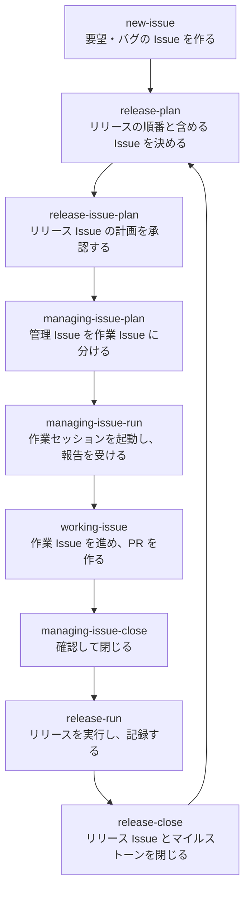
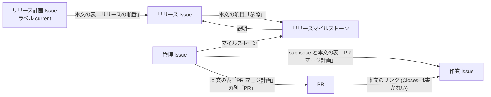
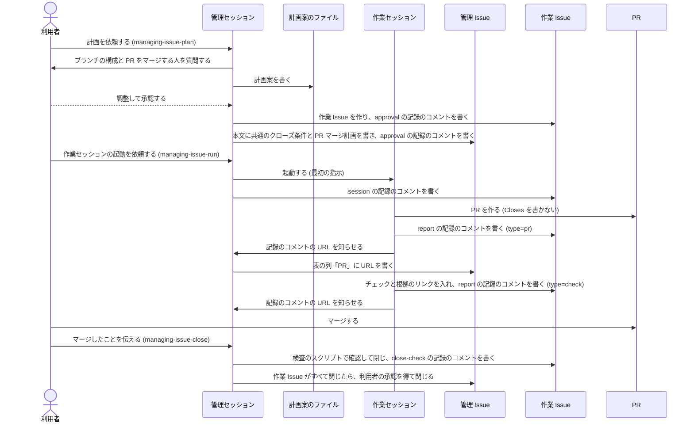
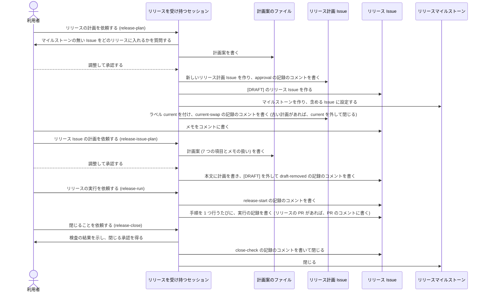

# 全体の流れ

プラグイン issue-practice の 9 つのスキルを、どのセッションが・いつ呼び出し、GitHub に何を書くかを示します。スキルの一覧は [README.md](../README.md) の節「使えるスキル」に、用語 (管理 Issue・作業 Issue・リリース計画 Issue・記録のコメントなど) は [terms.md](terms.md) にあります。実際の使い方を、架空のプロジェクトの 6 つのシナリオで示した文書は [scenarios.md](scenarios.md) です。

## スキルを呼び出すセッションと、きっかけ

スキルを呼び出すのは、いつもセッション (Claude Code のセッション) です。きっかけは、利用者の依頼・作業セッションからの報告のメッセージ・最初の指示 (管理セッションが作業セッションを起動するときに渡す文) の 3 種類です。

| スキル | 呼び出すセッション | きっかけ |
| --- | --- | --- |
| `new-issue` | どのセッションも | 利用者の依頼か、切り出すことを利用者が承認したとき |
| `managing-issue-plan` | 管理セッション | 利用者の依頼 |
| `managing-issue-run` | 管理セッション | 利用者の依頼と、作業セッションからの報告のメッセージ |
| `managing-issue-close` | 管理セッション | PR をマージした人がマージしたことを伝えたとき |
| `working-issue` | 作業セッション (自己管理 Issue では、そのセッション) | 最初の指示 (自己管理 Issue では、利用者の依頼) |
| `release-plan`・`release-issue-plan`・`release-run`・`release-close` | リリースを受け持つセッション | 利用者の依頼 |

ほかのスキルの手順の中で、スキル `new-issue` を使うことがあります。どれも、切り出すことやメモを Issue にすることを利用者が決めたときです。

| 使うスキル | 使う場面 |
| --- | --- |
| `managing-issue-run` | 作業セッションから切り出したいという報告 (`carve-out`) を受けたとき |
| `release-issue-plan` | リリース Issue のメモを Issue に切り出すとき |
| `release-run` | リリースの実行の中で見つかった問題を、このリリースでは直さないと決めたとき |
| `release-close` | 直さない問題が、閉じる前に切り出されていなかったとき |

計画を変えるときは、計画を立てたスキルをもう一度使います。管理 Issue の計画は `managing-issue-plan`、リリースの順番は `release-plan`、承認の後のリリース Issue の計画は `release-issue-plan` (実行を始めた後は `release-run`) です。

## 全体の流れ

リリースの計画から、作業を進めてリリースを閉じるまでの流れです。矢印は、次に使うスキルを指します。

- PR 1 つで済む Issue は、自己管理 Issue として計画し、`managing-issue-plan` の後に、同じセッションで `working-issue` と `managing-issue-close` を使います。`managing-issue-run` は使いません。
- リリースを閉じた後、次のリリースは、ラベル `current` の付いたリリース計画 Issue の表の次の行です。新しい要望を入れて順番を変えるときは、`release-plan` で新しいリリース計画を立てます。

## GitHub に書くもの

スキルが GitHub に書くものと、その関係です。矢印は、根本のものが矢じりのものを指していることを表し、矢印の上の文は、どこで指しているか (本文のどこに書くか・何を設定するか) を表します。

| もの | 書くスキル | 中身 |
| --- | --- | --- |
| リリース計画 Issue | `release-plan` | 題名 `📅 リリース計画 YYYYMMDD`。本文にリリースの順番の表。有効な計画にラベル `current` を付ける |
| リリース Issue | `release-plan` (作る)・`release-issue-plan` (計画を書く) | 題名 `[DRAFT] 🔖 リリース R<番号> (主題)`。計画を承認したら `[DRAFT]` を外す。本文に 7 つの項目 |
| リリースマイルストーン | `release-plan` (作る)・`release-close` (閉じる) | 名前 `R<番号> (主題)`。リリースに含める Issue に設定する |
| 要望・バグ・切り出しの Issue | `new-issue` | 本文に問題 (か要望) とクローズ条件。解決策は書かない |
| 作業 Issue | `managing-issue-plan` | 管理 Issue の sub-issue。本文に共通の条件のコピーと固有の条件 |
| 管理 Issue の本文 | `managing-issue-plan` (書く)・`managing-issue-run` (表の列「PR」) | 共通のクローズ条件と PR マージ計画 (表と図) |
| 記録のコメント | すべてのスキル | 承認・計画の変更・報告・確認の結果などの経緯。1 行目の形は [record-comments.md](record-comments.md) |
| クローズ条件のチェック | `working-issue`・`managing-issue-close`・`release-close` | チェックを入れた項目の末尾に根拠のリンク。書き方は [closing-conditions.md](closing-conditions.md) |

どのスキルも、書く前に計画案のファイル (ディレクトリ `tmp/issue-practice/` の下) か会話で書き込みを示し、利用者の承認を得てから書きます。書き込みは検査のスクリプト (ファイル `issue-practice/scripts/issue_practice.py`) が行い、途中で失敗しても、同じ計画案で同じコマンドを実行すれば、残りの書き込みだけを行います。

## 管理 Issue と作業 Issue の流れ

管理セッションが管理 Issue を作業 Issue に分け、作業セッションが作業 Issue を 1 つずつ進める流れです。

- 作業セッションは、分けたい (`split`)・条件を変えたい (`condition-change`)・切り出したい (`carve-out`)・中断する (`suspend`) ときも、同じく記録のコメントを書いて管理セッションに知らせ、判断があるまで待機します。管理セッションは、利用者に質問してから計画を変えます。
- 作業 Issue は、管理セッションが利用者の承認を得ずに閉じます。チェックを入れるセッションと閉じるセッションを分けて、確認の漏れに気づけるようにするためです。管理 Issue と自己管理 Issue は、利用者の承認を得てから閉じます。
- 閉じた Issue を依存先とする Issue には、`dependency-resolved` の記録のコメントを書き、本文の節「依存先」から項目を消します。

## リリースの流れ

リリースを受け持つセッションが、リリースを計画し、実行して閉じる流れです。

- リリース計画 Issue の書き込みは、ラベル `current` の付け替えの途中で失敗しても、同じ計画案でやり直せる順に行います。書く順と、途中で中断したときに残る状態は、[release-plan-issue.md](../skills/release-plan/references/release-plan-issue.md) の節「書く順と、やり直し」にあります。
- 「今のリリース」と「次のリリース」は、ラベル `current` の付いたリリース計画 Issue の表から、検査のスクリプト (サブコマンド `release current`) が決めます。題名に `[DRAFT]` があるリリース Issue は、計画を承認するまで「今のリリース」になりません。決め方は [release-plan-table.md](release-plan-table.md) にあります。
- リリースの手順 (タグ・デプロイ・告知など) は、プロジェクトのものです。スキル `release-issue-plan` は、プロジェクトの手順の文書のどの手順を行うか・省くかと理由を、リリース Issue に記録します。
