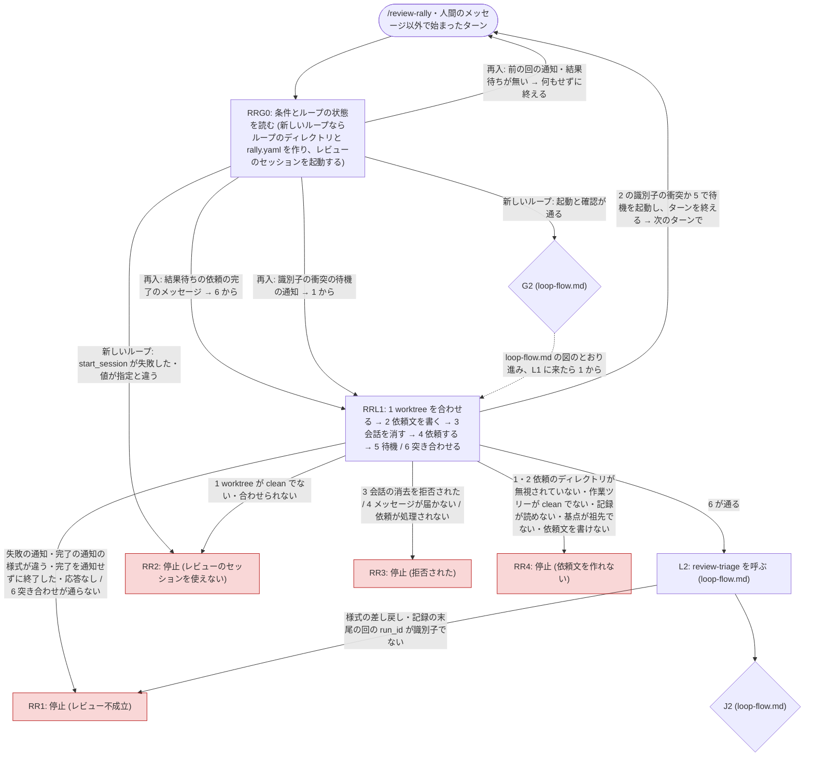

# 差し替えた部分の流れと、追加の停止

**このファイルが、`review-rally` が差し替えた部分の図と、追加の停止ノード RR1〜RR4 の決定表、どの停止でも行うことの SSOT。** 差し替えないノードとその遷移は [loop-flow.md](../../review-triage-loop/references/loop-flow.md) の図が SSOT。

- 図の ID 集合 (RRG0・RRL1・RR1・RR2・RR3・RR4) と決定表の ID 集合は 1:1。RRG0 と RRL1 の決定表は [round.md](round.md) にある。同梱の `triagecheck` はこのファイルを検査しないので、人手で照合する。
- 図の `IN` はループに入る起点 (スキルの起動・人間のメッセージ以外で始まったターン) を示す記号で、ノード ID ではない。
- 図の G2・L2・J2 は `loop-flow.md` のノードで、そこから先は `loop-flow.md` の図に従う (L1 に戻ったら、L1 の代わりに RRL1 に入る)。

## 図

再入の中身の SSOT は [round.md](round.md) の「再入の手順」。開始の前提が満たされないときは、停止ではないので図に含めない ([session.md](session.md) の「開始の前提」)。

## 決定表 (RR1〜RR4)

| ID | 種類 | 条件 | 報告に書くもの |
| --- | --- | --- | --- |
| RR1 | 停止 | レビュー不成立。レビューのセッションが失敗を通知した・完了の通知の 1 行目が様式どおりでない・完了を通知せずにターンを終了し、結果のファイルも無い・応答なし (`isRunning` が真のまま、`lastActivityAt` が 60 分より前)・突き合わせ ([round.md](round.md) の手順 6) が通らない・`review-triage` が結果の様式を差し戻した・`review-triage` の後に記録の末尾の回の `run_id` が識別子でない。どれに当たるかの決め方の SSOT は [round.md](round.md) の「再入の手順」 | その回の識別子と、不成立の理由 (失敗の通知の理由・通知の 1 行目・一致しなかった項目と両方の値)。結果のファイルの有無と、複製したパス (下の「停止のときに行うこと」の 1)。応答なしなら、承認待ちなどでレビューのセッションのターンが進んでいないおそれがあること (人間がレビューのセッションを開いて確認する)。突き合わせの 4 (ブランチの一覧が変わった) なら、動いた・できた・消えたブランチと、依頼の前と後の SHA。戻すかどうかは人間が決めること |
| RR2 | 停止 | レビューのセッションを使えない。`start_session` が失敗した・`get_session` のモデル・effort・権限モードが指定やメインのセッションと違う・`worktreePath` が無いか `.claude/worktrees/` の下にない ([session.md](session.md) の「起動」の 2)・レビューの worktree が clean でないか、HEAD に合わせられない ([round.md](round.md) の手順 1) | 当たった項目と、指定の値と実際の値。モデルか effort が違うなら、アプリは起動元より上の値を無視するので、メインのセッションのモデルか effort を上げるか、指定を下げて新しいループを始めること。レビューの worktree が clean でなければ、`git -C <レビューの worktree> status --porcelain` の出力 |
| RR3 | 停止 | 拒否された。`clear_session` を拒否された ([round.md](round.md) の手順 3)・`SendMessage` の結果が `delivered` でも `queued` でもない (手順 4)・依頼が処理されない (待機の通知の時点で `isRunning` が偽で、`lastActivityAt` が依頼を送った時刻より前。[round.md](round.md) の「完了のメッセージが無いまま来たターン」) | 拒否したツールと、その結果の文面。`clear_session` なら、人間がレビューのセッションを画面に開いているかピン留めしていると拒否されるので、閉じるか外してから新しいループを始めること。`SendMessage` や依頼が処理されないなら、レビューのセッションの権限モードがメインのセッションと違うと、メッセージが承認待ちになることがあること |
| RR4 | 停止 | 依頼文を作れない。レビューの worktree の中から見て依頼のディレクトリが無視されていない ([round.md](round.md) の手順 1)・メインの作業ツリーが clean でない・記録が読めない・増分の基点 (記録の最後の回の `head`) が HEAD の祖先でない・`review-request` が識別子の衝突以外の理由で依頼文を書かなかった (手順 2) | 当たったものすべてと、何を片付ければよいか。汚れたファイルの一覧、記録のパスと読めない理由、基点の SHA と現在の HEAD、`review-request` が報告した理由。依頼のディレクトリが無視されていなければ、どのファイル (`.gitignore`) に何 (`tmp/`) を足し、どのブランチ (現在のブランチ) にコミットするか。基点が祖先でないときは、ループの間に履歴を書き換えた (reset・rebase・squash) ことが原因であり、どう続けるかは人間が決めること |

## 停止のときに行うこと

**どの停止ノード ([loop-flow.md](../../review-triage-loop/references/loop-flow.md) の S2〜S6 と、上の RR1〜RR4) でも、次の順に行ってから報告する。**

1. **依頼文と結果を複製する。** レビューの worktree の依頼のディレクトリに依頼文か結果が 1 つでもあれば、そのディレクトリの全体を、ループのディレクトリに複製する。レビューの worktree を片付けた後も、停止の原因を調べられるようにするため。
2. **`rally.yaml` を `state: stopped`・`stop_reason: "<ID>: <1 行の理由>"` にする。**
3. **片付けはしない。案内だけを報告に書く** (下の「片付けの案内」)。片付けは元に戻せないので、行うかどうかは人間が決める。

## 片付けの案内

停止の報告に、`rally.yaml` の `session` から組み立てた次の手順を、人間が実行できる形で書く。

- **新しく作られた worktree なら** (`session.reused` が偽): レビューのセッション (`session.name`・`session.id`) をアーカイブする (サイドバーから。アーカイブで worktree も片付けられる)。アーカイブの後にブランチ (`session.branch`) が残っていれば、`git branch -D <session.branch>` で消す。
- **再利用された worktree なら** (`session.reused` が真): レビューのセッションを**アーカイブしない** (以前の作業のファイルが消えるおそれがある)。依頼のディレクトリを消し (`rm -r <レビューの worktree>/tmp/review-rally/<ループの id>`)、worktree を元の HEAD に戻し (`git -C <レビューの worktree> show-ref --verify --quiet refs/heads/<session.original_head>` が成功すれば `git -C <レビューの worktree> checkout <session.original_head>`、失敗すれば `git -C <レビューの worktree> checkout --detach <session.original_head>`)、ブランチを消す (`git branch -D <session.branch>`)。
- **ループのディレクトリと記録は消さない。** ほかの経路と収束を比べる材料になる。

## 停止の報告に足すもの

報告の全体は [reporting.md](../../review-triage-loop/references/reporting.md) の「必ず出すもの」で、S2〜S6 ごとに足すものは [loop-flow.md](../../review-triage-loop/references/loop-flow.md) の決定表。このループでは、どの停止 (S2〜S6・RR1〜RR4) でも次を足す。

| 項目 | 書くもの |
| --- | --- |
| ループ | ループの id と、ループのディレクトリの絶対パス |
| レビューのセッション | 名前・id・worktree のパス・実効モデルと effort (`rally.yaml` の `session`) |
| 複製 | 上の「停止のときに行うこと」の 1 で複製したか、複製先の絶対パス |
| 片付け | 上の「片付けの案内」 |
| 回数 | この起動で回した回数と上限 (reporting.md の 2) |
| 次にできる操作 | 新しいループを始めること (このスキルは `--resume` を持たない)。S2 なら、回答の渡し先 (`review-triage-fix` を単独で起動して回答する。SSOT は loop-flow.md の S2 の行) |
| S3 のとき | 収束後の全量レビューの要否 (規則の SSOT は [review-request.md](../../review-triage/references/review-request.md) の「収束後の全量レビューと、その要否」) と、`review-request --full-review --base <loop.base>` で依頼文を作り、別のセッションで実行する手段。`--base` を付けないと起点が `origin/HEAD` になって範囲が広がるので、必ず付けるよう書く。行うかどうかは人間が決める |
