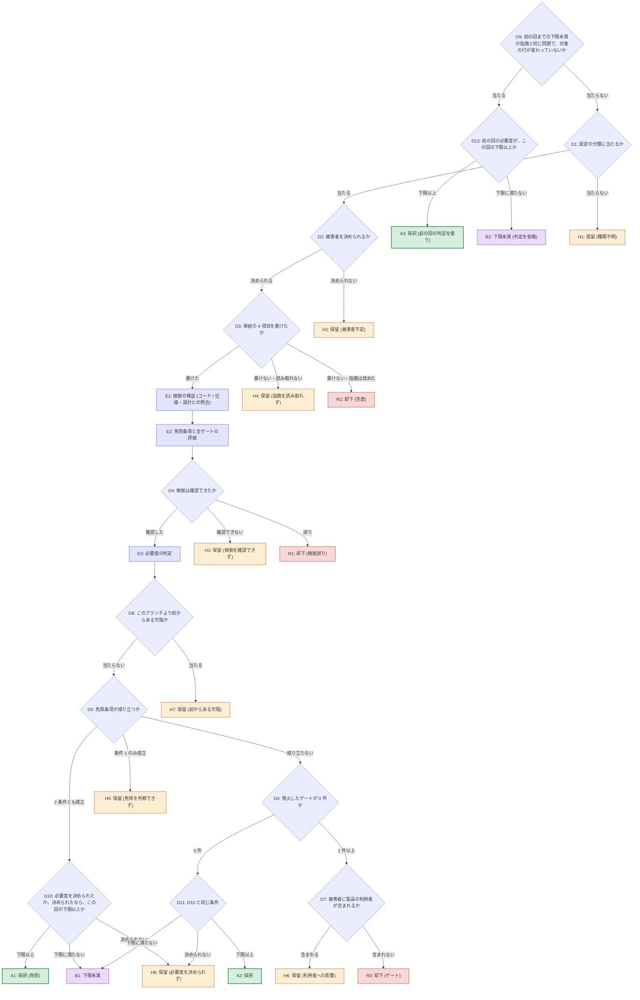

# 判定フロー

**このファイルが判定フローの SSOT。** 役割の分担 (owning) は次のとおり。

- **図 (mermaid) が、ノードと遷移の SSOT。** 順序と分岐はここだけが定める。
- **決定表が、各ノードの条件と書くものの SSOT。** 遷移先の欄は持たない (遷移先は図が SSOT)。図と表は同じ事実を二度語らない。
- **散文 (SKILL.md・references) はノード ID で参照し、順序・分岐・量化子を言い直さない。** 1 回目の試行では、散文が状態機械を言い直すたびに量化子がずれ、同種の指摘が続いた。
- 図のノード ID 集合と決定表の ID 集合は 1:1。同梱の `triagecheck` の `judgment-flow` 検査が照合する。

## 方針

- **評価と判定を分ける。** 評価 (E1〜E3) の結果はすべて記録に残し、判定は図の分岐だけで決まる。同じ評価結果から違う判定が出ないようにするため。
- **D1〜D3 で決着した指摘には、E1・E2 を行わない。** 空虚な指摘に、仕様・設計との照合 (sub-agent を要する) やゲート評価のコストを払わないため。ただし D3 の帰結の 4 項目は、D1 に進んだ指摘の**全件に書く** (D9 で当たって判定を省略した指摘には書かない)。D1・D2 で決着した指摘にも、後から判断を検証する材料として残す。
- **D4 以降で決着した指摘には、E1・E2 の結果がすべて記録に残る。** 判定が D4 (根拠) で決まっても、ゲートの評価結果は捨てない。どのゲートが機能しているかは記録の蓄積でしか見えないため。
- **境界上は保留にする。** 決められないときの遷移先は必ず保留 (H1〜H8)。却下ゲートは仮説であり、誤った却下は気づかれないまま残るため、判断できないまま却下へ流さない。

## 図 (ノードと遷移の SSOT)

## 決定表 (各ノードの条件と書くものの SSOT)

| ID | 種類 | 条件・内容 | 記録に書くもの |
| --- | --- | --- | --- |
| D9 | 判定 | 指摘が、記録の前の回までの下限未満の指摘 (B1 で決着したもの) と同じ問題で、対象の行が変わっていないか。次の 2 つがともに成り立てば「当たる」。**(1) 問題が同じ** (この指摘が述べる問題が、前の指摘の帰結の「何が」と同じ)。同じ問題の前の指摘が複数あれば、最も後の回のものと比べる。**(2) 対象の行が、前の指摘を判定した回でレビューした内容から、この回でレビューした内容までに変わっていない。** (2) は、D8 の (1) と同じツール lineorigin で確認し、全量の起点の代わりに、前の指摘を判定した回の `head` を渡す (確認の方法の SSOT は [premise-check.md](premise-check.md) の「(1) 対象の行が変わっていないか」)。ただし、この回でレビューした内容が、前の指摘を判定した回の `head` と同じコミットなら、ツールを使わずに (2) が成り立つとする。行は変わっていないが、ツールは、起点とレビューした内容が同じコミットだと「確認できない」を返すため。(1) が成り立たなければ「当たらない」。(1) が成り立ち、(2) が成り立たないか確認できないときも「当たらない」とし、D1 から通常どおり判定する。行が変わっていれば、文の意味も、帰結も、必要度も変わりうるため | (1) が成り立った指摘のすべてで、`below_minimum_ref` に、前の指摘 (回と `id`) と、(2) の結果と理由 |
| D12 | 判定 | D9 で当たった前の指摘の必要度 (`fix_necessity`) が、この回の必要度の下限 (回の `min_fix_necessity`) 以上か。必要度は Must・Should・Could の順に高い。下限が無い回では「下限以上」とする。「下限以上」になるのは、前の指摘を判定した回より下限を下げたか、無くした回である | — (前の指摘の記録を使う) |
| D1 | 判定 | 指摘の対象パスが設定 (`.claude/review-triage.yaml`) のいずれかの分類に当たるか。読み込み自体の 3 値 (OK / 対象外 / 読めない) は [config-schema.md](config-schema.md)。「読めない」は判定を始めない (このノードに入らない) | パスから決まった分類 (`category`) |
| D2 | 判定 | 指摘の内容から被害者が分類の `audience` と同じか違うかを決められるか。上書きは「より要求水準の高い被害者へ」(開発者 → 利用者) の向きにのみ行う ([config-schema.md](config-schema.md) の上書き規則) | 初期値 (`audience_initial`) と最終値 (`audience`) |
| D3 | 判定 | 帰結の 4 項目を具体的に書けたか。4 項目は、条件 (どんな状況で起きるか) / 誰に (誰が困るか) / 何が (何が起きるか) / 気づかされるか (帰結が起きたとき、困る人が、何によって、いつ気づかされるか)。「何によって」は、エラーメッセージ・失敗する検査・通常の利用で目に見えて違う結果・後の工程 (その文書をもとにした実装・テスト・レビュー) のどれか。「いつ」は、被害が出る前・被害が出た時・後の工程のどれか。困る人が自分で調べたり疑ったりしたときにだけ分かる場合は、「気づかされない」と書く。文書やコードを検査する関門が無いことは、理由として書かない。指摘文は「何が悪いか」を書くが、判断に要るのは「何が壊れるか」。書き下ろす過程そのものが空虚な指摘をふるいにかける | 帰結の 4 項目 (`consequence`。D1 に進んだ指摘の全件) |
| E1 | 評価 | コードとの照合を全件に行い、当たる指摘には仕様・設計との照合も行う。**呼ばれ方・照合の仕方・記録に残す値の SSOT は [premise-check.md](premise-check.md)** | どこまで照合したか (`premise_check.stages`) と結果 (`premise_check.result`) |
| E2 | 評価 | 免除条項の 2 条件と、すべての却下ゲートを評価する。早期に打ち切らない。ゲートごとの定義・書くもの・免除条項は [rejection-gates.md](rejection-gates.md) | 発火したゲート (`gates_fired`。すべて) と、各ゲート・免除条項で書かせたもの |
| E3 | 評価 | 修正の必要度 (その指摘の問題を直すことがどれだけ必要か。値は Must・Should・Could) を、次の 2 つの条件で決める (必要度の判定)。**条件 1: 帰結が起きたとき、困る人 (帰結の「誰に」) は、何もしなくても目的 (その人が文書やコードを使ってしようとしていたこと) を達成できるか。** できるなら Could。**条件 2: できないとき、困る人が気づいて取れる回避策があるか。** あるなら Should、無いなら Must。回避策には次の 3 つを含める。被害が出る前に、困る人が気づいて避けられる手段。被害が出た後に気づいて、やり直しや手作業で回復できる手段。後の工程 (その文書をもとにした実装・テスト・レビュー) で気づいて直せること。文を読み違えたときだけ帰結が起きる指摘は、正しい読み方を決める記述を同じ節か参照先から挙げられるなら、その記述を回避策として数える (帰結の「気づかされるか」には「気づかされない」と書く)。**Must にするには、回避策が無い理由を書く。書けなければ Must にせず、条件 2 を決められないとする。** どちらかの条件を決められなければ、必要度を付けない。材料は帰結の 4 項目とこの 2 つの条件だけで、上流のレビューが付けた深刻度 (`attrs.severity`) と、修正の大きさは使わない | D4 で根拠を確認した指摘のすべてで、2 つの条件の結果 (`fix_necessity_reason`) と、決まった必要度 (`fix_necessity`)。決着が保留や却下でも書く |
| D4 | 判定 | E1 の結果が verified (確認できた) か、wrong (誤り) か、unverifiable (確認できなかった) か | — (E1 の記録を使う) |
| D5 | 判定 | E2 で評価した免除条項の 2 条件がともに成立するか。条件 1 (検出能力の欠落・消失の主張) だけが成立し条件 2 の理由を書けない場合は判断できない扱い | — (E2 の記録を使う) |
| D6 | 判定 | E2 で発火したゲートが 0 件か | — (E2 の記録を使う) |
| D7 | 判定 | 最終の被害者 (D2 の結果) に製品の利用者 (オペレータ / 管理者 / プロバイダ) が含まれるか。複数の被害者がいる場合、1 人でも利用者が含まれれば「含まれる」 | — (D2 の記録を使う) |
| D8 | 判定 | 指摘の対象が、このブランチより前からある欠陥か。次の 2 つがともに成り立てば「当たる」。**(1) 対象の行が、全量の起点から、レビューした内容までに変わっていない。(2) 全量の起点の内容でも、同じ欠陥が成り立つ** (ブランチの変更が誤りにしたのではない)。(1) が成り立たなければ「当たらない」。(1) を確認できないとき (全量の起点か対象の行が決まらない、など) も、前からある欠陥だと言えないので「当たらない」とする。(1) が成り立ち、(2) を確認できないときは「当たる」とする (方針「境界上は保留にする」)。全量の起点の決め方と、(1)(2) の確認の方法の SSOT は [premise-check.md](premise-check.md) の「前からある欠陥の確認の方法」。採択にすると、前の回の修正が前からある記述を参照するたびに参照先の欠陥が採択になり、ブランチの範囲が回ごとに広がる (経緯は [#92](https://github.com/akm/claude-plugins/issues/92)) | D8 で判定した指摘のすべてで、`prior_defect` に (1)(2) の結果と理由。当たったかどうかは書かない。(1)(2) の結果から決まる。D4〜D7 と違い、判定の材料がほかの記録に残らないので、書かないと、当たらなかった理由も、D8 を判定したかどうかも記録から分からない。`verdict_reason` に書く規則だけでは書き忘れを機械検査で見つけられなかったので、記録のキーにした ([#110](https://github.com/akm/claude-plugins/issues/110)) |
| D10 | 判定 | E3 で必要度を決められたか。決められたなら、必要度がこの回の必要度の下限以上か (比べ方と、下限が無い回の扱いは D12 と同じ)。免除条項が成り立つ指摘にも下限を適用する。免除条項は却下しないことを定めていて、今回直すかどうかは定めていないため | — (E3 の記録と、回の `min_fix_necessity` を使う) |
| D11 | 判定 | D10 と同じ条件 | — (D10 と同じ) |
| A1 | 決着 | 採択 (免除条項による)。他のゲートに引っかかっていても却下しない | `verdict: adopted`。`verdict_reason` に A1 と免除の根拠 |
| A2 | 決着 | 採択 | `verdict: adopted`。`verdict_reason` に A2 |
| A3 | 決着 | 採択 — 前の回で下限未満にした指摘の必要度が、この回の下限以上。前の回の判定を使い、D1 以降の判定を省略する | `verdict: adopted`。`verdict_reason` に A3 |
| B1 | 決着 | 下限未満 — 必要度が、この回の必要度の下限に満たない。却下 (対処しない) でも保留 (人間の判断待ち) でもなく、人間が事前に指定した下限によって、今回は直さないと決まったもの。記録に残し、生成サマリの一覧で人間に示す | `verdict: below_minimum`。`verdict_reason` に B1 |
| B2 | 決着 | 下限未満 — 前の回で下限未満にした指摘と同じ問題で、対象の行が変わっておらず、その必要度がこの回の下限にも満たない。D1 以降の判定を省略する | `verdict: below_minimum`。`verdict_reason` に B2 |
| H1 | 決着 | 保留 — どの分類にも当たらず種類不明。`category: unknown` にする | `verdict: held`。`verdict_reason` に H1 とどのパターンを試したか |
| H2 | 決着 | 保留 — 被害者が分類と同じか違うか決められない | `verdict: held`。`verdict_reason` に H2 と決められなかった理由 |
| H3 | 決着 | 保留 — 根拠を確認できなかった (E1 が unverifiable) | `verdict: held`。`verdict_reason` に H3 と何を調べて分からなかったか |
| H4 | 決着 | 保留 — 指摘の文そのものを読み取れず、帰結を書けない。空虚 (R2) と混同しない。区別の基準は R2 の行 | `verdict: held`。`verdict_reason` に H4 とどこが読み取れないか |
| H5 | 決着 | 保留 — 免除の条件 1 が成立するのに条件 2 の理由を書けない。検出能力が失われる種類の欠陥は最も見逃してはならないので、判断できないまま先へ流さない | `verdict: held`。`verdict_reason` に H5 と挙げた関門の候補 |
| H6 | 決着 | 保留 — ゲートに引っかかったが、被害者に製品の利用者が含まれる。誤った却下が製品に残るため人間に判断を渡す。提示の形は [hold-presentation.md](hold-presentation.md) | `verdict: held`。`verdict_reason` に H6。発火したゲートと衝突の内容を添える |
| H7 | 決着 | 保留 — このブランチより前からある欠陥。採択にするとブランチの範囲が広がり、却下にすると欠陥が直されないまま別の Issue にも残らないので、このブランチで直すか、別の Issue にするかを人間に渡す。提示の形は [hold-presentation.md](hold-presentation.md) | `verdict: held`。`verdict_reason` に H7 と、ブランチの変更が、その欠陥を参照する・呼び出すようになったか。全量の起点の SHA と、(1)(2) の結果と根拠は、D8 の行のとおり `prior_defect` に書く |
| H8 | 決着 | 保留 — 必要度を決められない。Must として扱っても Should として扱っても問題が残るので、決められなかったことをそのまま人間に示す。下限が無い回でも保留にする | `verdict: held`。`verdict_reason` に H8 と、決められなかった条件 |
| R1 | 決着 | 却下 — 根拠が誤っている (E1 が wrong)。「直す意味がない」ではなく「そもそも成り立たない」 | `verdict: rejected`。`verdict_reason` に R1 と出所・実際の記述 |
| R2 | 決着 | 却下 — 空虚 (帰結を具体的に書けない)。指摘を読めたのに書けない場合に限る。読めたことを示すために「指摘をどう読んだか」を書く。書けなければ読めていないので H4 | `verdict: rejected`。`verdict_reason` に R2 と指摘をどう読んだか |
| R3 | 決着 | 却下 — ゲートに引っかかり、被害者が開発者・CI だけ。誤って却下しても開発者が調べて対処できる | `verdict: rejected`。`verdict_reason` に R3 と発火したゲート名 (すべて) |
